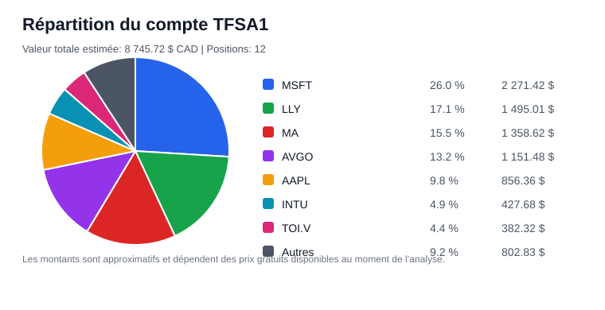
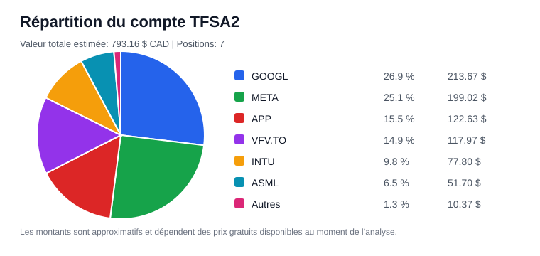

# Rapport trimestriel d’investissement

- Date: 2026-05-27
- Mode utilisé: high-cagr
- Version des règles: 2026-05-12-high-cagr-stability-v3
- Capital analysé: 350.00 $
- Valeur totale du portefeuille: 9 538.88 $
- Moyenne pondérée des scores hors VFV: 7.99
- Légende ticker: `*` = données très insuffisantes, absence de prix, ou compagnie à vérifier. Un alias simple est affiché entre parenthèses.

> Ceci n’est pas un conseil financier. Ce rapport applique seulement les règles mécaniques du guide fourni. Les données gratuites peuvent être incomplètes, retardées ou erronées. Toute décision finale doit être validée manuellement.

## 1. Résumé exécutif

- Allocation recommandée de la cotisation: VFV.TO 35.00 $, APP 220.50 $, META 87.50 $, GOOGL 7.00 $
- Changement principal d’allocation: GOOGL: DECREASED (Allocation réduite: capital_allocation_score baisse de -16.1; score fondamental baisse de -1.0; risque cycle/bulle HIGH: allocation plafonnée; stabilité mensuelle: REDUCE_AFTER_SCORE_DROP.)
- Robustesse de l’allocation: ROBUST (100.0/100) - L’allocation reste assez stable sous hypothèses prudentes.
- Qualité de décision: HIGH (90.0/100) - Recommandation robuste: APP, META, GOOGL; VFV reste contrôlé et les garde-fous sont cohérents.
- Meilleur achat actuel: APP
- Meilleure opportunité actuelle: APP
- Allocation VFV: 10 % obligatoire avant redirections.
- ETF défensifs: Désactivé pour ce mode.
- Régime de marché: BUBBLE_RISK (79.3/100) - Un thème de croissance/tech/semi semble très dominant; le modèle limite modérément la surexposition au thème chaud.
- Positions exclues de cette moyenne, mais toujours considérées pour les cotisations: APP, ANET, ASML, SBGSY, TSLA, LRCX, WSP.TO, CSU.TO, NANO.TO, SIEGY, TMC
- Signaux de vente: CSU.TO (CSU)=WATCH, NANO.TO (NANO)*=WATCH, SIEGY=WATCH, TMC*=WATCH
- Alertes de surveillance non liées à une vente: META=WATCH, WSP.TO (WSP)=MANUAL_REVIEW, TSLA=MANUAL_REVIEW, TOI.V (TOI)*=MANUAL_REVIEW, TMC*=MANUAL_REVIEW, SIEGY=MANUAL_REVIEW, SBGSY (SCHN)=MANUAL_REVIEW, NANO.TO (NANO)*=MANUAL_REVIEW
- Opportunités quality drawdown: ANET=opportunité potentielle, APP=opportunité potentielle, ASML=opportunité potentielle, AVGO=opportunité potentielle, BAM=opportunité potentielle, INTU=opportunité potentielle
- Protection des winners: Aucun winner ne demande une protection spéciale.
- Meilleures candidates surveillance externe: Aucune
- Nouvelles idées à ajouter au market_universe: ABNB, MNST
- Candidates à promouvoir manuellement: Aucune
- Tendances historiques à surveiller: LRCX=DETERIORATING, TSLA=DEVELOPING
- Risque cycle/bulle/tendance dominant: AVGO=EXTREME, ASML=EXTREME, LRCX=EXTREME, AAPL=EXTREME, ANET=EXTREME, CSU.TO (CSU)=EXTREME
- Durabilité 15-30 ans: compounders très durables=META, APP, MSFT, LLY, MA; fragiles/non prouvés=AAPL, TOI.V (TOI)*, WSP.TO (WSP), CSU.TO (CSU), SIEGY
- Thèse de croissance de marché: vents structurels=TSLA, MSFT, BAM, META, MA; risque hype=AVGO, ASML
- Fraîcheur des données: aucune alerte majeure dans le core/scanner; 1 idées discovery à vérifier
- Donnée à valider en priorité: APP - Juste valeur (TRES_HAUTE)
- Risque principal du portefeuille: forte exposition USD

## 2. Historique automatique des changements du portefeuille

Cette section se met à jour automatiquement quand `portfolio.csv` change. L’agent compare les actions et les comptes de cette analyse avec l’état précédent, puis inscrit les ajouts, réductions, ventes, transferts possibles et changements de coût moyen.

`portfolio.csv` reste l’état actuel du portefeuille. L’historique automatique est conservé dans `data/portfolio_change_history.csv` et recopié dans les rapports.

### Changements détectés depuis la dernière analyse

| date | ticker | account_type | change_type | shares_before | shares_after | shares_change | estimated_change_value_cad | current_value_cad_after | reason |
| --- | --- | --- | --- | --- | --- | --- | --- | --- | --- |
| 2026-05-27 | APP | TFSA2 | COST_BASIS_UPDATED | 0.1579 | 0.1579 | 0.0 | 0.00 $ | 122.63 $ | Cout moyen ou devise du cout moyen modifie dans portfolio.csv. |
| 2026-05-27 | GOOGL | TFSA2 | COST_BASIS_UPDATED | 0.3974 | 0.3974 | 0.0 | 0.00 $ | 213.67 $ | Cout moyen ou devise du cout moyen modifie dans portfolio.csv. |
| 2026-05-27 | INTU | TFSA2 | COST_BASIS_UPDATED | 0.1819 | 0.1819 | 0.0 | 0.00 $ | 77.80 $ | Cout moyen ou devise du cout moyen modifie dans portfolio.csv. |
| 2026-05-27 | META | TFSA2 | COST_BASIS_UPDATED | 0.2364 | 0.2364 | 0.0 | 0.00 $ | 199.02 $ | Cout moyen ou devise du cout moyen modifie dans portfolio.csv. |

### Résumé par compte et titre

| account_type | account_tax_category | ticker | buy_or_add_count | sell_or_reduce_count | transfer_count | cost_update_count | net_shares_change | estimated_net_add_value_cad | first_change_date | last_change_date |
| --- | --- | --- | --- | --- | --- | --- | --- | --- | --- | --- |
| TFSA1 | TFSA | AAPL | 1 | 0 | 0 | 0 | 2.0 | 0.00 $ | 2026-05-12 | 2026-05-12 |
| TFSA1 | TFSA | AVGO | 1 | 0 | 0 | 0 | 2.0 | 0.00 $ | 2026-05-12 | 2026-05-12 |
| TFSA1 | TFSA | BAM | 1 | 0 | 0 | 0 | 5.0 | 0.00 $ | 2026-05-12 | 2026-05-12 |
| TFSA1 | TFSA | INTU | 1 | 0 | 0 | 0 | 1.0 | 0.00 $ | 2026-05-12 | 2026-05-12 |
| TFSA1 | TFSA | LLY | 1 | 0 | 0 | 0 | 1.0 | 0.00 $ | 2026-05-12 | 2026-05-12 |
| TFSA1 | TFSA | MA | 1 | 0 | 0 | 0 | 2.0 | 0.00 $ | 2026-05-12 | 2026-05-12 |
| TFSA1 | TFSA | MSFT | 1 | 0 | 0 | 0 | 4.0 | 0.00 $ | 2026-05-12 | 2026-05-12 |
| TFSA1 | TFSA | NANO.TO | 1 | 0 | 0 | 0 | 107.0 | 101.65 $ | 2026-05-12 | 2026-05-12 |
| TFSA1 | TFSA | QQC.TO | 1 | 0 | 0 | 0 | 1.0 | 47.50 $ | 2026-05-12 | 2026-05-12 |
| TFSA1 | TFSA | TMC | 1 | 0 | 0 | 0 | 8.0 | 0.00 $ | 2026-05-12 | 2026-05-12 |
| TFSA1 | TFSA | TOI.V | 1 | 0 | 0 | 0 | 4.0 | 374.16 $ | 2026-05-12 | 2026-05-12 |
| TFSA1 | TFSA | XUS.TO | 1 | 0 | 0 | 0 | 4.0 | 250.52 $ | 2026-05-12 | 2026-05-12 |
| TFSA2 | TFSA | APP | 1 | 0 | 0 | 3 | 0.1579 | 107.28 $ | 2026-05-21 | 2026-05-27 |
| TFSA2 | TFSA | ASML | 1 | 0 | 0 | 6 | 0.0235 | 0.00 $ | 2026-05-12 | 2026-05-24 |
| TFSA2 | TFSA | FBTC.TO | 1 | 0 | 0 | 0 | 0.3034 | 10.61 $ | 2026-05-21 | 2026-05-21 |
| TFSA2 | TFSA | GOOGL | 2 | 0 | 0 | 7 | 0.3974 | 115.57 $ | 2026-05-12 | 2026-05-27 |
| TFSA2 | TFSA | INTU | 1 | 0 | 0 | 7 | 0.1819 | 0.00 $ | 2026-05-12 | 2026-05-27 |
| TFSA2 | TFSA | META | 1 | 0 | 0 | 7 | 0.2364 | 0.00 $ | 2026-05-12 | 2026-05-27 |
| TFSA2 | TFSA | VFV.TO | 2 | 0 | 0 | 1 | 0.6396 | 114.91 $ | 2026-05-12 | 2026-05-21 |

### Derniers changements historiques

| date | ticker | account_type | change_type | shares_before | shares_after | shares_change | estimated_change_value_cad | reason |
| --- | --- | --- | --- | --- | --- | --- | --- | --- |
| 2026-05-27 | APP | TFSA2 | COST_BASIS_UPDATED | 0.1579 | 0.1579 | 0.0 | 0.00 $ | Cout moyen ou devise du cout moyen modifie dans portfolio.csv. |
| 2026-05-27 | GOOGL | TFSA2 | COST_BASIS_UPDATED | 0.3974 | 0.3974 | 0.0 | 0.00 $ | Cout moyen ou devise du cout moyen modifie dans portfolio.csv. |
| 2026-05-27 | INTU | TFSA2 | COST_BASIS_UPDATED | 0.1819 | 0.1819 | 0.0 | 0.00 $ | Cout moyen ou devise du cout moyen modifie dans portfolio.csv. |
| 2026-05-27 | META | TFSA2 | COST_BASIS_UPDATED | 0.2364 | 0.2364 | 0.0 | 0.00 $ | Cout moyen ou devise du cout moyen modifie dans portfolio.csv. |
| 2026-05-24 | APP | TFSA2 | COST_BASIS_UPDATED | 0.1579 | 0.1579 | 0.0 | 0.00 $ | Cout moyen ou devise du cout moyen modifie dans portfolio.csv. |
| 2026-05-24 | ASML | TFSA2 | COST_BASIS_UPDATED | 0.0235 | 0.0235 | 0.0 | 0.00 $ | Cout moyen ou devise du cout moyen modifie dans portfolio.csv. |
| 2026-05-24 | GOOGL | TFSA2 | COST_BASIS_UPDATED | 0.3974 | 0.3974 | 0.0 | 0.00 $ | Cout moyen ou devise du cout moyen modifie dans portfolio.csv. |
| 2026-05-24 | INTU | TFSA2 | COST_BASIS_UPDATED | 0.1819 | 0.1819 | 0.0 | 0.00 $ | Cout moyen ou devise du cout moyen modifie dans portfolio.csv. |
| 2026-05-24 | META | TFSA2 | COST_BASIS_UPDATED | 0.2364 | 0.2364 | 0.0 | 0.00 $ | Cout moyen ou devise du cout moyen modifie dans portfolio.csv. |
| 2026-05-22 | APP | TFSA2 | COST_BASIS_UPDATED | 0.1579 | 0.1579 | 0.0 | 0.00 $ | Cout moyen ou devise du cout moyen modifie dans portfolio.csv. |
| 2026-05-22 | ASML | TFSA2 | COST_BASIS_UPDATED | 0.0235 | 0.0235 | 0.0 | 0.00 $ | Cout moyen ou devise du cout moyen modifie dans portfolio.csv. |
| 2026-05-22 | GOOGL | TFSA2 | COST_BASIS_UPDATED | 0.3974 | 0.3974 | 0.0 | 0.00 $ | Cout moyen ou devise du cout moyen modifie dans portfolio.csv. |

### Transactions déduites automatiquement

Ce registre est généré automatiquement à partir des changements détectés dans `portfolio.csv`. Il sert à améliorer la comparaison avec VFV.TO, mais il reste approximatif: le vrai prix de transaction, les frais et l’heure exacte ne sont pas connus.

| date | ticker | account_type | inferred_transaction_type | shares_change | estimated_value_cad | external_flow_cad | sp500_proxy_price_at_flow | confidence | notes |
| --- | --- | --- | --- | --- | --- | --- | --- | --- | --- |
| 2026-05-27 | APP | TFSA2 | INFERRED_COST_UPDATE | 0.0 | 0.00 $ |  |  | INFO_ONLY | Changement de coût moyen; pas traité comme flux externe. |
| 2026-05-27 | GOOGL | TFSA2 | INFERRED_COST_UPDATE | 0.0 | 0.00 $ |  |  | INFO_ONLY | Changement de coût moyen; pas traité comme flux externe. |
| 2026-05-27 | INTU | TFSA2 | INFERRED_COST_UPDATE | 0.0 | 0.00 $ |  |  | INFO_ONLY | Changement de coût moyen; pas traité comme flux externe. |
| 2026-05-27 | META | TFSA2 | INFERRED_COST_UPDATE | 0.0 | 0.00 $ |  |  | INFO_ONLY | Changement de coût moyen; pas traité comme flux externe. |
| 2026-05-24 | APP | TFSA2 | INFERRED_COST_UPDATE | 0.0 | 0.00 $ |  |  | INFO_ONLY | Changement de coût moyen; pas traité comme flux externe. |
| 2026-05-24 | APP | TFSA2 | INFERRED_COST_UPDATE | 0.0 | 0.00 $ |  |  | INFO_ONLY | Changement de coût moyen; pas traité comme flux externe. |
| 2026-05-24 | ASML | TFSA2 | INFERRED_COST_UPDATE | 0.0 | 0.00 $ |  |  | INFO_ONLY | Changement de coût moyen; pas traité comme flux externe. |
| 2026-05-24 | ASML | TFSA2 | INFERRED_COST_UPDATE | 0.0 | 0.00 $ |  |  | INFO_ONLY | Changement de coût moyen; pas traité comme flux externe. |
| 2026-05-24 | GOOGL | TFSA2 | INFERRED_COST_UPDATE | 0.0 | 0.00 $ |  |  | INFO_ONLY | Changement de coût moyen; pas traité comme flux externe. |
| 2026-05-24 | GOOGL | TFSA2 | INFERRED_COST_UPDATE | 0.0 | 0.00 $ |  |  | INFO_ONLY | Changement de coût moyen; pas traité comme flux externe. |
| 2026-05-24 | INTU | TFSA2 | INFERRED_COST_UPDATE | 0.0 | 0.00 $ |  |  | INFO_ONLY | Changement de coût moyen; pas traité comme flux externe. |
| 2026-05-24 | INTU | TFSA2 | INFERRED_COST_UPDATE | 0.0 | 0.00 $ |  |  | INFO_ONLY | Changement de coût moyen; pas traité comme flux externe. |

### Registre manuel optionnel

Ce tableau est seulement utile si vous voulez inscrire manuellement une cotisation en espèces, un dividende ou une note de transaction. Il n’est pas nécessaire pour détecter les changements de positions.

| date | ticker | account_type | transaction_type | shares | trade_value_cad | net_contribution_cad | income_cad | notes |
| --- | --- | --- | --- | --- | --- | --- | --- | --- |
|  |  |  |  |  |  |  |  | Aucune transaction manuelle inscrite. |

### Répartition actuelle par compte

Ces diagrammes utilisent la valeur actuelle estimée en CAD. Les petites lignes peuvent être regroupées dans `Autres` pour garder le graphique lisible.

#### TFSA1

#### TFSA2

| account_type | total_value_cad | positions_count | top_positions | note |
| --- | --- | --- | --- | --- |
| TFSA1 | 8 745.72 $ | 12 | MSFT 26 %, LLY 17 %, MA 16 %, AVGO 13 %, AAPL 10 % | Certaines petites positions sont regroupées dans Autres. |
| TFSA2 | 793.16 $ | 7 | GOOGL 27 %, META 25 %, APP 15 %, VFV.TO 15 %, INTU 10 % | Certaines petites positions sont regroupées dans Autres. |

### Performance par compte vs S&P 500

Cette section compare la performance estimée des comptes à VFV.TO, utilisé comme proxy S&P 500 en CAD. La colonne `valeur ajoutée vs S&P 500` tient maintenant compte des transactions déduites automatiquement quand le prix VFV du jour est disponible; elle reste approximative parce que les vrais frais et prix de transaction ne sont pas connus.

Lecture du calcul:

- Proxy utilisé: `VFV.TO`, car il représente le S&P 500 en dollars canadiens dans le modèle.
- Base de rendement du benchmark: si disponible, l’agent utilise `Adj Close` de yfinance comme proxy gratuit de rendement total approximatif, donc les distributions de VFV sont intégrées dans la comparaison. Si `Adj Close` est indisponible, il revient au prix `Close`.
- Date de départ: la première analyse locale exploitable conservée dans `data/account_performance_history.csv` pour chaque compte.
- Rendement du compte: `valeur actuelle du compte / valeur du compte à la date de départ - 1`.
- Rendement S&P 500: `prix VFV.TO actuel / prix VFV.TO à la date de départ - 1`.
- Écart vs S&P 500: `rendement du compte - rendement VFV.TO`.
- Protection anti-erreur: si des cotisations, retraits, achats ou ventes sont détectés depuis la date de départ, le rapport masque le rendement simple du compte et l’écart simple vs S&P 500, car ces chiffres peuvent confondre argent ajouté et vraie performance.
- TWR du portefeuille: rendement chaîné approximatif entre snapshots locaux; à chaque période, les cotisations/retraits détectés sont retirés du calcul afin de mieux mesurer le mouvement des titres et la qualité de la stratégie.
- TWR du S&P 500: rendement VFV.TO chaîné sur les mêmes dates de snapshots.
- Écart TWR vs S&P 500: `TWR du portefeuille - TWR VFV.TO`. C’est la lecture principale pour juger la stratégie indépendamment du timing des cotisations.
- Valeur équivalente S&P 500: l’agent simule la valeur qu’aurait eue le compte si la valeur de départ, puis les cotisations/retraits détectés, avaient suivi VFV.TO.
- Valeur ajoutée vs S&P 500: `valeur actuelle du compte - valeur équivalente S&P 500`.
- XIRR du portefeuille: rendement annualisé pondéré par l’argent, calculé avec la valeur de départ comme investissement initial, les cotisations/retraits datés, puis la valeur actuelle comme valeur finale.
- XIRR du S&P 500: même logique, mais en simulant que les mêmes flux datés auraient été investis dans VFV.TO.
- Écart XIRR vs S&P 500: `XIRR du portefeuille - XIRR VFV.TO`. C’est la lecture la plus fidèle lorsque les flux et les prix VFV aux dates utiles sont disponibles.
- Prudence: si l’historique local est inférieur à environ 90 jours, le XIRR annualisé peut devenir très extrême; le rapport l’indique alors comme historique trop court au lieu d’en faire une conclusion.

Limite importante: ce calcul est approximatif. Il dépend de l’historique local conservé, des changements détectés automatiquement dans `portfolio.csv`, des transactions réelles si tu les inscris dans `portfolio_transactions.csv`, du prix VFV disponible aux dates utiles, et ne connaît pas parfaitement les frais, impôts, écarts de prix exacts ou transactions intrajournalières.

| indicateur | à quoi ça sert | comment l’interpréter |
| --- | --- | --- |
| preferred_performance_summary | Résumé choisi par le modèle. | Lis cette phrase en premier: elle privilégie l’indicateur le plus fiable selon les flux détectés. |
| portfolio_twr | Mesure la performance de la stratégie du compte. | Neutralise les cotisations/retraits détectés; c’est la meilleure lecture pour juger le mouvement réel des titres. |
| twr_excess_vs_sp500 | Compare la stratégie à VFV.TO. | Positif = la stratégie bat VFV sur l’historique local; négatif = elle est derrière VFV. |
| value_added_vs_sp500_cad | Montant gagné ou perdu vs un scénario VFV. | Estime la différence en dollars si les mêmes flux avaient été investis dans VFV.TO. |
| portfolio_return_since_tracking | Rendement simple depuis le début du suivi. | Utile seulement sans flux importants; sinon le rapport affiche N/D pour éviter de confondre cotisation et rendement. |
| xirr_excess_vs_sp500 | Compare le rendement annualisé personnel à VFV. | Très utile après plusieurs mois/années; si l’historique est court, le rapport évite d’en tirer une conclusion. |
| benchmark_return_basis | Indique la base utilisée pour VFV. | `ADJUSTED_CLOSE_TOTAL_RETURN_PROXY` est préférable: la comparaison inclut approximativement les distributions réinvesties. |
| sp500_twr | TWR de VFV.TO sur les mêmes dates. | C’est le point de comparaison principal pour savoir si la stratégie fait mieux que le S&P 500 en CAD. |
| sp500_equivalent_value_cad | Valeur théorique du compte en version VFV. | Montre combien le compte vaudrait environ si la valeur initiale et les flux avaient suivi VFV.TO. |
| external_flows_cad | Flux détectés depuis le début du suivi. | Montant de cotisations/retraits/achats déduits qui sont neutralisés dans les lectures ajustées. |
| twr_status / xirr_status | Qualité ou état du calcul. | Indique si le calcul est ajusté des flux, si l’historique est court ou si des données manquent. |

| account_type | current_value_cad | unrealized_gain_percent | tracking_start_date | benchmark_return_basis | portfolio_return_since_tracking | sp500_return_since_tracking | excess_return_vs_sp500 | portfolio_twr | sp500_twr | twr_excess_vs_sp500 | twr_status | twr_period_count | twr_method | portfolio_xirr | sp500_xirr | xirr_excess_vs_sp500 | xirr_status | xirr_flow_count | xirr_method | external_flows_cad | sp500_equivalent_value_cad | value_added_vs_sp500_cad | value_added_vs_sp500_percent | flow_adjusted_status | comparison_status | simple_return_status | preferred_performance_read | preferred_performance_summary | interpretation |
| --- | --- | --- | --- | --- | --- | --- | --- | --- | --- | --- | --- | --- | --- | --- | --- | --- | --- | --- | --- | --- | --- | --- | --- | --- | --- | --- | --- | --- | --- |
| ALL_ACCOUNTS | 9 538.88 $ | -4.7 % | 2026-05-15 | ADJUSTED_CLOSE_TOTAL_RETURN_PROXY | N/D (flux détectés) | 2.0 % | N/D (flux détectés) | 3.0 % | 2.0 % | 1.0 % | TWR_FLOW_ADJUSTED_SIMILAR_TO_SP500 | 6 | TWR approximatif chaîné sur 6 période(s) entre snapshots locaux; neutralise les cotisations/retraits détectés; 4 flux déduit(s) automatiquement de portfolio.csv. | N/D (historique < 90 jours) | N/D (historique < 90 jours) | N/D (historique < 90 jours) | XIRR_AVAILABLE_SHORT_HISTORY | 4 | XIRR annualisé avec flux datés; 4 flux déduit(s) automatiquement de portfolio.csv. | 248.45 $ | 9 447.22 $ | 91.66 $ | 1.0 % | SIMILAR_TO_SP500_FLOW_ADJUSTED | APPROXIMATE_CONTRIBUTIONS_CHANGED | FLOW_DISTORTED_BY_CONTRIBUTIONS | TWR_EXCESS | Lecture recommandée: TWR, la stratégie du compte est devant VFV.TO d’environ 1.0 points depuis le début du suivi après neutralisation des cotisations/retraits détectés. | Comparaison approximative: le compte a probablement reçu des cotisations, achats ou ventes depuis la base. Une mesure exacte demanderait les transactions datées et les prix historiques du benchmark. |
| TFSA1 | 8 745.72 $ | -5.1 % | 2026-05-15 | ADJUSTED_CLOSE_TOTAL_RETURN_PROXY | 3.1 % | 2.0 % | 1.1 % | 3.1 % | 2.0 % | 1.1 % | TWR_NO_EXTERNAL_FLOWS_SIMILAR_TO_SP500 | 6 | TWR approximatif chaîné sur 6 période(s) entre snapshots locaux; aucun flux externe détecté entre les snapshots. | N/D (historique < 90 jours) | N/D (historique < 90 jours) | N/D (historique < 90 jours) | XIRR_AVAILABLE_SHORT_HISTORY | 0 | XIRR annualisé depuis la première analyse locale, sans flux externe détecté depuis la base. | 0.00 $ | 8 648.82 $ | 96.90 $ | 1.1 % | NO_EXTERNAL_FLOWS_SINCE_BASELINE | SIMILAR_TO_SP500 | CLEAN_NO_EXTERNAL_FLOW | TWR_EXCESS | Lecture recommandée: TWR, la stratégie du compte est devant VFV.TO d’environ 1.1 points depuis le début du suivi. | Le compte évolue près du proxy S&P 500 depuis le début du suivi local. |
| TFSA2 | 793.16 $ | -0.1 % | 2026-05-15 | ADJUSTED_CLOSE_TOTAL_RETURN_PROXY | N/D (flux détectés) | 2.0 % | N/D (flux détectés) | -0.2 % | 2.0 % | -2.2 % | TWR_FLOW_ADJUSTED_BEHIND_SP500 | 6 | TWR approximatif chaîné sur 6 période(s) entre snapshots locaux; neutralise les cotisations/retraits détectés; 4 flux déduit(s) automatiquement de portfolio.csv. | N/D (historique < 90 jours) | N/D (historique < 90 jours) | N/D (historique < 90 jours) | XIRR_AVAILABLE_SHORT_HISTORY | 4 | XIRR annualisé avec flux datés; 4 flux déduit(s) automatiquement de portfolio.csv. | 248.45 $ | 798.40 $ | -5.24 $ | -0.7 % | SIMILAR_TO_SP500_FLOW_ADJUSTED | APPROXIMATE_CONTRIBUTIONS_CHANGED | FLOW_DISTORTED_BY_CONTRIBUTIONS | TWR_EXCESS | Lecture recommandée: TWR, la stratégie du compte est derrière VFV.TO d’environ 2.2 points depuis le début du suivi après neutralisation des cotisations/retraits détectés. | Comparaison approximative: le compte a probablement reçu des cotisations, achats ou ventes depuis la base. Une mesure exacte demanderait les transactions datées et les prix historiques du benchmark. |

## 3. Allocation de la cotisation

| ticker | amount | percentage | reason | confidence | allocation_type | decision_quality |
| --- | --- | --- | --- | --- | --- | --- |
| VFV.TO | 35.00 $ | 10.0 % | Filet de sécurité S&P 500 selon moyenne des scores. | HIGH | Allocation VFV obligatoire | HIGH |
| APP | 220.50 $ | 63.0 % | Quality drawdown: le titre a chuté, mais la thèse, la vente GREEN, la durabilité et le cash-flow restent assez solides; l'allocation est permise de façon limitée pour éviter de manquer un winner temporairement puni. | HIGH | Optimisation mensuelle high-CAGR | HIGH |
| META | 87.50 $ | 25.0 % | Quality drawdown: le titre a chuté, mais la thèse, la vente GREEN, la durabilité et le cash-flow restent assez solides; l'allocation est permise de façon limitée pour éviter de manquer un winner temporairement puni. | HIGH | Optimisation mensuelle high-CAGR | HIGH |
| GOOGL | 7.00 $ | 2.0 % | Allocation réduite: entreprise de qualité possible, mais thème/cycle déjà chaud ou cyclique; le sizing limite le risque de payer une tendance. | HIGH | Optimisation mensuelle high-CAGR | HIGH |

### Defensive ETF Fallback

Cette couche sert seulement de stabilisateur dans les modes plus prudents. Elle est désactivée en `high-cagr`; en `rational-aggressive`, elle reste volontairement très plafonnée.

| ticker | statut | score | rôle | raison |
| --- | --- | --- | --- | --- |
|  | DESACTIVE |  |  | Couche ETF défensive inactive pour ce mode. |

### Régime de marché et contexte institutionnel léger

Cette couche lit des ETF/indices gratuits pour détecter le climat général: risk-on, risk-off, stress de taux, risque de bulle/tendance ou risque de récession. Elle influence seulement le sizing avec un impact plafonné; elle ne vend rien, ne garde pas de cash volontairement et ne remplace jamais les fondamentaux.

| metric | status | value | interpretation | impact |
| --- | --- | --- | --- | --- |
| Régime de marché | BUBBLE_RISK | 79.3 | Un thème de croissance/tech/semi semble très dominant; le modèle limite modérément la surexposition au thème chaud. | Contexte de sizing seulement; ne déclenche jamais une vente ou du cash volontaire. |
| Signaux principaux | INFO | tech/IA/semi surperforme le marché large sur 6 mois (37.7 %); semi-conducteurs très forts sur 6 mois (98.7 %); semi-conducteurs très forts sur 1 an (169.6 %); VIX bas (17.0) pendant leadership de croissance | Lecture basée sur ETF/indices gratuits et données yfinance. | Aide à réduire les allocations trop concentrées dans un thème de marché extrême. |
| Garde-fou anti-surcorrection | ACTIVE | impact plafonné | Le régime ne remplace pas les fondamentaux, la thèse, la valorisation ou VFV. | Protège le profil long terme contre le market timing macro. |
| Sources gratuites suivies | YFINANCE_PROXY | IWM, QQQ, SOXX, SPY, TLT, UUP, VFV.TO, XLF, XLI, XLK, XLP, XLU, XLV, ^TNX, ^VIX | ETF/indices utilisés comme proxys de climat de marché. | Sources gratuites imparfaites, mais répétables et compatibles avec un agent local. |

| universe | ticker | market_regime_status | market_regime_score | market_regime_allocation_adjustment | market_regime_exposure | market_regime_reason | market_regime_guardrail |
| --- | --- | --- | --- | --- | --- | --- | --- |
| CORE_PORTFOLIO | AAPL | BUBBLE_RISK | 79.3 | -3.85 | tech_ai_semi, hot_valuation, strong_balance, high_quality_growth | régime euphorique: exposition tech/IA/semi déjà très favorisée; valorisation chaude pendant un régime de bulle/tendance | Impact plafonné: aucun achat/vente automatique, aucun market timing, aucun cash volontaire. Mode high-cagr: ajustement max -4.0/+1.5 points. |
| CORE_PORTFOLIO | TSLA | BUBBLE_RISK | 79.3 | -3.85 | tech_ai_semi, cyclical, recession_sensitive, rate_sensitive, high_beta, hot_valuation, strong_balance | régime euphorique: exposition tech/IA/semi déjà très favorisée; valorisation chaude pendant un régime de bulle/tendance | Impact plafonné: aucun achat/vente automatique, aucun market timing, aucun cash volontaire. Mode high-cagr: ajustement max -4.0/+1.5 points. |
| CORE_PORTFOLIO | WSP.TO (WSP) | BUBBLE_RISK | 79.3 | -3.85 | tech_ai_semi, cyclical, recession_sensitive, hot_valuation, strong_balance | régime euphorique: exposition tech/IA/semi déjà très favorisée; valorisation chaude pendant un régime de bulle/tendance | Impact plafonné: aucun achat/vente automatique, aucun market timing, aucun cash volontaire. Mode high-cagr: ajustement max -4.0/+1.5 points. |
| MARKET_SCANNER | AMAT | BUBBLE_RISK | 79.3 | -3.85 | tech_ai_semi, cyclical, recession_sensitive, high_beta, hot_valuation, strong_balance, high_quality_growth | régime euphorique: exposition tech/IA/semi déjà très favorisée; valorisation chaude pendant un régime de bulle/tendance | Impact plafonné: aucun achat/vente automatique, aucun market timing, aucun cash volontaire. Mode high-cagr: ajustement max -4.0/+1.5 points. |
| MARKET_SCANNER | CRWD | BUBBLE_RISK | 79.3 | -3.85 | tech_ai_semi, hot_valuation, strong_balance | régime euphorique: exposition tech/IA/semi déjà très favorisée; valorisation chaude pendant un régime de bulle/tendance | Impact plafonné: aucun achat/vente automatique, aucun market timing, aucun cash volontaire. Mode high-cagr: ajustement max -4.0/+1.5 points. |
| MARKET_SCANNER | FTNT | BUBBLE_RISK | 79.3 | -3.85 | tech_ai_semi, hot_valuation, strong_balance, quality_drawdown | régime euphorique: exposition tech/IA/semi déjà très favorisée; valorisation chaude pendant un régime de bulle/tendance | Impact plafonné: aucun achat/vente automatique, aucun market timing, aucun cash volontaire. Mode high-cagr: ajustement max -4.0/+1.5 points. |
| MARKET_SCANNER | PNG.V | BUBBLE_RISK | 79.3 | -3.85 | tech_ai_semi, hot_valuation, strong_balance | régime euphorique: exposition tech/IA/semi déjà très favorisée; valorisation chaude pendant un régime de bulle/tendance | Impact plafonné: aucun achat/vente automatique, aucun market timing, aucun cash volontaire. Mode high-cagr: ajustement max -4.0/+1.5 points. |
| MARKET_SCANNER | SNOW | BUBBLE_RISK | 79.3 | -3.85 | tech_ai_semi, hot_valuation, strong_balance | régime euphorique: exposition tech/IA/semi déjà très favorisée; valorisation chaude pendant un régime de bulle/tendance | Impact plafonné: aucun achat/vente automatique, aucun market timing, aucun cash volontaire. Mode high-cagr: ajustement max -4.0/+1.5 points. |
| MARKET_SCANNER | SNPS | BUBBLE_RISK | 79.3 | -3.85 | tech_ai_semi, cyclical, recession_sensitive, hot_valuation, strong_balance | régime euphorique: exposition tech/IA/semi déjà très favorisée; valorisation chaude pendant un régime de bulle/tendance | Impact plafonné: aucun achat/vente automatique, aucun market timing, aucun cash volontaire. Mode high-cagr: ajustement max -4.0/+1.5 points. |
| DISCOVERY_IDEAS | CDNS | BUBBLE_RISK | 79.3 | -3.85 | tech_ai_semi, cyclical, recession_sensitive, hot_valuation, strong_balance, quality_drawdown | régime euphorique: exposition tech/IA/semi déjà très favorisée; valorisation chaude pendant un régime de bulle/tendance | Impact plafonné: aucun achat/vente automatique, aucun market timing, aucun cash volontaire. Mode high-cagr: ajustement max -4.0/+1.5 points. |
| DISCOVERY_IDEAS | PANW | BUBBLE_RISK | 79.3 | -3.85 | tech_ai_semi, hot_valuation, strong_balance | régime euphorique: exposition tech/IA/semi déjà très favorisée; valorisation chaude pendant un régime de bulle/tendance | Impact plafonné: aucun achat/vente automatique, aucun market timing, aucun cash volontaire. Mode high-cagr: ajustement max -4.0/+1.5 points. |
| DISCOVERY_IDEAS | TTWO | BUBBLE_RISK | 79.3 | -3.85 | tech_ai_semi, hot_valuation, strong_balance | régime euphorique: exposition tech/IA/semi déjà très favorisée; valorisation chaude pendant un régime de bulle/tendance | Impact plafonné: aucun achat/vente automatique, aucun market timing, aucun cash volontaire. Mode high-cagr: ajustement max -4.0/+1.5 points. |
| DISCOVERY_IDEAS | VRSN | BUBBLE_RISK | 79.3 | -3.85 | tech_ai_semi, hot_valuation, strong_balance | régime euphorique: exposition tech/IA/semi déjà très favorisée; valorisation chaude pendant un régime de bulle/tendance | Impact plafonné: aucun achat/vente automatique, aucun market timing, aucun cash volontaire. Mode high-cagr: ajustement max -4.0/+1.5 points. |
| DISCOVERY_IDEAS | WBD | BUBBLE_RISK | 79.3 | -3.85 | tech_ai_semi, high_beta, hot_valuation, strong_balance | régime euphorique: exposition tech/IA/semi déjà très favorisée; valorisation chaude pendant un régime de bulle/tendance | Impact plafonné: aucun achat/vente automatique, aucun market timing, aucun cash volontaire. Mode high-cagr: ajustement max -4.0/+1.5 points. |
| CORE_PORTFOLIO | ANET | BUBBLE_RISK | 79.3 | -2.75 | tech_ai_semi, high_beta, strong_balance, quality_drawdown | régime euphorique: exposition tech/IA/semi déjà très favorisée | Impact plafonné: aucun achat/vente automatique, aucun market timing, aucun cash volontaire. Mode high-cagr: ajustement max -4.0/+1.5 points. |
| CORE_PORTFOLIO | ASML | BUBBLE_RISK | 79.3 | -2.75 | tech_ai_semi, cyclical, recession_sensitive, high_beta, strong_balance, quality_drawdown | régime euphorique: exposition tech/IA/semi déjà très favorisée | Impact plafonné: aucun achat/vente automatique, aucun market timing, aucun cash volontaire. Mode high-cagr: ajustement max -4.0/+1.5 points. |
| CORE_PORTFOLIO | CSU.TO (CSU) | BUBBLE_RISK | 79.3 | -2.75 | tech_ai_semi, strong_balance | régime euphorique: exposition tech/IA/semi déjà très favorisée | Impact plafonné: aucun achat/vente automatique, aucun market timing, aucun cash volontaire. Mode high-cagr: ajustement max -4.0/+1.5 points. |
| CORE_PORTFOLIO | INTU | BUBBLE_RISK | 79.3 | -2.75 | tech_ai_semi, strong_balance, quality_drawdown | régime euphorique: exposition tech/IA/semi déjà très favorisée | Impact plafonné: aucun achat/vente automatique, aucun market timing, aucun cash volontaire. Mode high-cagr: ajustement max -4.0/+1.5 points. |
| CORE_PORTFOLIO | LRCX | BUBBLE_RISK | 79.3 | -2.75 | tech_ai_semi, cyclical, recession_sensitive, high_beta, strong_balance | régime euphorique: exposition tech/IA/semi déjà très favorisée | Impact plafonné: aucun achat/vente automatique, aucun market timing, aucun cash volontaire. Mode high-cagr: ajustement max -4.0/+1.5 points. |
| CORE_PORTFOLIO | MSFT | BUBBLE_RISK | 79.3 | -2.75 | tech_ai_semi, rate_sensitive, strong_balance, quality_drawdown | régime euphorique: exposition tech/IA/semi déjà très favorisée | Impact plafonné: aucun achat/vente automatique, aucun market timing, aucun cash volontaire. Mode high-cagr: ajustement max -4.0/+1.5 points. |

### Justification de chaque montant recommandé

Cette section explique seulement les titres qui reçoivent une partie de la cotisation. Elle relie le choix actuel aux scores, au sizing, à la dernière recommandation et aux derniers changements détectés dans `portfolio.csv`.

#### Synthèse longue de la recommandation

En excluant VFV.TO, la cotisation va vers APP, META, GOOGL parce que ces positions ressortent comme les meilleurs compromis actuels entre qualité d’entreprise, potentiel de composition long terme, thèse intacte, valorisation acceptable et risque de portefeuille. L’agent ne récompense pas seulement une hausse ou une baisse de prix: il exige que l’avantage attendu reste supérieur au coût d’opportunité de VFV.TO. Les textes ci-dessous détaillent chaque titre recommandé séparément.

**APP (AppLovin Corporation) — justification détaillée.** APP (AppLovin Corporation) reçoit 220.50 $ (63.0 %) comme première destination hors VFV. Son profil est le suivant: profil Compounder croissance/qualité, secteur Communication Services, industrie Advertising Agencies. Profil par défaut pour compounders de qualité et croissance. Le titre est retenu parce qu’il combine score d’allocation 98.9/100, conviction 90/100, un potentiel qualitatif élevé, une thèse intacte, un statut de vente vert et un avantage vs VFV jugé clairement meilleur que VFV. Le modèle ne le choisit donc pas pour une simple tendance de prix: il estime que le compromis qualité, croissance, valorisation et risque marginal est actuellement meilleur que VFV.TO. Le montant reflète un sizing normal lié à une opportunité de baisse de qualité encadrée, une valorisation non extrême face à la juste valeur disponible, un risque cycle/bulle moyen, un niveau de fiabilité des données élevé et l’effet de concentration après achat. Par rapport à la dernière recommandation comparable: INCREASED, de 125.00 $ à 220.50 $. Allocation augmentée: stabilité mensuelle: CONTINUITY_IF_CLOSE. Fiche qualitative automatique de APP (AppLovin Corporation): niveau de preuve PARTIAL_SOURCE_BACKED, sources utilisées: profil d'activité Yahoo Finance/yfinance, SEC EDGAR companyfacts, nouvelles publiques gratuites et sources publiques de thèse de marché. APP (AppLovin Corporation) est classée dans Communication Services / Advertising Agencies; le profil gratuit détecte surtout IA et publicité. Avantage concurrentiel et rempart: Le profil d'activité gratuit fait ressortir effets de réseau et échelle et données; le modèle les traite comme indices de moat à confirmer. Protection en crise: La protection en crise est appuyée par bilan jugé solide, free cash flow positif et significatif et marges positives, mais elle ne supprime pas le risque de cycle ou de valorisation. Pouvoir de prix: Les marges stables ou en expansion suggèrent un certain pouvoir économique, mais la cause exacte doit être validée. Gestion et secteur: qualité de gestion marquée favorable; bilan solide; marge FCF 71.9%; variation du nombre d'actions -1.7%; discipline actionnariale shareholder_friendly. thèse de marché attractive but cyclical; score de thèse 70/100; benchmark 5 ans 9.7%. Risques à surveiller: risque cycle/bulle medium. Fit portefeuille: score allocation 98.9/100, conviction 90/100, qualité CAGR high, thèse intact, coût d'opportunité clearly better than vfv. La position reçoit du capital parce que ce profil reste admissible après concentration et garde-fous. Sur l’équipe de gestion, la qualité de gestion est traitée comme favorable; le bilan est jugé solide; cash-flow: marge de free cash flow autour de 71.9%, conversion FCF/bénéfice 1.18x, dette nette/FCF 0.36x; discipline actionnariale: variation du nombre d’actions -1.7%, SBC/revenus 3.8%. L’agent ne rencontre évidemment pas les dirigeants; il évalue plutôt les traces mesurables: rentabilité, free cash flow, bilan, dilution, rachats ou émission d’actions. Ici, le cash-flow est excellent et la discipline actionnariale favorable; cela indique si la croissance peut devenir de la valeur par action plutôt qu’une simple expansion du chiffre d’affaires. Côté secteur, croissance sectorielle estimée autour de 9.7 %; benchmark sectoriel 5 ans à 9.7%; benchmark au-dessus de sa moyenne 200 jours; thèse de marché attrayante mais cyclique; confiance faible. La thèse de marché est attrayante mais cyclique et la durabilité 15-30 ans très durable. Pour ton profil, le secteur doit être assez grand et assez sain pour laisser l’entreprise réinvestir longtemps; s’il est cyclique ou sensible à une mode, le modèle limite le sizing au lieu de rejeter automatiquement. Le moat reste le point central. Le modèle voit un avantage concurrentiel cohérent avec Compounder croissance/qualité: capacité à maintenir des marges, à défendre la relation client et à réinvestir sans dépendre seulement d’un cycle favorable. La durabilité long terme est classée très durable avec un score de 95.8/100. Le moat est considéré clair par les données disponibles. L’avantage recherché est la capacité à protéger les marges, conserver les clients, monétiser mieux sans détruire la demande et réinvestir à rendement élevé. Le titre est donc choisi parce qu’il combine qualité d’entreprise, santé sectorielle, discipline de gestion, moat, valorisation non excessive et compatibilité avec ton horizon 15-30 ans. Sources utilisées: SEC EDGAR companyfacts, yfinance+official, SEC EDGAR/company filings, free recent news context, news context already checked, official data already fetched, ... (+1).

**META (Meta Platforms, Inc.) — justification détaillée.** META (Meta Platforms, Inc.) reçoit 87.50 $ (25.0 %) comme destination #2 hors VFV. Son profil est le suivant: profil Compounder croissance/qualité, secteur Communication Services, industrie Internet Content & Information. Profil par défaut pour compounders de qualité et croissance. Le titre est retenu parce qu’il combine score d’allocation 87.2/100, conviction 90/100, un potentiel qualitatif élevé, une thèse intacte, un statut de vente vert et un avantage vs VFV jugé clairement meilleur que VFV. Le modèle ne le choisit donc pas pour une simple tendance de prix: il estime que le compromis qualité, croissance, valorisation et risque marginal est actuellement meilleur que VFV.TO. Le montant reflète un sizing limité lié à une opportunité de baisse de qualité encadrée, une valorisation non extrême face à la juste valeur disponible, un risque cycle/bulle faible, un niveau de fiabilité des données élevé et l’effet de concentration après achat. Par rapport à la dernière recommandation comparable: DECREASED, de 125.00 $ à 87.50 $. Allocation réduite: statut WATCH: sizing volontairement limité; stabilité mensuelle: SUPPORT_CONTINUITY. Fiche qualitative automatique de META (Meta Platforms, Inc.): niveau de preuve PARTIAL_SOURCE_BACKED, sources utilisées: profil d'activité Yahoo Finance/yfinance, SEC EDGAR companyfacts, nouvelles publiques gratuites et sources publiques de thèse de marché. META (Meta Platforms, Inc.) est classée dans Communication Services / Internet Content & Information; le profil gratuit détecte surtout logiciels et plateforme. Avantage concurrentiel et rempart: Le profil d'activité gratuit fait ressortir effets de réseau et échelle et données; le modèle les traite comme indices de moat à confirmer. Protection en crise: La protection en crise est appuyée par bilan jugé solide, free cash flow positif et significatif et marges positives, mais elle ne supprime pas le risque de cycle ou de valorisation. Pouvoir de prix: Les marges stables ou en expansion suggèrent un certain pouvoir économique, mais la cause exacte doit être validée. Gestion et secteur: qualité de gestion marquée favorable; bilan solide; marge FCF 22.9%; variation du nombre d'actions -2.3%; discipline actionnariale dilution_watch. thèse de marché structural tailwind; score de thèse 74/100; benchmark 5 ans 9.7%. Risques à surveiller: risque cycle/bulle low. Fit portefeuille: score allocation 87.2/100, conviction 90/100, qualité CAGR high, thèse intact, coût d'opportunité clearly better than vfv. La position reçoit du capital parce que ce profil reste admissible après concentration et garde-fous. Sur l’équipe de gestion, la qualité de gestion est traitée comme favorable; le bilan est jugé solide; cash-flow: marge de free cash flow autour de 22.9%, conversion FCF/bénéfice 0.76x, dette nette/FCF 0.60x; discipline actionnariale: variation du nombre d’actions -1.5%, SBC/revenus 10.2%. L’agent ne rencontre évidemment pas les dirigeants; il évalue plutôt les traces mesurables: rentabilité, free cash flow, bilan, dilution, rachats ou émission d’actions. Ici, le cash-flow est solide et la discipline actionnariale à surveiller; cela indique si la croissance peut devenir de la valeur par action plutôt qu’une simple expansion du chiffre d’affaires. Côté secteur, croissance sectorielle estimée autour de 9.7 %; benchmark sectoriel 5 ans à 9.7%; benchmark au-dessus de sa moyenne 200 jours; thèse de marché portée par un vent structurel; confiance moyen. La thèse de marché est portée par un vent structurel et la durabilité 15-30 ans très durable. Pour ton profil, le secteur doit être assez grand et assez sain pour laisser l’entreprise réinvestir longtemps; s’il est cyclique ou sensible à une mode, le modèle limite le sizing au lieu de rejeter automatiquement. Le moat reste le point central. Le modèle voit un avantage concurrentiel cohérent avec Compounder croissance/qualité: capacité à maintenir des marges, à défendre la relation client et à réinvestir sans dépendre seulement d’un cycle favorable. La durabilité long terme est classée très durable avec un score de 96.1/100. Le moat est considéré clair par les données disponibles. L’avantage recherché est la capacité à protéger les marges, conserver les clients, monétiser mieux sans détruire la demande et réinvestir à rendement élevé. Le titre est donc choisi parce qu’il combine qualité d’entreprise, santé sectorielle, discipline de gestion, moat, valorisation non excessive et compatibilité avec ton horizon 15-30 ans. Sources utilisées: SEC EDGAR companyfacts, yfinance+official, SEC EDGAR/company filings, free recent news context, news context already checked, official data already fetched, ... (+1).

**GOOGL — justification détaillée.** GOOGL reçoit 7.00 $ (2.0 %) comme destination #3 hors VFV. Son profil est le suivant: profil Compounder croissance/qualité, secteur Unknown. Profil par défaut pour compounders de qualité et croissance. Le titre est retenu parce qu’il combine score d’allocation 72.0/100, conviction 90/100, un potentiel qualitatif élevé, une thèse intacte, un statut de vente vert et un avantage vs VFV jugé clairement meilleur que VFV. Le modèle ne le choisit donc pas pour une simple tendance de prix: il estime que le compromis qualité, croissance, valorisation et risque marginal est actuellement meilleur que VFV.TO. Le montant reflète un sizing normal lié à allocation réduite: entreprise de qualité possible, mais thème/cycle déjà chaud ou cyclique; le sizing limite le risque de payer une tendance, une valorisation acceptable mais déjà plus exigeante, un risque cycle/bulle élevé, un niveau de fiabilité des données élevé et l’effet de concentration après achat. Par rapport à la dernière recommandation comparable: DECREASED, de 225.00 $ à 7.00 $. Allocation réduite: capital_allocation_score baisse de -16.1; score fondamental baisse de -1.0; risque cycle/bulle HIGH: allocation plafonnée; stabilité mensuelle: REDUCE_AFTER_SCORE_DROP. Fiche qualitative automatique de GOOGL: niveau de preuve BASIC_AUTOMATED, sources utilisées: SEC EDGAR companyfacts, nouvelles publiques gratuites, sources publiques de thèse de marché et métriques financières gratuites yfinance/cache local. Alphabet est une plateforme de recherche, publicité numérique, YouTube, Android et Google Cloud. Avantage concurrentiel et rempart: Fiche interne prudente: Son rempart spécifique vient surtout de l'échelle des données, de la distribution mondiale, de l'intégration de son écosystème et des effets d'habitude autour de Search, YouTube et Android. Protection en crise: La protection en crise est appuyée par bilan jugé solide, free cash flow positif et significatif et marges positives, mais elle ne supprime pas le risque de cycle ou de valorisation. Pouvoir de prix: Fiche interne prudente: Sa monétisation dépend de la qualité du ciblage publicitaire, de l'inventaire vidéo, du cloud et de l'intégration de l'IA, pas seulement d'une hausse directe des prix. Gestion et secteur: qualité de gestion marquée favorable; bilan solide; marge FCF 18.2%; variation du nombre d'actions -1.7%; discipline actionnariale acceptable_dilution. thèse de marché mature or low growth; score de thèse 64/100; benchmark 5 ans 9.7%. Risques à surveiller: risque cycle/bulle high. Fiche interne prudente: Risques principaux: réglementation, concurrence IA/recherche et cyclicité des budgets publicitaires. Fit portefeuille: score allocation 72.0/100, conviction 90/100, qualité CAGR high, thèse intact, coût d'opportunité clearly better than vfv. La position reçoit du capital parce que ce profil reste admissible après concentration et garde-fous. Sur l’équipe de gestion, la qualité de gestion est traitée comme favorable; le bilan est jugé solide; cash-flow: marge de free cash flow autour de 18.2%, conversion FCF/bénéfice 0.55x, dette nette/FCF 0.15x; discipline actionnariale: variation du nombre d’actions -1.7%, SBC/revenus 6.2%. L’agent ne rencontre évidemment pas les dirigeants; il évalue plutôt les traces mesurables: rentabilité, free cash flow, bilan, dilution, rachats ou émission d’actions. Ici, le cash-flow est solide et la discipline actionnariale acceptable; cela indique si la croissance peut devenir de la valeur par action plutôt qu’une simple expansion du chiffre d’affaires. Côté secteur, croissance sectorielle estimée autour de 9.7 %; benchmark sectoriel 5 ans à 9.7%; benchmark au-dessus de sa moyenne 200 jours; thèse de marché mature or low growth; confiance faible. La thèse de marché est mature or low growth et la durabilité 15-30 ans durable but cyclical. Pour ton profil, le secteur doit être assez grand et assez sain pour laisser l’entreprise réinvestir longtemps; s’il est cyclique ou sensible à une mode, le modèle limite le sizing au lieu de rejeter automatiquement. Le moat reste le point central. Le modèle voit un avantage concurrentiel cohérent avec Compounder croissance/qualité: capacité à maintenir des marges, à défendre la relation client et à réinvestir sans dépendre seulement d’un cycle favorable. La durabilité long terme est classée durable but cyclical avec un score de 90.6/100. Le moat est considéré clair par les données disponibles. L’avantage recherché est la capacité à protéger les marges, conserver les clients, monétiser mieux sans détruire la demande et réinvestir à rendement élevé. Le titre est donc choisi parce qu’il combine qualité d’entreprise, santé sectorielle, discipline de gestion, moat, valorisation non excessive et compatibilité avec ton horizon 15-30 ans. Sources utilisées: SEC EDGAR companyfacts, yfinance+official, SEC EDGAR/company filings, free recent news context, news context already checked, official data already fetched, ... (+1).

Cette lecture reste une recommandation mécanique et probabiliste: elle indique où le prochain dollar semble le mieux aligné avec ton profil haut CAGR 15-30 ans, avec garde-fous contre concentration, mode de marché, valorisation extrême et thèse qui se détériore.

| ticker | montant | pourquoi_ce_titre | pourquoi_ce_montant | vs_dernière_recommandation | lien_avec_portefeuille |
| --- | --- | --- | --- | --- | --- |
| VFV.TO | 35.00 $ (10.0 %) | VFV sert de filet de sécurité mécanique quand une partie du capital doit rester exposée au marché large au lieu d’être forcée vers un titre individuel. | Allocation VFV obligatoire. Filet de sécurité S&P 500 selon moyenne des scores | Avant: 25.00 $; maintenant: 35.00 $; variation: 10.00 $; statut: INCREASED. Filet de sécurité S&P 500 selon moyenne des scores. Référence: 2026-05-24, 2026-05-23. | Dernier changement du titre: 2026-05-21: SHARES_INCREASED sur VFV.TO dans TFSA2 (variation 0.0827 action(s), valeur estimée 14.99 $). |
| APP | 220.50 $ (63.0 %) | score d’allocation 98.9/100; CAGR qualitatif HIGH; vs VFV: CLEARLY_BETTER_THAN_VFV; thèse INTACT, liquidation GREEN; BUY / ADD. | Optimisation mensuelle high-CAGR; sizing permis: NORMAL; risque cycle/bulle: MEDIUM; stabilité: CONTINUITY_IF_CLOSE. Quality drawdown: le titre a chuté, mais la thèse, la vente GREEN, la durabilité et le cash-flow restent assez solides; l'allocation est permise de façon limitée pour éviter de manquer un winner temporairement puni. | Avant: 125.00 $; maintenant: 220.50 $; variation: 95.50 $; statut: INCREASED. Allocation augmentée: stabilité mensuelle: CONTINUITY_IF_CLOSE. Référence: 2026-05-24, 2026-05-23. | Dernier changement du titre: 2026-05-21: POSITION_ADDED sur APP dans TFSA2 (variation 0.1579 action(s), valeur estimée 107.28 $). |
| META | 87.50 $ (25.0 %) | score d’allocation 87.2/100; CAGR qualitatif HIGH; vs VFV: CLEARLY_BETTER_THAN_VFV; thèse INTACT, liquidation GREEN; BUY / ADD. | Optimisation mensuelle high-CAGR; sizing permis: LIMITED; surveillance: WATCH; stabilité: SUPPORT_CONTINUITY. Quality drawdown: le titre a chuté, mais la thèse, la vente GREEN, la durabilité et le cash-flow restent assez solides; l'allocation est permise de façon limitée pour éviter de manquer un winner temporairement puni. | Avant: 125.00 $; maintenant: 87.50 $; variation: -37.50 $; statut: DECREASED. Allocation réduite: statut WATCH: sizing volontairement limité; stabilité mensuelle: SUPPORT_CONTINUITY. Référence: 2026-05-24, 2026-05-23. | Aucun changement récent détecté sur ce titre; dernier changement réel du portefeuille: 2026-05-21: POSITION_ADDED sur APP dans TFSA2 (variation 0.1579 action(s), valeur estimée 107.28 $). |
| GOOGL | 7.00 $ (2.0 %) | score d’allocation 72.0/100; CAGR qualitatif HIGH; vs VFV: CLEARLY_BETTER_THAN_VFV; thèse INTACT, liquidation GREEN; BUY / ADD. | Optimisation mensuelle high-CAGR; sizing permis: NORMAL; risque cycle/bulle: HIGH; stabilité: REDUCE_AFTER_SCORE_DROP. Allocation réduite: entreprise de qualité possible, mais thème/cycle déjà chaud ou cyclique; le sizing limite le risque de payer une tendance. | Avant: 225.00 $; maintenant: 7.00 $; variation: -218.00 $; statut: DECREASED. Allocation réduite: capital_allocation_score baisse de -16.1; score fondamental baisse de -1.0; risque cycle/bulle HIGH: allocation plafonnée; stabilité mensuelle: REDUCE_AFTER_SCORE_DROP. Référence: 2026-05-24, 2026-05-23. | Dernier changement du titre: 2026-05-21: SHARES_INCREASED sur GOOGL dans TFSA2 (variation 0.2195 action(s), valeur estimée 115.57 $). |

### Lecture qualitative sourcée des titres retenus ou admissibles

Cette section ajoute une couche qualitative, mais seulement à partir de rapports locaux fiables comme BNCD/Morningstar, NBF, rapports annuels ou présentations investisseurs déposés dans `data/research_reports/bncd_morningstar`. Si aucune source exploitable n’est trouvée, l’agent refuse d’inventer une histoire qualitative.

**APP — RECOMMANDÉ.** Analyse qualitative sourcée non disponible pour APP avec les rapports locaux actuels. Pour éviter un texte générique, l’agent n’invente pas son avantage concurrentiel, son rempart spécifique, sa résistance en crise ou son pouvoir de prix. Ajoutez un rapport BNCD/Morningstar, NBF, un rapport annuel ou une présentation investisseurs dont le nom contient le ticker pour activer cette section. Raison technique: Aucun rapport local fiable trouvé pour ce ticker.

**META — RECOMMANDÉ.** Analyse qualitative sourcée non disponible pour META avec les rapports locaux actuels. Pour éviter un texte générique, l’agent n’invente pas son avantage concurrentiel, son rempart spécifique, sa résistance en crise ou son pouvoir de prix. Ajoutez un rapport BNCD/Morningstar, NBF, un rapport annuel ou une présentation investisseurs dont le nom contient le ticker pour activer cette section. Raison technique: Aucun rapport local fiable trouvé pour ce ticker.

**VFV.TO — RECOMMANDÉ.** VFV.TO est un ETF de marché large, pas une entreprise avec moat, management et pouvoir de prix à analyser comme une action individuelle. Son rôle qualitatif dans le modèle est de servir de coût d’opportunité et de filet de sécurité quand les titres individuels ne compensent pas assez le risque. La résilience vient surtout de la diversification du S&P 500, pas d’un avantage concurrentiel propre à une seule compagnie. Source: classification interne du modèle et structure connue de VFV.TO comme ETF S&P 500.

**GOOGL — RECOMMANDÉ.** Analyse qualitative sourcée non disponible pour GOOGL avec les rapports locaux actuels. Pour éviter un texte générique, l’agent n’invente pas son avantage concurrentiel, son rempart spécifique, sa résistance en crise ou son pouvoir de prix. Ajoutez un rapport BNCD/Morningstar, NBF, un rapport annuel ou une présentation investisseurs dont le nom contient le ticker pour activer cette section. Raison technique: Aucun rapport local fiable trouvé pour ce ticker.

**MSFT — ÉLIGIBLE_NON_RETENU.** Analyse qualitative sourcée non disponible pour MSFT avec les rapports locaux actuels. Pour éviter un texte générique, l’agent n’invente pas son avantage concurrentiel, son rempart spécifique, sa résistance en crise ou son pouvoir de prix. Ajoutez un rapport BNCD/Morningstar, NBF, un rapport annuel ou une présentation investisseurs dont le nom contient le ticker pour activer cette section. Raison technique: Aucun rapport local fiable trouvé pour ce ticker.

**LLY — ÉLIGIBLE_NON_RETENU.** Analyse qualitative sourcée non disponible pour LLY avec les rapports locaux actuels. Pour éviter un texte générique, l’agent n’invente pas son avantage concurrentiel, son rempart spécifique, sa résistance en crise ou son pouvoir de prix. Ajoutez un rapport BNCD/Morningstar, NBF, un rapport annuel ou une présentation investisseurs dont le nom contient le ticker pour activer cette section. Raison technique: Aucun rapport local fiable trouvé pour ce ticker.

**BAM — ÉLIGIBLE_NON_RETENU.** Analyse qualitative sourcée non disponible pour BAM avec les rapports locaux actuels. Pour éviter un texte générique, l’agent n’invente pas son avantage concurrentiel, son rempart spécifique, sa résistance en crise ou son pouvoir de prix. Ajoutez un rapport BNCD/Morningstar, NBF, un rapport annuel ou une présentation investisseurs dont le nom contient le ticker pour activer cette section. Raison technique: Aucun rapport local fiable trouvé pour ce ticker.

**AVGO — ÉLIGIBLE_NON_RETENU.** Analyse qualitative sourcée non disponible pour AVGO avec les rapports locaux actuels. Pour éviter un texte générique, l’agent n’invente pas son avantage concurrentiel, son rempart spécifique, sa résistance en crise ou son pouvoir de prix. Ajoutez un rapport BNCD/Morningstar, NBF, un rapport annuel ou une présentation investisseurs dont le nom contient le ticker pour activer cette section. Raison technique: Aucun rapport local fiable trouvé pour ce ticker.

**ANET — ÉLIGIBLE_NON_RETENU.** Les sources locales utilisées décrivent Arista Networks, Inc. comme une entreprise à narrow moat et mentionnent surtout actifs incorporels, coûts de changement, écosystème, effets de réseau, avantage de coût et échelle efficiente comme sources d’avantage concurrentiel. Le rempart le plus spécifique qui ressort est lié à actifs incorporels, coûts de changement et écosystème, ce qui peut rendre l’offre plus difficile à remplacer si ces éléments restent confirmés. Pour les périodes de crise, les protections documentées tournent autour de flux de trésorerie solides et bilan solide, ce qui peut soutenir la résilience sans supprimer le risque propre à l’entreprise. Le pouvoir de prix semble appuyé par pouvoir de prix, clients captifs ou produit critique et offre premium, mais l’agent le traite comme une observation sourcée à surveiller plutôt qu’une garantie. Sources: ANET_MORNINGSTAR_STOCK_ANALYST_REPORT_04-14-2026.pdf; ANET_MORNINGSTAR_DATA_TEAR_SHEET_04-30-2026.pdf.

**AAPL — ÉLIGIBLE_NON_RETENU.** Les sources locales utilisées décrivent Apple Inc. comme une entreprise à wide moat et mentionnent surtout écosystème, coûts de changement, effets de réseau, marque forte, actifs incorporels et avantage de coût comme sources d’avantage concurrentiel. Le rempart le plus spécifique qui ressort est lié à écosystème, coûts de changement et effets de réseau, ce qui peut rendre l’offre plus difficile à remplacer si ces éléments restent confirmés. Pour les périodes de crise, les protections documentées tournent autour de bilan solide, abonnements et flux de trésorerie solides, ce qui peut soutenir la résilience sans supprimer le risque propre à l’entreprise. Le pouvoir de prix semble appuyé par offre premium, pouvoir de prix, clients captifs ou produit critique, hausses de prix et marges soutenues, mais l’agent le traite comme une observation sourcée à surveiller plutôt qu’une garantie. Sources: AAPL_MORNINGSTAR_STOCK_ANALYST_REPORT_04-21-2026.pdf; AAPL_MORNINGSTAR_DATA_TEAR_SHEET_04-29-2026.pdf.

### Fiches qualitatives automatiques multi-sources

Ces fiches combinent les rapports locaux disponibles, yfinance/Yahoo Finance, SEC EDGAR quand disponible, nouvelles gratuites, thèse de marché, métriques de cash-flow et historique local. Elles ne remplacent pas une analyse professionnelle, mais elles rendent la justification moins générique.

| ticker | statut | niveau_sources | lecture | sources_manquantes |
| --- | --- | --- | --- | --- |
| APP | RECOMMANDÉ | PARTIAL_SOURCE_BACKED | Fiche qualitative automatique de APP (AppLovin Corporation): niveau de preuve PARTIAL_SOURCE_BACKED, sources utilisées: profil d'activité Yahoo Finance/yfinance, SEC EDGAR companyfacts, nouvelles publiques gratuites et sources publiques de thèse de marché. APP (AppLovin Corporation) est classée dans Communication Services / Advertising Agencies; le profil... | rapport local BNCD/Morningstar/annuel |
| META | RECOMMANDÉ | PARTIAL_SOURCE_BACKED | Fiche qualitative automatique de META (Meta Platforms, Inc.): niveau de preuve PARTIAL_SOURCE_BACKED, sources utilisées: profil d'activité Yahoo Finance/yfinance, SEC EDGAR companyfacts, nouvelles publiques gratuites et sources publiques de thèse de marché. META (Meta Platforms, Inc.) est classée dans Communication Services / Internet Content & Informatio... | rapport local BNCD/Morningstar/annuel |
| GOOGL | RECOMMANDÉ | BASIC_AUTOMATED | Fiche qualitative automatique de GOOGL: niveau de preuve BASIC_AUTOMATED, sources utilisées: SEC EDGAR companyfacts, nouvelles publiques gratuites, sources publiques de thèse de marché et métriques financières gratuites yfinance/cache local. Alphabet est une plateforme de recherche, publicité numérique, YouTube, Android et Google Cloud. Avantage concurren... | rapport local BNCD/Morningstar/annuel; résumé d'activité gratuit Yahoo Finance |
| AAPL | ÉLIGIBLE_NON_RETENU | FULL_SOURCE_BACKED | Fiche qualitative automatique de AAPL (Apple Inc.): niveau de preuve FULL_SOURCE_BACKED, sources utilisées: rapports locaux BNCD/Morningstar/annuel: AAPL_MORNINGSTAR_STOCK_ANALYST_REPORT_04-21-2026.pdf; AAPL_MORNINGSTAR_DATA_TEAR_SHEET_04-29-2026.pdf, profil d'activité Yahoo Finance/yfinance, SEC EDGAR companyfacts et nouvelles publiques gratuites. AAPL (... | N/D |
| ANET | ÉLIGIBLE_NON_RETENU | FULL_SOURCE_BACKED | Fiche qualitative automatique de ANET (Arista Networks, Inc.): niveau de preuve FULL_SOURCE_BACKED, sources utilisées: rapports locaux BNCD/Morningstar/annuel: ANET_MORNINGSTAR_STOCK_ANALYST_REPORT_04-14-2026.pdf; ANET_MORNINGSTAR_DATA_TEAR_SHEET_04-30-2026.pdf, profil d'activité Yahoo Finance/yfinance, SEC EDGAR companyfacts et nouvelles publiques gratui... | N/D |
| AVGO | ÉLIGIBLE_NON_RETENU | PARTIAL_SOURCE_BACKED | Fiche qualitative automatique de AVGO (Broadcom Inc.): niveau de preuve PARTIAL_SOURCE_BACKED, sources utilisées: profil d'activité Yahoo Finance/yfinance, SEC EDGAR companyfacts, nouvelles publiques gratuites et sources publiques de thèse de marché. AVGO (Broadcom Inc.) est classée dans Semiconductors; le profil gratuit détecte surtout cloud, IA, logicie... | rapport local BNCD/Morningstar/annuel |
| BAM | ÉLIGIBLE_NON_RETENU | PARTIAL_SOURCE_BACKED | Fiche qualitative automatique de BAM (Brookfield Asset Management Ltd.): niveau de preuve PARTIAL_SOURCE_BACKED, sources utilisées: profil d'activité Yahoo Finance/yfinance, SEC EDGAR companyfacts, nouvelles publiques gratuites et sources publiques de thèse de marché. BAM (Brookfield Asset Management Ltd.) est classée dans Alternative Asset Management; le... | rapport local BNCD/Morningstar/annuel |
| LLY | ÉLIGIBLE_NON_RETENU | PARTIAL_SOURCE_BACKED | Fiche qualitative automatique de LLY (Eli Lilly and Company): niveau de preuve PARTIAL_SOURCE_BACKED, sources utilisées: profil d'activité Yahoo Finance/yfinance, SEC EDGAR companyfacts, nouvelles publiques gratuites et sources publiques de thèse de marché. Eli Lilly est une pharmaceutique centrée sur médicaments brevetés, innovation clinique et franchise... | rapport local BNCD/Morningstar/annuel |
| MSFT | ÉLIGIBLE_NON_RETENU | PARTIAL_SOURCE_BACKED | Fiche qualitative automatique de MSFT (Microsoft Corporation): niveau de preuve PARTIAL_SOURCE_BACKED, sources utilisées: profil d'activité Yahoo Finance/yfinance, SEC EDGAR companyfacts, nouvelles publiques gratuites et sources publiques de thèse de marché. MSFT (Microsoft Corporation) est classée dans Cloud Computing / Software - Infrastructure; le prof... | rapport local BNCD/Morningstar/annuel |

### Qualité de décision

Cette section indique à quel point la recommandation est robuste avec les preuves disponibles aujourd’hui. Elle n’ajoute pas une nouvelle allocation: elle qualifie la décision finale.

| decision_quality_level | decision_quality_score | summary | profile_calibration | vfv_total_percent | vfv_redirection_percent | core_allocation_percent | data_quality_status | risk_status | stability_status | sensitivity_status |
| --- | --- | --- | --- | --- | --- | --- | --- | --- | --- | --- |
| HIGH | 90.0 | Recommandation robuste: APP, META, GOOGL; VFV reste contrôlé et les garde-fous sont cohérents. | HIGH_CAGR_LONG_TERM | 10.0 % | 0.0 % | 90.0 % | ROBUST | WATCH | STABLE | ROBUST |

- Interprétation du score: 85-100 indique une recommandation très solide: les données, les risques, la concentration, VFV et la logique high-CAGR sont bien alignés.
- Raisons principales: La cotisation est investie dans au moins une position core admissible, pas seulement dans VFV., 8 position(s) core passent les principaux garde-fous d’ajout., Les titres recommandés ont des données suffisamment fiables pour une décision mécanique., La part VFV reste principalement un filet de sécurité, pas un défaut majeur de candidats., APP se détache clairement du candidat suivant selon le capital_allocation_score., La recommandation ne semble pas provenir d’un changement historique non expliqué.
- Points à surveiller: META reçoit 25% de la cotisation avec une surveillance active; le score tient compte du sizing réel., GOOGL reçoit du capital avec un risque cycle/bulle HIGH, acceptable seulement avec sizing limité., 1 alerte(s) de concentration ou facteur commun existent dans le portefeuille.
- Ce qui empêche HIGH: Rien de majeur: la recommandation atteint le niveau HIGH.

### Pourquoi l’allocation a changé

Cette section explique les variations par rapport aux analyses précédentes. Elle n’ancre pas la décision: elle décrit seulement pourquoi le moteur a choisi différemment ou non.

| ticker | previous_amount | current_amount | change_amount | change_status | main_explanation | decision_impact |
| --- | --- | --- | --- | --- | --- | --- |
| APP | 125.00 $ | 220.50 $ | 95.50 $ | INCREASED | Allocation augmentée: stabilité mensuelle: CONTINUITY_IF_CLOSE. | Explication seulement; ne modifie pas le choix des titres ni les montants. |
| GOOGL | 225.00 $ | 7.00 $ | -218.00 $ | DECREASED | Allocation réduite: capital_allocation_score baisse de -16.1; score fondamental baisse de -1.0; risque cycle/bulle HIGH: allocation plafonnée; stabilité mensuelle: REDUCE_AFTER_SCORE_DROP. | Explication seulement; ne modifie pas le choix des titres ni les montants. |
| META | 125.00 $ | 87.50 $ | -37.50 $ | DECREASED | Allocation réduite: statut WATCH: sizing volontairement limité; stabilité mensuelle: SUPPORT_CONTINUITY. | Explication seulement; ne modifie pas le choix des titres ni les montants. |
| VFV.TO | 25.00 $ | 35.00 $ | 10.00 $ | INCREASED | Filet de sécurité S&P 500 selon moyenne des scores. | Explication seulement; ne modifie pas le choix des titres ni les montants. |

### Robustesse de l’allocation

Cette section teste la recommandation avec deux hypothèses plus prudentes. Elle ne propose pas une deuxième allocation: elle indique seulement si la décision actuelle dépend trop d’optimisme dans les données.

| robustness_status | robustness_score | top_pick_status | base_top_pick | prudent_top_pick | strict_data_top_pick | vfv_base_percent | vfv_prudent_percent | vfv_strict_data_percent | summary |
| --- | --- | --- | --- | --- | --- | --- | --- | --- | --- |
| ROBUST | 100.0 | STABLE | APP | APP | APP | 10.0 % | 10.0 % | 10.0 % | L’allocation reste assez stable sous hypothèses prudentes. |

- Interprétation du score: 80-100 indique que l’allocation reste assez stable même si les hypothèses deviennent un peu plus prudentes. La recommandation peut être lue comme robuste, tout en validant les données normales.
| ticker | base_amount | prudent_amount | strict_data_amount | max_change_amount | max_change_percent | robustness_note |
| --- | --- | --- | --- | --- | --- | --- |
| APP | 220.50 $ | 220.50 $ | 220.50 $ | 0.00 $ | 0.0 % | Stable dans les tests prudents. |
| GOOGL | 7.00 $ | 7.00 $ | 7.00 $ | 0.00 $ | 0.0 % | Stable dans les tests prudents. |
| META | 87.50 $ | 87.50 $ | 87.50 $ | 0.00 $ | 0.0 % | Stable dans les tests prudents. |
| VFV.TO | 35.00 $ | 35.00 $ | 35.00 $ | 0.00 $ | 0.0 % | Stable dans les tests prudents. |

## 4. Signaux de vente et surveillance

Les signaux de vente fondamentaux sont séparés des alertes de surveillance. Une alerte technique ou de valorisation peut limiter une cotisation sans devenir une recommandation de vente.

Lecture simple: le premier tableau répond à “faut-il vendre, réduire ou liquider?”. Le second répond à “faut-il surveiller avant d’ajouter?”. Les détails complets restent dans `latest_sell_signals.csv`.

| ticker | statut_vente | action_recommandée | raison_principale | preuve_fondamentale_confirmée | validation_manuelle_requise | protection_winner |
| --- | --- | --- | --- | --- | --- | --- |
| CSU.TO (CSU) | YELLOW | WATCH | Fondamental confirmé: moat affaibli ou absent. | Oui | Non | NO_POSITION |
| NANO.TO (NANO)* | YELLOW | WATCH | Thèse incertaine. | Non | Non | NOT_A_WINNER |
| SIEGY | YELLOW | WATCH | Thèse en affaiblissement. | Non | Non | NO_POSITION |
| TMC* | YELLOW | WATCH | Thèse incertaine. | Non | Non | NOT_A_WINNER |

### Check-list avant vente

Cette bonification regroupe les preuves déjà calculées par le modèle. Elle aide à éviter deux erreurs: vendre un winner sur du bruit de marché, ou garder un loser quand la thèse fondamentale est réellement cassée. Une réduction ou liquidation importante doit rester validée manuellement.

| ticker | validation_level | fundamental_evidence | technical_or_valuation_context | winner_protection_check | historical_trend_check | news_or_research_check | tax_check | checklist_summary |
| --- | --- | --- | --- | --- | --- | --- | --- | --- |
| CSU.TO (CSU) | WATCH_ONLY_NO_SELL | Confirmée (1): Fondamental confirmé: moat affaibli ou absent. | Contexte additionnel: Alerte technique: prix sous SMA 200.; Alerte marché: sous-performance importante vs ETF sur 1 an (pertinence MEDIUM). (+2) | Aucune vente winner active. | Aucune détérioration historique majeure. | rapport local disponible; nouvelles vérifiées (UNKNOWN_OR_MIXED) | Aucune alerte fiscale majeure détectée. | Surveiller et ne pas renforcer; pas de vente automatique. |
| NANO.TO (NANO)* | WATCH_ONLY_NO_SELL | Aucune preuve fondamentale de vente confirmée. | Contexte seulement: Alerte technique: prix sous SMA 200.; Alerte: secteur sous le seuil du profil (8 %). (+5) | Aucune vente winner active. | Aucune détérioration historique majeure. | nouvelles vérifiées (UNKNOWN_OR_MIXED) | Aucune alerte fiscale majeure détectée. | Surveiller et ne pas renforcer; pas de vente automatique. |
| SIEGY | WATCH_ONLY_NO_SELL | Aucune preuve fondamentale de vente confirmée. | Contexte seulement: Alerte valorisation: PEG > limite profil + 1.0 (3.0).; Thèse en affaiblissement. (+2) | Aucune vente winner active. | Aucune détérioration historique majeure. | nouvelles vérifiées (UNKNOWN_OR_MIXED) | Aucune alerte fiscale majeure détectée. | Surveiller et ne pas renforcer; pas de vente automatique. |
| TMC* | WATCH_ONLY_NO_SELL | Aucune preuve fondamentale de vente confirmée. | Contexte seulement: Alerte technique: prix sous SMA 200.; Données importantes incertaines. (+4) | Aucune vente winner active. | Aucune détérioration historique majeure. | nouvelles vérifiées (UNKNOWN_OR_MIXED) | Aucune alerte fiscale majeure détectée. | Surveiller et ne pas renforcer; pas de vente automatique. |

### Alertes de surveillance

| ticker | statut_surveillance | action | raison_principale | impact_sur_achat |
| --- | --- | --- | --- | --- |
| META | WATCH |  | Alerte technique: prix sous SMA 200. | Peut limiter le sizing sans déclencher une vente. |
| WSP.TO (WSP) | MANUAL_REVIEW |  | Alerte: EPS estimé positif mais sous le seuil du profil (10 %)., Alerte valorisation: PEG > limite profil + 1.0 (3.0)., Alerte technique: prix sous SMA 200... | Peut limiter le sizing sans déclencher une vente. |
| TSLA | MANUAL_REVIEW |  | Alerte valorisation: PEG > limite profil + 1.0 (3.0)., Validation manuelle requise: Forward P/E possiblement non acceptable, mais donnée non confirmée. | Peut limiter le sizing sans déclencher une vente. |
| TOI.V (TOI)* | MANUAL_REVIEW |  | Alerte technique: prix sous SMA 200., Alerte marché: sous-performance importante vs ETF sur 1 an (pertinence HIGH)., Validation manuelle requise: pression su... | Peut limiter le sizing sans déclencher une vente. |
| TMC* | MANUAL_REVIEW |  | Alerte technique: prix sous SMA 200., Données importantes incertaines., Validation manuelle requise: EPS estimé sous le seuil sérieux du profil (2 %), mais d... | Peut limiter le sizing sans déclencher une vente. |
| SIEGY | MANUAL_REVIEW |  | Alerte valorisation: PEG > limite profil + 1.0 (3.0)., Thèse en affaiblissement., Validation manuelle requise: EPS estimé sous le seuil sérieux du profil (5... | Peut limiter le sizing sans déclencher une vente. |
| SBGSY (SCHN) | MANUAL_REVIEW |  | Alerte: EPS estimé positif mais sous le seuil du profil (10 %)., Validation manuelle requise: EPS estimé sous le seuil sérieux du profil (5 %), mais donnée n... | Peut limiter le sizing sans déclencher une vente. |
| NANO.TO (NANO)* | MANUAL_REVIEW |  | Alerte technique: prix sous SMA 200., Alerte: secteur sous le seuil du profil (8 %)., Données importantes incertaines., Validation manuelle requise: EPS esti... | Peut limiter le sizing sans déclencher une vente. |
| MA | MANUAL_REVIEW |  | Alerte technique: prix sous SMA 200., Alerte: ETF de comparaison négatif sur 5 ans (pertinence HIGH)., Validation manuelle requise: secteur possiblement en d... | Peut limiter le sizing sans déclencher une vente. |
| ASML | MANUAL_REVIEW |  | Alerte marché: sous-performance importante vs ETF sur 1 an (pertinence HIGH)., Validation manuelle requise: Forward P/E possiblement non acceptable, mais don... | Peut limiter le sizing sans déclencher une vente. |
| MSFT | WATCH |  | Alerte technique: prix sous SMA 200., Alerte: secteur sous le seuil du profil (8 %). | Peut limiter le sizing sans déclencher une vente. |
| LLY | WATCH |  | Alerte: secteur sous le seuil du profil (8 %). | Peut limiter le sizing sans déclencher une vente. |

### Quality Drawdown Opportunity

Cette couche sépare une baisse dangereuse d'une baisse potentiellement intéressante: elle ne bonifie un titre que si la thèse, la vente GREEN, la qualité, le cash-flow et les nouvelles disponibles ne montrent pas de détérioration fondamentale.

| ticker | statut | score | impact_allocation | contexte_nouvelles | lecture | titres_récents |
| --- | --- | --- | --- | --- | --- | --- |
| ANET | QUALITY_DRAWDOWN_OPPORTUNITY | 88.63 | 4.0 | UNKNOWN_OR_MIXED | Baisse de prix importante avec thèse intacte, vente GREEN, qualité/durabilité élevées et aucun signal fondamental confirmé. La faiblesse du prix devient une opportunit... | Xerox and Super Micro Shares Are Soaring, What You Need To Know; Dell and Diebold Nixdorf Stocks Trade Up, What You Need To Know; Cisco Soars 32% in a Month, Arista Falls 10%, Broadcom Drifts: The AI Networking Trade Has a Clear Winner; Here's Why You Should Retain Paychex Stock in Your Portfolio; Orla Mining and BitFuFu have been highlighted as Zacks Bull and Bear of the Day |
| APP | QUALITY_DRAWDOWN_OPPORTUNITY | 94.48 | 4.0 | UNKNOWN_OR_MIXED | Baisse de prix importante avec thèse intacte, vente GREEN, qualité/durabilité élevées et aucun signal fondamental confirmé. La faiblesse du prix devient une opportunit... | AppLovin Stock Surges Past Key Level As Analyst Offers Bullish View; Spotlight On May 2026's Leading Growth Stocks With Insider Ownership; Stock Market Today: Nasdaq, Micron Close At New Highs; This Airline Teams Up With Musk's Starlink (Live Coverage); AppLovin (APP) Stock Trades Up, Here Is Why; Spotlight On 3 Growth Companies With Strong Insider Stakes |
| ASML | QUALITY_DRAWDOWN_OPPORTUNITY | 78.86 | 4.0 | UNKNOWN_OR_MIXED | Baisse de prix importante avec thèse intacte, vente GREEN, qualité/durabilité élevées et aucun signal fondamental confirmé. La faiblesse du prix devient une opportunit... | Why KLA Corporation (KLAC) Stock Is Up Today; FormFactor, Amkor, and Teradyne Shares Are Soaring, What You Need To Know; Photronics and Lam Research Shares Are Soaring, What You Need To Know; Amtech, Semtech, and Applied Materials Stocks Trade Up, What You Need To Know; Why Is Marvell Technology (MRVL) Stock Rocketing Higher Today |
| AVGO | QUALITY_DRAWDOWN_OPPORTUNITY | 90.7 | 4.0 | UNKNOWN_OR_MIXED | Baisse de prix importante avec thèse intacte, vente GREEN, qualité/durabilité élevées et aucun signal fondamental confirmé. La faiblesse du prix devient une opportunit... | Broadcom Extends AI And Broadband Reach With New 50G Home Gateway SoC; Tech ETFs to Buy as Micron Technology Joins the $1 Trillion Club; TSMC, IBD Stock Of The Day, Flirts With Buy Point As Chip Giant Will Raise Prices Amid AI Demand; Why These Semiconductor Stocks Could Surge 50% in the Next 12 Months; Trump’s Bull Market is Over? Not a Chance! JPM Says S&P Can Rally 22% From Here |
| BAM | QUALITY_DRAWDOWN_OPPORTUNITY | 87.45 | 4.0 | UNKNOWN_OR_MIXED | Baisse de prix importante avec thèse intacte, vente GREEN, qualité/durabilité élevées et aucun signal fondamental confirmé. La faiblesse du prix devient une opportunit... | RBC Favors Brookfield, AltaGas, Emera Among Canadian Regulated Utilities; Brookfield Renews Normal Course Issuer Bid; The Bull Case For Carlyle Group (CG) Could Change Following New ABC [ONE] Retirement Partnership Announcement; Is Brookfield Asset Management (TSX:BAM) Pricing In Too Much Optimism After Recent Weakness; Hark raises $700M Series A for its secretive ‘universal’ AI interface |
| CSU.TO (CSU) | AVOID_FALLING_KNIFE | 58.39 | -10.0 | UNKNOWN_OR_MIXED | Baisse de prix détectée, mais le modèle refuse de la traiter comme opportunité: thèse non intacte; signal fondamental de vente confirmé | Tech, Media & Telecom Roundup: Market Talk; Is Constellation Software (CNSWF) a Solid Growth Stock? 3 Reasons to Think "Yes"; Constellation Software Q1 Earnings Call Highlights; Reassessing Constellation Software’s Valuation After Recent Share Price Weakness And Tentative Rebound; Constellation Software Reports Q1 2026 Results: Full Earnings Call Transcript |
| INTU | QUALITY_DRAWDOWN_OPPORTUNITY | 84.52 | 4.0 | UNKNOWN_OR_MIXED | Baisse de prix importante avec thèse intacte, vente GREEN, qualité/durabilité élevées et aucun signal fondamental confirmé. La faiblesse du prix devient une opportunit... | FedEx upgraded, Dollar General downgraded: Wall Street's top analyst calls; Here Are Wednesday’s Top Wall Street Analyst Research Calls: Agilent, Dollar General, FedEx, GE Aerospace, Hershey, Intuit, SanDisk, Workday, Zscaler, and More; Intuit’s Q1 Earnings Call: Our Top 5 Analyst Questions; Why Did INTU, BJ, AZO Stocks Tumble To 52-Week Lows?; Stocks Finish Mostly Higher on Iran Peace Progress |
| MA | QUALITY_DRAWDOWN_OPPORTUNITY | 85.67 | 4.0 | UNKNOWN_OR_MIXED | Baisse de prix importante avec thèse intacte, vente GREEN, qualité/durabilité élevées et aucun signal fondamental confirmé. La faiblesse du prix devient une opportunit... | Mastercard Secures New York BitLicense in Push for Stablecoins, Tokenized Deposits; SoFi Launches Stablecoin to Consumers as Crypto Push Continues. Will People Use It?; Mastercard Secures New York BitLicense; Forget SoFi: 3 Fintech Stocks With Less Drama; Visa, Mastercard envision agentic commerce benefits |
| META | QUALITY_DRAWDOWN_OPPORTUNITY | 91.24 | 4.0 | UNKNOWN_OR_MIXED | Baisse de prix importante avec thèse intacte, vente GREEN, qualité/durabilité élevées et aucun signal fondamental confirmé. La faiblesse du prix devient une opportunit... | Meta board member Dana White says Mark Zuckerberg is like Trump, Carl Icahn, and Michael Jordan in one key way; Micron joins the $1 trillion club as AI memory rally outruns megacaps: Chart of the Day; An Upcoming IPO Could Soon Surpass NVIDIA As The World’s Most Valuable Company (It’s Not SpaceX); META Rides on Solid Momentum in Ad Business: A Sign of More Upside?; 14 Companies Now Worth Over $1 Trillion |
| MSFT | QUALITY_DRAWDOWN_OPPORTUNITY | 87.27 | 4.0 | SECTOR_OR_MACRO_PRESSURE | Baisse de prix importante avec thèse intacte, vente GREEN, qualité/durabilité élevées et aucun signal fondamental confirmé. La faiblesse du prix devient une opportunit... | Is Wall Street underestimating MSFT AI revenue potential? Morgan Stanley weighs in; 14 Companies Now Worth Over $1 Trillion; Alphabet Explores Orbital Data Centers To Power Long Term AI Growth; GTS Securities Buys $47.8 Million Worth of This Brand-New Quality-Growth ETF; Social Buzz: Wallstreetbets Stocks Mostly Advancing Pre-Bell Wednesday; Intuitive Machines, Rocket Lab to Open Higher |
| NANO.TO (NANO)* | AVOID_FALLING_KNIFE | 35.03 | -10.0 | UNKNOWN_OR_MIXED | Baisse de prix détectée, mais le modèle refuse de la traiter comme opportunité: thèse non intacte; fiabilité des données insuffisante; trop de données critiques manqua... | 3 TSX Penny Stocks With Market Caps Under CA$200M; Nano One Materials Secures Additional C$4.3 Million in Funding From Canada; Nano One Materials Advances Candiac LFP Production Capacity Expansion Project; Nano One Materials Corp advances One-Pot LFP strategy, targets first commercial deals in 2026; Nano One Materials positions for 2026 revenue as LFP demand builds |
| TMC* | AVOID_FALLING_KNIFE | 40.8 | -10.0 | UNKNOWN_OR_MIXED | Baisse de prix détectée, mais le modèle refuse de la traiter comme opportunité: thèse non intacte; trop de données critiques manquantes; qualité du cash-flow insuffisa... | TMC and Allseas Just Signed an Agreement to Develop a Commercial Nodule Recovery System. Does This Move Make the Stock a Buy in 2026 and Beyond?; TMC Highlights Long Runway on Strong Liquidity as Permitting Process Advances, Wedbush Says; A Look At TMC The Metals (TMC) Valuation As Key Deep Seabed Milestones Move Closer To Production; TMC The Metals Co Inc (TMC) Q1 2026 Earnings Call Highlights: Strategic Partnerships and ...; TMC the metals Q1 Earnings Call Highlights |
| TOI.V (TOI)* | PRICE_WEAKNESS_WITH_FUNDAMENTAL_RISK | 68.65 | -6.0 | UNKNOWN_OR_MIXED | Baisse de prix détectée, mais le modèle refuse de la traiter comme opportunité: fiabilité des données insuffisante | TSX Value Opportunities That May Be Trading Below Fair Value In May 2026; There May Be Some Bright Spots In Topicus.com's (CVE:TOI) Earnings; Constellation Software Expands With Keypoint Deal As Topicus Revenue Climbs; 3 TSX Stocks That May Be Priced Below Their Estimated Value In May 2026; TSX Stocks Like Martinrea International That May Be Valued Below Their Estimated Worth |
| WSP.TO (WSP) | NORMAL_PULLBACK_OR_WEAK_SETUP | 59.98 | 0.0 | UNKNOWN_OR_MIXED | La baisse est détectée, mais la qualité, la croissance, les preuves ou la valorisation ne justifient pas de bonifier l'allocation. | Shareholders Can Be Confident That WSP Global's (TSE:WSP) Earnings Are High Quality; Is WSP Global (TSX:WSP) Pricing Look Interesting After Recent Share Price Weakness; CIBC Cuts WSP Global Target By $10, But Keeps Outperformer; WSP Global Q1 Earnings Rise 30%, Revenue Tops Estimates; Backlog Hits Record Level; Is It Time To Reassess WSP Global (TSX:WSP) After Recent Infrastructure Project Headlines? |

## 5. Protection des winners

Cette couche ne vend pas une baisse normale. Elle surveille surtout les winners qui reculent fortement depuis leur sommet personnel en même temps que la thèse ou les fondamentaux se détériorent.

Les valeurs de portefeuille sont exprimées en CAD quand le prix gratuit et le taux de change sont disponibles. Si une donnée manque, la colonne `portfolio_valuation_source` dans `latest_scores.csv` indique la méthode de secours utilisée.

| ticker | shares | average_cost | average_cost_currency | average_cost_cad | acquisition_value | acquisition_value_currency | acquisition_value_cad | current_value | current_value_currency | quote_currency | current_price_cad | unrealized_gain_percent | drawdown_from_personal_high | winner_protection_status | winner_protection_action | winner_protection_reason |
| --- | --- | --- | --- | --- | --- | --- | --- | --- | --- | --- | --- | --- | --- | --- | --- | --- |
|  |  |  |  |  |  |  |  |  |  |  |  |  |  | AUCUNE_PROTECTION_ACTIVE | HOLD | Aucun winner ne demande une protection spéciale dans le rapport court. |

## 6. Core Portfolio Analysis

Lecture simple: ce tableau répond à “est-ce que ce titre mérite une cotisation, une surveillance ou une exclusion?”. Les scores complets restent dans `latest_scores.csv`.

| ticker | score_total | conviction_score | capital_allocation_score | expected_cagr_quality | long_term_durability_status | cash_flow_quality_status | shareholder_discipline_status | shareholder_return_profile | opportunity_cost_status | thesis_status | liquidation_status | monitoring_status | winner_protection_status | cycle_bubble_risk_level | data_reliability_level | allocation_decision | final_position_action |
| --- | --- | --- | --- | --- | --- | --- | --- | --- | --- | --- | --- | --- | --- | --- | --- | --- | --- |
| APP | 10.0 | 90.0 | 98.87 | HIGH | VERY_DURABLE_COMPOUNDER | EXCELLENT_CASH_COMPOUNDER | SHAREHOLDER_FRIENDLY | REINVESTMENT_COMPOUNDER | CLEARLY_BETTER_THAN_VFV | INTACT | GREEN | NORMAL | NOT_A_WINNER | MEDIUM | HIGH | BUY / ADD | BUY / ADD |
| META | 10.0 | 90.0 | 87.18 | HIGH | VERY_DURABLE_COMPOUNDER | GOOD_CASH_GENERATOR | DILUTION_WATCH | LOW_YIELD_GROWTH_COMPOUNDER | CLEARLY_BETTER_THAN_VFV | INTACT | GREEN | WATCH | NOT_A_WINNER | LOW | HIGH | BUY / ADD | ADD_WITH_MONITORING |
| MA | 7.0 | 85.0 | 81.93 | MEDIUM | VERY_DURABLE_COMPOUNDER | EXCELLENT_CASH_COMPOUNDER | SHAREHOLDER_FRIENDLY | LOW_YIELD_GROWTH_COMPOUNDER | SIMILAR_TO_VFV | INTACT | GREEN | MANUAL_REVIEW | NOT_A_WINNER | LOW | HIGH | NO_NEW_ALLOCATION | NO_NEW_ALLOCATION |
| MSFT | 7.25 | 90.0 | 74.9 | MEDIUM | VERY_DURABLE_COMPOUNDER | GOOD_CASH_GENERATOR | ACCEPTABLE_DILUTION | LOW_YIELD_GROWTH_COMPOUNDER | SIMILAR_TO_VFV | INTACT | GREEN | WATCH | NOT_A_WINNER | LOW | HIGH | ELIGIBLE_BUT_NOT_SELECTED | ELIGIBLE_BUT_NOT_SELECTED |
| LLY | 8.5 | 90.0 | 72.31 | HIGH | VERY_DURABLE_COMPOUNDER | WEAK_CASH_CONVERSION | ACCEPTABLE_DILUTION | LOW_YIELD_GROWTH_COMPOUNDER | CLEARLY_BETTER_THAN_VFV | INTACT | GREEN | WATCH | NOT_A_WINNER | MEDIUM | HIGH | ELIGIBLE_BUT_NOT_SELECTED | ELIGIBLE_BUT_NOT_SELECTED |
| GOOGL | 8.75 | 90.0 | 71.98 | HIGH | DURABLE_BUT_CYCLICAL | GOOD_CASH_GENERATOR | ACCEPTABLE_DILUTION | REINVESTMENT_COMPOUNDER | CLEARLY_BETTER_THAN_VFV | INTACT | GREEN | NORMAL | NOT_A_WINNER | HIGH | HIGH | BUY / ADD | BUY / ADD |
| BAM | 9.75 | 90.0 | 68.9 | MEDIUM | DURABLE_BUT_CYCLICAL | CASH_FLOW_MODEL_NOT_PRIMARY | ACCEPTABLE_DILUTION | HIGH_YIELD_QUALITY_RISK | SIMILAR_TO_VFV | INTACT | GREEN | WATCH | NOT_A_WINNER | MEDIUM | HIGH | ELIGIBLE_BUT_NOT_SELECTED | ELIGIBLE_BUT_NOT_SELECTED |
| INTU | 6.0 | 77.0 | 65.65 | LOW | VERY_DURABLE_COMPOUNDER | EXCELLENT_CASH_COMPOUNDER | ACCEPTABLE_DILUTION | BALANCED_TOTAL_RETURN_COMPOUNDER | WORSE_THAN_VFV | INTACT | GREEN | WATCH | NO_COST_DATA | LOW | HIGH | NO_NEW_ALLOCATION | NO_NEW_ALLOCATION |
| AVGO | 10.0 | 90.0 | 63.2 | HIGH | DURABLE_BUT_CYCLICAL | EXCELLENT_CASH_COMPOUNDER | DILUTION_WATCH | LOW_YIELD_GROWTH_COMPOUNDER | CLEARLY_BETTER_THAN_VFV | INTACT | GREEN | WATCH | NOT_A_WINNER | EXTREME | HIGH | ELIGIBLE_BUT_NOT_SELECTED | ELIGIBLE_BUT_NOT_SELECTED |
| ANET | 7.75 | 100 | 61.81 | MEDIUM | DURABLE_BUT_CYCLICAL | EXCELLENT_CASH_COMPOUNDER | DILUTION_WATCH | REINVESTMENT_COMPOUNDER | SIMILAR_TO_VFV | INTACT | GREEN | NORMAL | NO_POSITION | EXTREME | HIGH | ELIGIBLE_BUT_NOT_SELECTED | ELIGIBLE_BUT_NOT_SELECTED |
| ASML | 7.5 | 90.0 | 50.28 | LOW | DURABLE_BUT_CYCLICAL | EXCELLENT_CASH_COMPOUNDER | SHAREHOLDER_FRIENDLY | LOW_YIELD_GROWTH_COMPOUNDER | SIMILAR_TO_VFV | INTACT | GREEN | MANUAL_REVIEW | NOT_A_WINNER | EXTREME | HIGH | NO_NEW_ALLOCATION | NO_NEW_ALLOCATION |
| SBGSY (SCHN) | 5.75 | 90.0 | 48.83 | LOW | VERY_DURABLE_COMPOUNDER | GOOD_CASH_GENERATOR | ACCEPTABLE_DILUTION | DIVIDEND_NEEDS_GROWTH_CONFIRMATION | WORSE_THAN_VFV | INTACT | GREEN | MANUAL_REVIEW | NO_POSITION | MEDIUM | HIGH | NO_NEW_ALLOCATION | NO_NEW_ALLOCATION |
| AAPL | 8.25 | 100 | 47.09 | HIGH | HIGH_GROWTH_BUT_FRAGILE | GOOD_CASH_GENERATOR | ACCEPTABLE_DILUTION | LOW_YIELD_GROWTH_COMPOUNDER | WORSE_THAN_VFV | INTACT | GREEN | NORMAL | NOT_A_WINNER | EXTREME | HIGH | DO_NOT_ADD | DO_NOT_ADD |
| TSLA | 5.75 | 81.0 | 41.68 | LOW | VERY_DURABLE_COMPOUNDER | GOOD_CASH_GENERATOR | DILUTION_WATCH | REINVESTMENT_COMPOUNDER | WORSE_THAN_VFV | INTACT | GREEN | MANUAL_REVIEW | NO_POSITION | MEDIUM | HIGH | NO_NEW_ALLOCATION | NO_NEW_ALLOCATION |
| LRCX | 7.5 | 90.0 | 37.06 | LOW | DURABLE_BUT_CYCLICAL | EXCELLENT_CASH_COMPOUNDER | DILUTION_WATCH | LOW_YIELD_GROWTH_COMPOUNDER | SIMILAR_TO_VFV | INTACT | GREEN | NORMAL | NO_POSITION | EXTREME | HIGH | NO_NEW_ALLOCATION | NO_NEW_ALLOCATION |
| WSP.TO (WSP) | 4.25 | 26.0 | 11.36 | LOW | SPECULATIVE_OR_UNPROVEN | GOOD_CASH_GENERATOR | ACCEPTABLE_DILUTION | LOW_YIELD_GROWTH_COMPOUNDER | WORSE_THAN_VFV | INTACT | GREEN | MANUAL_REVIEW | NO_POSITION | MEDIUM | HIGH | NO_NEW_ALLOCATION | NO_NEW_ALLOCATION |
| CSU.TO (CSU) | 3.25 | 47.0 | 0 | LOW | SPECULATIVE_OR_UNPROVEN | GOOD_CASH_GENERATOR | ACCEPTABLE_DILUTION | HIGH_YIELD_MANUAL_REVIEW | WORSE_THAN_VFV | WEAKENING | YELLOW | WATCH | NO_POSITION | EXTREME | HIGH | DO_NOT_ADD | WATCH |
| FBTC.TO | ETF | ETF | ETF | ETF_DIVERSIFIED | ETF_DIVERSIFIED | ETF | ETF | ETF | ETF_COMPARE_TO_VFV | ETF | GREEN | NORMAL | ETF | ETF | ETF | ETF_HOLD_ONLY | HOLD |
| NANO.TO (NANO)* | 1.0 | 2.0 | 0 | UNCERTAIN | SPECULATIVE_OR_UNPROVEN | WEAK_CASH_CONVERSION | HIGH_DILUTION_RISK | NO_DIVIDEND_OR_UNKNOWN | WORSE_THAN_VFV | UNCERTAIN | YELLOW | MANUAL_REVIEW | NOT_A_WINNER | MEDIUM | LOW | DO_NOT_ADD | WATCH |
| QQC.TO | ETF | ETF | ETF | ETF_DIVERSIFIED | ETF_DIVERSIFIED | ETF | ETF | ETF | ETF_COMPARE_TO_VFV | ETF | GREEN | NORMAL | ETF | ETF | ETF | ETF_HOLD_ONLY | HOLD |
| SIEGY | 5.25 | 61.0 | 0 | LOW | SPECULATIVE_OR_UNPROVEN | GOOD_CASH_GENERATOR | ACCEPTABLE_DILUTION | DIVIDEND_NEEDS_GROWTH_CONFIRMATION | WORSE_THAN_VFV | WEAKENING | YELLOW | MANUAL_REVIEW | NO_POSITION | HIGH | HIGH | DO_NOT_ADD | WATCH |
| TMC* | 2.0 | 23.0 | 0 | UNCERTAIN | SPECULATIVE_OR_UNPROVEN | CASH_FLOW_STRESS | HIGH_DILUTION_RISK | NO_DIVIDEND_OR_UNKNOWN | WORSE_THAN_VFV | UNCERTAIN | YELLOW | MANUAL_REVIEW | NOT_A_WINNER | LOW | MEDIUM | DO_NOT_ADD | WATCH |
| TOI.V (TOI)* | 7.0 | 39.0 | 0 | UNCERTAIN | SPECULATIVE_OR_UNPROVEN | GOOD_CASH_GENERATOR | ACCEPTABLE_DILUTION | REINVESTMENT_COMPOUNDER | SIMILAR_TO_VFV | INTACT | GREEN | MANUAL_REVIEW | NOT_A_WINNER | MEDIUM | LOW | NO_NEW_ALLOCATION | NO_NEW_ALLOCATION |
| VFV.TO | BENCHMARK | BENCHMARK | BENCHMARK | BENCHMARK | BENCHMARK | BENCHMARK | BENCHMARK | BENCHMARK | BENCHMARK_FALLBACK | BENCHMARK | BENCHMARK | BENCHMARK | BENCHMARK | BENCHMARK | BENCHMARK | BUY / ADD | BUY / ADD |
| XUS.TO | ETF | ETF | ETF | ETF_DIVERSIFIED | ETF_DIVERSIFIED | ETF | ETF | ETF | ETF_COMPARE_TO_VFV | ETF | GREEN | NORMAL | ETF | ETF | ETF | ETF_HOLD_ONLY | HOLD |

### Preuve du score

Cette section sépare le score complet avec estimations du score confirmé par preuves directes. Elle ne force pas à remplir plus de données, mais elle limite l’excès de confiance quand une grosse recommandation dépend surtout de proxys automatiques.

| ticker | score_with_estimates | score_confirmed_only | score_estimate_gap | score_evidence_level | score_evidence_penalty | score_evidence_reason |
| --- | --- | --- | --- | --- | --- | --- |
| APP | 10.0 | 6.0 | 4.0 | AUTOMATED_STRONG | 1.5 | Le score repose beaucoup sur des estimations, mais les preuves automatiques et officielles disponibles sont assez complètes et cohérentes. |
| META | 10.0 | 6.0 | 4.0 | AUTOMATED_STRONG | 1.5 | Le score repose beaucoup sur des estimations, mais les preuves automatiques et officielles disponibles sont assez complètes et cohérentes. |
| MA | 7.0 | 3.0 | 4.0 | AUTOMATED_STRONG | 1.5 | Le score repose beaucoup sur des estimations, mais les preuves automatiques et officielles disponibles sont assez complètes et cohérentes. |
| MSFT | 7.25 | 4.25 | 3.0 | AUTOMATED_STRONG | 1.5 | Le score repose beaucoup sur des estimations, mais les preuves automatiques et officielles disponibles sont assez complètes et cohérentes. |
| LLY | 8.5 | 5.5 | 3.0 | AUTOMATED_STRONG | 1.5 | Le score repose beaucoup sur des estimations, mais les preuves automatiques et officielles disponibles sont assez complètes et cohérentes. |
| GOOGL | 8.75 | 5.0 | 3.75 | AUTOMATED_STRONG | 1.5 | Le score repose beaucoup sur des estimations, mais les preuves automatiques et officielles disponibles sont assez complètes et cohérentes. |
| BAM | 9.75 | 3.75 | 6.0 | AUTOMATED_STRONG | 1.5 | Le score repose beaucoup sur des estimations, mais les preuves automatiques et officielles disponibles sont assez complètes et cohérentes. |
| INTU | 6.0 | 3.0 | 3.0 | AUTOMATED_STRONG | 1.5 | Le score repose beaucoup sur des estimations, mais les preuves automatiques et officielles disponibles sont assez complètes et cohérentes. |
| AVGO | 10.0 | 5.0 | 5.0 | AUTOMATED_STRONG | 1.5 | Le score repose beaucoup sur des estimations, mais les preuves automatiques et officielles disponibles sont assez complètes et cohérentes. |
| ASML | 7.5 | 1.5 | 6.0 | AUTOMATED_STRONG | 1.5 | Le score repose beaucoup sur des estimations, mais les preuves automatiques et officielles disponibles sont assez complètes et cohérentes. |
| SBGSY (SCHN) | 5.75 | 1.75 | 4.0 | AUTOMATED_STRONG | 1.5 | Le score repose beaucoup sur des estimations, mais les preuves automatiques et officielles disponibles sont assez complètes et cohérentes. |
| WSP.TO (WSP) | 4.25 | 1.25 | 3.0 | AUTOMATED_STRONG | 1.5 | Le score repose beaucoup sur des estimations, mais les preuves automatiques et officielles disponibles sont assez complètes et cohérentes. |
| CSU.TO (CSU) | 3.25 | 1.25 | 2.0 | ESTIMATE_HEAVY | 7.0 | Une part importante du score dépend de proxys automatiques; allocation possible mais prudente. |
| NANO.TO (NANO)* | 1.0 | 0.75 | 0.25 | ESTIMATE_HEAVY | 7.0 | Une part importante du score dépend de proxys automatiques; allocation possible mais prudente. |

### Positions à lire en priorité

Le détail complet par critère a été retiré du rapport principal pour garder le document utilisable. Les positions ci-dessous sont celles qui reçoivent du capital, déclenchent une surveillance, ont un signal de vente, ou ont une donnée/risque qui peut changer la décision. Le détail complet reste dans `latest_scores.csv`.

| ticker | allocation_decision | final_position_action | capital_allocation_score | score_total | opportunity_cost_status | monitoring_status | sell_status | cycle_bubble_risk_level | data_reliability_level | raison |
| --- | --- | --- | --- | --- | --- | --- | --- | --- | --- | --- |
| META | BUY / ADD | ADD_WITH_MONITORING | 87.18 | 10.0 | CLEARLY_BETTER_THAN_VFV | WATCH | GREEN | LOW | HIGH | Reçoit du nouveau capital après score, thèse, admissibilité d’achat, drift et sizing. Surveillance séparée: Alerte technique: prix sous SMA 200. |
| GOOGL | BUY / ADD | BUY / ADD | 71.98 | 8.75 | CLEARLY_BETTER_THAN_VFV | NORMAL | GREEN | HIGH | HIGH | Reçoit du nouveau capital après score, thèse, admissibilité d’achat, drift et sizing. |
| APP | BUY / ADD | BUY / ADD | 98.87 | 10.0 | CLEARLY_BETTER_THAN_VFV | NORMAL | GREEN | MEDIUM | HIGH | Reçoit du nouveau capital après score, thèse, admissibilité d’achat, drift et sizing. |
| CSU.TO (CSU) | DO_NOT_ADD | WATCH | 0 | 3.25 | WORSE_THAN_VFV | WATCH | YELLOW | EXTREME | HIGH | Position à surveiller; aucun achat/vente automatique sans validation du contexte. |
| SIEGY | DO_NOT_ADD | WATCH | 0 | 5.25 | WORSE_THAN_VFV | MANUAL_REVIEW | YELLOW | HIGH | HIGH | Position à surveiller; aucun achat/vente automatique sans validation du contexte. |
| NANO.TO (NANO)* | DO_NOT_ADD | WATCH | 0 | 1.0 | WORSE_THAN_VFV | MANUAL_REVIEW | YELLOW | MEDIUM | LOW | Position à surveiller; aucun achat/vente automatique sans validation du contexte. |
| TMC* | DO_NOT_ADD | WATCH | 0 | 2.0 | WORSE_THAN_VFV | MANUAL_REVIEW | YELLOW | LOW | MEDIUM | Position à surveiller; aucun achat/vente automatique sans validation du contexte. |
| AVGO | ELIGIBLE_BUT_NOT_SELECTED | ELIGIBLE_BUT_NOT_SELECTED | 63.2 | 10.0 | CLEARLY_BETTER_THAN_VFV | WATCH | GREEN | EXTREME | HIGH | Petite allocation permise, mais non retenue par le sizing marginal de cette cotisation. |
| ASML | NO_NEW_ALLOCATION | NO_NEW_ALLOCATION | 50.28 | 7.5 | SIMILAR_TO_VFV | MANUAL_REVIEW | GREEN | EXTREME | HIGH | Aucune allocation nouvelle après comparaison VFV, garde-fous et sizing. |
| MA | NO_NEW_ALLOCATION | NO_NEW_ALLOCATION | 81.93 | 7.0 | SIMILAR_TO_VFV | MANUAL_REVIEW | GREEN | LOW | HIGH | Aucune allocation nouvelle après comparaison VFV, garde-fous et sizing. |
| MSFT | ELIGIBLE_BUT_NOT_SELECTED | ELIGIBLE_BUT_NOT_SELECTED | 74.9 | 7.25 | SIMILAR_TO_VFV | WATCH | GREEN | LOW | HIGH | Petite allocation permise, mais non retenue par le sizing marginal de cette cotisation. |
| LLY | ELIGIBLE_BUT_NOT_SELECTED | ELIGIBLE_BUT_NOT_SELECTED | 72.31 | 8.5 | CLEARLY_BETTER_THAN_VFV | WATCH | GREEN | MEDIUM | HIGH | Petite allocation permise, mais non retenue par le sizing marginal de cette cotisation. |
| BAM | ELIGIBLE_BUT_NOT_SELECTED | ELIGIBLE_BUT_NOT_SELECTED | 68.9 | 9.75 | SIMILAR_TO_VFV | WATCH | GREEN | MEDIUM | HIGH | Petite allocation permise, mais non retenue par le sizing marginal de cette cotisation. |
| INTU | NO_NEW_ALLOCATION | NO_NEW_ALLOCATION | 65.65 | 6.0 | WORSE_THAN_VFV | WATCH | GREEN | LOW | HIGH | Aucune allocation nouvelle après comparaison VFV, garde-fous et sizing. |
| SBGSY (SCHN) | NO_NEW_ALLOCATION | NO_NEW_ALLOCATION | 48.83 | 5.75 | WORSE_THAN_VFV | MANUAL_REVIEW | GREEN | MEDIUM | HIGH | Aucune allocation nouvelle après comparaison VFV, garde-fous et sizing. |
| TSLA | NO_NEW_ALLOCATION | NO_NEW_ALLOCATION | 41.68 | 5.75 | WORSE_THAN_VFV | MANUAL_REVIEW | GREEN | MEDIUM | HIGH | Aucune allocation nouvelle après comparaison VFV, garde-fous et sizing. |

## 7. Durabilité 15-30 ans

Cette section ne prédit pas un rendement exact. Elle classe la solidité probable du modèle d’affaires sur un horizon très long et aide à éviter de confondre une tendance chaude avec un compounder durable.

| universe | ticker | long_term_durability_score | long_term_durability_status | expected_cagr_quality | cycle_bubble_risk_level | thesis_status | data_reliability_level |
| --- | --- | --- | --- | --- | --- | --- | --- |
| MARKET_SCANNER | NFLX | 96.55 | VERY_DURABLE_COMPOUNDER | HIGH | LOW | INTACT | HIGH |
| CORE_PORTFOLIO | META | 96.1 | VERY_DURABLE_COMPOUNDER | HIGH | LOW | INTACT | HIGH |
| MARKET_SCANNER | BKNG | 96.05 | VERY_DURABLE_COMPOUNDER | HIGH | LOW | INTACT | HIGH |
| MARKET_SCANNER | APH | 95.85 | VERY_DURABLE_COMPOUNDER | HIGH | MEDIUM | INTACT | HIGH |
| MARKET_SCANNER | WDC | 95.8 | VERY_DURABLE_COMPOUNDER | HIGH | MEDIUM | INTACT | HIGH |
| MARKET_SCANNER | STX | 95.8 | VERY_DURABLE_COMPOUNDER | HIGH | MEDIUM | INTACT | HIGH |
| CORE_PORTFOLIO | APP | 95.8 | VERY_DURABLE_COMPOUNDER | HIGH | MEDIUM | INTACT | HIGH |
| MARKET_SCANNER | FICO | 95.3 | VERY_DURABLE_COMPOUNDER | HIGH | LOW | INTACT | HIGH |
| MARKET_SCANNER | ALNY | 95.3 | VERY_DURABLE_COMPOUNDER | HIGH | LOW | INTACT | HIGH |
| CORE_PORTFOLIO | MSFT | 94.68 | VERY_DURABLE_COMPOUNDER | MEDIUM | LOW | INTACT | HIGH |
| MARKET_SCANNER | YUM | 93.1 | VERY_DURABLE_COMPOUNDER | HIGH | LOW | INTACT | HIGH |
| DISCOVERY_IDEAS | VRTX | 91.53 | VERY_DURABLE_COMPOUNDER | MEDIUM | LOW | INTACT | HIGH |
| DISCOVERY_IDEAS | ABNB | 91.3 | VERY_DURABLE_COMPOUNDER | HIGH | LOW | INTACT | HIGH |
| DISCOVERY_IDEAS | ADSK | 90.85 | VERY_DURABLE_COMPOUNDER | MEDIUM | LOW | INTACT | HIGH |
| CORE_PORTFOLIO | LLY | 90.8 | VERY_DURABLE_COMPOUNDER | HIGH | MEDIUM | INTACT | HIGH |
| MARKET_SCANNER | RTX | 90.3 | VERY_DURABLE_COMPOUNDER | HIGH | LOW | INTACT | HIGH |
| MARKET_SCANNER | V | 90.1 | VERY_DURABLE_COMPOUNDER | MEDIUM | LOW | INTACT | HIGH |
| DISCOVERY_IDEAS | MNST | 90.1 | VERY_DURABLE_COMPOUNDER | HIGH | MEDIUM | INTACT | HIGH |
| CORE_PORTFOLIO | MA | 90.05 | VERY_DURABLE_COMPOUNDER | MEDIUM | LOW | INTACT | HIGH |
| DISCOVERY_IDEAS | PLTR | 89.8 | VERY_DURABLE_COMPOUNDER | LOW | MEDIUM | INTACT | HIGH |
| MARKET_SCANNER | RHM.DE | 89.7 | VERY_DURABLE_COMPOUNDER | HIGH | LOW | INTACT | HIGH |
| MARKET_SCANNER | DOL.TO | 89.7 | VERY_DURABLE_COMPOUNDER | LOW | LOW | INTACT | HIGH |
| DISCOVERY_IDEAS | CME | 89.6 | VERY_DURABLE_COMPOUNDER | MEDIUM | LOW | INTACT | HIGH |
| MARKET_SCANNER | MSCI | 89.55 | VERY_DURABLE_COMPOUNDER | HIGH | MEDIUM | INTACT | HIGH |
| DISCOVERY_IDEAS | DXCM | 89.43 | VERY_DURABLE_COMPOUNDER | MEDIUM | LOW | INTACT | HIGH |
| DISCOVERY_IDEAS | PAYX | 89.05 | VERY_DURABLE_COMPOUNDER | MEDIUM | LOW | INTACT | HIGH |
| MARKET_SCANNER | CLS.TO | 88.8 | VERY_DURABLE_COMPOUNDER | HIGH | MEDIUM | INTACT | HIGH |
| MARKET_SCANNER | DSG.TO | 88.45 | VERY_DURABLE_COMPOUNDER | LOW | LOW | INTACT | HIGH |

## 8. Thèse de croissance de marché long terme

Cette couche regarde si le marché adressable a un vent structurel durable. Elle s'appuie sur les données gratuites déjà disponibles, les benchmarks sectoriels, les sources officielles/rapports locaux quand présents et un catalogue prudent de sources publiques. Son impact sur le score d'allocation est volontairement faible pour ne pas acheter une mode.

| universe | ticker | market_growth_thesis_score | market_growth_thesis_status | market_growth_thesis_adjustment | market_growth_thesis_confidence | market_growth_thesis_themes | market_growth_thesis_sources | market_growth_thesis_reason |
| --- | --- | --- | --- | --- | --- | --- | --- | --- |
| MARKET_UNIVERSE | WDC | 92.0 | STRUCTURAL_TAILWIND | 3.0 | HIGH | AI_CLOUD_SOFTWARE | OECD digital economy, SEC EDGAR/company filings, SEC/company filings, company IR, free recent news context, news context already checked, official data already fetched, sector benchmark proxy | croissance excellente (22.8 %). benchmark 10 ans indisponible: la these de marche depend davantage des autres preuves. benchmark 5 ans: croissance excellente (22.8 %). benchmark sectoriel au-dessus de sa SMA 200. themes detectes: vent structurel numerisation, cloud, automatisation logicielle et IA. croissance entreprise forte et compatible avec un marche en expansion. risque cycle/bulle moyen. |
| CORE_PORTFOLIO | TSLA | 84.5 | STRUCTURAL_TAILWIND | 2.0 | HIGH | DIGITAL_PAYMENTS | SEC EDGAR/company filings, World Bank financial inclusion, company IR, company filings, free recent news context, local BNCD/Morningstar reports, local research report already parsed, news context already checked, official data already fetched, sector benchmark proxy | croissance solide (8.3 %). benchmark 10 ans indisponible: la these de marche depend davantage des autres preuves. benchmark 5 ans: croissance excellente (8.3 %). benchmark sectoriel au-dessus de sa SMA 200. themes detectes: transition durable du cash vers les paiements electroniques et reseaux mondiaux. croissance entreprise forte et compatible avec un marche en expansion. risque cycle/bulle moyen. |
| CORE_PORTFOLIO | AVGO | 84.0 | HYPE_RISK | -3.0 | HIGH | AI_CLOUD_SOFTWARE, SEMICONDUCTORS | OECD digital economy, SEC EDGAR/company filings, SEC/company filings, SIA semiconductor reports, company IR, free recent news context, news context already checked, official data already fetched, sector benchmark proxy | croissance excellente (33.3 %). benchmark 10 ans indisponible: la these de marche depend davantage des autres preuves. benchmark 5 ans: croissance excellente (33.3 %). benchmark sectoriel au-dessus de sa SMA 200. themes detectes: vent structurel numerisation, cloud, automatisation logicielle et IA.; demande structurelle liee au calcul, IA, donnees et infrastructure numerique. croissance entreprise forte et compatible avec un marche en expansion. risque cycle/bulle extreme: le vent de marche peut deja etre trop anticipe. |
| DISCOVERY_IDEAS | VST | 82.5 | STRUCTURAL_TAILWIND | 2.0 | HIGH | ENERGY_TRANSITION | EIA, IEA, IRENA, SEC EDGAR/company filings, company filings, free recent news context, news context already checked, official data already fetched, sector benchmark proxy | croissance solide (9.8 %). benchmark 10 ans indisponible: la these de marche depend davantage des autres preuves. benchmark 5 ans: croissance excellente (9.8 %). benchmark sectoriel au-dessus de sa SMA 200. themes detectes: besoin structurel d'energie, mais rendement tres sensible aux taux, prix et regulation. croissance entreprise forte et compatible avec un marche en expansion. |
| CORE_PORTFOLIO | MSFT | 81.35 | STRUCTURAL_TAILWIND | 2.0 | HIGH | AI_CLOUD_SOFTWARE | OECD digital economy, SEC EDGAR/company filings, SEC/company filings, company IR, free recent news context, news context already checked, official data already fetched, sector benchmark proxy | croissance correcte (5.9 %). benchmark 10 ans indisponible: la these de marche depend davantage des autres preuves. benchmark 5 ans: croissance solide (5.9 %). themes detectes: vent structurel numerisation, cloud, automatisation logicielle et IA. croissance entreprise forte et compatible avec un marche en expansion. |
| CORE_PORTFOLIO | BAM | 81.0 | STRUCTURAL_TAILWIND | 2.0 | HIGH | FINANCIAL_MARKETS | IMF financial stability, SEC EDGAR/company filings, central bank data, company filings, free recent news context, news context already checked, official data already fetched, sector benchmark proxy | croissance excellente (13.0 %). benchmark 10 ans indisponible: la these de marche depend davantage des autres preuves. benchmark 5 ans: croissance excellente (13.0 %). benchmark sectoriel au-dessus de sa SMA 200. themes detectes: croissance liee aux marches et au credit, mais fortement cyclique. croissance entreprise forte et compatible avec un marche en expansion. risque cycle/bulle moyen. |
| DISCOVERY_IDEAS | TTWO | 80.0 | STRUCTURAL_TAILWIND | 2.0 | HIGH | AI_CLOUD_SOFTWARE | OECD digital economy, SEC EDGAR/company filings, SEC/company filings, company IR, free recent news context, news context already checked, official data already fetched, sector benchmark proxy | croissance solide (9.7 %). benchmark 10 ans indisponible: la these de marche depend davantage des autres preuves. benchmark 5 ans: croissance excellente (9.7 %). benchmark sectoriel au-dessus de sa SMA 200. themes detectes: vent structurel numerisation, cloud, automatisation logicielle et IA. croissance entreprise positive mais moderee. risque cycle/bulle moyen. |
| MARKET_UNIVERSE | NEE | 79.0 | STRUCTURAL_TAILWIND | 2.0 | HIGH | ENERGY_TRANSITION, RESOURCES_COMMODITIES | EIA, EIA/IEA, IEA, IRENA, SEC EDGAR/company filings, commodity market data, company filings, free recent news context, news context already checked, official data already fetched, sector benchmark proxy | croissance solide (9.8 %). benchmark 10 ans indisponible: la these de marche depend davantage des autres preuves. benchmark 5 ans: croissance excellente (9.8 %). benchmark sectoriel au-dessus de sa SMA 200. themes detectes: besoin structurel d'energie, mais rendement tres sensible aux taux, prix et regulation.; demande possible, mais le cycle des prix domine souvent le rendement. croissance entreprise positive mais moderee. |
| DISCOVERY_IDEAS | WEC | 78.5 | STRUCTURAL_TAILWIND | 2.0 | HIGH | ENERGY_TRANSITION, RESOURCES_COMMODITIES | EIA, EIA/IEA, IEA, IRENA, SEC EDGAR/company filings, commodity market data, company filings, free recent news context, news context already checked, official data already fetched, sector benchmark proxy | croissance solide (9.8 %). benchmark 10 ans indisponible: la these de marche depend davantage des autres preuves. benchmark 5 ans: croissance excellente (9.8 %). benchmark sectoriel au-dessus de sa SMA 200. themes detectes: besoin structurel d'energie, mais rendement tres sensible aux taux, prix et regulation.; demande possible, mais le cycle des prix domine souvent le rendement. croissance entreprise positive et compatible avec un marche sain. risque cycle/bulle moyen. |
| MARKET_UNIVERSE | DUK | 78.5 | STRUCTURAL_TAILWIND | 2.0 | HIGH | ENERGY_TRANSITION, RESOURCES_COMMODITIES | EIA, EIA/IEA, IEA, IRENA, SEC EDGAR/company filings, commodity market data, company filings, free recent news context, news context already checked, official data already fetched, sector benchmark proxy | croissance solide (9.8 %). benchmark 10 ans indisponible: la these de marche depend davantage des autres preuves. benchmark 5 ans: croissance excellente (9.8 %). benchmark sectoriel au-dessus de sa SMA 200. themes detectes: besoin structurel d'energie, mais rendement tres sensible aux taux, prix et regulation.; demande possible, mais le cycle des prix domine souvent le rendement. croissance entreprise positive et compatible avec un marche sain. risque cycle/bulle moyen. |
| DISCOVERY_IDEAS | ZS | 78.0 | STRUCTURAL_TAILWIND | 2.0 | MEDIUM |  | SEC EDGAR/company filings, free recent news context, news context already checked, official data already fetched, sector benchmark proxy | croissance excellente (22.8 %). benchmark 10 ans indisponible: la these de marche depend davantage des autres preuves. benchmark 5 ans: croissance excellente (22.8 %). benchmark sectoriel au-dessus de sa SMA 200. aucun grand theme structurel specifique detecte automatiquement. croissance entreprise forte et compatible avec un marche en expansion. |
| DISCOVERY_IDEAS | XYL | 78.0 | STRUCTURAL_TAILWIND | 2.0 | MEDIUM |  | SEC EDGAR/company filings, free recent news context, news context already checked, official data already fetched, sector benchmark proxy | croissance excellente (12.9 %). benchmark 10 ans indisponible: la these de marche depend davantage des autres preuves. benchmark 5 ans: croissance excellente (12.9 %). benchmark sectoriel au-dessus de sa SMA 200. aucun grand theme structurel specifique detecte automatiquement. croissance entreprise forte et compatible avec un marche en expansion. |
| DISCOVERY_IDEAS | VRSK | 78.0 | STRUCTURAL_TAILWIND | 2.0 | MEDIUM |  | SEC EDGAR/company filings, free recent news context, news context already checked, official data already fetched, sector benchmark proxy | croissance excellente (12.9 %). benchmark 10 ans indisponible: la these de marche depend davantage des autres preuves. benchmark 5 ans: croissance excellente (12.9 %). benchmark sectoriel au-dessus de sa SMA 200. aucun grand theme structurel specifique detecte automatiquement. croissance entreprise forte et compatible avec un marche en expansion. |
| MARKET_UNIVERSE | SMCI | 78.0 | STRUCTURAL_TAILWIND | 2.0 | MEDIUM |  | SEC EDGAR/company filings, free recent news context, news context already checked, official data already fetched, sector benchmark proxy | croissance excellente (22.8 %). benchmark 10 ans indisponible: la these de marche depend davantage des autres preuves. benchmark 5 ans: croissance excellente (22.8 %). benchmark sectoriel au-dessus de sa SMA 200. aucun grand theme structurel specifique detecte automatiquement. croissance entreprise forte et compatible avec un marche en expansion. |
| MARKET_UNIVERSE | EFX | 78.0 | STRUCTURAL_TAILWIND | 2.0 | MEDIUM |  | SEC EDGAR/company filings, free recent news context, news context already checked, official data already fetched, sector benchmark proxy | croissance excellente (12.9 %). benchmark 10 ans indisponible: la these de marche depend davantage des autres preuves. benchmark 5 ans: croissance excellente (12.9 %). benchmark sectoriel au-dessus de sa SMA 200. aucun grand theme structurel specifique detecte automatiquement. croissance entreprise forte et compatible avec un marche en expansion. |
| DISCOVERY_IDEAS | AXON | 78.0 | STRUCTURAL_TAILWIND | 2.0 | MEDIUM |  | SEC EDGAR/company filings, free recent news context, news context already checked, official data already fetched, sector benchmark proxy | croissance excellente (12.9 %). benchmark 10 ans indisponible: la these de marche depend davantage des autres preuves. benchmark 5 ans: croissance excellente (12.9 %). benchmark sectoriel au-dessus de sa SMA 200. aucun grand theme structurel specifique detecte automatiquement. croissance entreprise forte et compatible avec un marche en expansion. |
| CORE_PORTFOLIO | WSP.TO (WSP) | 77.5 | ATTRACTIVE_BUT_CYCLICAL | 1.0 | HIGH | ELECTRIFICATION_AUTOMATION | IEA electrification outlook, World Bank infrastructure, company filings, free recent news context, local BNCD/Morningstar reports, local research report already parsed, news context already checked, sector benchmark proxy | croissance excellente (12.9 %). benchmark 10 ans indisponible: la these de marche depend davantage des autres preuves. benchmark 5 ans: croissance excellente (12.9 %). benchmark sectoriel au-dessus de sa SMA 200. themes detectes: investissements durables en electrification, automatisation et infrastructures. croissance entreprise positive mais moderee. risque cycle/bulle moyen. |
| MARKET_UNIVERSE | CEG | 77.5 | ATTRACTIVE_BUT_CYCLICAL | 1.0 | HIGH | ENERGY_TRANSITION, RESOURCES_COMMODITIES | EIA, EIA/IEA, IEA, IRENA, SEC EDGAR/company filings, commodity market data, company filings, free recent news context, news context already checked, official data already fetched, sector benchmark proxy | croissance solide (9.8 %). benchmark 10 ans indisponible: la these de marche depend davantage des autres preuves. benchmark 5 ans: croissance excellente (9.8 %). benchmark sectoriel au-dessus de sa SMA 200. themes detectes: besoin structurel d'energie, mais rendement tres sensible aux taux, prix et regulation.; demande possible, mais le cycle des prix domine souvent le rendement. croissance entreprise forte et compatible avec un marche en expansion. risque cycle/bulle moyen. qualite possiblement trop chere: le marche peut etre bon sans que le prix soit bon. |
| MARKET_UNIVERSE | BX | 77.5 | STRUCTURAL_TAILWIND | 2.0 | HIGH | FINANCIAL_MARKETS | IMF financial stability, SEC EDGAR/company filings, central bank data, company filings, free recent news context, news context already checked, official data already fetched, sector benchmark proxy | croissance excellente (13.0 %). benchmark 10 ans indisponible: la these de marche depend davantage des autres preuves. benchmark 5 ans: croissance excellente (13.0 %). benchmark sectoriel au-dessus de sa SMA 200. themes detectes: croissance liee aux marches et au credit, mais fortement cyclique. croissance entreprise positive mais moderee. |
| MARKET_UNIVERSE | ROK | 76.0 | ATTRACTIVE_BUT_CYCLICAL | 1.0 | HIGH | ELECTRIFICATION_AUTOMATION | IEA electrification outlook, SEC EDGAR/company filings, World Bank infrastructure, company filings, free recent news context, news context already checked, official data already fetched, sector benchmark proxy | croissance excellente (12.9 %). benchmark 10 ans indisponible: la these de marche depend davantage des autres preuves. benchmark 5 ans: croissance excellente (12.9 %). benchmark sectoriel au-dessus de sa SMA 200. themes detectes: investissements durables en electrification, automatisation et infrastructures. croissance entreprise positive et compatible avec un marche sain. risque cycle/bulle eleve: prudence sur le narratif de marche. |
| CORE_PORTFOLIO | ASML | 76.0 | HYPE_RISK | -3.0 | HIGH | SEMICONDUCTORS | SEC EDGAR/company filings, SEC/company filings, SIA semiconductor reports, company IR, free recent news context, news context already checked, official data already fetched, sector benchmark proxy | croissance excellente (33.3 %). benchmark 10 ans indisponible: la these de marche depend davantage des autres preuves. benchmark 5 ans: croissance excellente (33.3 %). benchmark sectoriel au-dessus de sa SMA 200. themes detectes: demande structurelle liee au calcul, IA, donnees et infrastructure numerique. croissance entreprise forte et compatible avec un marche en expansion. risque cycle/bulle extreme: le vent de marche peut deja etre trop anticipe. |
| CORE_PORTFOLIO | SBGSY (SCHN) | 75.5 | ATTRACTIVE_BUT_CYCLICAL | 1.0 | HIGH | ELECTRIFICATION_AUTOMATION | IEA electrification outlook, World Bank infrastructure, company filings, free recent news context, news context already checked, sector benchmark proxy | croissance excellente (12.9 %). benchmark 10 ans indisponible: la these de marche depend davantage des autres preuves. benchmark 5 ans: croissance excellente (12.9 %). benchmark sectoriel au-dessus de sa SMA 200. themes detectes: investissements durables en electrification, automatisation et infrastructures. croissance entreprise positive mais moderee. risque cycle/bulle moyen. |
| CORE_PORTFOLIO | LLY | 75.35 | ATTRACTIVE_BUT_CYCLICAL | 1.0 | HIGH | HEALTHCARE_INNOVATION | OECD health data, SEC EDGAR/company filings, World Bank demographics, company filings, free recent news context, news context already checked, official data already fetched, sector benchmark proxy | croissance correcte (5.4 %). benchmark 10 ans indisponible: la these de marche depend davantage des autres preuves. benchmark 5 ans: croissance solide (5.4 %). benchmark sectoriel au-dessus de sa SMA 200. themes detectes: demographie, innovation medicale et besoins de sante persistants. croissance entreprise forte et compatible avec un marche en expansion. risque cycle/bulle moyen. |
| DISCOVERY_IDEAS | XEL | 75.0 | ATTRACTIVE_BUT_CYCLICAL | 1.0 | HIGH | ENERGY_TRANSITION, RESOURCES_COMMODITIES | EIA, EIA/IEA, IEA, IRENA, SEC EDGAR/company filings, commodity market data, company filings, free recent news context, news context already checked, official data already fetched, sector benchmark proxy | croissance solide (9.8 %). benchmark 10 ans indisponible: la these de marche depend davantage des autres preuves. benchmark 5 ans: croissance excellente (9.8 %). benchmark sectoriel au-dessus de sa SMA 200. themes detectes: besoin structurel d'energie, mais rendement tres sensible aux taux, prix et regulation.; demande possible, mais le cycle des prix domine souvent le rendement. croissance entreprise positive mais moderee. risque cycle/bulle moyen. |
| MARKET_UNIVERSE | RHM.DE | 75.0 | STRUCTURAL_TAILWIND | 2.0 | MEDIUM |  | free recent news context, news context already checked, sector benchmark proxy | croissance excellente (12.9 %). benchmark 10 ans indisponible: la these de marche depend davantage des autres preuves. benchmark 5 ans: croissance excellente (12.9 %). benchmark sectoriel au-dessus de sa SMA 200. aucun grand theme structurel specifique detecte automatiquement. croissance entreprise forte et compatible avec un marche en expansion. |
| DISCOVERY_IDEAS | EXC | 75.0 | STRUCTURAL_TAILWIND | 2.0 | HIGH | ENERGY_TRANSITION | EIA, IEA, IRENA, SEC EDGAR/company filings, company filings, free recent news context, news context already checked, official data already fetched, sector benchmark proxy | croissance solide (9.8 %). benchmark 10 ans indisponible: la these de marche depend davantage des autres preuves. benchmark 5 ans: croissance excellente (9.8 %). benchmark sectoriel au-dessus de sa SMA 200. themes detectes: besoin structurel d'energie, mais rendement tres sensible aux taux, prix et regulation. croissance entreprise positive mais moderee. |
| MARKET_UNIVERSE | BLK | 75.0 | ATTRACTIVE_BUT_CYCLICAL | 1.0 | HIGH | FINANCIAL_MARKETS | IMF financial stability, SEC EDGAR/company filings, central bank data, company filings, free recent news context, news context already checked, official data already fetched, sector benchmark proxy | croissance excellente (13.0 %). benchmark 10 ans indisponible: la these de marche depend davantage des autres preuves. benchmark 5 ans: croissance excellente (13.0 %). benchmark sectoriel au-dessus de sa SMA 200. themes detectes: croissance liee aux marches et au credit, mais fortement cyclique. croissance entreprise forte et compatible avec un marche en expansion. risque cycle/bulle eleve: prudence sur le narratif de marche. |
| MARKET_UNIVERSE | SO | 74.5 | ATTRACTIVE_BUT_CYCLICAL | 0.0 | HIGH | ENERGY_TRANSITION | EIA, IEA, IRENA, SEC EDGAR/company filings, company filings, free recent news context, news context already checked, official data already fetched, sector benchmark proxy | croissance solide (9.8 %). benchmark 10 ans indisponible: la these de marche depend davantage des autres preuves. benchmark 5 ans: croissance excellente (9.8 %). benchmark sectoriel au-dessus de sa SMA 200. themes detectes: besoin structurel d'energie, mais rendement tres sensible aux taux, prix et regulation. croissance entreprise positive et compatible avec un marche sain. risque cycle/bulle moyen. |

## 9. Qualité du cash-flow

Cette couche vérifie si les profits semblent appuyés par du free cash flow durable. Elle influence légèrement le sizing: bon cash-flow = petit bonus, cash-flow faible = prudence, secteurs non comparables = pas de pénalité mécanique.

| universe | ticker | cash_flow_quality_status | cash_flow_quality_score | cash_flow_quality_adjustment | free_cash_flow_margin | fcf_conversion | net_debt_to_fcf | free_cash_flow_growth | cash_flow_quality_reason |
| --- | --- | --- | --- | --- | --- | --- | --- | --- | --- |
| CORE_PORTFOLIO | AAPL | GOOD_CASH_GENERATOR | 84.0 | 2.0 | 0.23732882225869315 | 0.8817694848674226 | 0.3759150323488615 | -0.09227347505215655 | Statut cash-flow: GOOD_CASH_GENERATOR. Marge FCF 23.7%. Conversion FCF/bénéfice 0.88x. Dette nette/FCF 0.38x. Croissance FCF récente -9.2%. Les profits semblent mieux appuyés par du cash réinvestissable. |
| CORE_PORTFOLIO | ANET | EXCELLENT_CASH_COMPOUNDER | 100 | 4.0 | 0.47218983532651543 | 1.2110269408213248 | -2.9049948565515944 | 0.15673793591208307 | Statut cash-flow: EXCELLENT_CASH_COMPOUNDER. Marge FCF 47.2%. Conversion FCF/bénéfice 1.21x. Dette nette/FCF -2.90x. Croissance FCF récente 15.7%. Les profits semblent mieux appuyés par du cash réinvestissable. |
| CORE_PORTFOLIO | APP | EXCELLENT_CASH_COMPOUNDER | 98.0 | 4.0 | 0.7193905468937732 | 1.1826799977442914 | 0.3601868940209671 | 0.9015461128221551 | Statut cash-flow: EXCELLENT_CASH_COMPOUNDER. Marge FCF 71.9%. Conversion FCF/bénéfice 1.18x. Dette nette/FCF 0.36x. Croissance FCF récente 90.2%. Les profits semblent mieux appuyés par du cash réinvestissable. |
| CORE_PORTFOLIO | ASML | EXCELLENT_CASH_COMPOUNDER | 100 | 4.0 | 0.33756386355774737 | 1.1475534372593503 | -0.5142419297561507 | 0.21404586539837722 | Statut cash-flow: EXCELLENT_CASH_COMPOUNDER. Marge FCF 33.8%. Conversion FCF/bénéfice 1.15x. Dette nette/FCF -0.51x. Croissance FCF récente 21.4%. Les profits semblent mieux appuyés par du cash réinvestissable. |
| CORE_PORTFOLIO | AVGO | EXCELLENT_CASH_COMPOUNDER | 98.0 | 4.0 | 0.4212750637844945 | 1.1637983222347141 | 1.9277327784796017 | 0.38631915112805193 | Statut cash-flow: EXCELLENT_CASH_COMPOUNDER. Marge FCF 42.1%. Conversion FCF/bénéfice 1.16x. Dette nette/FCF 1.93x. Croissance FCF récente 38.6%. Les profits semblent mieux appuyés par du cash réinvestissable. |
| CORE_PORTFOLIO | BAM | CASH_FLOW_MODEL_NOT_PRIMARY | 60.0 | 0.0 | 0.4559461805555556 | 0.8454728370221328 | 0.8886244950023798 | 0.3033498759305211 | Cash-flow classique non prioritaire pour ce profil d'affaires; le modèle privilégie bilan, capital, dette, régulation et qualité des actifs plutôt qu'une pénalité FCF mécanique. |
| CORE_PORTFOLIO | CSU.TO (CSU) | GOOD_CASH_GENERATOR | 75.0 | 2.0 | 0.2292007227049815 | 0.05203125 | 0.9564564564564565 | 0.2512916862376702 | Statut cash-flow: GOOD_CASH_GENERATOR. Marge FCF 22.9%. Conversion FCF/bénéfice 0.05x. Dette nette/FCF 0.96x. Croissance FCF récente 25.1%. Les profits semblent mieux appuyés par du cash réinvestissable. |
| CORE_PORTFOLIO | FBTC.TO | ETF | ETF | ETF | Donnée pas dispo | Donnée pas dispo | Donnée pas dispo | Donnée pas dispo | FNB/ETF: pas de free cash flow d’entreprise à scorer. |
| CORE_PORTFOLIO | GOOGL | GOOD_CASH_GENERATOR | 78.0 | 2.0 | 0.18187550268595656 | 0.5543315427101461 | 0.15043812955531896 | 0.006899015996921554 | Statut cash-flow: GOOD_CASH_GENERATOR. Marge FCF 18.2%. Conversion FCF/bénéfice 0.55x. Dette nette/FCF 0.15x. Croissance FCF récente 0.7%. Les profits semblent mieux appuyés par du cash réinvestissable. |
| CORE_PORTFOLIO | INTU | EXCELLENT_CASH_COMPOUNDER | 100 | 4.0 | 0.3230311720036111 | 1.5722408891186352 | -0.9394087865425444 | 0.31268882175226587 | Statut cash-flow: EXCELLENT_CASH_COMPOUNDER. Marge FCF 32.3%. Conversion FCF/bénéfice 1.57x. Dette nette/FCF -0.94x. Croissance FCF récente 31.3%. Les profits semblent mieux appuyés par du cash réinvestissable. |
| CORE_PORTFOLIO | LLY | WEAK_CASH_CONVERSION | 52.0 | -4.0 | 0.09150186409733196 | 0.288953488372093 | 6.386317993293092 | 0.13405797101449277 | Statut cash-flow: WEAK_CASH_CONVERSION. Marge FCF 9.2%. Conversion FCF/bénéfice 0.29x. Dette nette/FCF 6.39x. Croissance FCF récente 13.4%. Prudence: les profits ou la croissance semblent moins bien convertis en cash durable. |
| CORE_PORTFOLIO | LRCX | EXCELLENT_CASH_COMPOUNDER | 100 | 4.0 | 0.29367531531807145 | 1.0104252963252516 | -0.054941395377015256 | 0.2722246621450941 | Statut cash-flow: EXCELLENT_CASH_COMPOUNDER. Marge FCF 29.4%. Conversion FCF/bénéfice 1.01x. Dette nette/FCF -0.05x. Croissance FCF récente 27.2%. Les profits semblent mieux appuyés par du cash réinvestissable. |
| CORE_PORTFOLIO | MA | EXCELLENT_CASH_COMPOUNDER | 100 | 4.0 | 0.5011436064773871 | 1.0978754676643505 | -0.6260854362142316 | 0.20955395259826282 | Statut cash-flow: EXCELLENT_CASH_COMPOUNDER. Marge FCF 50.1%. Conversion FCF/bénéfice 1.10x. Dette nette/FCF -0.63x. Croissance FCF récente 21.0%. Les profits semblent mieux appuyés par du cash réinvestissable. |
| CORE_PORTFOLIO | META | GOOD_CASH_GENERATOR | 77.0 | 2.0 | 0.2294368201586338 | 0.7626616824903238 | 0.5994925068858574 | -0.1472666074863146 | Statut cash-flow: GOOD_CASH_GENERATOR. Marge FCF 22.9%. Conversion FCF/bénéfice 0.76x. Dette nette/FCF 0.60x. Croissance FCF récente -14.7%. Les profits semblent mieux appuyés par du cash réinvestissable. |
| CORE_PORTFOLIO | MSFT | GOOD_CASH_GENERATOR | 82.0 | 2.0 | 0.2541884965427156 | 0.7032268834943829 | 0.11390708131432321 | -0.03321137827219833 | Statut cash-flow: GOOD_CASH_GENERATOR. Marge FCF 25.4%. Conversion FCF/bénéfice 0.70x. Dette nette/FCF 0.11x. Croissance FCF récente -3.3%. Les profits semblent mieux appuyés par du cash réinvestissable. |
| CORE_PORTFOLIO | NANO.TO (NANO)* | WEAK_CASH_CONVERSION | 50.0 | -4.0 | Donnée pas dispo | 1.207948262825607 | Donnée pas dispo | -1.4411901407351655 | Statut cash-flow: WEAK_CASH_CONVERSION. Conversion FCF/bénéfice 1.21x. Croissance FCF récente -144.1%. Prudence: les profits ou la croissance semblent moins bien convertis en cash durable. |
| CORE_PORTFOLIO | QQC.TO | ETF | ETF | ETF | Donnée pas dispo | Donnée pas dispo | Donnée pas dispo | Donnée pas dispo | FNB/ETF: pas de free cash flow d’entreprise à scorer. |
| CORE_PORTFOLIO | SBGSY (SCHN) | GOOD_CASH_GENERATOR | 80.0 | 2.0 | 0.11426578999800757 | 1.1020898390583713 | 3.329337248474281 | 0.10261956260514293 | Statut cash-flow: GOOD_CASH_GENERATOR. Marge FCF 11.4%. Conversion FCF/bénéfice 1.10x. Dette nette/FCF 3.33x. Croissance FCF récente 10.3%. Les profits semblent mieux appuyés par du cash réinvestissable. |
| CORE_PORTFOLIO | SIEGY | GOOD_CASH_GENERATOR | 81.0 | 2.0 | 0.13700990952175787 | 1.1239085239085238 | 4.208009423603404 | 0.12895478751174694 | Statut cash-flow: GOOD_CASH_GENERATOR. Marge FCF 13.7%. Conversion FCF/bénéfice 1.12x. Dette nette/FCF 4.21x. Croissance FCF récente 12.9%. Les profits semblent mieux appuyés par du cash réinvestissable. |
| CORE_PORTFOLIO | TMC* | CASH_FLOW_STRESS | 27.0 | -8.0 | Donnée pas dispo | 0.13474068608446618 | Donnée pas dispo | -1.9798331173407906 | Statut cash-flow: CASH_FLOW_STRESS. Conversion FCF/bénéfice 0.13x. Croissance FCF récente -198.0%. Prudence: les profits ou la croissance semblent moins bien convertis en cash durable. |
| CORE_PORTFOLIO | TOI.V (TOI)* | GOOD_CASH_GENERATOR | 75.0 | 2.0 | 0.2589850428589282 | 0.09626987547892721 | 0.5352081448076353 | 0.18470637465227036 | Statut cash-flow: GOOD_CASH_GENERATOR. Marge FCF 25.9%. Conversion FCF/bénéfice 0.10x. Dette nette/FCF 0.54x. Croissance FCF récente 18.5%. Les profits semblent mieux appuyés par du cash réinvestissable. |
| CORE_PORTFOLIO | TSLA | GOOD_CASH_GENERATOR | 90.0 | 2.0 | 0.06559313275754795 | 1.6394306800210858 | -1.4401929260450161 | 0.7369449874336778 | Statut cash-flow: GOOD_CASH_GENERATOR. Marge FCF 6.6%. Conversion FCF/bénéfice 1.64x. Dette nette/FCF -1.44x. Croissance FCF récente 73.7%. Les profits semblent mieux appuyés par du cash réinvestissable. |
| CORE_PORTFOLIO | VFV.TO | BENCHMARK | BENCHMARK | BENCHMARK | Donnée pas dispo | Donnée pas dispo | Donnée pas dispo | Donnée pas dispo | VFV.TO est un ETF benchmark, pas une entreprise à analyser par free cash flow. |
| CORE_PORTFOLIO | WSP.TO (WSP) | GOOD_CASH_GENERATOR | 83.0 | 2.0 | 0.11447087776866284 | 2.1705900653323655 | 3.8802733705986334 | 0.7183318282571218 | Statut cash-flow: GOOD_CASH_GENERATOR. Marge FCF 11.4%. Conversion FCF/bénéfice 2.17x. Dette nette/FCF 3.88x. Croissance FCF récente 71.8%. Les profits semblent mieux appuyés par du cash réinvestissable. |
| CORE_PORTFOLIO | XUS.TO | ETF | ETF | ETF | Donnée pas dispo | Donnée pas dispo | Donnée pas dispo | Donnée pas dispo | FNB/ETF: pas de free cash flow d’entreprise à scorer. |
| MARKET_SCANNER | ABBV | EXCELLENT_CASH_COMPOUNDER | 87.0 | 4.0 | 0.29130150425114454 | 4.215806909607194 | 3.0933991917377637 | -0.0008972633467922986 | Statut cash-flow: EXCELLENT_CASH_COMPOUNDER. Marge FCF 29.1%. Conversion FCF/bénéfice 4.22x. Dette nette/FCF 3.09x. Croissance FCF récente -0.1%. Les profits semblent mieux appuyés par du cash réinvestissable. |
| MARKET_SCANNER | ABT | EXCELLENT_CASH_COMPOUNDER | 94.0 | 4.0 | 0.1668245804006497 | 1.133507050889025 | 0.8283975659229209 | 0.1643835616438356 | Statut cash-flow: EXCELLENT_CASH_COMPOUNDER. Marge FCF 16.7%. Conversion FCF/bénéfice 1.13x. Dette nette/FCF 0.83x. Croissance FCF récente 16.4%. Les profits semblent mieux appuyés par du cash réinvestissable. |
| MARKET_SCANNER | ACN | EXCELLENT_CASH_COMPOUNDER | 96.0 | 4.0 | 0.15607715456166024 | 1.41622125243523 | -0.09731411650892559 | 0.2623294768204094 | Statut cash-flow: EXCELLENT_CASH_COMPOUNDER. Marge FCF 15.6%. Conversion FCF/bénéfice 1.42x. Dette nette/FCF -0.10x. Croissance FCF récente 26.2%. Les profits semblent mieux appuyés par du cash réinvestissable. |

## 10. Discipline envers les actionnaires

Cette couche vérifie si la croissance se transforme en valeur par action. Une dilution normale ou compensée ne déclenche pas de vente; une dilution élevée limite surtout le sizing et demande une surveillance.

| universe | ticker | shareholder_discipline_status | shareholder_discipline_score | shareholder_discipline_adjustment | share_count_growth_1y | share_count_cagr_3y | share_count_cagr_5y | buyback_yield | sbc_to_revenue | fcf_per_share_growth | shareholder_discipline_reason |
| --- | --- | --- | --- | --- | --- | --- | --- | --- | --- | --- | --- |
| CORE_PORTFOLIO | AAPL | ACCEPTABLE_DILUTION | 71.0 | 1.0 | -0.026180913344576395 | -0.02773627144108126 | -0.030611389991790472 | 0.019834062075143166 | 0.030908710811440764 | -0.06786944578646004 | Discipline actionnariale: ACCEPTABLE_DILUTION. Variation principale du nombre d’actions -3.1%. Rachats/market cap 2.0%. SBC/revenus 3.1%. Croissance FCF/action -6.8%. La dilution détectée semble partiellement compensée par la croissance par action ou la qualité du cash-flow. |
| CORE_PORTFOLIO | ANET | DILUTION_WATCH | 43.0 | -1.5 | -0.004197249657905022 | 0.002590774970699039 | 0.7422662889682923 | 0.008226018172262496 | 0.048769112895166396 | 0.16161351785250733 | Discipline actionnariale: DILUTION_WATCH. Variation principale du nombre d’actions 74.2%. Rachats/market cap 0.8%. SBC/revenus 4.9%. Croissance FCF/action 16.2%. La dilution détectée semble partiellement compensée par la croissance par action ou la qualité du cash-flow. |
| CORE_PORTFOLIO | APP | SHAREHOLDER_FRIENDLY | 86.0 | 3.0 | -0.016783864858829767 | -0.027290336987345398 | Donnée pas dispo | 0.011545896933376737 | 0.03839296938703458 | 0.9340062117157291 | Discipline actionnariale: SHAREHOLDER_FRIENDLY. Variation principale du nombre d’actions -2.7%. Rachats/market cap 1.2%. SBC/revenus 3.8%. Croissance FCF/action 93.4%. La dilution détectée semble partiellement compensée par la croissance par action ou la qualité du cash-flow. |
| CORE_PORTFOLIO | ASML | SHAREHOLDER_FRIENDLY | 85.0 | 3.0 | -0.011941056910569126 | -0.0076802761667778 | Donnée pas dispo | 0.009649769125842563 | 0.006192737079587233 | 0.22871805765184172 | Discipline actionnariale: SHAREHOLDER_FRIENDLY. Variation principale du nombre d’actions -0.8%. Rachats/market cap 1.0%. SBC/revenus 0.6%. Croissance FCF/action 22.9%. La dilution détectée semble partiellement compensée par la croissance par action ou la qualité du cash-flow. |
| CORE_PORTFOLIO | AVGO | DILUTION_WATCH | 38.0 | -1.5 | 0.015696944328170703 | 0.04686329923808552 | 0.6305932459022934 | 0.003183077569308161 | 0.11845915444456619 | 0.36489447848543843 | Discipline actionnariale: DILUTION_WATCH. Variation principale du nombre d’actions 63.1%. Rachats/market cap 0.3%. SBC/revenus 11.8%. Croissance FCF/action 36.5%. La dilution détectée semble partiellement compensée par la croissance par action ou la qualité du cash-flow. |
| CORE_PORTFOLIO | BAM | ACCEPTABLE_DILUTION | 73.0 | 1.0 | 0.08098594377031731 | 0.014290148063773156 | Donnée pas dispo | 0.005305741947701069 | 0.0763888888888889 | 0.20570473967925196 | Discipline actionnariale: ACCEPTABLE_DILUTION. Variation principale du nombre d’actions 1.4%. Rachats/market cap 0.5%. SBC/revenus 7.6%. Croissance FCF/action 20.6%. La dilution détectée semble partiellement compensée par la croissance par action ou la qualité du cash-flow. |
| CORE_PORTFOLIO | CSU.TO (CSU) | ACCEPTABLE_DILUTION | 80.0 | 1.0 | 0.0 | 0.0 | Donnée pas dispo | Donnée pas dispo | Donnée pas dispo | 0.2512916862376704 | Discipline actionnariale: ACCEPTABLE_DILUTION. Variation principale du nombre d’actions 0.0%. Croissance FCF/action 25.1%. La dilution détectée semble partiellement compensée par la croissance par action ou la qualité du cash-flow. |
| CORE_PORTFOLIO | FBTC.TO | ETF | ETF | ETF | Donnée pas dispo | Donnée pas dispo | Donnée pas dispo | Donnée pas dispo | Donnée pas dispo | Donnée pas dispo | FNB/ETF: pas de dilution d’entreprise individuelle à scorer. |
| CORE_PORTFOLIO | GOOGL | ACCEPTABLE_DILUTION | 73.0 | 1.0 | -0.017433919820036947 | -0.024109275873952063 | Donnée pas dispo | 0.009649073679286982 | 0.06194332184809699 | 0.024764681284847434 | Discipline actionnariale: ACCEPTABLE_DILUTION. Variation principale du nombre d’actions -2.4%. Rachats/market cap 1.0%. SBC/revenus 6.2%. Croissance FCF/action 2.5%. La dilution détectée semble partiellement compensée par la croissance par action ou la qualité du cash-flow. |
| CORE_PORTFOLIO | INTU | ACCEPTABLE_DILUTION | 71.0 | 1.0 | -0.0035211267605633756 | -0.0011750892139806846 | 0.013996606888295515 | 0.032582835637367795 | 0.10450852317986299 | 0.31732729815421745 | Discipline actionnariale: ACCEPTABLE_DILUTION. Variation principale du nombre d’actions 1.4%. Rachats/market cap 3.3%. SBC/revenus 10.5%. Croissance FCF/action 31.7%. La dilution détectée semble partiellement compensée par la croissance par action ou la qualité du cash-flow. |
| CORE_PORTFOLIO | LLY | ACCEPTABLE_DILUTION | 81.0 | 1.0 | -0.005262930848539793 | -0.018178000306528386 | -0.0029111308117089063 | 0.004236996533902303 | 0.00960432040994799 | 13.48201494465049 | Discipline actionnariale: ACCEPTABLE_DILUTION. Variation principale du nombre d’actions -0.3%. Rachats/market cap 0.4%. SBC/revenus 1.0%. Croissance FCF/action 13.5%. La dilution détectée semble partiellement compensée par la croissance par action ou la qualité du cash-flow. |
| CORE_PORTFOLIO | LRCX | DILUTION_WATCH | 48.0 | -1.5 | -0.02258267358612065 | -0.028323041270362226 | 0.539705991633503 | 0.008591092431412392 | 0.018625440323556754 | 0.30161869220474724 | Discipline actionnariale: DILUTION_WATCH. Variation principale du nombre d’actions 54.0%. Rachats/market cap 0.9%. SBC/revenus 1.9%. Croissance FCF/action 30.2%. La dilution détectée semble partiellement compensée par la croissance par action ou la qualité du cash-flow. |
| CORE_PORTFOLIO | MA | SHAREHOLDER_FRIENDLY | 91.0 | 3.0 | -0.02265372168284785 | -0.022831056047155407 | -0.020721897557303248 | 0.026866231187641688 | 0.01820621512000244 | 0.2375899713670968 | Discipline actionnariale: SHAREHOLDER_FRIENDLY. Variation principale du nombre d’actions -2.1%. Rachats/market cap 2.7%. SBC/revenus 1.8%. Croissance FCF/action 23.8%. La dilution détectée semble partiellement compensée par la croissance par action ou la qualité du cash-flow. |
| CORE_PORTFOLIO | META | DILUTION_WATCH | 61.0 | -1.5 | -0.015302218821729108 | -0.01604689782279045 | -0.02275766948874447 | 0.01688966910085963 | 0.10164405919409253 | -0.1340151173151617 | Discipline actionnariale: DILUTION_WATCH. Variation principale du nombre d’actions -2.3%. Rachats/market cap 1.7%. SBC/revenus 10.2%. Croissance FCF/action -13.4%. La dilution détectée semble partiellement compensée par la croissance par action ou la qualité du cash-flow. |
| CORE_PORTFOLIO | MSFT | ACCEPTABLE_DILUTION | 65.0 | 1.0 | -0.0005355469272995128 | -0.0033267045584206567 | -0.005740393594137694 | 0.00600467592105081 | 0.042502591188539135 | -0.03269334016276604 | Discipline actionnariale: ACCEPTABLE_DILUTION. Variation principale du nombre d’actions -0.6%. Rachats/market cap 0.6%. SBC/revenus 4.3%. Croissance FCF/action -3.3%. La dilution détectée semble partiellement compensée par la croissance par action ou la qualité du cash-flow. |
| CORE_PORTFOLIO | NANO.TO (NANO)* | HIGH_DILUTION_RISK | 38.0 | -7.0 | 0.007594466128365784 | 0.045320968922461846 | Donnée pas dispo | Donnée pas dispo | Donnée pas dispo | -1.4378647914080136 | Discipline actionnariale: HIGH_DILUTION_RISK. Variation principale du nombre d’actions 4.5%. Croissance FCF/action -143.8%. Signal de surveillance: le modèle limite le sizing, mais ne recommande pas de vente seulement pour la dilution. |
| CORE_PORTFOLIO | QQC.TO | ETF | ETF | ETF | Donnée pas dispo | Donnée pas dispo | Donnée pas dispo | Donnée pas dispo | Donnée pas dispo | Donnée pas dispo | FNB/ETF: pas de dilution d’entreprise individuelle à scorer. |
| CORE_PORTFOLIO | SBGSY (SCHN) | ACCEPTABLE_DILUTION | 76.0 | 1.0 | 0.0021646636229064598 | -0.001757750115961021 | Donnée pas dispo | Donnée pas dispo | Donnée pas dispo | 0.10023791760835388 | Discipline actionnariale: ACCEPTABLE_DILUTION. Variation principale du nombre d’actions -0.2%. Croissance FCF/action 10.0%. La dilution détectée semble partiellement compensée par la croissance par action ou la qualité du cash-flow. |
| CORE_PORTFOLIO | SIEGY | ACCEPTABLE_DILUTION | 76.0 | 1.0 | -0.006426215554846237 | -0.006588699809269127 | Donnée pas dispo | 0.009270536977731903 | Donnée pas dispo | 0.136256617461173 | Discipline actionnariale: ACCEPTABLE_DILUTION. Variation principale du nombre d’actions -0.7%. Rachats/market cap 0.9%. Croissance FCF/action 13.6%. La dilution détectée semble partiellement compensée par la croissance par action ou la qualité du cash-flow. |
| CORE_PORTFOLIO | TMC* | HIGH_DILUTION_RISK | 22.0 | -7.0 | 0.19460166297449888 | 0.17034336403647443 | 1.0560664000454616 | Donnée pas dispo | Donnée pas dispo | -1.8202174395949315 | Discipline actionnariale: HIGH_DILUTION_RISK. Variation principale du nombre d’actions 105.6%. Croissance FCF/action -182.0%. Signal de surveillance: le modèle limite le sizing, mais ne recommande pas de vente seulement pour la dilution. |
| CORE_PORTFOLIO | TOI.V (TOI)* | ACCEPTABLE_DILUTION | 80.0 | 1.0 | 0.0 | 0.0 | Donnée pas dispo | Donnée pas dispo | Donnée pas dispo | 0.18470637465227036 | Discipline actionnariale: ACCEPTABLE_DILUTION. Variation principale du nombre d’actions 0.0%. Croissance FCF/action 18.5%. La dilution détectée semble partiellement compensée par la croissance par action ou la qualité du cash-flow. |
| CORE_PORTFOLIO | TSLA | DILUTION_WATCH | 53.0 | -1.5 | 0.09647077114427871 | 0.00489209552084513 | 0.2664266003027762 | Donnée pas dispo | 0.029791093254031027 | 0.584123383080243 | Discipline actionnariale: DILUTION_WATCH. Variation principale du nombre d’actions 26.6%. SBC/revenus 3.0%. Croissance FCF/action 58.4%. La dilution détectée semble partiellement compensée par la croissance par action ou la qualité du cash-flow. |
| CORE_PORTFOLIO | VFV.TO | BENCHMARK | BENCHMARK | BENCHMARK | Donnée pas dispo | Donnée pas dispo | Donnée pas dispo | Donnée pas dispo | Donnée pas dispo | Donnée pas dispo | VFV.TO est un ETF benchmark, pas une entreprise à analyser par dilution. |
| CORE_PORTFOLIO | WSP.TO (WSP) | ACCEPTABLE_DILUTION | 73.0 | 1.0 | 0.03517195842888121 | 0.027618851673038014 | Donnée pas dispo | Donnée pas dispo | Donnée pas dispo | 0.659948199200737 | Discipline actionnariale: ACCEPTABLE_DILUTION. Variation principale du nombre d’actions 2.8%. Croissance FCF/action 66.0%. La dilution détectée semble partiellement compensée par la croissance par action ou la qualité du cash-flow. |

## 11. Surveillance externe / Market Universe

Le scanner analyse seulement l’univers fourni ou la liste par défaut. Il ne couvre pas tout le marché.

Cette section analyse la grande liste externe `data/market_universe.csv`. Ces candidates servent seulement à l’analyse manuelle: elles ne reçoivent jamais d’achat automatique.

| ticker | company_name | score_total | conviction_score | expected_cagr_quality | opportunity_cost_status | benchmark_ticker | benchmark_relevance_level | cycle_bubble_risk_level | cycle_bubble_score | candidate_status | reason |
| --- | --- | --- | --- | --- | --- | --- | --- | --- | --- | --- | --- |
| ADI | Analog Devices | 7.5 | 100 | MEDIUM | SIMILAR_TO_VFV | SOXX | HIGH | EXTREME | 100 | PROMISING_BUT_INCOMPLETE | Profil prometteur mais incomplet: préfiltre de qualité respecté avec les données disponibles; risque cycle/bulle/tendance EXTREME: allocation potentielle à limiter |
| NTR.TO | Nutrien | 7.5 | 100 | MEDIUM | SIMILAR_TO_VFV | XLB | MEDIUM | MEDIUM | 41.0 | PROMISING_BUT_INCOMPLETE | Profil prometteur mais incomplet: préfiltre de qualité respecté avec les données disponibles |
| FTS.TO | Fortis | 7.0 | 100 | MEDIUM | SIMILAR_TO_VFV | XLU | HIGH | MEDIUM | 34.0 | PROMISING_BUT_INCOMPLETE | Profil prometteur mais incomplet: préfiltre de qualité respecté avec les données disponibles |
| TD.TO | Toronto Dominion Bank | 7.0 | 100 | MEDIUM | SIMILAR_TO_VFV | XLF | HIGH | EXTREME | 100 | PROMISING_BUT_INCOMPLETE | Profil prometteur mais incomplet: préfiltre de qualité respecté avec les données disponibles; risque cycle/bulle/tendance EXTREME: allocation potentielle à limiter |
| AMGN | Amgen | 5.0 | 100 | LOW | WORSE_THAN_VFV | XLV | HIGH | LOW | 8.0 | PROMISING_BUT_INCOMPLETE | Profil prometteur mais incomplet: préfiltre de qualité respecté avec les données disponibles |
| SLF.TO | Sun Life Financial | 7.0 | 99.0 | MEDIUM | SIMILAR_TO_VFV | XLF | HIGH | MEDIUM | 42.0 | PROMISING_BUT_INCOMPLETE | Profil prometteur mais incomplet: préfiltre de qualité respecté avec les données disponibles |
| MOD | Modine Manufacturing | 7.75 | 98.0 | MEDIUM | SIMILAR_TO_VFV | XLI | MEDIUM | MEDIUM | 32.0 | PROMISING_BUT_INCOMPLETE | Profil prometteur mais incomplet: préfiltre de qualité respecté avec les données disponibles |
| RBA.TO | Ritchie Bros | 7.75 | 98.0 | MEDIUM | SIMILAR_TO_VFV | XLI | MEDIUM | LOW | 4.0 | PROMISING_BUT_INCOMPLETE | Profil prometteur mais incomplet: prix sous SMA 200 avec forte sous-performance (pertinence benchmark MEDIUM) |
| BKNG | Booking Holdings Inc. | 10.0 | 90.0 | HIGH | CLEARLY_BETTER_THAN_VFV | XLY | HIGH | LOW | 4.0 | PROMISING_BUT_INCOMPLETE | Profil prometteur mais incomplet: prix sous SMA 200 avec forte sous-performance (pertinence benchmark HIGH) |
| MU | Micron Technology | 10.0 | 90.0 | HIGH | CLEARLY_BETTER_THAN_VFV | SOXX | HIGH | EXTREME | 88.0 | PROMISING_BUT_INCOMPLETE | Profil prometteur mais incomplet: préfiltre de qualité respecté avec les données disponibles; risque cycle/bulle/tendance EXTREME: allocation potentielle à limiter |
| NEM | Newmont | 10.0 | 90.0 | MEDIUM | SIMILAR_TO_VFV | GDX | HIGH | EXTREME | 100 | PROMISING_BUT_INCOMPLETE | Profil prometteur mais incomplet: préfiltre de qualité respecté avec les données disponibles; risque cycle/bulle/tendance EXTREME: allocation potentielle à limiter |
| NVDA | NVIDIA Corporation | 10.0 | 90.0 | HIGH | CLEARLY_BETTER_THAN_VFV | SOXX | HIGH | EXTREME | 97.0 | PROMISING_BUT_INCOMPLETE | Profil prometteur mais incomplet: préfiltre de qualité respecté avec les données disponibles; risque cycle/bulle/tendance EXTREME: allocation potentielle à limiter |
| TSM | TSMC | 10.0 | 90.0 | HIGH | CLEARLY_BETTER_THAN_VFV | SOXX | HIGH | EXTREME | 100 | PROMISING_BUT_INCOMPLETE | Profil prometteur mais incomplet: préfiltre de qualité respecté avec les données disponibles; risque cycle/bulle/tendance EXTREME: allocation potentielle à limiter |
| APH | Amphenol | 9.75 | 90.0 | HIGH | CLEARLY_BETTER_THAN_VFV | XLI | MEDIUM | MEDIUM | 26.0 | PROMISING_BUT_INCOMPLETE | À analyser manuellement avant ajout au portefeuille. Aucun achat automatique. benchmark seulement moyennement pertinent: exige des preuves exceptionnelles avant promotion |
| FNV.TO | Franco-Nevada | 9.75 | 90.0 | MEDIUM | SIMILAR_TO_VFV | GDX | MEDIUM | EXTREME | 89.0 | PROMISING_BUT_INCOMPLETE | Profil prometteur mais incomplet: préfiltre de qualité respecté avec les données disponibles; risque cycle/bulle/tendance EXTREME: allocation potentielle à limiter |
| STX | Seagate Technology Holdings PLC | 9.75 | 90.0 | HIGH | CLEARLY_BETTER_THAN_VFV | XLK | MEDIUM | MEDIUM | 40.0 | PROMISING_BUT_INCOMPLETE | À analyser manuellement avant ajout au portefeuille. Aucun achat automatique. benchmark seulement moyennement pertinent: exige des preuves exceptionnelles avant promotion |
| WDC | Western Digital | 9.75 | 90.0 | HIGH | CLEARLY_BETTER_THAN_VFV | XLK | MEDIUM | MEDIUM | 40.0 | PROMISING_BUT_INCOMPLETE | À analyser manuellement avant ajout au portefeuille. Aucun achat automatique. benchmark seulement moyennement pertinent: exige des preuves exceptionnelles avant promotion |
| WPM.TO | Wheaton Precious Metals | 9.75 | 90.0 | MEDIUM | SIMILAR_TO_VFV | GDX | MEDIUM | EXTREME | 97.0 | PROMISING_BUT_INCOMPLETE | Profil prometteur mais incomplet: préfiltre de qualité respecté avec les données disponibles; risque cycle/bulle/tendance EXTREME: allocation potentielle à limiter |

## 12. Découverte externe à ajouter au Market Universe

La découverte externe analyse une liste auto-entretenue de titres provenant de sources gratuites configurées. Elle exclut les titres déjà dans le portfolio, la watchlist ou le market_universe, et ne couvre pas tout le marché.

Cette section cherche seulement des idées à ajouter manuellement dans `data/market_universe.csv`. Elle ne remplace pas le Core Portfolio et ne déclenche jamais d’achat automatique.

Le nettoyage automatique met en quarantaine ou écarte les titres avec données indisponibles, signaux de faillite/delisting dans les nouvelles gratuites, prix très faible, taille trop petite ou détérioration mécanique majeure.

Si rien n’apparaît ici, cela veut dire qu’aucune idée externe n’a passé les filtres assez stricts pour mériter une attention prioritaire.

| ticker | company_name | score_total | conviction_score | expected_cagr_quality | opportunity_cost_status | data_quality | valuation_status | cycle_bubble_risk_level | discovery_status | reason | suggested_action |
| --- | --- | --- | --- | --- | --- | --- | --- | --- | --- | --- | --- |
| ABNB | Airbnb | 9.0 | 90.0 | HIGH | CLEARLY_BETTER_THAN_VFV | HIGH | NOT_EXPENSIVE | LOW | ADD_TO_MARKET_UNIVERSE_REVIEW | Idée externe très alignée avec le profil high-CAGR selon les données gratuites. À ajouter seulement au market_universe pour analyse manuelle future, pas au portefeuille. | Si la thèse te plaît après lecture manuelle, ajouter le ticker et le nom dans data/market_universe.csv. |
| MNST | Monster Beverage | 8.5 | 90.0 | HIGH | CLEARLY_BETTER_THAN_VFV | HIGH | MODERATELY_EXPENSIVE | MEDIUM | ADD_TO_MARKET_UNIVERSE_REVIEW | Idée externe très alignée avec le profil high-CAGR selon les données gratuites. À ajouter seulement au market_universe pour analyse manuelle future, pas au portefeuille. | Si la thèse te plaît après lecture manuelle, ajouter le ticker et le nom dans data/market_universe.csv. |
| ROST | Ross Stores | 9.5 | 90.0 | HIGH | CLEARLY_BETTER_THAN_VFV | HIGH | MODERATELY_EXPENSIVE | HIGH | STRONG_BUT_WAIT | risque cycle/bulle/tendance HIGH | Garder comme idée secondaire; ajouter au market_universe seulement si tu veux la suivre de près. |
| VST | Vistra Corp . | 9.0 | 90.0 | MEDIUM | SIMILAR_TO_VFV | HIGH | NOT_EXPENSIVE | LOW | STRONG_BUT_WAIT | avantage face à VFV pas encore clair | Garder comme idée secondaire; ajouter au market_universe seulement si tu veux la suivre de près. |
| CSCO | Cisco | 8.5 | 90.0 | HIGH | CLEARLY_BETTER_THAN_VFV | HIGH | MODERATELY_EXPENSIVE | HIGH | STRONG_BUT_WAIT | risque cycle/bulle/tendance HIGH | Garder comme idée secondaire; ajouter au market_universe seulement si tu veux la suivre de près. |
| WTW | Willis Towers Watson | 8.5 | 90.0 | LOW | WORSE_THAN_VFV | HIGH | NOT_EXPENSIVE | MEDIUM | STRONG_BUT_WAIT | avantage face à VFV pas encore clair | Garder comme idée secondaire; ajouter au market_universe seulement si tu veux la suivre de près. |
| AMD | Advanced Micro Devices | 8.0 | 90.0 | HIGH | CLEARLY_BETTER_THAN_VFV | HIGH | MODERATELY_EXPENSIVE | EXTREME | STRONG_BUT_WAIT | risque cycle/bulle/tendance EXTREME | Garder comme idée secondaire; ajouter au market_universe seulement si tu veux la suivre de près. |
| AON | Aon plc | 8.0 | 90.0 | LOW | WORSE_THAN_VFV | HIGH | MODERATELY_EXPENSIVE | LOW | STRONG_BUT_WAIT | avantage face à VFV pas encore clair | Garder comme idée secondaire; ajouter au market_universe seulement si tu veux la suivre de près. |
| CB | Chubb Limited | 8.0 | 90.0 | MEDIUM | SIMILAR_TO_VFV | HIGH | MODERATELY_EXPENSIVE | HIGH | STRONG_BUT_WAIT | risque cycle/bulle/tendance HIGH; avantage face à VFV pas encore clair | Garder comme idée secondaire; ajouter au market_universe seulement si tu veux la suivre de près. |
| CTSH | Cognizant | 8.0 | 90.0 | LOW | WORSE_THAN_VFV | HIGH | NOT_EXPENSIVE | LOW | STRONG_BUT_WAIT | prix sous SMA 200 avec forte sous-performance (pertinence benchmark HIGH); avantage face à VFV pas encore clair | Garder comme idée secondaire; ajouter au market_universe seulement si tu veux la suivre de près. |
| EA | Electronic Arts | 8.0 | 90.0 | HIGH | CLEARLY_BETTER_THAN_VFV | HIGH | NOT_EXPENSIVE | MEDIUM | STRONG_BUT_WAIT | profil intéressant, mais pas assez exceptionnel pour une proposition prioritaire | Garder comme idée secondaire; ajouter au market_universe seulement si tu veux la suivre de près. |
| EXC | Exelon | 8.0 | 90.0 | LOW | WORSE_THAN_VFV | HIGH | MODERATELY_EXPENSIVE | LOW | STRONG_BUT_WAIT | avantage face à VFV pas encore clair | Garder comme idée secondaire; ajouter au market_universe seulement si tu veux la suivre de près. |

### Nettoyage automatique du radar

| ticker | ticker_display | company_name | source | maintenance_status | reason | suggested_action |
| --- | --- | --- | --- | --- | --- | --- |
| ABNB | ABNB | Airbnb | nasdaq100_wikipedia | ACTIVE_TOP_IDEA | Passe les filtres stricts de découverte high-CAGR. | À lire manuellement; ajouter à data/market_universe.csv seulement si la thèse te convainc. |
| MNST | MNST | Monster Beverage | nasdaq100_wikipedia | ACTIVE_TOP_IDEA | Passe les filtres stricts de découverte high-CAGR. | À lire manuellement; ajouter à data/market_universe.csv seulement si la thèse te convainc. |
| TFII.TO* | TFII.TO* | TFI International Inc. | config/market_scanner.yaml:discovery_universe | QUARANTINE | Qualité des données insuffisante. | Ne pas proposer comme idée prioritaire tant que les données gratuites restent faibles. |
| FI* | FI* | Fiserv Inc. | config/market_scanner.yaml:discovery_universe | QUARANTINE | Prix indisponible avec les données gratuites. | Garder hors recommandations jusqu’à ce que le ticker ou les données soient validés. |

## 13. Promotion manuelle vers le Core Portfolio

Cette section affiche seulement les actions externes qui méritent vraiment une revue de promotion vers `portfolio.csv` avec `shares=0`.

Le filtre compare maintenant la candidate aux meilleurs titres du Core Portfolio, pas seulement à la position la plus faible. Si aucune entreprise ne passe ces filtres stricts, l’agent ne recommande aucune promotion. Même une candidate `PROMOTE_TO_CORE_REVIEW` ne reçoit aucun achat automatique.

| universe | ticker | ticker_display | resolved_ticker | company_name | score_total | conviction_score | expected_cagr_quality | opportunity_cost_status | data_quality | cycle_bubble_risk_level | cycle_bubble_score | promotion_status | reason | next_step |
| --- | --- | --- | --- | --- | --- | --- | --- | --- | --- | --- | --- | --- | --- | --- |
|  |  |  |  |  |  |  |  |  |  |  |  | AUCUNE_PROMOTION_FONDEE | Aucun titre externe ne mérite vraiment une promotion vers le Core Portfolio selon les filtres stricts. | Ne rien ajouter au portfolio pour l’instant; continuer la surveillance dans le market_universe. |

## 14. Opportunity Cost vs VFV

| universe | ticker | opportunity_cost_status | score_total | conviction_score | allocation_decision | sell_decision | final_position_action |
| --- | --- | --- | --- | --- | --- | --- | --- |
| CORE_PORTFOLIO | AAPL | WORSE_THAN_VFV | 8.25 | 100 | DO_NOT_ADD | HOLD | DO_NOT_ADD |
| CORE_PORTFOLIO | ANET | SIMILAR_TO_VFV | 7.75 | 100 | ELIGIBLE_BUT_NOT_SELECTED | HOLD | ELIGIBLE_BUT_NOT_SELECTED |
| CORE_PORTFOLIO | APP | CLEARLY_BETTER_THAN_VFV | 10.0 | 90.0 | BUY / ADD | HOLD | BUY / ADD |
| CORE_PORTFOLIO | ASML | SIMILAR_TO_VFV | 7.5 | 90.0 | NO_NEW_ALLOCATION | HOLD | NO_NEW_ALLOCATION |
| CORE_PORTFOLIO | AVGO | CLEARLY_BETTER_THAN_VFV | 10.0 | 90.0 | ELIGIBLE_BUT_NOT_SELECTED | HOLD | ELIGIBLE_BUT_NOT_SELECTED |
| CORE_PORTFOLIO | BAM | SIMILAR_TO_VFV | 9.75 | 90.0 | ELIGIBLE_BUT_NOT_SELECTED | HOLD | ELIGIBLE_BUT_NOT_SELECTED |
| CORE_PORTFOLIO | CSU.TO (CSU) | WORSE_THAN_VFV | 3.25 | 47.0 | DO_NOT_ADD | WATCH | WATCH |
| CORE_PORTFOLIO | FBTC.TO | ETF_COMPARE_TO_VFV | ETF | ETF | ETF_HOLD_ONLY | HOLD | HOLD |
| CORE_PORTFOLIO | GOOGL | CLEARLY_BETTER_THAN_VFV | 8.75 | 90.0 | BUY / ADD | HOLD | BUY / ADD |
| CORE_PORTFOLIO | INTU | WORSE_THAN_VFV | 6.0 | 77.0 | NO_NEW_ALLOCATION | HOLD | NO_NEW_ALLOCATION |
| CORE_PORTFOLIO | LLY | CLEARLY_BETTER_THAN_VFV | 8.5 | 90.0 | ELIGIBLE_BUT_NOT_SELECTED | HOLD | ELIGIBLE_BUT_NOT_SELECTED |
| CORE_PORTFOLIO | LRCX | SIMILAR_TO_VFV | 7.5 | 90.0 | NO_NEW_ALLOCATION | HOLD | NO_NEW_ALLOCATION |
| CORE_PORTFOLIO | MA | SIMILAR_TO_VFV | 7.0 | 85.0 | NO_NEW_ALLOCATION | HOLD | NO_NEW_ALLOCATION |
| CORE_PORTFOLIO | META | CLEARLY_BETTER_THAN_VFV | 10.0 | 90.0 | BUY / ADD | HOLD | ADD_WITH_MONITORING |
| CORE_PORTFOLIO | MSFT | SIMILAR_TO_VFV | 7.25 | 90.0 | ELIGIBLE_BUT_NOT_SELECTED | HOLD | ELIGIBLE_BUT_NOT_SELECTED |
| CORE_PORTFOLIO | NANO.TO (NANO)* | WORSE_THAN_VFV | 1.0 | 2.0 | DO_NOT_ADD | WATCH | WATCH |
| CORE_PORTFOLIO | QQC.TO | ETF_COMPARE_TO_VFV | ETF | ETF | ETF_HOLD_ONLY | HOLD | HOLD |
| CORE_PORTFOLIO | SBGSY (SCHN) | WORSE_THAN_VFV | 5.75 | 90.0 | NO_NEW_ALLOCATION | HOLD | NO_NEW_ALLOCATION |
| CORE_PORTFOLIO | SIEGY | WORSE_THAN_VFV | 5.25 | 61.0 | DO_NOT_ADD | WATCH | WATCH |
| CORE_PORTFOLIO | TMC* | WORSE_THAN_VFV | 2.0 | 23.0 | DO_NOT_ADD | WATCH | WATCH |
| CORE_PORTFOLIO | TOI.V (TOI)* | SIMILAR_TO_VFV | 7.0 | 39.0 | NO_NEW_ALLOCATION | HOLD | NO_NEW_ALLOCATION |
| CORE_PORTFOLIO | TSLA | WORSE_THAN_VFV | 5.75 | 81.0 | NO_NEW_ALLOCATION | HOLD | NO_NEW_ALLOCATION |
| CORE_PORTFOLIO | VFV.TO | BENCHMARK_FALLBACK | BENCHMARK | BENCHMARK | BUY / ADD | ETF_BENCHMARK_FALLBACK | BUY / ADD |
| CORE_PORTFOLIO | WSP.TO (WSP) | WORSE_THAN_VFV | 4.25 | 26.0 | NO_NEW_ALLOCATION | HOLD | NO_NEW_ALLOCATION |
| CORE_PORTFOLIO | XUS.TO | ETF_COMPARE_TO_VFV | ETF | ETF | ETF_HOLD_ONLY | HOLD | HOLD |
| MARKET_UNIVERSE | ALNY | CLEARLY_BETTER_THAN_VFV | 8.5 | 90.0 | PROMISING_BUT_INCOMPLETE | HOLD |  |
| MARKET_UNIVERSE | APH | CLEARLY_BETTER_THAN_VFV | 9.75 | 90.0 | PROMISING_BUT_INCOMPLETE | HOLD |  |
| MARKET_UNIVERSE | BKNG | CLEARLY_BETTER_THAN_VFV | 10.0 | 90.0 | PROMISING_BUT_INCOMPLETE | HOLD |  |
| MARKET_UNIVERSE | CAT | CLEARLY_BETTER_THAN_VFV | 8.0 | 90.0 | PROMISING_BUT_INCOMPLETE | HOLD |  |
| MARKET_UNIVERSE | EFX | CLEARLY_BETTER_THAN_VFV | 8.0 | 88.0 | PROMISING_BUT_INCOMPLETE | HOLD |  |
| MARKET_UNIVERSE | FICO | CLEARLY_BETTER_THAN_VFV | 8.25 | 90.0 | PROMISING_BUT_INCOMPLETE | HOLD |  |
| MARKET_UNIVERSE | MSCI | CLEARLY_BETTER_THAN_VFV | 8.0 | 90.0 | PROMISING_BUT_INCOMPLETE | HOLD |  |
| MARKET_UNIVERSE | MU | CLEARLY_BETTER_THAN_VFV | 10.0 | 90.0 | PROMISING_BUT_INCOMPLETE | HOLD |  |
| MARKET_UNIVERSE | NFLX | CLEARLY_BETTER_THAN_VFV | 9.0 | 90.0 | PROMISING_BUT_INCOMPLETE | HOLD |  |

## 15. Historique et tendances

Cette section compare l’analyse actuelle avec les analyses précédentes quand elles existent.

| ticker | universe | trend_status | trend_severity | history_reference_count | history_reference_dates | score_total_change | conviction_score_change | capital_allocation_score_change | previous_thesis_status | current_thesis_status | previous_liquidation_status | current_liquidation_status | previous_allocation_decision | previous_final_position_action | trend_reasons |
| --- | --- | --- | --- | --- | --- | --- | --- | --- | --- | --- | --- | --- | --- | --- | --- |
| AAPL | CORE_PORTFOLIO | STABLE | 0 | 2 | 2026-05-24, 2026-05-23 | 0.0 | 0.0 | -3.865 | INTACT | INTACT | GREEN | GREEN | DO_NOT_ADD | DO_NOT_ADD | Pas de changement majeur par rapport a la reference historique.; Reference historique: moyenne des 2 derniere(s) date(s) distincte(s): 2026-05-24, 2026-05-23. |
| APP | CORE_PORTFOLIO | STABLE | 0 | 2 | 2026-05-24, 2026-05-23 | 0.0 | 0.0 | 1.725 | INTACT | INTACT | GREEN | GREEN | BUY / ADD | ADD_WITH_MONITORING | Pas de changement majeur par rapport a la reference historique.; Reference historique: moyenne des 2 derniere(s) date(s) distincte(s): 2026-05-24, 2026-05-23. |
| ASML | CORE_PORTFOLIO | STABLE | 0 | 2 | 2026-05-24, 2026-05-23 | 0.0 | 0.0 | -2.83 | INTACT | INTACT | GREEN | GREEN | NO_NEW_ALLOCATION | NO_NEW_ALLOCATION | Pas de changement majeur par rapport a la reference historique.; Reference historique: moyenne des 2 derniere(s) date(s) distincte(s): 2026-05-24, 2026-05-23. |
| AVGO | CORE_PORTFOLIO | STABLE | 0 | 2 | 2026-05-24, 2026-05-23 | 0.0 | 0.0 | -1.635 | INTACT | INTACT | GREEN | GREEN | ELIGIBLE_BUT_NOT_SELECTED | ELIGIBLE_BUT_NOT_SELECTED | Pas de changement majeur par rapport a la reference historique.; Reference historique: moyenne des 2 derniere(s) date(s) distincte(s): 2026-05-24, 2026-05-23. |
| BAM | CORE_PORTFOLIO | STABLE | 0 | 2 | 2026-05-24, 2026-05-23 | 0.0 | 0.0 | 0.075 | INTACT | INTACT | GREEN | GREEN | ELIGIBLE_BUT_NOT_SELECTED | ELIGIBLE_BUT_NOT_SELECTED | Pas de changement majeur par rapport a la reference historique.; Reference historique: moyenne des 2 derniere(s) date(s) distincte(s): 2026-05-24, 2026-05-23. |
| CSU.TO | CORE_PORTFOLIO | STABLE | 0 | 2 | 2026-05-24, 2026-05-23 | -0.25 | 0.0 | 0.0 | WEAKENING | WEAKENING | YELLOW | YELLOW | DO_NOT_ADD | WATCH | Pas de changement majeur par rapport a la reference historique.; Reference historique: moyenne des 2 derniere(s) date(s) distincte(s): 2026-05-24, 2026-05-23. |
| GOOGL | CORE_PORTFOLIO | STABLE | 0 | 2 | 2026-05-24, 2026-05-23 | -1.0 | 0.0 | -16.085 | INTACT | INTACT | GREEN | GREEN | BUY / ADD | BUY / ADD | Pas de changement majeur par rapport a la reference historique.; Reference historique: moyenne des 2 derniere(s) date(s) distincte(s): 2026-05-24, 2026-05-23. |
| INTU | CORE_PORTFOLIO | STABLE | 0 | 2 | 2026-05-24, 2026-05-23 | -0.5 | 0.0 | -3.235 | INTACT | INTACT | GREEN | GREEN | NO_NEW_ALLOCATION | NO_NEW_ALLOCATION | Pas de changement majeur par rapport a la reference historique.; Reference historique: moyenne des 2 derniere(s) date(s) distincte(s): 2026-05-24, 2026-05-23. |
| LLY | CORE_PORTFOLIO | STABLE | 0 | 2 | 2026-05-24, 2026-05-23 | 0.0 | 0.0 | 1.145 | INTACT | INTACT | GREEN | GREEN | ELIGIBLE_BUT_NOT_SELECTED | ELIGIBLE_BUT_NOT_SELECTED | Pas de changement majeur par rapport a la reference historique.; Reference historique: moyenne des 2 derniere(s) date(s) distincte(s): 2026-05-24, 2026-05-23. |
| LRCX | CORE_PORTFOLIO | DETERIORATING | 2 | 2 | 2026-05-24, 2026-05-23 | -1.5 | 0.0 | -38.035 | INTACT | INTACT | GREEN | GREEN | ELIGIBLE_BUT_NOT_SELECTED | ELIGIBLE_BUT_NOT_SELECTED | score_total en baisse de -1.50; qualite CAGR passee de HIGH a LOW; Reference historique: moyenne des 2 derniere(s) date(s) distincte(s): 2026-05-24, 2026-05-23. |
| MA | CORE_PORTFOLIO | STABLE | 0 | 2 | 2026-05-24, 2026-05-23 | 0.0 | 0.0 | -0.035 | INTACT | INTACT | GREEN | GREEN | NO_NEW_ALLOCATION | NO_NEW_ALLOCATION | Pas de changement majeur par rapport a la reference historique.; Reference historique: moyenne des 2 derniere(s) date(s) distincte(s): 2026-05-24, 2026-05-23. |
| META | CORE_PORTFOLIO | STABLE | 0 | 2 | 2026-05-24, 2026-05-23 | 0.0 | 0.0 | -1.65 | INTACT | INTACT | GREEN | GREEN | BUY / ADD | ADD_WITH_MONITORING | Pas de changement majeur par rapport a la reference historique.; Reference historique: moyenne des 2 derniere(s) date(s) distincte(s): 2026-05-24, 2026-05-23. |
| MSFT | CORE_PORTFOLIO | STABLE | 0 | 2 | 2026-05-24, 2026-05-23 | -0.25 | 0.0 | 2.885 | INTACT | INTACT | GREEN | GREEN | ELIGIBLE_BUT_NOT_SELECTED | ELIGIBLE_BUT_NOT_SELECTED | Pas de changement majeur par rapport a la reference historique.; Reference historique: moyenne des 2 derniere(s) date(s) distincte(s): 2026-05-24, 2026-05-23. |
| NANO.TO | CORE_PORTFOLIO | STABLE | 0 | 2 | 2026-05-24, 2026-05-23 | 0.0 | 1.0 | 0.0 | UNCERTAIN | UNCERTAIN | YELLOW | YELLOW | DO_NOT_ADD | WATCH | Pas de changement majeur par rapport a la reference historique.; Reference historique: moyenne des 2 derniere(s) date(s) distincte(s): 2026-05-24, 2026-05-23. |
| SBGSY | CORE_PORTFOLIO | STABLE | 0 | 2 | 2026-05-24, 2026-05-23 | 0.0 | 0.0 | 4.265 | INTACT | INTACT | GREEN | GREEN | NO_NEW_ALLOCATION | NO_NEW_ALLOCATION | Pas de changement majeur par rapport a la reference historique.; Reference historique: moyenne des 2 derniere(s) date(s) distincte(s): 2026-05-24, 2026-05-23. |
| TMC | CORE_PORTFOLIO | STABLE | 0 | 2 | 2026-05-24, 2026-05-23 | 0.5 | 8.0 | 0.0 | UNCERTAIN | UNCERTAIN | YELLOW | YELLOW | DO_NOT_ADD | WATCH | Pas de changement majeur par rapport a la reference historique.; Reference historique: moyenne des 2 derniere(s) date(s) distincte(s): 2026-05-24, 2026-05-23. |
| TSLA | CORE_PORTFOLIO | DEVELOPING | 1 | 2 | 2026-05-24, 2026-05-23 | 1.0 | 6.0 | 0.02 | INTACT | INTACT | GREEN | GREEN | NO_NEW_ALLOCATION | NO_NEW_ALLOCATION | score_total en hausse de 1.00; Reference historique: moyenne des 2 derniere(s) date(s) distincte(s): 2026-05-24, 2026-05-23. |
| WSP.TO | CORE_PORTFOLIO | STABLE | 0 | 2 | 2026-05-24, 2026-05-23 | 0.0 | 0.0 | -3.765 | INTACT | INTACT | GREEN | GREEN | NO_NEW_ALLOCATION | NO_NEW_ALLOCATION | Pas de changement majeur par rapport a la reference historique.; Reference historique: moyenne des 2 derniere(s) date(s) distincte(s): 2026-05-24, 2026-05-23. |

## 16. Stabilité mensuelle modérée

Cette section amortit les petits changements d’un mois à l’autre sans bloquer une vraie amélioration ni cacher une détérioration. Un nouveau titre peut remplacer l’ancien choix seulement s’il est nettement meilleur, ou si l’ancien choix se détériore.

| ticker | allocation_stability_status | allocation_stability_adjustment | previous_capital_allocation_score | capital_allocation_score_change | allocation_decision | final_position_action | reason |
| --- | --- | --- | --- | --- | --- | --- | --- |
| APP | CONTINUITY_IF_CLOSE | 5.5 | 97.145 | 1.725 | BUY / ADD | BUY / ADD | Le titre recevait déjà une allocation et reste comparable; léger bonus anti-bruit. Le titre était déjà retenu et reste très proche du meilleur candidat; l’amortisseur évite un changement causé par un écart trop mince. |
| GOOGL | REDUCE_AFTER_SCORE_DROP | -3.0 | 88.065 | -16.085 | BUY / ADD | BUY / ADD | Le titre recevait une allocation, mais son score d’allocation a reculé nettement. |
| META | SUPPORT_CONTINUITY | 3.0 | 88.83 | -1.65 | BUY / ADD | ADD_WITH_MONITORING | Le titre recevait déjà une allocation et reste comparable; léger bonus anti-bruit. |
| ANET | CHALLENGER_NEEDS_CLEAR_EDGE | -2.5 | Donnée pas dispo | Donnée pas dispo | ELIGIBLE_BUT_NOT_SELECTED | ELIGIBLE_BUT_NOT_SELECTED | Aucune allocation historique exploitable: décision basée sur les règles actuelles. Nouveau candidat proche de l’ancien choix: petite pénalité anti-bruit jusqu’à ce que son avantage devienne plus clair. |
| AVGO | CHALLENGER_NEEDS_CLEAR_EDGE | -2.0 | 64.835 | -1.635 | ELIGIBLE_BUT_NOT_SELECTED | ELIGIBLE_BUT_NOT_SELECTED | Titre déjà surveillé et encore admissible; mini bonus sans forcer l’allocation. Nouveau candidat proche de l’ancien choix: petite pénalité anti-bruit jusqu’à ce que son avantage devienne plus clair. |
| BAM | CHALLENGER_NEEDS_CLEAR_EDGE | -2.0 | 68.825 | 0.075 | ELIGIBLE_BUT_NOT_SELECTED | ELIGIBLE_BUT_NOT_SELECTED | Titre déjà surveillé et encore admissible; mini bonus sans forcer l’allocation. Nouveau candidat proche de l’ancien choix: petite pénalité anti-bruit jusqu’à ce que son avantage devienne plus clair. |
| LLY | CHALLENGER_NEEDS_CLEAR_EDGE | -2.0 | 71.165 | 1.145 | ELIGIBLE_BUT_NOT_SELECTED | ELIGIBLE_BUT_NOT_SELECTED | Titre déjà surveillé et encore admissible; mini bonus sans forcer l’allocation. Nouveau candidat proche de l’ancien choix: petite pénalité anti-bruit jusqu’à ce que son avantage devienne plus clair. |
| MSFT | CHALLENGER_NEEDS_CLEAR_EDGE | -2.0 | 72.015 | 2.885 | ELIGIBLE_BUT_NOT_SELECTED | ELIGIBLE_BUT_NOT_SELECTED | Titre déjà surveillé et encore admissible; mini bonus sans forcer l’allocation. Nouveau candidat proche de l’ancien choix: petite pénalité anti-bruit jusqu’à ce que son avantage devienne plus clair. |

## 17. Risque cycle / bulle / tendance

Cette section ne sert pas à vendre automatiquement. Elle sert à éviter qu’une cotisation long terme soit trop influencée par un thème déjà très populaire ou par le haut d’un cycle.

| universe | ticker | cycle_risk_profile | cycle_bubble_risk_level | cycle_bubble_score | cycle_bubble_penalty | allocation_multiplier | cycle_normalized_status | cycle_normalized_growth_cap | cycle_adjusted_growth_estimate | cycle_normalized_earnings_risk_score | comment | reasons |
| --- | --- | --- | --- | --- | --- | --- | --- | --- | --- | --- | --- | --- |
| MARKET_UNIVERSE | TSM | SEMI_CAPEX_CYCLE | EXTREME | 100 | 14.0 | 0.6 | POSSIBLE_PEAK_EARNINGS | 22.0 | 22.0 | 35 | Risque élevé de payer un thème/cycle très avancé: allocation fortement limitée, pas un signal de vente automatique. | Industrie très cyclique: semi-conducteurs / capex / IA.; Performance 1 an très élevée: risque de tendance déjà avancée.; ETF sectoriel très fort sur 1 an: thème possiblement chaud.; Prix très proche du sommet 12 mois.; Croissance future estimée au-dessus du niveau normalisé du cycle.; Croissance des bénéfices récente très supérieure au cycle normal.; Titre fort et proche du sommet: risque d’acheter après une phase déjà favorable du cycle.; P/E raisonnable malgré profits très élevés: possible illusion de valorisation de haut de cycle.; Marge actuelle supérieure au niveau prudent de cycle complet. |
| MARKET_UNIVERSE | TD.TO | FINANCIAL_MARKET_CYCLE | EXTREME | 100 | 14.0 | 0.6 | POSSIBLE_PEAK_EARNINGS | 11.0 | 11.0 | 35 | Risque élevé de payer un thème/cycle très avancé: allocation fortement limitée, pas un signal de vente automatique. | Entreprise sensible au cycle du crédit, des marchés ou des taux.; Performance 1 an très élevée: risque de tendance déjà avancée.; Prix très proche du sommet 12 mois.; Prix > 120 % de la juste valeur estimée.; Croissance future estimée très au-dessus du niveau normalisé du cycle.; Croissance des bénéfices récente exceptionnelle: risque de bénéfices de haut de cycle.; Titre fort et proche du sommet: risque d’acheter après une phase déjà favorable du cycle.; P/E raisonnable malgré profits très élevés: possible illusion de valorisation de haut de cycle. |
| MARKET_UNIVERSE | QCOM | SEMI_CAPEX_CYCLE | EXTREME | 100 | 14.0 | 0.6 | POSSIBLE_PEAK_EARNINGS | 20.0 | -305.0 | 29.0 | Risque élevé de payer un thème/cycle très avancé: allocation fortement limitée, pas un signal de vente automatique. | Industrie très cyclique: semi-conducteurs / capex / IA.; Performance 1 an élevée: risque de payer une tendance chaude.; ETF sectoriel très fort sur 1 an: thème possiblement chaud.; Prix > 120 % de la juste valeur estimée.; Croissance des bénéfices récente exceptionnelle: risque de bénéfices de haut de cycle.; P/E raisonnable malgré profits très élevés: possible illusion de valorisation de haut de cycle. |
| MARKET_UNIVERSE | NEM | RESOURCE_CYCLE | EXTREME | 100 | 14.0 | 0.6 | POSSIBLE_PEAK_EARNINGS | 8.0 | 8.0 | 35 | Risque élevé de payer un thème/cycle très avancé: allocation fortement limitée, pas un signal de vente automatique. | Industrie cyclique: ressources / matières premières.; Performance 1 an très élevée: risque de tendance déjà avancée.; ETF sectoriel très fort sur 1 an: thème possiblement chaud.; PEG > 2.5: valorisation sensible aux attentes.; Croissance future estimée au-dessus du niveau normalisé du cycle.; Croissance des bénéfices récente exceptionnelle: risque de bénéfices de haut de cycle.; Croissance des revenus très supérieure au rythme normalisé du cycle.; P/E raisonnable malgré profits très élevés: possible illusion de valorisation de haut de cycle.; Marge actuelle supérieure au niveau prudent de cycle complet. |
| MARKET_UNIVERSE | MPWR | SEMI_CAPEX_CYCLE | EXTREME | 100 | 14.0 | 0.6 | ABOVE_NORMAL_CYCLE | 18.0 | 18.0 | 17.0 | Risque élevé de payer un thème/cycle très avancé: allocation fortement limitée, pas un signal de vente automatique. | Industrie très cyclique: semi-conducteurs / capex / IA.; Performance 1 an très élevée: risque de tendance déjà avancée.; ETF sectoriel très fort sur 1 an: thème possiblement chaud.; Prix proche du sommet 12 mois.; Prix > 140 % de la juste valeur estimée.; Croissance future estimée au-dessus du niveau normalisé du cycle.; Titre fort et proche du sommet: risque d’acheter après une phase déjà favorable du cycle. |
| MARKET_UNIVERSE | KLAC | SEMI_CAPEX_CYCLE | EXTREME | 100 | 14.0 | 0.6 | ABOVE_NORMAL_CYCLE | 20.0 | 11.545 | 15.0 | Risque élevé de payer un thème/cycle très avancé: allocation fortement limitée, pas un signal de vente automatique. | Industrie très cyclique: semi-conducteurs / capex / IA.; Performance 1 an très élevée: risque de tendance déjà avancée.; ETF sectoriel très fort sur 1 an: thème possiblement chaud.; Prix proche du sommet 12 mois.; Prix > 140 % de la juste valeur estimée.; Forward PE élevé par rapport à la croissance estimée.; Titre fort et proche du sommet: risque d’acheter après une phase déjà favorable du cycle.; Marge actuelle supérieure au niveau prudent de cycle complet. |
| MARKET_UNIVERSE | CCO.TO | RESOURCE_CYCLE | EXTREME | 100 | 14.0 | 0.6 | ABOVE_NORMAL_CYCLE | 8.0 | 7.632 | 20.0 | Risque élevé de payer un thème/cycle très avancé: allocation fortement limitée, pas un signal de vente automatique. | Industrie cyclique: ressources / matières premières.; Performance 1 an très élevée: risque de tendance déjà avancée.; ETF sectoriel très fort sur 1 an: thème possiblement chaud.; Prix > 140 % de la juste valeur estimée.; Forward PE élevé par rapport à la croissance estimée.; Croissance des bénéfices récente exceptionnelle: risque de bénéfices de haut de cycle. |
| CORE_PORTFOLIO | AVGO | SEMI_CAPEX_CYCLE | EXTREME | 100 | 14.0 | 0.6 | POSSIBLE_PEAK_EARNINGS | 22.0 | 22.0 | 30.0 | Risque élevé de payer un thème/cycle très avancé: allocation fortement limitée, pas un signal de vente automatique. | Industrie très cyclique: semi-conducteurs / capex / IA.; Performance 1 an très élevée: risque de tendance déjà avancée.; ETF sectoriel très fort sur 1 an: thème possiblement chaud.; Prix proche du sommet 12 mois.; Croissance future estimée au-dessus du niveau normalisé du cycle.; Titre fort et proche du sommet: risque d’acheter après une phase déjà favorable du cycle.; Écart important entre trailing P/E et forward P/E: attentes très dépendantes du prochain cycle de bénéfices.; Marge actuelle supérieure au niveau prudent de cycle complet. |
| CORE_PORTFOLIO | ASML | SEMI_CAPEX_CYCLE | EXTREME | 100 | 14.0 | 0.6 | WATCH_CYCLE_NORMALIZATION | 20.0 | 14.1 | 8.0 | Risque élevé de payer un thème/cycle très avancé: allocation fortement limitée, pas un signal de vente automatique. | Industrie très cyclique: semi-conducteurs / capex / IA.; Performance 1 an très élevée: risque de tendance déjà avancée.; ETF sectoriel très fort sur 1 an: thème possiblement chaud.; Prix proche du sommet 12 mois.; Prix > 140 % de la juste valeur estimée.; Titre fort et proche du sommet: risque d’acheter après une phase déjà favorable du cycle. |
| MARKET_UNIVERSE | AMAT | SEMI_CAPEX_CYCLE | EXTREME | 100 | 14.0 | 0.6 | WATCH_CYCLE_NORMALIZATION | 22.0 | 12.255 | 8.0 | Risque élevé de payer un thème/cycle très avancé: allocation fortement limitée, pas un signal de vente automatique. | Industrie très cyclique: semi-conducteurs / capex / IA.; Performance 1 an très élevée: risque de tendance déjà avancée.; ETF sectoriel très fort sur 1 an: thème possiblement chaud.; Prix proche du sommet 12 mois.; Qualité possible, mais valorisation déjà exigeante.; Titre fort et proche du sommet: risque d’acheter après une phase déjà favorable du cycle. |
| MARKET_UNIVERSE | AEM.TO | RESOURCE_CYCLE | EXTREME | 100 | 14.0 | 0.6 | POSSIBLE_PEAK_EARNINGS | 8.0 | 8.0 | 35 | Risque élevé de payer un thème/cycle très avancé: allocation fortement limitée, pas un signal de vente automatique. | Industrie cyclique: ressources / matières premières.; Performance 1 an élevée: risque de payer une tendance chaude.; ETF sectoriel très fort sur 1 an: thème possiblement chaud.; Drawdown significatif: risque de bulle actuelle moins élevé, mais thèse à valider.; Prix > 140 % de la juste valeur estimée.; Croissance future estimée au-dessus du niveau normalisé du cycle.; Croissance des bénéfices récente exceptionnelle: risque de bénéfices de haut de cycle.; Croissance des revenus très supérieure au rythme normalisé du cycle.; P/E raisonnable malgré profits très élevés: possible illusion de valorisation de haut de cycle.; Marge actuelle très supérieure au niveau prudent de cycle complet.; Drawdown important: le risque de payer le sommet du cycle est partiellement réduit. |
| MARKET_UNIVERSE | ADI | SEMI_CAPEX_CYCLE | EXTREME | 100 | 14.0 | 0.6 | POSSIBLE_PEAK_EARNINGS | 20.0 | 20.0 | 35 | Risque élevé de payer un thème/cycle très avancé: allocation fortement limitée, pas un signal de vente automatique. | Industrie très cyclique: semi-conducteurs / capex / IA.; Performance 1 an très élevée: risque de tendance déjà avancée.; ETF sectoriel très fort sur 1 an: thème possiblement chaud.; Prix proche du sommet 12 mois.; Prix > 120 % de la juste valeur estimée.; Croissance future estimée très au-dessus du niveau normalisé du cycle.; Croissance des bénéfices récente exceptionnelle: risque de bénéfices de haut de cycle.; Titre fort et proche du sommet: risque d’acheter après une phase déjà favorable du cycle. |
| MARKET_UNIVERSE | WPM.TO | RESOURCE_CYCLE | EXTREME | 97.0 | 14.0 | 0.6 | POSSIBLE_PEAK_EARNINGS | 8.0 | 8.0 | 35 | Risque élevé de payer un thème/cycle très avancé: allocation fortement limitée, pas un signal de vente automatique. | Industrie cyclique: ressources / matières premières.; Performance 1 an élevée: risque de payer une tendance chaude.; ETF sectoriel très fort sur 1 an: thème possiblement chaud.; Croissance future estimée au-dessus du niveau normalisé du cycle.; Croissance des bénéfices récente exceptionnelle: risque de bénéfices de haut de cycle.; Croissance des revenus très supérieure au rythme normalisé du cycle.; Marge actuelle très supérieure au niveau prudent de cycle complet. |
| MARKET_UNIVERSE | NVDA | SEMI_CAPEX_CYCLE | EXTREME | 97.0 | 14.0 | 0.6 | POSSIBLE_PEAK_EARNINGS | 22.0 | 22.0 | 35 | Risque élevé de payer un thème/cycle très avancé: allocation fortement limitée, pas un signal de vente automatique. | Industrie très cyclique: semi-conducteurs / capex / IA.; Performance 1 an élevée: risque de payer une tendance chaude.; ETF sectoriel très fort sur 1 an: thème possiblement chaud.; Croissance future estimée très au-dessus du niveau normalisé du cycle.; Croissance des bénéfices récente exceptionnelle: risque de bénéfices de haut de cycle.; Croissance des revenus très supérieure au rythme normalisé du cycle.; P/E raisonnable malgré profits très élevés: possible illusion de valorisation de haut de cycle.; Marge actuelle très supérieure au niveau prudent de cycle complet. |
| MARKET_UNIVERSE | TXN | SEMI_CAPEX_CYCLE | EXTREME | 95.0 | 14.0 | 0.6 | WATCH_CYCLE_NORMALIZATION | 22.0 | 19.995 | 8.0 | Risque élevé de payer un thème/cycle très avancé: allocation fortement limitée, pas un signal de vente automatique. | Industrie très cyclique: semi-conducteurs / capex / IA.; Performance 1 an très élevée: risque de tendance déjà avancée.; ETF sectoriel très fort sur 1 an: thème possiblement chaud.; Prix proche du sommet 12 mois.; Prix > 120 % de la juste valeur estimée.; Titre fort et proche du sommet: risque d’acheter après une phase déjà favorable du cycle. |
| MARKET_UNIVERSE | BRK-B | FINANCIAL_MARKET_CYCLE | EXTREME | 94.0 | 14.0 | 0.6 | POSSIBLE_PEAK_EARNINGS | 11.0 | 11.0 | 35 | Risque élevé de payer un thème/cycle très avancé: allocation fortement limitée, pas un signal de vente automatique. | Entreprise sensible au cycle du crédit, des marchés ou des taux.; Prix proche du sommet 12 mois.; Prix > 140 % de la juste valeur estimée.; PEG > 3: attentes de croissance élevées.; Croissance future estimée très au-dessus du niveau normalisé du cycle.; Croissance des bénéfices récente exceptionnelle: risque de bénéfices de haut de cycle. |
| MARKET_UNIVERSE | CRWD | BROAD_QUALITY | EXTREME | 91.0 | 14.0 | 0.6 | NOT_CYCLICAL | Donnée pas dispo | 17.475 | 0.0 | Risque élevé de payer un thème/cycle très avancé: allocation fortement limitée, pas un signal de vente automatique. | Profil moins cyclique détecté.; Performance 1 an forte.; ETF sectoriel très fort sur 1 an: thème possiblement chaud.; Prix proche du sommet 12 mois.; Prix > 140 % de la juste valeur estimée.; PEG > 3: attentes de croissance élevées.; Forward PE élevé par rapport à la croissance estimée. |
| MARKET_UNIVERSE | MFC.TO | FINANCIAL_MARKET_CYCLE | EXTREME | 90.0 | 14.0 | 0.6 | POSSIBLE_PEAK_EARNINGS | 11.0 | 11.0 | 35 | Risque élevé de payer un thème/cycle très avancé: allocation fortement limitée, pas un signal de vente automatique. | Entreprise sensible au cycle du crédit, des marchés ou des taux.; Prix proche du sommet 12 mois.; Qualité possible, mais valorisation déjà exigeante.; Prix > 120 % de la juste valeur estimée.; Croissance future estimée très au-dessus du niveau normalisé du cycle.; Croissance des bénéfices récente exceptionnelle: risque de bénéfices de haut de cycle.; P/E raisonnable malgré profits très élevés: possible illusion de valorisation de haut de cycle. |
| CORE_PORTFOLIO | LRCX | SEMI_CAPEX_CYCLE | EXTREME | 90.0 | 14.0 | 0.6 | ABOVE_NORMAL_CYCLE | 20.0 | 20.0 | 17.0 | Risque élevé de payer un thème/cycle très avancé: allocation fortement limitée, pas un signal de vente automatique. | Industrie très cyclique: semi-conducteurs / capex / IA.; ETF sectoriel très fort sur 1 an: thème possiblement chaud.; Prix proche du sommet 12 mois.; Prix > 140 % de la juste valeur estimée.; Croissance future estimée au-dessus du niveau normalisé du cycle.; Titre fort et proche du sommet: risque d’acheter après une phase déjà favorable du cycle. |
| CORE_PORTFOLIO | AAPL | TECH_AI_GROWTH_THEME | EXTREME | 90.0 | 14.0 | 0.6 | WATCH_CYCLE_NORMALIZATION | 16.0 | 16.0 | 8.0 | Risque élevé de payer un thème/cycle très avancé: allocation fortement limitée, pas un signal de vente automatique. | Thème croissance/tech: excellent possible, mais sensible aux attentes du marché.; Performance 1 an élevée: risque de payer une tendance chaude.; ETF sectoriel très fort sur 1 an: thème possiblement chaud.; Prix très proche du sommet 12 mois.; Qualité possible, mais valorisation déjà exigeante.; Titre fort et proche du sommet: risque d’acheter après une phase déjà favorable du cycle. |
| MARKET_UNIVERSE | FNV.TO | RESOURCE_CYCLE | EXTREME | 89.0 | 14.0 | 0.6 | POSSIBLE_PEAK_EARNINGS | 8.0 | 8.0 | 35 | Risque élevé de payer un thème/cycle très avancé: allocation fortement limitée, pas un signal de vente automatique. | Industrie cyclique: ressources / matières premières.; Performance 1 an forte.; ETF sectoriel très fort sur 1 an: thème possiblement chaud.; Croissance future estimée au-dessus du niveau normalisé du cycle.; Croissance des bénéfices récente exceptionnelle: risque de bénéfices de haut de cycle.; Croissance des revenus très supérieure au rythme normalisé du cycle.; Marge actuelle très supérieure au niveau prudent de cycle complet. |
| MARKET_UNIVERSE | MU | SEMI_CAPEX_CYCLE | EXTREME | 88.0 | 14.0 | 0.6 | POSSIBLE_PEAK_EARNINGS | 22.0 | 22.0 | 35 | Risque élevé de payer un thème/cycle très avancé: allocation fortement limitée, pas un signal de vente automatique. | Industrie très cyclique: semi-conducteurs / capex / IA.; ETF sectoriel très fort sur 1 an: thème possiblement chaud.; Prix proche du sommet 12 mois.; Croissance future estimée très au-dessus du niveau normalisé du cycle.; Croissance des revenus très supérieure au rythme normalisé du cycle.; Écart important entre trailing P/E et forward P/E: attentes très dépendantes du prochain cycle de bénéfices.; Marge actuelle supérieure au niveau prudent de cycle complet. |
| MARKET_UNIVERSE | C | FINANCIAL_MARKET_CYCLE | EXTREME | 86.0 | 14.0 | 0.6 | POSSIBLE_PEAK_EARNINGS | 11.0 | 11.0 | 35 | Risque élevé de payer un thème/cycle très avancé: allocation fortement limitée, pas un signal de vente automatique. | Entreprise sensible au cycle du crédit, des marchés ou des taux.; Performance 1 an très élevée: risque de tendance déjà avancée.; Prix proche du sommet 12 mois.; Croissance future estimée au-dessus du niveau normalisé du cycle.; Croissance des bénéfices récente exceptionnelle: risque de bénéfices de haut de cycle.; Titre fort et proche du sommet: risque d’acheter après une phase déjà favorable du cycle.; P/E raisonnable malgré profits très élevés: possible illusion de valorisation de haut de cycle. |
| MARKET_UNIVERSE | CS.TO | RESOURCE_CYCLE | EXTREME | 85.0 | 14.0 | 0.6 | POSSIBLE_PEAK_EARNINGS | 8.0 | 8.0 | 35 | Risque élevé de payer un thème/cycle très avancé: allocation fortement limitée, pas un signal de vente automatique. | Industrie cyclique: ressources / matières premières.; Performance 1 an très élevée: risque de tendance déjà avancée.; Croissance future estimée au-dessus du niveau normalisé du cycle.; Croissance des bénéfices récente exceptionnelle: risque de bénéfices de haut de cycle.; Croissance des revenus très supérieure au rythme normalisé du cycle.; P/E raisonnable malgré profits très élevés: possible illusion de valorisation de haut de cycle. |

## 18. Portfolio Risk

- Nombre de positions effectives: 7.57
- Poids des 3 plus grosses positions: 53.7 %
- Poids des 5 plus grosses positions: 74.8 %
- Poids total tech/IA/semi-conducteurs: 36.9 %
- Poids total USD: 86.3 %
- Poids total CAD: 13.1 %
- Poids total EUR: 0.5 %

### Concentration par action

| Nom | Poids |
| --- | --- |
| AAPL | 9.0 % |
| ANET | 0.0 % |
| APP | 1.3 % |
| ASML | 0.5 % |
| AVGO | 12.1 % |
| BAM | 3.5 % |
| CSU.TO | 0.0 % |
| FBTC.TO | 0.1 % |
| GOOGL | 2.2 % |
| INTU | 5.3 % |
| LLY | 15.7 % |
| LRCX | 0.0 % |
| MA | 14.2 % |
| META | 2.1 % |
| MSFT | 23.8 % |
| NANO.TO | 1.0 % |
| QQC.TO | 0.5 % |
| SBGSY | 0.0 % |
| SIEGY | 0.0 % |
| TMC | 0.7 % |
| TOI.V | 4.0 % |
| TSLA | 0.0 % |
| VFV.TO | 1.2 % |
| WSP.TO | 0.0 % |
| XUS.TO | 2.7 % |

### Concentration par secteur

Le secteur indique dans quel type d’industrie chaque position est classée: logiciel, semi-conducteurs, santé, paiements, industrielles, etc.

| Secteur | Poids |
| --- | --- |
| Cloud Computing | 23.8 % |
| Technology | 18.3 % |
| Pharmaceutical | 15.7 % |
| Digital Payments | 14.2 % |
| Semiconductors | 12.1 % |
| S&P 500 ETF | 3.9 % |
| Alternative Asset Management | 3.5 % |
| Communication Services | 3.4 % |
| Unknown | 2.2 % |
| Basic Materials | 1.7 % |
| Semiconductor Manufacturing Equipment | 0.5 % |
| Nasdaq 100 ETF | 0.5 % |
| Bitcoin / Crypto ETF | 0.1 % |

### Concentration par devise

| Devise | Poids |
| --- | --- |
| USD | 86.3 % |
| CAD | 13.1 % |
| EUR | 0.5 % |

### Concentration par région

| Région | Poids |
| --- | --- |
| United States | 87.9 % |
| Canada | 5.2 % |
| Netherlands | 4.0 % |
| Unknown | 2.2 % |
| Europe | 0.5 % |
| Global | 0.1 % |

### Facteurs communs

Les facteurs communs indiquent les moteurs ou risques qui peuvent relier plusieurs positions même si elles sont dans des secteurs différents: IA, croissance, taux d’intérêt, cloud, semi-conducteurs, consommation, etc.

| Facteur | Poids |
| --- | --- |
| growth | 36.4 % |
| AI | 35.9 % |
| technology | 24.3 % |
| cloud | 23.8 % |
| financials | 17.7 % |
| healthcare | 15.7 % |
| pharma | 15.7 % |
| innovation | 15.7 % |
| payments | 14.2 % |
| consumer | 14.2 % |
| global_growth | 14.2 % |
| semiconductors | 12.6 % |
| infrastructure | 12.1 % |
| broad_market | 3.9 % |
| S&P500 | 3.9 % |
| alternative_assets | 3.5 % |
| rates_sensitive | 3.5 % |
| large_cap | 2.7 % |
| capex_cycle | 0.5 % |
| geopolitics | 0.5 % |
| Nasdaq100 | 0.5 % |
| mega_cap | 0.5 % |
| bitcoin | 0.1 % |
| crypto | 0.1 % |
| high_volatility | 0.1 % |
| speculative_asset | 0.1 % |
| alternative_asset | 0.1 % |
| software | 0.0 % |
| vertical_markets | 0.0 % |
| acquisitive_growth | 0.0 % |
| industrial | 0.0 % |
| electrification | 0.0 % |
| automation | 0.0 % |
| engineering | 0.0 % |

### Alertes

| risk_type | risk_level | description | impact |
| --- | --- | --- | --- |
| devise | MEDIUM | USD: forte exposition USD | Poids concerné: 86.3 % |

## 19. Stress Tests

### Bear market normal

- Perte estimée en dollars: 2 378.82 $
- Perte estimée en %: 24.9 %
- Positions qui contribuent le plus: MSFT (567.86 $), LLY (373.75 $), MA (339.65 $)
- Interprétation: Volatilité normale de marché.

### Crash sévère

- Perte estimée en dollars: 3 809.65 $
- Perte estimée en %: 39.9 %
- Positions qui contribuent le plus: MSFT (908.57 $), LLY (598.00 $), MA (543.45 $)
- Interprétation: Compression généralisée des multiples et panique de liquidité.

### Tech/AI/Semiconductor unwind

- Perte estimée en dollars: 2 174.38 $
- Perte estimée en %: 22.8 %
- Positions qui contribuent le plus: MSFT (795.00 $), AVGO (403.02 $), LLY (224.25 $)
- Interprétation: Corrélation cachée IA, cloud et semi-conducteurs.

### Taux élevés persistants

- Perte estimée en dollars: 1 927.05 $
- Perte estimée en %: 20.2 %
- Positions qui contribuent le plus: MSFT (681.43 $), AVGO (345.44 $), MA (203.79 $)
- Interprétation: Duration implicite des actions de croissance et actifs sensibles aux taux.

### Récession

- Perte estimée en dollars: 2 123.37 $
- Perte estimée en %: 22.3 %
- Positions qui contribuent le plus: MSFT (454.28 $), MA (407.59 $), AVGO (345.44 $)
- Interprétation: Baisse des revenus cycliques et compression des marges.

### USD/CAD shock

- Perte estimée en dollars: 823.62 $
- Perte estimée en %: 8.6 %
- Positions qui contribuent le plus: MSFT (227.14 $), LLY (149.50 $), MA (135.86 $)
- Interprétation: Risque de devise pour un investisseur canadien.

## 20. Fiscalité approximative

Analyse fiscale approximative à valider avec un comptable ou fiscaliste.

| ticker | account_type | account_tax_category | shares | current_value | tax_comment | warning |
| --- | --- | --- | --- | --- | --- | --- |
| AAPL | TFSA1 | TFSA | 2.0 | 856.36 $ | Excellent pour actifs à haut CAGR; gains et retraits non imposables. Libellé de compte: TFSA1. | Dividendes américains potentiellement plus adaptés au REER selon situation. |
| AVGO | TFSA1 | TFSA | 2.0 | 1 151.48 $ | Excellent pour actifs à haut CAGR; gains et retraits non imposables. Libellé de compte: TFSA1. | Dividendes américains potentiellement plus adaptés au REER selon situation. |
| BAM | TFSA1 | TFSA | 5.0 | 334.36 $ | Excellent pour actifs à haut CAGR; gains et retraits non imposables. Libellé de compte: TFSA1. | Aucune alerte fiscale mécanique. |
| XUS.TO | TFSA1 | TFSA | 4.0 | 257.30 $ | Excellent pour actifs à haut CAGR; gains et retraits non imposables. Libellé de compte: TFSA1. | Aucune alerte fiscale mécanique. |
| LLY | TFSA1 | TFSA | 1.0 | 1 495.01 $ | Excellent pour actifs à haut CAGR; gains et retraits non imposables. Libellé de compte: TFSA1. | Dividendes américains potentiellement plus adaptés au REER selon situation. |
| MA | TFSA1 | TFSA | 2.0 | 1 358.62 $ | Excellent pour actifs à haut CAGR; gains et retraits non imposables. Libellé de compte: TFSA1. | Dividendes américains potentiellement plus adaptés au REER selon situation. |
| MSFT | TFSA1 | TFSA | 4.0 | 2 271.42 $ | Excellent pour actifs à haut CAGR; gains et retraits non imposables. Libellé de compte: TFSA1. | Dividendes américains potentiellement plus adaptés au REER selon situation. |
| NANO.TO | TFSA1 | TFSA | 107.0 | 99.51 $ | Excellent pour actifs à haut CAGR; gains et retraits non imposables. Libellé de compte: TFSA1. | Aucune alerte fiscale mécanique. |
| TMC | TFSA1 | TFSA | 8.0 | 62.48 $ | Excellent pour actifs à haut CAGR; gains et retraits non imposables. Libellé de compte: TFSA1. | Aucune alerte fiscale mécanique. |
| TOI.V | TFSA1 | TFSA | 4.0 | 382.32 $ | Excellent pour actifs à haut CAGR; gains et retraits non imposables. Libellé de compte: TFSA1. | Aucune alerte fiscale mécanique. |
| INTU | TFSA1 | TFSA | 1.0 | 427.68 $ | Excellent pour actifs à haut CAGR; gains et retraits non imposables. Libellé de compte: TFSA1. | Dividendes américains potentiellement plus adaptés au REER selon situation. |
| QQC.TO | TFSA1 | TFSA | 1.0 | 49.18 $ | Excellent pour actifs à haut CAGR; gains et retraits non imposables. Libellé de compte: TFSA1. | Aucune alerte fiscale mécanique. |
| ASML | TFSA2 | TFSA | 0.0235 | 51.70 $ | Excellent pour actifs à haut CAGR; gains et retraits non imposables. Libellé de compte: TFSA2. | Aucune alerte fiscale mécanique. |
| GOOGL | TFSA2 | TFSA | 0.3974 | 213.67 $ | Excellent pour actifs à haut CAGR; gains et retraits non imposables. Libellé de compte: TFSA2. | Aucune alerte fiscale mécanique. |
| INTU | TFSA2 | TFSA | 0.1819 | 77.80 $ | Excellent pour actifs à haut CAGR; gains et retraits non imposables. Libellé de compte: TFSA2. | Dividendes américains potentiellement plus adaptés au REER selon situation. |
| META | TFSA2 | TFSA | 0.2364 | 199.02 $ | Excellent pour actifs à haut CAGR; gains et retraits non imposables. Libellé de compte: TFSA2. | Dividendes américains potentiellement plus adaptés au REER selon situation. |
| VFV.TO | TFSA2 | TFSA | 0.6396 | 117.97 $ | Excellent pour actifs à haut CAGR; gains et retraits non imposables. Libellé de compte: TFSA2. | Aucune alerte fiscale mécanique. |
| APP | TFSA2 | TFSA | 0.1579 | 122.63 $ | Excellent pour actifs à haut CAGR; gains et retraits non imposables. Libellé de compte: TFSA2. | Aucune alerte fiscale mécanique. |
| FBTC.TO | TFSA2 | TFSA | 0.3034 | 10.37 $ | Excellent pour actifs à haut CAGR; gains et retraits non imposables. Libellé de compte: TFSA2. | Aucune alerte fiscale mécanique. |
| CSU.TO | TFSA | TFSA | 0.0 | 0.00 $ | Excellent pour actifs à haut CAGR; gains et retraits non imposables. | Aucune alerte fiscale mécanique. |
| SBGSY | TFSA | TFSA | 0.0 | 0.00 $ | Excellent pour actifs à haut CAGR; gains et retraits non imposables. | Aucune alerte fiscale mécanique. |
| SIEGY | TFSA | TFSA | 0.0 | 0.00 $ | Excellent pour actifs à haut CAGR; gains et retraits non imposables. | Aucune alerte fiscale mécanique. |
| WSP.TO | TFSA | TFSA | 0.0 | 0.00 $ | Excellent pour actifs à haut CAGR; gains et retraits non imposables. | Aucune alerte fiscale mécanique. |
| TSLA | TFSA | TFSA | 0.0 | 0.00 $ | Excellent pour actifs à haut CAGR; gains et retraits non imposables. | Aucune alerte fiscale mécanique. |
| LRCX | TFSA | TFSA | 0.0 | 0.00 $ | Excellent pour actifs à haut CAGR; gains et retraits non imposables. | Dividendes américains potentiellement plus adaptés au REER selon situation. |
| ANET | TFSA | TFSA | 0.0 | 0.00 $ | Excellent pour actifs à haut CAGR; gains et retraits non imposables. | Aucune alerte fiscale mécanique. |

## 21. Données manquantes et estimations automatiques

### Tickers à vérifier

`*` signifie que les données sont très insuffisantes, que le prix manque, ou que la compagnie trouvée doit être validée. Un alias simple est affiché entre parenthèses, par exemple `SBGSY (SCHN)`. Le statut de couverture distingue un vrai doute sur le ticker d’un simple manque de données gratuites.

| ticker_display | input_tickers | resolved_ticker | intended_company_name | company_name_found | ticker_validation_status | ticker_coverage_status | free_data_coverage_class | free_data_coverage_score | suggested_yahoo_tickers | issues | suggested_action |
| --- | --- | --- | --- | --- | --- | --- | --- | --- | --- | --- | --- |
| NANO.TO (NANO)* | NANO | NANO.TO | Nano One Materials Corp. | Nano One Materials Corp. | ALIAS_USED | NEEDS_BNCD_OR_MANUAL_CONFIRMATION | VALID_TICKER_POOR_FREE_COVERAGE | 0.6824 |  | MANUAL_REQUIRED; LOW_DATA_QUALITY; VALID_TICKER_POOR_FREE_COVERAGE; NEEDS_BNCD_OR_MANUAL_CONFIRMATION | Le ticker semble valide, mais les donnees gratuites couvrent mal les fondamentaux. Ce n'est pas un signal negatif sur la compagnie; limiter les grosses allocations jusqu'a validation BNCD/Morningstar ou manuelle. |
| TMC* | TMC | TMC |  | TMC the metals company Inc. | OK | NEEDS_BNCD_OR_MANUAL_CONFIRMATION | VALID_TICKER_POOR_FREE_COVERAGE | 0.6824 |  | MANUAL_REQUIRED; LOW_DATA_QUALITY; VALID_TICKER_POOR_FREE_COVERAGE; NEEDS_BNCD_OR_MANUAL_CONFIRMATION | Le ticker semble valide, mais les donnees gratuites couvrent mal les fondamentaux. Ce n'est pas un signal negatif sur la compagnie; limiter les grosses allocations jusqu'a validation BNCD/Morningstar ou manuelle. |
| TOI.V (TOI)* | TOI | TOI.V | Topicus.com Inc. | Topicus.com Inc. | ALIAS_USED | NEEDS_BNCD_OR_MANUAL_CONFIRMATION | VALID_TICKER_POOR_FREE_COVERAGE | 0.92 |  | LOW_DATA_QUALITY; VALID_TICKER_POOR_FREE_COVERAGE; NEEDS_BNCD_OR_MANUAL_CONFIRMATION | Le ticker semble valide, mais les donnees gratuites couvrent mal les fondamentaux. Ce n'est pas un signal negatif sur la compagnie; limiter les grosses allocations jusqu'a validation BNCD/Morningstar ou manuelle. |
| MG.TO* | MG.TO | MG.TO | Magna International Inc. | Magna International Inc. | OK | NEEDS_BNCD_OR_MANUAL_CONFIRMATION | VALID_TICKER_POOR_FREE_COVERAGE | 0.92 |  | LOW_DATA_QUALITY; VALID_TICKER_POOR_FREE_COVERAGE; NEEDS_BNCD_OR_MANUAL_CONFIRMATION | Le ticker semble valide, mais les donnees gratuites couvrent mal les fondamentaux. Ce n'est pas un signal negatif sur la compagnie; limiter les grosses allocations jusqu'a validation BNCD/Morningstar ou manuelle. |
| WAB* | WAB | WAB | Wabtec | Westinghouse Air Brake Technologies Corporation | POSSIBLE_WRONG_TICKER | POSSIBLE_WRONG_TICKER | WRONG_OR_NO_MARKET_DATA | 1.0 | WAB.TO, WAB.V, WAB.PA | POSSIBLE_WRONG_TICKER; COMPANY_NAME_TO_VERIFY | Ne pas utiliser ce titre pour l'allocation avant validation: le nom trouve ne correspond peut-etre pas a la compagnie voulue. Suggestions a essayer: WAB.TO, WAB.V, WAB.PA. |

### Données à valider en priorité

Cette section classe seulement les données qui peuvent vraiment changer une allocation, un signal de vente ou la confiance. Elle sert à éviter de chercher des rapports pour des champs qui ne changeraient probablement rien.

| priority_rank | priority | ticker | universe | field_label | priority_score | decision_impact | suggested_action | bncd_report_needed |
| --- | --- | --- | --- | --- | --- | --- | --- | --- |
| 1 | TRES_HAUTE | APP | CORE_PORTFOLIO | Juste valeur | 102.0 | Peut changer le statut de valorisation, le score d’allocation et la part VFV. | Chercher un rapport BNCD/Morningstar ou confirmer cette donnée avec une source gratuite fiable. | True |
| 2 | TRES_HAUTE | META | CORE_PORTFOLIO | Juste valeur | 102.0 | Peut changer le statut de valorisation, le score d’allocation et la part VFV. | Chercher un rapport BNCD/Morningstar ou confirmer cette donnée avec une source gratuite fiable. | True |
| 3 | TRES_HAUTE | APP | CORE_PORTFOLIO | Croissance EPS estimée 3-5 ans | 100.0 | Peut changer la qualité fondamentale, la thèse, la conviction et l’admissibilité à l’achat. | Chercher un rapport BNCD/Morningstar ou confirmer cette donnée avec une source gratuite fiable. | True |
| 4 | TRES_HAUTE | META | CORE_PORTFOLIO | Croissance EPS estimée 3-5 ans | 100.0 | Peut changer la qualité fondamentale, la thèse, la conviction et l’admissibilité à l’achat. | Chercher un rapport BNCD/Morningstar ou confirmer cette donnée avec une source gratuite fiable. | True |
| 5 | TRES_HAUTE | APP | CORE_PORTFOLIO | ROIC moyen 5 ans | 98.0 | Peut changer la qualité fondamentale, la thèse, la conviction et l’admissibilité à l’achat. | Chercher un rapport BNCD/Morningstar ou confirmer cette donnée avec une source gratuite fiable. | True |
| 6 | TRES_HAUTE | META | CORE_PORTFOLIO | ROIC moyen 5 ans | 98.0 | Peut changer la qualité fondamentale, la thèse, la conviction et l’admissibilité à l’achat. | Chercher un rapport BNCD/Morningstar ou confirmer cette donnée avec une source gratuite fiable. | True |
| 7 | TRES_HAUTE | GOOGL | CORE_PORTFOLIO | Juste valeur | 97.0 | Peut changer le statut de valorisation, le score d’allocation et la part VFV. | Chercher un rapport BNCD/Morningstar ou confirmer cette donnée avec une source gratuite fiable. | True |
| 8 | TRES_HAUTE | APP | CORE_PORTFOLIO | Moat / avantage compétitif | 96.0 | Peut changer la qualité fondamentale, la thèse, la conviction et l’admissibilité à l’achat. | Chercher un rapport BNCD/Morningstar ou confirmer cette donnée avec une source gratuite fiable. | True |
| 9 | TRES_HAUTE | META | CORE_PORTFOLIO | Moat / avantage compétitif | 96.0 | Peut changer la qualité fondamentale, la thèse, la conviction et l’admissibilité à l’achat. | Chercher un rapport BNCD/Morningstar ou confirmer cette donnée avec une source gratuite fiable. | True |
| 10 | TRES_HAUTE | GOOGL | CORE_PORTFOLIO | Croissance EPS estimée 3-5 ans | 95.0 | Peut changer la qualité fondamentale, la thèse, la conviction et l’admissibilité à l’achat. | Chercher un rapport BNCD/Morningstar ou confirmer cette donnée avec une source gratuite fiable. | True |
| 11 | TRES_HAUTE | APP | CORE_PORTFOLIO | PEG | 94.0 | Peut changer le statut de valorisation, le score d’allocation et la part VFV. | Valider seulement si le titre devient une allocation importante. | False |
| 12 | TRES_HAUTE | META | CORE_PORTFOLIO | PEG | 94.0 | Peut changer le statut de valorisation, le score d’allocation et la part VFV. | Valider seulement si le titre devient une allocation importante. | False |

### Données vraiment manquantes

Ces lignes indiquent les champs que l’agent n’a pas pu obtenir ou estimer correctement avec les données gratuites.

| ticker | data_field | importance | impact |
| --- | --- | --- | --- |
| GOOGL | C8: forward_pe | HIGH | Peut réduire score, conviction, thèse ou admissibilité à l’allocation. |
| NANO.TO | C2: net_margin_stable_or_expanding | HIGH | Peut réduire score, conviction, thèse ou admissibilité à l’allocation. |
| NANO.TO | C4: moat_clear | HIGH | Peut réduire score, conviction, thèse ou admissibilité à l’allocation. |
| NANO.TO | C8: peg | HIGH | Peut réduire score, conviction, thèse ou admissibilité à l’allocation. |
| NANO.TO | C9: valuation_vs_5y_avg_ok | HIGH | Peut réduire score, conviction, thèse ou admissibilité à l’allocation. |
| NANO.TO | C10: current_price, fair_value | HIGH | Peut réduire score, conviction, thèse ou admissibilité à l’allocation. |
| TMC | C2: net_margin_stable_or_expanding | HIGH | Peut réduire score, conviction, thèse ou admissibilité à l’allocation. |
| TMC | C4: moat_clear | HIGH | Peut réduire score, conviction, thèse ou admissibilité à l’allocation. |
| TMC | C8: peg | HIGH | Peut réduire score, conviction, thèse ou admissibilité à l’allocation. |
| TMC | C9: valuation_vs_5y_avg_ok | HIGH | Peut réduire score, conviction, thèse ou admissibilité à l’allocation. |
| TMC | C10: current_price, fair_value | HIGH | Peut réduire score, conviction, thèse ou admissibilité à l’allocation. |
| TOI.V | C2: net_margin_stable_or_expanding | HIGH | Peut réduire score, conviction, thèse ou admissibilité à l’allocation. |
| TOI.V | C4: moat_clear | HIGH | Peut réduire score, conviction, thèse ou admissibilité à l’allocation. |
| TSLA | C2: net_margin_stable_or_expanding | HIGH | Peut réduire score, conviction, thèse ou admissibilité à l’allocation. |
| WSP.TO | C4: moat_clear | HIGH | Peut réduire score, conviction, thèse ou admissibilité à l’allocation. |
| ARAY | C9: valuation_vs_5y_avg_ok | HIGH | Peut réduire score, conviction, thèse ou admissibilité à l’allocation. |
| ARAY | C10: current_price, fair_value | HIGH | Peut réduire score, conviction, thèse ou admissibilité à l’allocation. |
| CLS.TO | C4: moat_clear | HIGH | Peut réduire score, conviction, thèse ou admissibilité à l’allocation. |
| DDOG | C2: net_margin_stable_or_expanding | HIGH | Peut réduire score, conviction, thèse ou admissibilité à l’allocation. |
| GFL.TO | C2: net_margin_stable_or_expanding | HIGH | Peut réduire score, conviction, thèse ou admissibilité à l’allocation. |

### Fraîcheur des données

Cette table indique si les prix, le cache local ou les rapports BNCD/Morningstar sont assez récents. Une donnée périmée ne bloque pas l’analyse, mais elle réduit la confiance et demande une validation avant une grosse décision.

| ticker | overall_data_freshness_level | market_data_freshness_level | market_data_age_hours | research_report_freshness_level | data_freshness_action |
| --- | --- | --- | --- | --- | --- |
| FI* | CRITICAL_REFRESH_NEEDED | UNAVAILABLE | 0.14 | NO_REPORT | Rafraîchir les données ou valider manuellement avant décision importante. |
| EA | WATCH_FRESHNESS | FRESH | 0.15 | UNKNOWN_DATE | Analyse utilisable, mais fraîcheur à vérifier avant grosse allocation. |

### Estimations automatiques à valider

Ces lignes ne veulent pas dire que la donnée est absente: elles indiquent que l’agent a utilisé un proxy gratuit qui mérite validation avant une décision importante.

| ticker | data_field | importance | impact |
| --- | --- | --- | --- |
| APP | balance_sheet_strong | MEDIUM | Donnée estimée automatiquement; à valider manuellement pour une décision importante. |
| APP | eps_growth_5y | MEDIUM | Donnée estimée automatiquement; à valider manuellement pour une décision importante. |
| APP | eps_growth_estimated_3_5y | MEDIUM | Donnée estimée automatiquement; à valider manuellement pour une décision importante. |
| APP | fair_value | MEDIUM | Donnée estimée automatiquement; à valider manuellement pour une décision importante. |
| APP | forward_pe_growth_acceptable | MEDIUM | Donnée estimée automatiquement; à valider manuellement pour une décision importante. |
| APP | management_quality_good | MEDIUM | Donnée estimée automatiquement; à valider manuellement pour une décision importante. |
| APP | margin_or_profitability_under_pressure | MEDIUM | Donnée estimée automatiquement; à valider manuellement pour une décision importante. |
| APP | moat_clear | MEDIUM | Donnée estimée automatiquement; à valider manuellement pour une décision importante. |
| APP | net_margin_stable_or_expanding | MEDIUM | Donnée estimée automatiquement; à valider manuellement pour une décision importante. |
| APP | peg_manual | MEDIUM | Donnée estimée automatiquement; à valider manuellement pour une décision importante. |
| APP | roic_5y_avg | MEDIUM | Donnée estimée automatiquement; à valider manuellement pour une décision importante. |
| APP | sector_cagr_estimated | MEDIUM | Donnée estimée automatiquement; à valider manuellement pour une décision importante. |
| APP | valuation_vs_5y_avg_ok | MEDIUM | Donnée estimée automatiquement; à valider manuellement pour une décision importante. |
| GOOGL | balance_sheet_strong | MEDIUM | Donnée estimée automatiquement; à valider manuellement pour une décision importante. |
| GOOGL | eps_growth_5y | MEDIUM | Donnée estimée automatiquement; à valider manuellement pour une décision importante. |
| GOOGL | eps_growth_estimated_3_5y | MEDIUM | Donnée estimée automatiquement; à valider manuellement pour une décision importante. |
| GOOGL | fair_value | MEDIUM | Donnée estimée automatiquement; à valider manuellement pour une décision importante. |
| GOOGL | management_quality_good | MEDIUM | Donnée estimée automatiquement; à valider manuellement pour une décision importante. |
| GOOGL | margin_or_profitability_under_pressure | MEDIUM | Donnée estimée automatiquement; à valider manuellement pour une décision importante. |
| GOOGL | moat_clear | MEDIUM | Donnée estimée automatiquement; à valider manuellement pour une décision importante. |
| GOOGL | net_margin_stable_or_expanding | MEDIUM | Donnée estimée automatiquement; à valider manuellement pour une décision importante. |
| GOOGL | peg_manual | MEDIUM | Donnée estimée automatiquement; à valider manuellement pour une décision importante. |
| GOOGL | roic_5y_avg | MEDIUM | Donnée estimée automatiquement; à valider manuellement pour une décision importante. |
| GOOGL | sector_cagr_estimated | MEDIUM | Donnée estimée automatiquement; à valider manuellement pour une décision importante. |

## 22. Calibration des proxies automatiques

Cette section compare les vraies données que vous fournissez dans `data/proxy_calibration.csv` avec les estimations automatiques de l’agent.

Elle ne change pas automatiquement les règles. Elle sert à voir quels proxies sont fiables et lesquels méritent une amélioration manuelle ou une future recalibration.

Résumé par donnée:

| field | filled_examples | usable_examples | match_count | close_count | review_count | bias_direction | reliability_status | recommended_action |
| --- | --- | --- | --- | --- | --- | --- | --- | --- |
| roic_5y_avg | 0 | 0 | 0 | 0 | 0 | NON_NUMERIC_OR_NOT_ENOUGH_DATA | WAITING_FOR_EXAMPLES | Remplir plusieurs exemples pour auditer ce proxy. |
| net_margin_stable_or_expanding | 0 | 0 | 0 | 0 | 0 | NON_NUMERIC_OR_NOT_ENOUGH_DATA | WAITING_FOR_EXAMPLES | Remplir plusieurs exemples pour auditer ce proxy. |
| eps_growth_5y | 0 | 0 | 0 | 0 | 0 | NON_NUMERIC_OR_NOT_ENOUGH_DATA | WAITING_FOR_EXAMPLES | Remplir plusieurs exemples pour auditer ce proxy. |
| eps_growth_estimated_3_5y | 0 | 0 | 0 | 0 | 0 | NON_NUMERIC_OR_NOT_ENOUGH_DATA | WAITING_FOR_EXAMPLES | Remplir plusieurs exemples pour auditer ce proxy. |
| sector_cagr_estimated | 0 | 0 | 0 | 0 | 0 | NON_NUMERIC_OR_NOT_ENOUGH_DATA | WAITING_FOR_EXAMPLES | Remplir plusieurs exemples pour auditer ce proxy. |
| forward_pe_manual | 0 | 0 | 0 | 0 | 0 | NON_NUMERIC_OR_NOT_ENOUGH_DATA | WAITING_FOR_EXAMPLES | Remplir plusieurs exemples pour auditer ce proxy. |
| peg_manual | 0 | 0 | 0 | 0 | 0 | NON_NUMERIC_OR_NOT_ENOUGH_DATA | WAITING_FOR_EXAMPLES | Remplir plusieurs exemples pour auditer ce proxy. |
| fair_value | 0 | 0 | 0 | 0 | 0 | NON_NUMERIC_OR_NOT_ENOUGH_DATA | WAITING_FOR_EXAMPLES | Remplir plusieurs exemples pour auditer ce proxy. |
| valuation_vs_5y_avg_ok | 0 | 0 | 0 | 0 | 0 | NON_NUMERIC_OR_NOT_ENOUGH_DATA | WAITING_FOR_EXAMPLES | Remplir plusieurs exemples pour auditer ce proxy. |
| moat_clear | 0 | 0 | 0 | 0 | 0 | NON_NUMERIC_OR_NOT_ENOUGH_DATA | WAITING_FOR_EXAMPLES | Remplir plusieurs exemples pour auditer ce proxy. |
| forward_pe_growth_acceptable | 0 | 0 | 0 | 0 | 0 | NON_NUMERIC_OR_NOT_ENOUGH_DATA | WAITING_FOR_EXAMPLES | Remplir plusieurs exemples pour auditer ce proxy. |
| management_quality_good | 0 | 0 | 0 | 0 | 0 | NON_NUMERIC_OR_NOT_ENOUGH_DATA | WAITING_FOR_EXAMPLES | Remplir plusieurs exemples pour auditer ce proxy. |
| balance_sheet_strong | 0 | 0 | 0 | 0 | 0 | NON_NUMERIC_OR_NOT_ENOUGH_DATA | WAITING_FOR_EXAMPLES | Remplir plusieurs exemples pour auditer ce proxy. |
| margin_or_profitability_under_pressure | 0 | 0 | 0 | 0 | 0 | NON_NUMERIC_OR_NOT_ENOUGH_DATA | WAITING_FOR_EXAMPLES | Remplir plusieurs exemples pour auditer ce proxy. |

Détail par entreprise:

| ticker | field | true_value | proxy_value | difference | relative_difference | comparison_status | recalibration_hint |
| --- | --- | --- | --- | --- | --- | --- | --- |
|  |  |  |  |  |  | AUCUNE_VRAIE_DONNEE_AFFICHER | Aucune vraie donnée utilisable n’est affichée dans le rapport court. Le détail complet reste dans latest_proxy_calibration.csv. |

## 23. Limites

- Données gratuites incomplètes.
- yfinance peut être incomplet, retardé ou temporairement indisponible.
- Le fichier manuel est optionnel: les champs vides sont remplacés par des estimations automatiques prudentes quand c’est possible.
- Les estimations automatiques ne remplacent pas une vraie lecture des rapports annuels.
- Le scanner et la découverte externe ne sont pas exhaustifs: ils analysent seulement les univers fournis ou configurés.
- Le système applique des règles; il ne prédit pas l’avenir.
- Ceci n’est pas un conseil financier.
- Les décisions finales doivent être validées manuellement.
- Les règles fiscales sont approximatives.

## 24. Sources / médiagraphie

Cette section liste les sources consultées par l’agent pour produire cette analyse locale.

| source | utilisation | éléments consultés | limite |
| --- | --- | --- | --- |
| Yahoo Finance via yfinance | Prix, historique, SMA 200, drawdown, rendement, PE/PEG, marges, profil d'activité, secteur/industrie et données financières disponibles gratuitement. | AAPL, ABBV, ABNB, ABT, ACN, ADBE, ADI, ADP, ADSK, AEM.TO, AEP, AIQUY, AIR.PA, AJG, ALNY, AMAT, AMD, AMGN, AMT, AMZN, ANET, AON, APH, APP, ... (+232) / familles de champs: prix, historique, valorisation, marges, cash-flow, profil d'activité, secteur, industrie, nouvelles yfinance. | Données gratuites parfois incomplètes, retardées, manquantes ou différentes selon la cotation. |
| Fichiers locaux utilisateur | Portefeuille, comptes, historique automatique des changements, corrections manuelles optionnelles, univers scanner et liste de découverte configurée. | data/portfolio.csv, data/portfolio_change_history.csv, data/portfolio_inferred_transactions.csv, data/account_performance_history.csv, data/portfolio_state_snapshot.csv, data/portfolio_transactions.csv, data/manual_inputs_friendly.txt, data/proxy_calibration.csv, data/market_universe.csv, config/market_scanner.yaml | La qualité dépend de ce qui est rempli et de l’exactitude des tickers. |
| SEC EDGAR companyfacts | Valider ou compléter automatiquement certains fondamentaux officiels des sociétés américaines: marges, croissance annuelle, dette, cash, ROE/ROA. En cas de conflit ambigu, l’agent conserve la donnée de marché gratuite et signale le conflit. | AAPL, ABBV, ABNB, ABT, ACN, ADBE, ADI, ADP, ADSK, AEP, AJG, ALNY, AMAT, AMD, AMGN, AMT, AMZN, ANET, AON, APH, APP, ARAY, ARM, ASML, ... (+181) / champs: capital_expenditures, debt_to_equity, eps_growth_5y, eps_growth_estimated_3_5y, fcf_per_share_growth, margin_or_profitability_under_pressure, net_debt_to_fcf, net_margin_stable_or_expanding, roic_5y_avg, sbc_to_revenue, share_count_cagr_3y, share_count_cagr_5y, share_count_growth_1y, share_repurchases, stock_based_compensation, total_cash, total_debt, trailing_pe | Couvre surtout les sociétés américaines déposant à la SEC; ne remplace pas une lecture complète du 10-K ou des rapports annuels. |
| Banque du Canada Valet API | Taux de change officiels vers le CAD quand le portefeuille doit convertir des positions étrangères. | Séries FXUSDCAD, FXEURCAD, FXGBPCAD, FXCHFCAD ou FXJPYCAD selon les devises présentes. | Le taux officiel peut être publié avec un délai; si indisponible, l’agent revient aux sources gratuites de marché puis au taux de secours. |
| Flux gratuits de nouvelles: yfinance/Yahoo Finance + Google News RSS | Titres d’articles récents utilisés seulement comme contexte pour distinguer baisse temporaire, pression sectorielle et risque fondamental possible. | AAPL, ABBV, ABNB, ABT, ACN, ADBE, ADI, ADP, ADSK, AEM.TO, AEP, AIQUY, AIR.PA, AJG, ALNY, AMAT, AMD, AMGN, AMT, AMZN, ANET, AON, APH, APP, ... (+228) / canaux: yfinance/Yahoo Finance / médias affichés: 24/7 Wall St., AFP, Associated Press, Associated Press Finance, Axios, Bankless, Barchart, Barrons.com, BeInCrypto, Benzinga, BioPharma Dive, Blockspace, Bloomberg, C-Store Dive, CFO Dive, CIO Dive, CorpGov.com, CryptoProwl, Energy Global, Entrepreneur, Exec Edge, FX Empire, FastCompany, Financial Post, ... (+71) | Ces flux gratuits sont incomplets, parfois bruyants et ne remplacent pas les communiqués officiels, rapports trimestriels ou analyses BNCD/Morningstar. |
| Thèse de marché long terme: sources publiques gratuites | Identifier si le marché adressable bénéficie d’un vent structurel durable avant d’ajuster légèrement le sizing. | AAPL, ABBV, ABNB, ABT, ACN, ADBE, ADI, ADP, ADSK, AEM.TO, AEP, AIQUY, AIR.PA, AJG, ALNY, AMAT, AMD, AMGN, AMT, AMZN, ANET, AON, APH, APP, ... (+229) / références: EIA, EIA/IEA, IEA, IEA electrification outlook, IMF financial stability, IRENA, OECD digital economy, OECD health data, SEC EDGAR/company filings, SEC/company filings, SIA semiconductor reports, World Bank demographics, World Bank financial inclusion, World Bank infrastructure, central bank data, commodity market data, company IR, company filings, free recent news context, local BNCD/Morningstar reports, local research report already parsed, news context already checked, official data already fetched, sector benchmark proxy | Cette couche reste modérée: elle ne prédit pas la taille exacte du marché et ne remplace pas les fondamentaux de l’entreprise. |
| Rapports locaux BNCD/Morningstar | Compléter certaines données fondamentales manquantes: juste valeur, moat, risques, bilan, marges ou valorisation quand détectable. | AAPL, ABBV, ABT, ACN, ADI, AEM.TO, AMAT, AMGN, ANET, BLX.TO, COST, CRWD, CSU.TO (CSU), DDOG, DELL, EA, ENB.TO, FNV.TO, FTS.TO, FTV, GFL.TO, HD, INTC, MELI, ... (+14) / fichiers: AAPL_MORNINGSTAR_DATA_TEAR_SHEET_04-29-2026.pdf, AAPL_MORNINGSTAR_STOCK_ANALYST_REPORT_04-21-2026.pdf, ABBV_MORNINGSTAR_DATA_TEAR_SHEET_04-30-2026.pdf, ABBV_MORNINGSTAR_STOCK_ANALYST_REPORT_04-29-2026.pdf, ABT_MORNINGSTAR_DATA_TEAR_SHEET_04-30-2026.pdf, ABT_MORNINGSTAR_STOCK_ANALYST_REPORT_04-16-2026.pdf, ACN_MORNINGSTAR_DATA_TEAR_SHEET_04-30-2026.pdf, ACN_MORNINGSTAR_STOCK_ANALYST_REPORT_03-19-2026.pdf, ADI_MORNINGSTAR_DATA_TEAR_SHEET_04-30-2026.pdf, ADI_MORNINGSTAR_STOCK_ANALYST_REPORT_04-23-2026.pdf, AEM_MORNINGSTAR_DATA_TEAR_SHEET_04-30-2026.pdf, AEM_MORNINGSTAR_STOCK_ANALYST_REPORT_04-15-2026.pdf, AMAT_MORNINGSTAR_DATA_TEAR_SHEET_04-30-2026.pdf, AMAT_MORNINGSTAR_STOCK_ANALYST_REPORT_02-13-2026.pdf, AMGN_MORNINGSTAR_DATA_TEAR_SHEET_04-30-2026.pdf, AMGN_MORNINGSTAR_STOCK_ANALYST_REPORT_02-04-2026.pdf, ANET_MORNINGSTAR_DATA_TEAR_SHEET_04-30-2026.pdf, ANET_MORNINGSTAR_STOCK_ANALYST_REPORT_04-14-2026.pdf, BLX.TO_2026-04-26_MORNINGSTAR_STOCK_ANALYST_REPORT_04-20-2026.pdf, BLX.TO_2026-04-29_MORNINGSTAR_DATA_TEAR_SHEET_04-29-2026.pdf, COST_MORNINGSTAR_DATA_TEAR_SHEET_04-30-2026.pdf, COST_MORNINGSTAR_STOCK_ANALYST_REPORT_03-06-2026.pdf, CRWD_MORNINGSTAR_DATA_TEAR_SHEET_04-30-2026.pdf, CRWD_MORNINGSTAR_STOCK_ANALYST_REPORT_04-08-2026.pdf, ... (+45) | Extraction automatique imparfaite; les PDF doivent être validés manuellement et ne doivent pas être recopiés longuement. |
| Fiches qualitatives automatiques multi-sources | Assembler une justification spécifique par entreprise: modèle d'affaires, moat, protections en crise, pouvoir de prix, gestion, secteur, risques et fit portefeuille. | Titres avec sources qualitatives ou fondamentales exploitables: AAPL, ABBV, ABNB, ABT, ACN, ADBE, ADI, ADP, ADSK, AEM.TO, AEP, AIQUY, AIR.PA, AJG, ALNY, AMAT, AMD, AMGN, AMT, AMZN, ANET, AON, APH, APP, ... (+229) / fiches retenues: reports/latest_company_dossiers.csv | La fiche synthétise des indices gratuits et locaux; si une source manque, elle signale la limite plutôt que de conclure avec certitude. |
| Configuration locale de l’agent | Règles de scoring, benchmarks, secteurs, expositions, alias de tickers et paramètres du scanner. | config/positions.yaml, benchmarks.yaml, sectors.yaml, exposures.yaml, rules.yaml, ticker_aliases.yaml, market_scanner.yaml | Ces règles sont mécaniques et ne remplacent pas une analyse professionnelle. |
| Historique local | Comparaison avec les analyses précédentes pour détecter détérioration, solidification ou développement. | reports/history/*.json et reports/latest_analysis_snapshot.json | La tendance dépend des analyses conservées localement; supprimer l’historique efface cette mémoire. |
| Calculs internes Python | Scores, conviction, thèse, liquidation, risque portefeuille, stress tests, fiscalité approximative et allocation. | Modules src/*.py du projet local. | Le système applique des règles; il ne prédit pas l’avenir. |
