# PAM Blossom — Competitive Visual Intelligence

**Status:** Internal, observational reference library (not a production template, design specification, audit gate, or performance-ranking system).
**Owner / scope:** Marketing & GTM, bounded Blossom `@therealpam` mandate.
**Purpose:** Understand visible finance/investing content conventions, learn from strong execution, spot overused motifs, and identify ways for PAM to deliver a distinct, more useful and credible reader experience.

**Private archive (CEO-authorized; batch 6 received 2026-10-24):** This library embeds **62 original CEO-supplied screenshots** across **49 analytical cases** in the private directory `docs/marketing/competitive_visual_assets/`. The initial 49 images were recovered under PR #227, batch 5 added 3, and batch 6 adds 10 further original PNGs with manifest checksums, descriptions and visible Markdown previews. The adjacent `verify_assets.py` checks image byte sizes and SHA-256 hashes after checkout. Private design-reference use only; third-party rights, market figures and performance claims remain unverified.

## Operating principle

**Observe the category; do not clone the competitor.** This collection is a *situational-awareness aid*, not creative direction by default. A competitor's existence, design style or apparent popularity does not establish effectiveness. Preserve PAM's CEO-approved identity, factual/source quality, editorial judgment, established renderer constraints and independent exact-post review. Treat "more institutional" as a testable *editorial/design hypothesis*, not as equivalent to more numbers, smaller type, pseudo-authority or superiority already demonstrated.

- **Read selectively.** Prompt 2 editors and image-development discussions may consult this file when choosing or evaluating an image format, **after** the real subject, thesis and evidence are clear. Never force a competitor motif into an unrelated story, copy a particular grid/module order, or add a competitor check to every post. No per-post benchmark paperwork.
- **Separate five things:** what the reference *visibly contains*; perceived strengths and weaknesses (*editorial judgment*); tentative PAM differentiation (*idea*); observed engagement (*only if independently available and age/context-qualified*); decisions supported by PAM's own reader feedback (*only with evidence*).
- **Minimal intake:** add a reference only when it demonstrates a distinctive tradeoff or a new/repeated category pattern; avoid accumulating dozens of nearly identical cards. Label unverified identity, dates, reach and rights as **UNKNOWN**.
- **Rights and provenance:** record CEO-supplied screenshot order, archive original screenshots in the **private GitHub repository only** as internal observational references, and bind each to its case and checksum manifest. Private retention at the CEO's direction **does not confer copyright ownership, permission to redistribute or approval to copy third-party graphic designs**. Keep the repo private, do not publish the asset folder via Pages/releases, and re-evaluate rights before exposing these materials.
- **Updates and evaluation:** a future design change requires a specific reader-value hypothesis, an authorized implementation/approval path, and appropriate mobile tests. A single screenshot is **not a reason to redesign a live template**. This library has **no release/PASS/HOLD authority**, no competitive surveillance job, and no automatic publication rights.

## Compact case record (repeat only when useful)

`ID | observed date + source status | account/post identification confidence | subject + observed structural grammar | strengths | weaknesses / risks | distinct PAM opportunity | evidence level + audience outcome (or UNKNOWN) | design action (NONE / IDEA / TEST PROPOSED / CEO APPROVED) | limitations`

Use precise, comparative language: "appears busy at thumbnail size" is an observation, while "performs poorly" requires engagement evidence. Distinguish screenshot framing and Blossom UI from the creator's actual image.

---

## CVI-20261023-001 — Leveraged Life: pre-market market board

Reference screenshots (1) — private archive

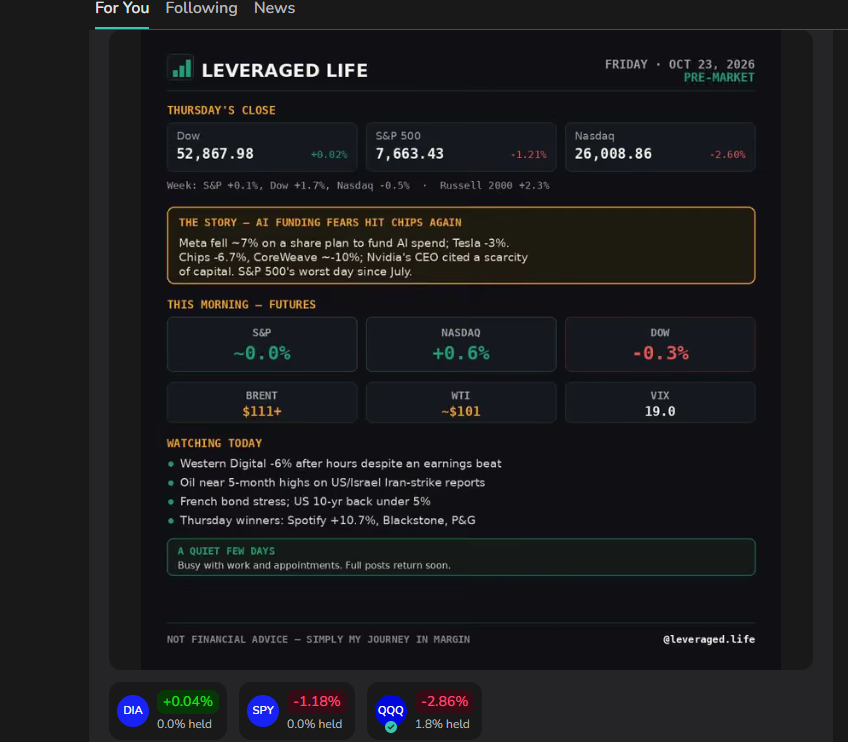

*Seed screenshot — Leveraged Life original pre-market dark market board with indices, futures and watch list*

- **Captured for review:** 2026-10-23, CEO-supplied screenshot in the PAM Marketing & GTM conversation. Visible graphic masthead `LEVERAGED LIFE`, account footer `@leveraged.life`, graphic date `Friday · Oct 23, 2026 · PRE-MARKET`. **Source type:** screenshot only. **Post URL / original creator account verification / engagement:** UNKNOWN; web search did not confirm an original permalink. The original CEO-uploaded PNG is now archived privately at `competitive_visual_assets/cvi_batch00_01.png`.
- **Observed creator-owned visual structure (top to bottom):** masthead and session/date; three boxed previous-close index readings (Dow, S&P 500, Nasdaq); one thin weekly-summary line; warm-color framed `THE STORY` explanatory panel; `THIS MORNING — FUTURES` / cross-asset indicators in two rows of three boxed readings (equities, crude, VIX); `WATCHING TODAY` list; personal posting-schedule note; compact disclaimer/footer. **Not part of the composition:** the DIA/SPY/QQQ holdings widgets underneath appear in Blossom's surrounding post interface, not inside the original visual.
- **Observable positive choices (editorial judgment):** immediate pre-market framing; familiar index orientation; discrete information groupings; a visually prioritized narrative panel; enough market breadth to serve readers seeking a morning pulse.
- **Potential weaknesses at feed size (judgment, not tested):** many near-equal competing numbers/panels; condensed secondary type and compressed supporting story; boxed dashboard aesthetic competes with the central interpretation; on-image underlying sources and timestamps for each individual observation are not discernible in this screenshot. **No conclusion about truth or actual readability on a different device:** no source-level audit or native-resolution image is available.
- **Potential PAM differentiation (IDEA, not required changes):** keep one clear, defensible thesis above a small set of *necessary* sourced figures; use quiet grid lines/typographic hierarchy instead of many outlined tiles; make observation clock, units and comparability obvious; dedicate space to interpretation, counter-case or watch condition rather than simply listing movers; preserve recognizable PAM pine/ivory identity; prefer a readable mobile overview over cramming in a terminal dashboard. For an M4 story, let the real cross-asset relationship dictate which few observations earn space. **Do not trace its exact panel order, highlight box, text or graphic styling.**
- **Outcome/effectiveness:** UNKNOWN. No verified likes, comments, views, saves, follows, comparative audience metrics or causal evidence. No claim that PAM is better-looking or that this design attracts more readers.
- **Design action:** `NONE — WATCH / OPTIONAL REFERENCE`. Keep using existing formats. Revisit if later PAM posts or multiple independently observed references expose a repeatable reader-comprehension problem.
- **Evidence confidence:** `VISUAL_OBSERVATION` for visible layout; `EDITORIAL_OPINION` for strengths/risks; `HYPOTHESIS` for PAM ideas; `NOT VERIFIED` for performance, account authenticity, original permalink and market-number correctness.

## CEO screenshot intake — 2026-10-23 (12 visual references; 8 thematic cases)

**Intake provenance:** the CEO supplied **12 screenshots in one PAM Marketing & GTM ChatGPT conversation** on 2026-10-23. Inventory numbers follow the presentation order. The original CEO-uploaded screenshot PNGs are now archived privately and associated with these references through the local asset directory and manifest. Owners' permissions, original Blossom permalinks, publication timestamps, original creator-file resolution and any platform analytics remain unverified. Descriptions capture the visible compositions only; figures/tickers/quotes on third-party graphics are **UNVERIFIED CONTENT**, not PAM research evidence. Apparent holdings chips, comments, post chrome and engagement counters from Blossom are not part of the creator's original graphic. Dates printed within the examples are graphic labels, not independently corroborated publication dates.

| Intake no. | Short screenshot identification (observed) | Analytical case | Original post permalink / image reproduction rights |
|---|---|---|---|
| **01** | Dark illustrated **US MARKET HIGHLIGHTS**, Oct 22; S&P 500/Nasdaq 100/Dow, movers/losers, Wall Street flag, bull/bear | [CVI-20261023-002](#cvi-20261023-002--illustrated-market-highlights-two-markets) | UNKNOWN / not granted |
| **02** | Dark illustrated **TSX MARKET HIGHLIGHTS**, Oct 22; Canadian indices, movers/losers, Toronto skyline, bull/bear | [CVI-20261023-002](#cvi-20261023-002--illustrated-market-highlights-two-markets) | UNKNOWN / not granted |
| **03** | **Nasdaq Composite, daily closes**, Sep 28–Oct 22 line chart with peak/end annotations and source footer | [CVI-20261023-004](#cvi-20261023-004--one-index-time-series-with-a-clear-takeaway) | UNKNOWN / not granted |
| **04** | **ZETA remaining performance obligations**, quarterly historical bars with Stock Analysis attribution | [CVI-20261023-005](#cvi-20261023-005--zeta-historical-operating-metric-bars) | UNKNOWN / not granted |
| **05** | Light-blue **CANADIAN MARKET UPDATE**: TSX headline counters, gainers/decliners, post header visible for Eldon \`@selldon\` | [CVI-20261023-003](#cvi-20261023-003--high-contrast-canadian-market-update) | UNKNOWN / not granted |
| **06** | Polygon/triangle of **on- vs off-balance-sheet commitments** across major tech firms | [CVI-20261023-006](#cvi-20261023-006--corporate-obligations-comparison-two-visual-grammars) | UNKNOWN / not granted |
| **07** | Paired horizontal bars comparing **recorded liabilities vs future lease/purchase commitments** by issuer | [CVI-20261023-006](#cvi-20261023-006--corporate-obligations-comparison-two-visual-grammars) | UNKNOWN / not granted |
| **08** | Dark **SGOV vs BND** paired bars: yield and five-year total return, Blossom post chrome visible | [CVI-20261023-007](#cvi-20261023-007--cash-versus-bonds-two-horizons) | UNKNOWN / not granted |
| **09** | Dark **SOFI Q3 earnings setup**: estimate/prior comparison plus stock-low/close/target comparison | [CVI-20261023-008](#cvi-20261023-008--sofi-event-driven-earnings-and-market-expectations) | UNKNOWN / not granted |
| **10** | \`@Granvestor\` **SharkNinja in one picture**: category, brand and regional segmentation | [CVI-20261023-009](#cvi-20261023-009--sharkninja-multiplate-company-research) | UNKNOWN / not granted |
| **11** | \`@Granvestor\` **What you pay vs what you could get**: peer forward P/E and 2031 valuation scenarios | [CVI-20261023-009](#cvi-20261023-009--sharkninja-multiplate-company-research) | UNKNOWN / not granted |
| **12** | \`@Granvestor\` **SharkNinja to 2031**: sales/EPS bear-base-bull scenario trajectories | [CVI-20261023-009](#cvi-20261023-009--sharkninja-multiplate-company-research) | UNKNOWN / not granted |

**Identity caution:** \`@selldon\` and \`@Granvestor\` are *visible screenshot labels*, not verified account ownership. Other images' creators are not identified with confidence. A chart's publisher/source watermark (for example, Stock Analysis or Bloomberg Tax) must not be confused with the Blossom poster or proof of usage rights. No independent fact audit of displayed numbers was performed.

### CVI-20261023-002 — Illustrated market highlights (two markets)

Reference screenshots (3) — private archive

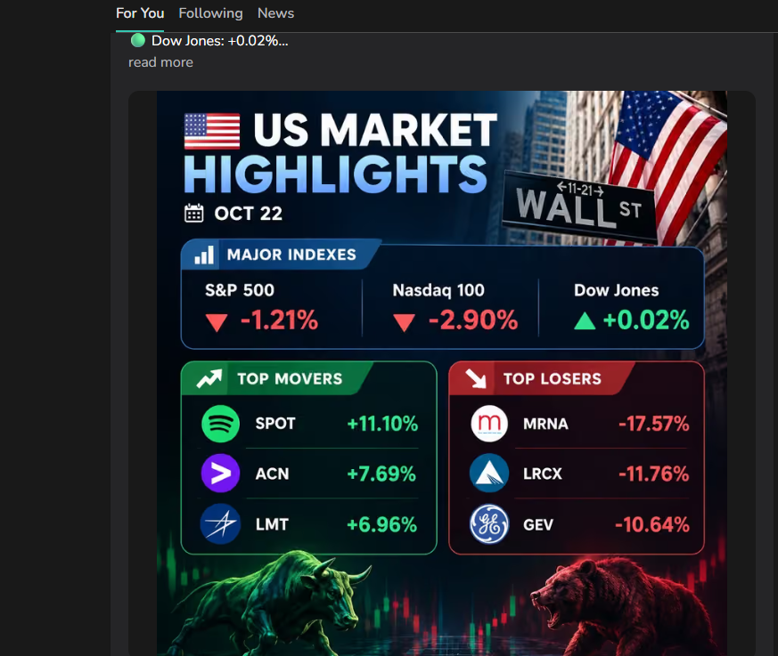

*Batch 1 · screenshot 01 — Dark illustrated US MARKET HIGHLIGHTS, Oct 22; S&P 500/Nasdaq 100/Dow, movers/losers, Wall Street flag, bull/bear*

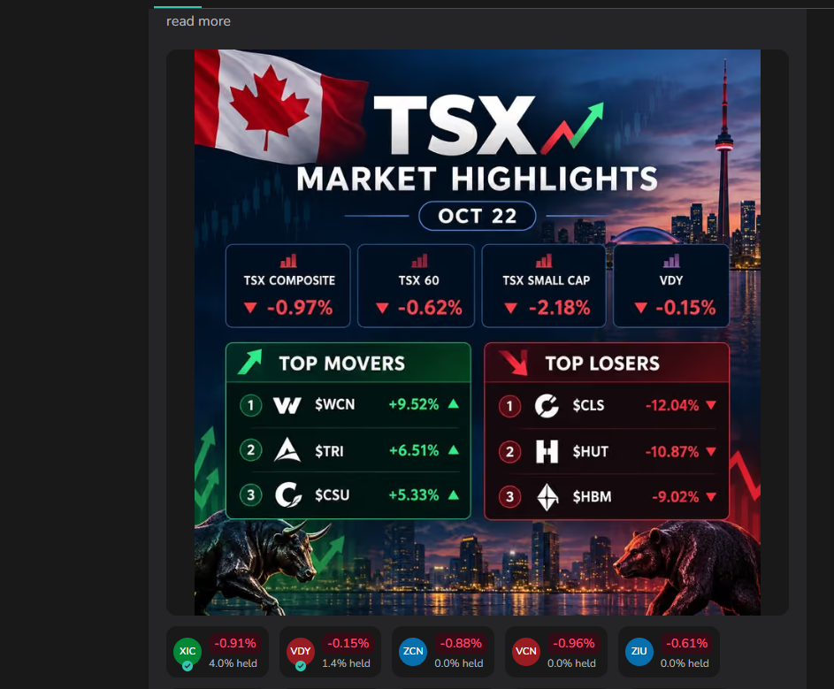

*Batch 1 · screenshot 02 — Dark illustrated TSX MARKET HIGHLIGHTS, Oct 22; Canadian indices, movers/losers, Toronto skyline, bull/bear*

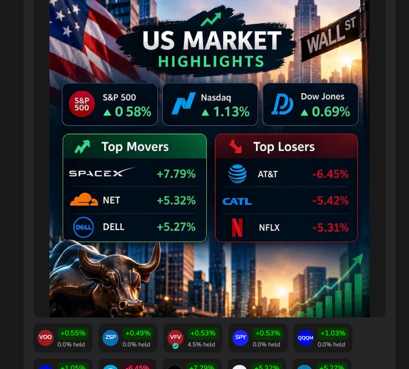

*Batch 2 · screenshot 04 — Dark US MARKET HIGHLIGHTS: three index tiles, top movers/losers, Wall Street photo, bull and rising-graph decoration*

**References:** #01 U.S. headline board and #02 Canadian/TSX board. **Category:** attention-first index/movers poster.

- **Visible grammar:** prominent market/country masthead; flags and recognizable city/market imagery; top-level index moves in uniform cards; mirrored green gainers/red losers; branded company logos; bulls and bears as narrative decoration; saturated blue-green-red against a dark photographic backdrop. U.S. screenshot covers S&P 500, Nasdaq 100 and Dow; Canadian screenshot covers TSX-family indicators. Holdings chips below the Canadian image are Blossom UI, not the infographic.
- **Strengths (judgment):** extremely quick market/session recognition; strong visual hook and color grouping; editorially accessible to a scrolling reader; intuitive winners-versus-losers organization.
- **Tradeoffs (judgment):** high decorative intensity can compete with essential figures; image backgrounds, logos and colored panels add visual density; the gains/losers framing tells *what moved* but little about *why it matters*. Market/index universes and sample selection may not be self-evident. Raw performance, financial accuracy and source rights are unverified.
- **Possible PAM edge (hypothesis):** retain fast orientation while making a verified market *relationship* the focal point; clearer session/universe definitions, quieter supporting modules, stronger on-image interpretive hierarchy and disciplined PAM identity. Do **not** adopt its exact photo, layout, company marks, animals or module order.
- **Action/outcome:** \`IDEA ONLY\`; not a request to redesign M4. Whether these posters outperform institutional research cards is **UNKNOWN**.

### CVI-20261023-003 — High-contrast Canadian market update

Reference screenshots (1) — private archive

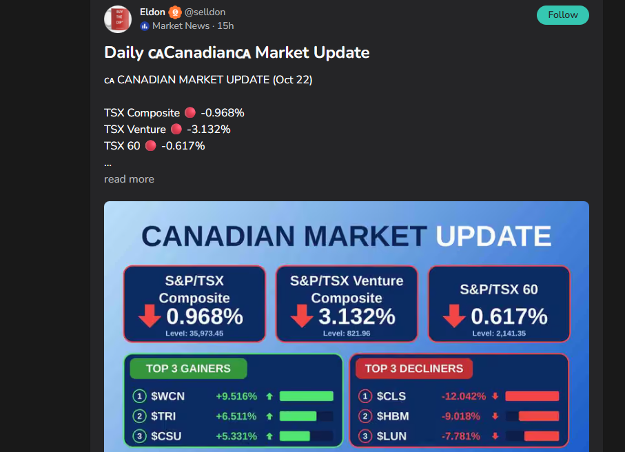

*Batch 1 · screenshot 05 — Light-blue CANADIAN MARKET UPDATE: TSX headline counters, gainers/decliners, post header visible for Eldon @selldon*

**Reference:** #05, bright blue TSX market-card composition; screenshot shows a Blossom author line \`Eldon @selldon\`, not independently verified. **Category:** simple, high-color retail market scoreboard.

- **Visible grammar:** large Canadian market heading; three index-loss cards using arrows, percentages and index levels; gainers/decliners modules with names, small bars, ranked markers; large blue canvas and strongly contrasting red/green accents. Screenshot crops the lower content, so completeness cannot be assumed.
- **Strengths (judgment):** highly recognizable Canadian scope; predictable order and strong contrast; more direct than photograph-heavy posters.
- **Tradeoffs:** oversized cards can consume room that could explain what drives the move; three-decimal precision may exceed the editorial need; repeated color, borders and arrows make the design busy; bright palette and stacked labels may distract on mobile.
- **Possible PAM edge:** distinguish *what changed* from *what matters* with one interpreted, sourced note; minimize redundant signals and ensure color is never the sole indication of direction. A restrained palette is a preference to test, not a guaranteed engagement advantage.
- **Action/outcome:** \`IDEA ONLY\`, engagement **UNKNOWN**.

### CVI-20261023-004 — One-index time series with a clear takeaway

Reference screenshots (1) — private archive

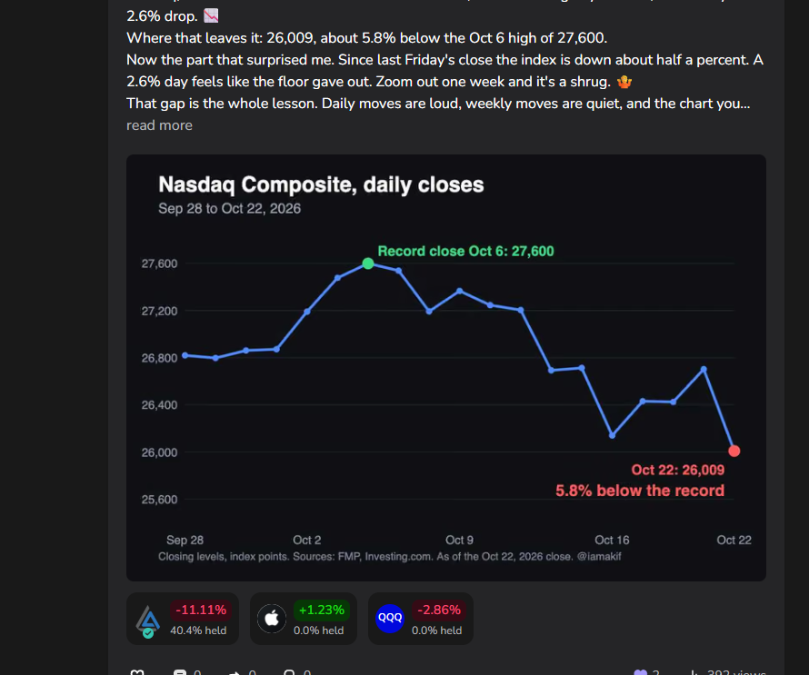

*Batch 1 · screenshot 03 — Nasdaq Composite, daily closes, Sep 28–Oct 22 line chart with peak/end annotations and source footer*

**Reference:** #03, Nasdaq Composite daily-close chart (Sep 28–Oct 22 labels). **Category:** minimalist point-to-point historical evidence.

- **Visible grammar:** single dark line plot with sparse horizontal levels, selective date ticks, one highlighted local record marker and one contrasting terminal marker; short annotations describe the drawdown. Main post text supplies the interpretation; source names and as-of note appear in a small footer.
- **Strengths:** one unmistakable question, an interpretable path, a visually linked peak-versus-latest comparison, very little decorative noise. Supports an insight that a one-day move and a multiweek trajectory tell different stories.
- **Tradeoffs:** tightly packed dates and small sources at feed width; the main takeaway depends on the scale, chosen start date and verified record. A truncated y-axis is legitimate for showing index-level movement if clearly labeled, but changes perceived amplitude and must be judged honestly.
- **Possible PAM edge:** a source-reproducible, period-aligned line chart with explicit levels, units and selectively labeled events; caption adds interpretation and uncertainty instead of restating endpoint labels.
- **Action/outcome:** \`OPTIONAL TECHNIQUE\`; no visual production requested, returns/record assertions **UNVERIFIED**.

### CVI-20261023-005 — ZETA historical operating metric bars

Reference screenshots (1) — private archive

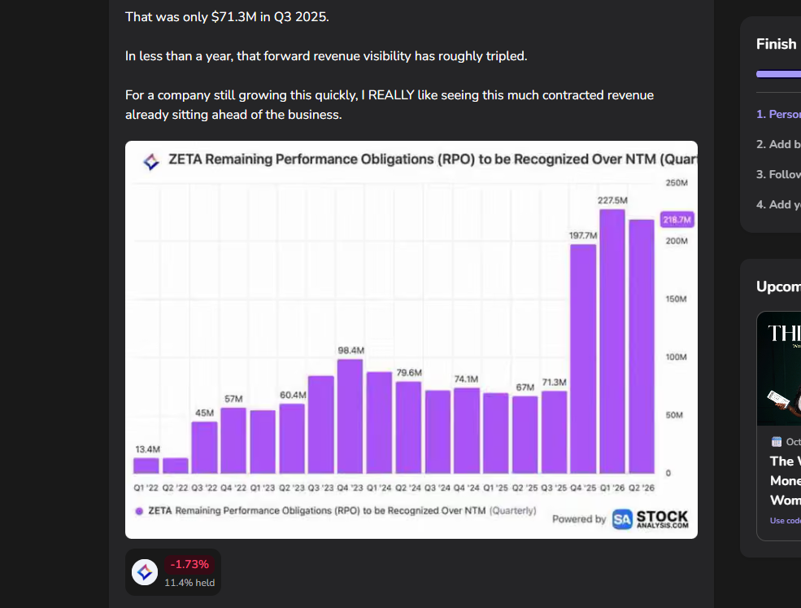

*Batch 1 · screenshot 04 — ZETA remaining performance obligations, quarterly historical bars with Stock Analysis attribution*

**Reference:** #04, Stock Analysis-branded chart of quarterly remaining performance obligations (RPO) to be recognized over the next twelve months. **Category:** evidence-led company operating metric with long history.

- **Visible grammar:** light-background quarterly vertical bars from 2022 through 2026, purple consistently used for one business metric, values annotated over bars, regular grid, and original data/chart provider watermark. The surrounding Blossom caption contextualizes changes over time.
- **Strengths:** shows the magnitude *and* persistence of an apparent recent step-change; one metric on one comparable axis; chronology allows readers to see whether a headline is an isolated spike.
- **Tradeoffs:** dozens of small quarterly labels can overwhelm mobile; screenshots of third-party charts can be cropped, reused without context or misunderstood as endorsed data; RPO is not automatically realized revenue, and definitions/period comparability must be independently checked for PAM's own work.
- **Possible PAM edge:** when E1 or another approved format requires such a trend, build from authorized source-linked issuer disclosures, plot only the evidence needed, and state the metric's limitation; prefer our own appropriately licensed visualization over copying third-party chart art.
- **Action/outcome:** \`IDEA ONLY\`, no data validated, no copied graphic retained.

### CVI-20261023-006 — Corporate obligations comparison, two visual grammars

Reference screenshots (2) — private archive

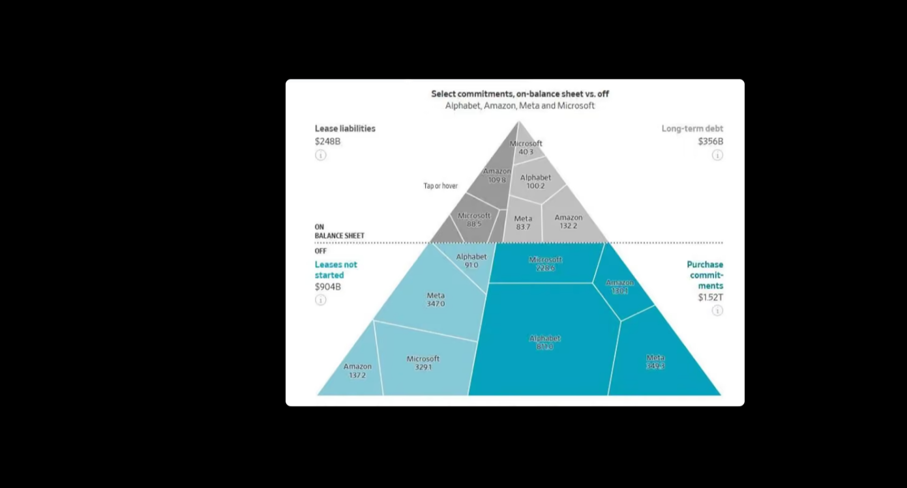

*Batch 1 · screenshot 06 — Polygon/triangle of on- vs off-balance-sheet commitments across major tech firms*

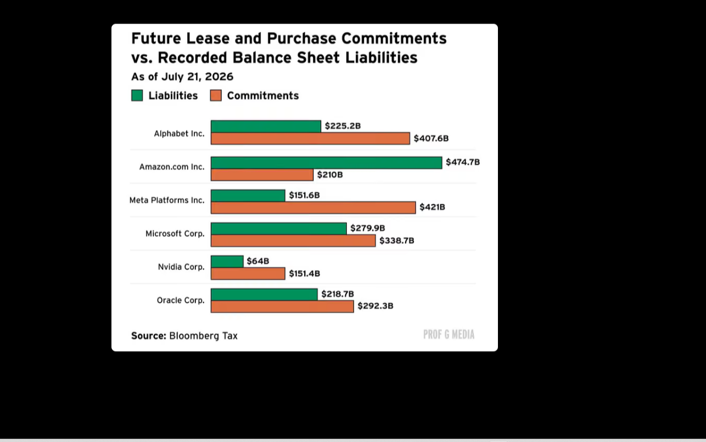

*Batch 1 · screenshot 07 — Paired horizontal bars comparing recorded liabilities vs future lease/purchase commitments by issuer*

**References:** #06, geometric triangle partition; #07, paired horizontal bars comparing liabilities and commitments by firm. **Category:** multi-company financial structure comparisons.

- **Triangle observation (#06):** triangular composition divided into sections with company/value labels and an on-balance versus off-balance boundary. The shape captures attention, but irregular cell areas and dense interior labels can imply unclear quantitative area encoding; some numerical labels are hard to read at feed width. Source and exact measurement definition are not verified.
- **Bar observation (#07):** simple issuer rows with two labeled horizontal bars and a clear legend for liabilities/commitments, uniform scales, source footer. Readers can compare magnitudes and exceptions without deciphering custom geometry, though category/definition equivalence remains important.
- **Lesson (judgment):** visual novelty only helps if the encoding is transparent. When accurate relative quantities are the thesis, ordinary aligned bars are often more interpretable than unconstrained polygons. A pyramid may be justified for a *true* nested/compositional hierarchy, not simply to stand out.
- **Possible PAM edge:** transparent accounting definitions (recognized liabilities versus future/conditional commitments), correct denominator/unit/date, one scale that doesn't imply bogus additivity, and an informative contrast/countercase. Be cautious about mixing issuers and periods.
- **Action/outcome:** \`DESIGN COMPARISON ONLY\`; no numeric verification or action to reproduce either visual.

### CVI-20261023-007 — Cash versus bonds: two horizons

Reference screenshots (1) — private archive

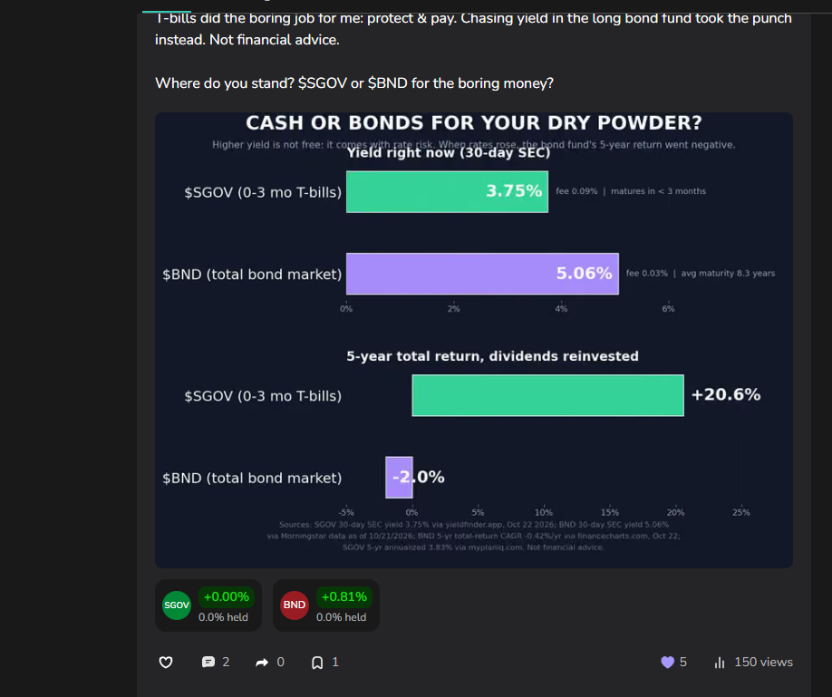

*Batch 1 · screenshot 08 — Dark SGOV vs BND paired bars: yield and five-year total return, Blossom post chrome visible*

**Reference:** #08, dark SGOV/BND chart comparing a recent yield-type observation and a five-year total-return comparison. **Category:** paired-metric investor education.

- **Visible grammar:** same two funds recur in two separately titled horizontal-bar sections; distinct bar colors; values at bar ends; low-contrast source notes near bottom; post text frames risk/return tradeoff.
- **Strengths:** deliberately contrasts *current yield* and *historical investor outcome*, avoiding a one-number comparison; bar lengths allow side-by-side inspection; caption can connect rates, duration and mark-to-market risk.
- **Tradeoffs:** the two panels display different metrics/time windows and must not be compared as like-for-like; yield conventions and five-year total-return periods need independent verification. Bottom notes and axes appear small. Opinionated post wording is not performance evidence.
- **Possible PAM edge:** label precisely each metric, period and risk exposure, differentiate yield from total return visually and verbally, and prioritize a non-prescriptive explanation of the underlying mechanism.
- **Action/outcome:** \`EDITORIAL INSIGHT\`, no verified financial values or user-response assessment.

### CVI-20261023-008 — SOFI event-driven earnings and market expectations

Reference screenshots (1) — private archive

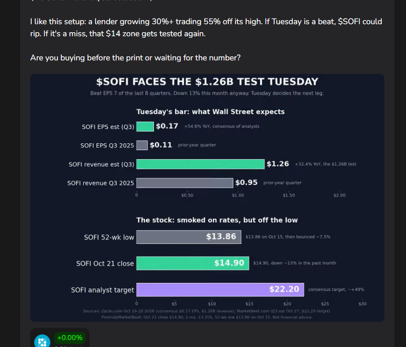

*Batch 1 · screenshot 09 — Dark SOFI Q3 earnings setup: estimate/prior comparison plus stock-low/close/target comparison*

**Reference:** #09, upcoming quarterly earnings setup. **Category:** pre-event company expectations sheet.

- **Visible grammar:** two aligned chart blocks in a dark restrained palette: forecast EPS/revenue versus prior-year figures, then observed equity low/close versus external analyst target; colored bars differentiate comparison roles; concise callouts about assumptions.
- **Strengths:** connects business expectations with market pricing in one image; supports an event thesis that can later be reviewed against actual results; structured rather than overly decorative.
- **Tradeoffs:** mixing accounting estimates with stock-price levels and analyst targets on one plate risks apples-to-oranges reading unless each panel has explicit units, dates, bases and forecast status. Text looks small at feed scale. Target prices are not facts about future value, nor investment recommendations.
- **Possible PAM edge:** clearer division of reported historical values, consensus estimates and author hypotheses; enough space for the uncertainty/what-would-change-the-thesis dimension; no trade prompt or unsupported future-price certainty.
- **Action/outcome:** \`OPTIONAL EDITORIAL REFERENCE\`, no recommendation or template rollout.

### CVI-20261023-009 — SharkNinja multiplate company research

Reference screenshots (3) — private archive

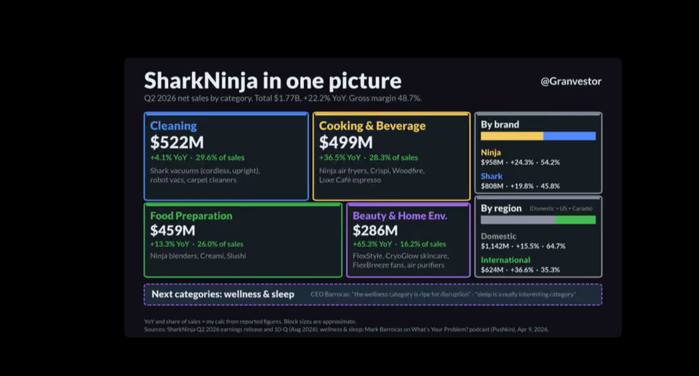

*Batch 1 · screenshot 10 — @Granvestor SharkNinja in one picture: category, brand and regional segmentation*

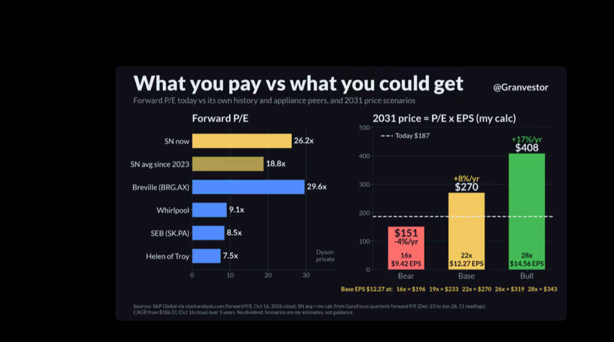

*Batch 1 · screenshot 11 — @Granvestor What you pay vs what you could get: peer forward P/E and 2031 valuation scenarios*

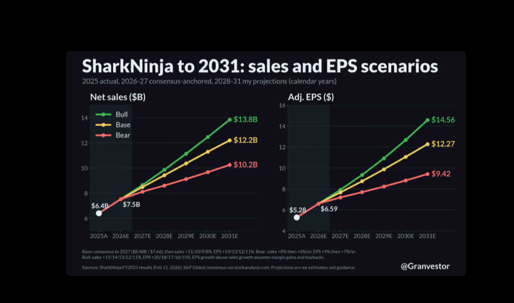

*Batch 1 · screenshot 12 — @Granvestor SharkNinja to 2031: sales/EPS bear-base-bull scenario trajectories*

**References:** #10 category/brand/region business mix; #11 valuation and five-year price scenarios; #12 sales and EPS bear/base/bull trajectories. Screenshots have a visible \`@Granvestor\` mark, **not independently linked to an authenticated account**. **Category:** coherent, staged company-research sequence (three separate images, not one giant dashboard).

- **Plate #10 observation:** compact dark research board with a few category revenue cards, brand and regional sales summaries, one forward-looking product-theme note and small footnotes. Its data dimensions are not fully additive; category, brand and region are *different cuts* of a reported business.
- **Plate #11 observation:** peer/historical forward P/E comparison on the left and author-created 2031 bear/base/bull multiple × EPS scenarios on the right. The graphic visibly separates current/reference valuation from hypothetical outcomes, but viewers still need definitions and key sensitivities.
- **Plate #12 observation:** matched sales and adjusted EPS line charts over 2025A–2031E with three colored scenarios, actual/estimate labels and a bottom methodology/source note. Scenarios are model outputs, not verified future facts; assumptions and consensus versus author estimates must be distinguished.
- **Strengths (judgment):** one company thesis developed through **business anatomy → valuation framing → forward scenarios**; consistent quiet visual family, more room for a genuine research narrative than a one-image market billboard; clear recurring colors and scenario labels.
- **Tradeoffs:** tightly compressed footnotes and numerous figures may be difficult to read in a phone feed; peers, margins, EPS definitions, source vintages and assumptions require their own evidence. A polished three-plate design cannot establish analytical validity or predictive accuracy.
- **Potential PAM opportunity (hypothesis):** when the evidence warrants it, offer a coherent *series* rather than jamming every analytical question into E1; explain what is reported versus estimated versus hypothetical, what breaks the bull case, and what would be monitored. Preserve PAM's own restrained identity, source grammar and production constraints instead of tracing these cards/charts.
- **Action/outcome:** \`OPTIONAL RESEARCH-DEPTH REFERENCE\`; **NOT** approval to implement new E2/E3/P-family templates. No verified engagement, investment thesis or accounting values.

### Cross-case observations from this batch (hypotheses only)

The screenshot sample spans three broad market presentation choices: (i) striking *market-poster scoreboards* (#01, #02, #05); (ii) *minimal time-series and categorical evidence* (#03, #04, #06, #07); and (iii) *investment-decision framing through comparisons/scenarios* (#08–#12). Neither density nor polished design proves better audience growth.

- **Fast recognition versus explanatory value:** colorful movers boards can win immediate attention, but a chart or interpretation that resolves a reader's *why* may have more durable educational utility. This remains an editorial hypothesis.
- **Visual differentiation without gimmicks:** PAM can favor legible hierarchy, careful accounting/market definitions, measured use of color, explanatory counterpoints and source traceability. Do not treat "institutional" as synonymous with smaller print or a Bloomberg-like façade.
- **A useful future question:** would a compact PAM single-thesis figure, or a short evidence-linked multi-part company series, generate better comprehension and meaningful discussion than a dense daily scoreboard? Test only when the account has sufficient comparable posts and CEO elects to run an experiment.
- **Current instruction:** **OBSERVE, DO NOT REDESIGN**. No new templates, renderer changes, mandatory competitor-screening, extra social monitoring, or content publication arise from this intake.

## CEO screenshot intake — 2026-10-23, batch 2 (14 references; 9 new cases + 1 existing-case update)

**Intake provenance:** the CEO shared **14 images** in the PAM Marketing & GTM ChatGPT conversation on 2026-10-23. Numbering follows their display order in that single message and is local to **batch 2**; it does not replace the 12-screenshot inventory above. Some are apparent Blossom graphics, others are magazine-style editorial art, BI application screenshots, chart catalogues, mockups or reports. **Do not treat this mixed collection as 14 competing Blossom posts or as performance evidence.**

**Archival scope:** each image is **registered below by subject, distinctive visible elements and analytical case**. The CEO-uploaded PNG screenshot bytes are now archived privately with their original intake sizes and hashes; the original public URLs, creator permissions, licensing and creator-source-file resolution remain unknown unless separately verified. The CEO's ChatGPT upload is an intake source, **not** a verified persistent hosted image URL. Displayed tickers, returns, rankings, fund balances and future assumptions are unverified *example text*, not facts for reuse. Do not confuse image watermarks with a verified author identity or presentation slides with published account material.

| Batch 2 image | Visible subject and composition (not fact-checked) | Group / analysis | Medium confidence and provenance |
|---|---|---|---|
| **01** | Dark neon **FINN TOP 10** June versus September 2026 holdings comparison, names entering/leaving, concentration and YTD change; \`Noor911\` graphic signature | [CVI-20261023-010](#cvi-20261023-010--portfolio-composition-before-and-after) | Screenshot of apparent Blossom post; exact author/URL unknown |
| **02** | Cream **MACLEAN'S / The Great Generational Rip-Off** magazine-style social-policy cover with illustrated two-generation split, large display typography and callout annotations | [CVI-20261023-011](#cvi-20261023-011--editorial-magazine-cover-as-visual-argument) | Cover-like illustration; publication authenticity and licensing unknown |
| **03** | Dark-gold **Canada's top 5 companies by market cap** ranking with bank/Shopify logos, medals, country flag and audience-vote CTA | [CVI-20261023-012](#cvi-20261023-012--canadian-market-cap-ranking-and-poll-poster) | Screenshot of apparent Blossom content; company figures unverified |
| **04** | Dark **US MARKET HIGHLIGHTS**: three index tiles, top movers/losers, Wall Street photo, bull and rising-graph decoration | [CVI-20261023-002](#cvi-20261023-002--illustrated-market-highlights-two-markets) (existing category, additional variant) | Screenshot of apparent Blossom content; no authenticated post link |
| **05** | **Qlik Financial Reporting** interface: revenue-by-division pie, monthly revenue/margin plot, category-level financial table | [CVI-20261023-013](#cvi-20261023-013--dense-legacy-bi-financial-reporting-interfaces) | Business-intelligence interface screenshot; not verified as Blossom |
| **06** | **Budget vs Actual Dashboard**: income and expenses side by side, KPI donut gauges, monthly bars plus target overlays, categorized variance tables | [CVI-20261023-015](#cvi-20261023-015--budget-versus-actual-symmetric-comparison) | Dashboard screenshot/mockup; source and permissions unknown |
| **07** | **YTD Dashboard**: KPI ribbon, sales/receivables comparison, aging breakdown bars, donut customer mixes, monthly credit percentages | [CVI-20261023-013](#cvi-20261023-013--dense-legacy-bi-financial-reporting-interfaces) | Reporting screenshot/mockup; not verified as public post |
| **08** | **Executive metrics dashboard**: revenue, expenses, quick/working metrics, monthly financial table, 12-month cash-flow/income plot | [CVI-20261023-013](#cvi-20261023-013--dense-legacy-bi-financial-reporting-interfaces) | Reporting screenshot/mockup; metrics not verified |
| **09** | **CashWise Cash Flow Dashboard**: browser-app navigation, cash/work-capital/liquidity KPI row, flow trends, expenses, receivables/payables donut summaries | [CVI-20261023-014](#cvi-20261023-014--modern-cash-flow-saas-dashboard) | Application UI screenshot, not evidence of a verified company or product |
| **10** | Flat illustration of data/tables/code feeding charts and document reports through arrows | [CVI-20261023-016](#cvi-20261023-016--chart-library-and-report-pipeline-reference-art) | Concept illustration, not a finance publication |
| **11** | **40 CHARTS GRAPHS** mosaic of varied bar, line, area, waterfall-like and dimensional chart examples | [CVI-20261023-016](#cvi-20261023-016--chart-library-and-report-pipeline-reference-art) | Generic chart catalogue, not verified analytics or popularity |
| **12** | White institutional-style **Aurelius Wealth Fund** portfolio review with asset allocation, risk stats, performance, target comparison and holdings | [CVI-20261023-017](#cvi-20261023-017--institutional-fund-report-light-versus-dark) | Report-style example/mockup; fund/return claims not authenticated |
| **13** | Dark blue-and-gold **Aethel Capital Management** multi-asset overview: NAV, alpha, risk, allocation, holdings and stress tests | [CVI-20261023-017](#cvi-20261023-017--institutional-fund-report-light-versus-dark) | Dashboard-style example/mockup; firm/status/metrics unverified |
| **14** | Dark aubergine **VOGUE LABS conversion & revenue report**: product category tiles, funnel, weekly revenue/AOV, acquisition channels, device mix and launch forecast | [CVI-20261023-018](#cvi-20261023-018--ecommerce-growth-funnel-and-revenue-dashboard) | Commercial analytics dashboard screenshot/mockup, not a verified Blossom competitor |

**Identity/source caution:** \`FINN\`, \`MACLEAN'S\`, \`Qlik\`, \`CashWise\`, \`Aurelius\`, \`Aethel\` and \`Vogue Labs\` are visible names/marks; their identity as actual publishers, current active businesses or image rights holders was **not independently investigated**. A concept logo or professional-looking display does not establish factual validity. The apparent \`Noor911\` signature is not a verified Blossom account. The image #04 contains a "SpaceX" entry in a purported market-movers list; **do not infer stock-market eligibility or accuracy from a logo and displayed percentage**.

### CVI-20261023-010 — Portfolio composition before and after

Reference screenshots (1) — private archive

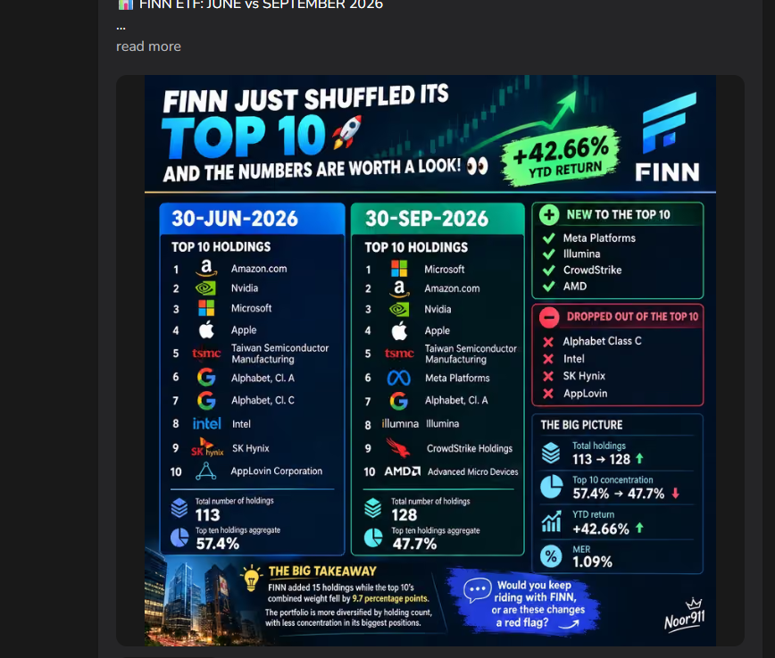

*Batch 2 · screenshot 01 — Dark neon FINN TOP 10 June versus September 2026 holdings comparison, names entering/leaving, concentration and YTD change; Noor911 graphic signature*

**Reference:** batch 2 #01. **Format:** attention-grabbing comparative holdings board, not evidence of actual FINN performance.

- **Observed grammar:** two dated, ranked top-ten holdings columns in strong blue and teal; additions/removals as annotated checklists; total portfolio position count and top-ten concentration summaries; high-visibility YTD percentage sticker; takeaway box and question prompt at the bottom. The various arrows/logos/colors are high energy but densely stacked.
- **Potential strengths (judgment):** temporal comparison has a genuine analytical purpose; changes in concentration/constituents are easier to see than in two independent screenshots; summary of broader diversification helps contextualize a ranked list.
- **Possible limitations:** the list is long at mobile width, company logos and mini text compete for attention, performance may be wrongly attributed to portfolio reshuffling, and holdings count/concentration can change for reasons other than deliberate allocation.
- **PAM opportunity (hypothesis):** for truthful portfolio-intelligence storytelling, make the single relevant *change* obvious (concentration, sector shift or turnover) and state dates, methodology, holdings scope and whether performance is actually attributable. Use PAM's own visuals; do not copy the two-column grid, emblem, or signature.
- **Status:** \`OPTIONAL BENCHMARK\`; no author/account verification and no performance figures validated.

### CVI-20261023-011 — Editorial magazine cover as visual argument

Reference screenshots (1) — private archive

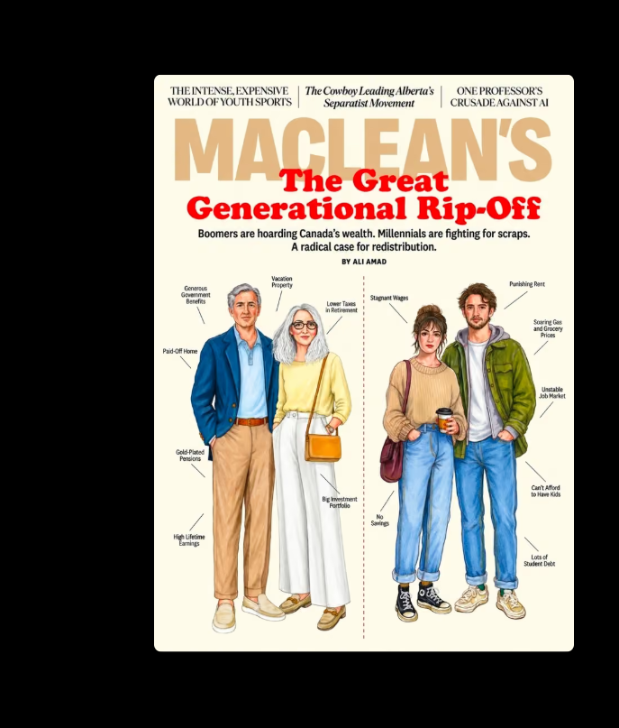

*Batch 2 · screenshot 02 — Cream MACLEAN'S / The Great Generational Rip-Off magazine-style social-policy cover with illustrated two-generation split, large display typography and callout annotations*

**Reference:** batch 2 #02. **Format:** illustrated narrative/political-economic cover, categorically different from a financial-data visualization.

- **Observed grammar:** warm paper background, oversized masthead and scarlet provocative title, contrasting illustrated older/younger pairs divided vertically, numerous callouts describing proposed intergenerational living conditions. Creates a single emotional *claim* rather than a statistical model.
- **Potential strengths:** memorable human stakes, instant thematic identity and high editorial differentiation compared with generic stock boards.
- **Potential risks:** heavily caricatured cohort framing and charged language can compress complex distributions into stereotypes; visual assertions such as wealth, benefit or debt disparities require real evidence before a finance account presents them as fact. Magazine-title rights, illustration rights and authenticity are not established.
- **PAM opportunity:** serious research sometimes deserves a human-centered illustration rather than any chart, **if** substantiated and fair to heterogeneous cohorts. Pair an empathetic clear narrative with measured, correctly segmented evidence; avoid lifting the original editorial imagery or divisive framing.
- **Status:** \`EDITORIAL TECHNIQUE\` only; no policy, data or publication recommendation inferred.

### CVI-20261023-012 — Canadian market-cap ranking and poll poster

Reference screenshots (1) — private archive

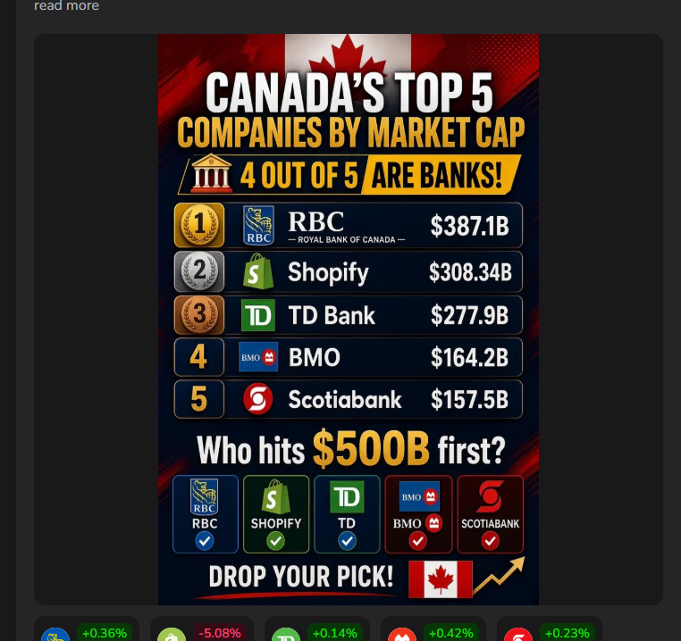

*Batch 2 · screenshot 03 — Dark-gold Canada's top 5 companies by market cap ranking with bank/Shopify logos, medals, country flag and audience-vote CTA*

**Reference:** batch 2 #03. **Format:** sports-style leaderboard plus engagement question.

- **Observed grammar:** flag, gold medals, numbered bank/retail company rows, strong metallic contrast, a "who reaches milestone first" question and branded choices at the bottom.
- **Potential strengths:** fast ranking comprehension, Canadian audience recognition and compact context for market concentration.
- **Potential weaknesses:** decorative medals and repeated logos may distract; precision without source date, currency and universe definition can mislead; rank ordering and forward milestone framing can invite prediction without analysis. Figures and the displayed "four banks" claim were **not verified**.
- **PAM opportunity:** show a country/sector concentration fact with specified as-of, market-cap basis, comparability and one useful explanation—rather than a superficial vote. Do not assume engagement bait improves credibility or audience growth.
- **Status:** \`OPTIONAL REFERENCE\`, no template change.

### CVI-20261023-013 — Dense legacy BI financial reporting interfaces

Reference screenshots (3) — private archive

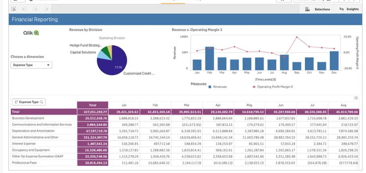

*Batch 2 · screenshot 05 — Qlik Financial Reporting interface: revenue-by-division pie, monthly revenue/margin plot, category-level financial table*

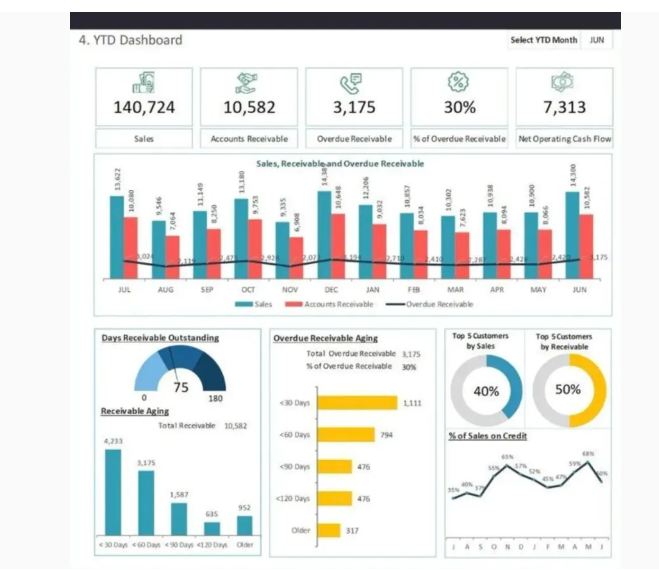

*Batch 2 · screenshot 07 — YTD Dashboard: KPI ribbon, sales/receivables comparison, aging breakdown bars, donut customer mixes, monthly credit percentages*

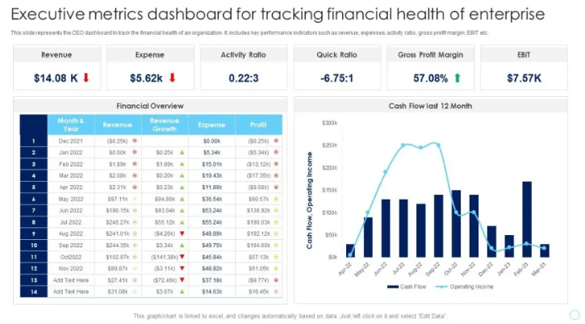

*Batch 2 · screenshot 08 — Executive metrics dashboard: revenue, expenses, quick/working metrics, monthly financial table, 12-month cash-flow/income plot*

**References:** batch 2 #05, #07 and #08. **Format:** interactive operational reporting dashboards, not directly comparable with mobile Blossom posts.

- **Image #05:** Qlik-branded financial reporting UI combines division/revenue pie, monthly revenue and margin plot with a large transaction/category detail table. High drill-down utility in a desktop workspace; tiny table cells are inappropriate for a single social thumbnail.
- **Image #07:** a YTD financial-operating report: multi-KPI header, sales/receivables monthly bars, aging distributions, customer-mix donuts and credit trend. Strong relationship between top KPIs and detailed diagnostics but high decoding cost.
- **Image #08:** executive health scorecard with leading ratios and a table/plot. Compact summary is useful; crowded table, charts and ambiguous ratio units would require careful clarity to publish.
- **Common strength:** **overview → diagnosis → supporting detail** hierarchy, integrated time-series + composition + operational breakdown. Data points have a purpose because a user can drill down.
- **Common tradeoff:** excellent information architecture for **interactive desktops**, weak fit for a static portrait phone image without editing. More dashboards/indicators do not automatically mean better research content.
- **PAM opportunity:** learn the sequencing, not the page density: one central question, one or two clear measurements and an optional evidence explanation, or split a justified deep dive into multiple separately reviewed views. Do not imply PAM already provides these BI metrics or integrations.
- **Status:** \`DESIGN INTELLIGENCE ONLY\`; does not activate product/dashboard development.

### CVI-20261023-014 — Modern cash-flow SaaS dashboard

Reference screenshots (1) — private archive

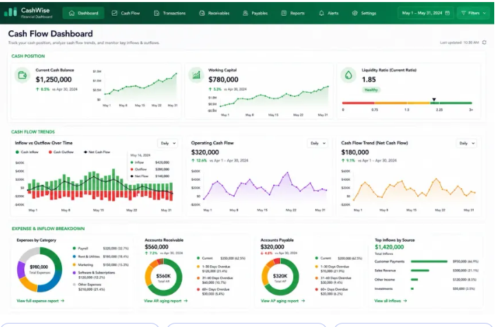

*Batch 2 · screenshot 09 — CashWise Cash Flow Dashboard: browser-app navigation, cash/work-capital/liquidity KPI row, flow trends, expenses, receivables/payables donut summaries*

**Reference:** batch 2 #09. **Format:** cleaner desktop finance application/dashboard compared with the legacy BI examples.

- **Observed grammar:** persistent green navigation, three KPI tiles with sparklines and liquidity gauge, then separate inflow/outflow time series and an expense/receivable/payable summary band with donut indicators.
- **Potential strengths:** visible grouping by user's actual workflow; each metric's temporal trend is locally adjacent; restrained green is used for status/brand rather than flooding the whole chart.
- **Potential limitations:** overloaded for a single Blossom graphic despite cleaner spacing; different measurement scales across widgets; polished SaaS UI does not prove that the numbers are correct, live or implementable by PAM.
- **PAM opportunity:** adopt the abstract principles of **clear metric ownership, compact trend context and useful visual grouping** in future analysis when appropriate; avoid copying the actual application chrome, product name, navigation or company presentation.
- **Status:** \`FUTURE DESIGN REFERENCE\`; no source/link/right or market effectiveness established.

### CVI-20261023-015 — Budget versus actual symmetric comparison

Reference screenshots (1) — private archive

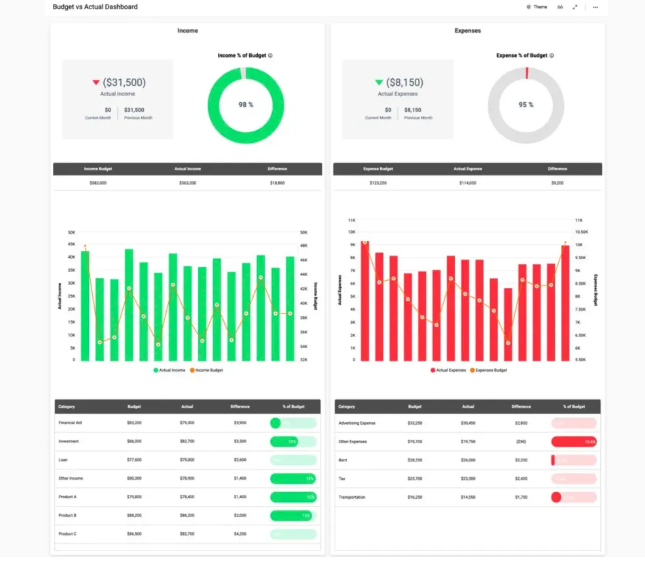

*Batch 2 · screenshot 06 — Budget vs Actual Dashboard: income and expenses side by side, KPI donut gauges, monthly bars plus target overlays, categorized variance tables*

**Reference:** batch 2 #06. **Format:** clean budget-versus-actual reporting pair.

- **Observed grammar:** near-mirrored income and expense columns, each with top variance callout and ring/gauge, monthly bars with budget target overlays, and bottom category-level comparison including percentage bars.
- **Strengths (judgment):** two matched analytic lenses in a predictable arrangement; explicit variance concept; planned-versus-realized is a valuable distinction that transfers beyond corporate budget examples.
- **Risks:** red and green on entire columns may assign misleading good/bad sentiment to context-dependent variances; exact sign convention, time base and currency matter; dual sections plus long category tables shrink mobile readability.
- **PAM opportunity:** use the *principle* of side-by-side actual-versus-expectations, forecasts-versus-outcomes or portfolio-target-versus-actual in future source-backed storytelling. A comparison must state a shared denominator/time period. Do not treat this desktop screenshot as a Blossom layout specification.
- **Status:** \`COMPARISON GRAMMAR\`, not implemented template.

### CVI-20261023-016 — Chart library and report-pipeline reference art

Reference screenshots (2) — private archive

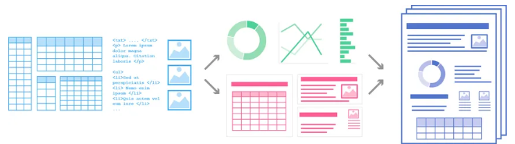

*Batch 2 · screenshot 10 — Flat illustration of data/tables/code feeding charts and document reports through arrows*

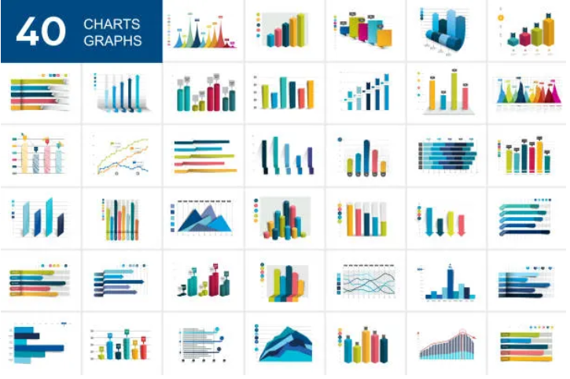

*Batch 2 · screenshot 11 — 40 CHARTS GRAPHS mosaic of varied bar, line, area, waterfall-like and dimensional chart examples*

**References:** batch 2 #10 and #11. **Format:** explanatory graphic and generic chart-type catalogue—not competitor posts or demonstrated performance.

- **Image #10:** visual metaphor of spreadsheet/code/data blocks feeding chart summaries and then assembled reports. Useful to communicate *data → analysis → published explanation*, but arrows/images are conceptual, not proof of an automated product.
- **Image #11:** "40 Charts Graphs" collage displaying a large menu of bar, line, area, dimensional and miscellaneous plots. Useful for noticing visual encodings, but many are decorative or misleading for small social-media reading areas.
- **PAM distinction:** the shape must serve the **evidence and reader question**, not vice versa. Prefer a truthful bar, line, map or comparison over a complicated 3D chart selected from a catalogue. Avoid implying a complete automated pipeline exists simply because such a diagram looks plausible.
- **Status:** \`BACKGROUND REFERENCE\` only; do not use this as permission to create 40 new template families.

### CVI-20261023-017 — Institutional fund report, light versus dark

Reference screenshots (2) — private archive

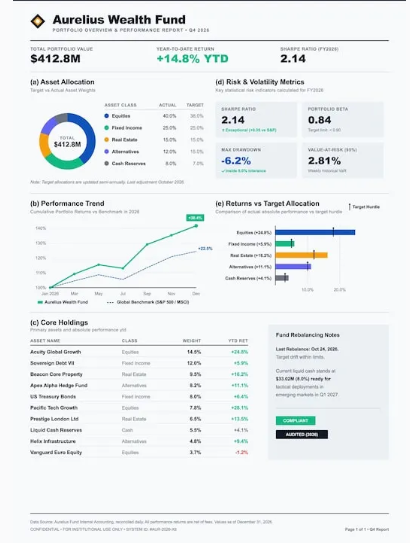

*Batch 2 · screenshot 12 — White institutional-style Aurelius Wealth Fund portfolio review with asset allocation, risk stats, performance, target comparison and holdings*

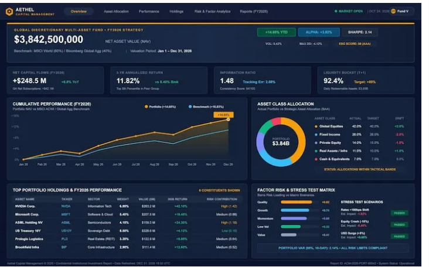

*Batch 2 · screenshot 13 — Dark blue-and-gold Aethel Capital Management multi-asset overview: NAV, alpha, risk, allocation, holdings and stress tests*

**References:** batch 2 #12 ("Aurelius Wealth Fund") and #13 ("Aethel Capital Management"). **Format:** portfolio oversight reports/dashboard mockups with very different visual treatment.

- **Light report (#12):** white research letter/report page, small typographic headings, top performance/risk figures, allocation donut and table, return progression, target allocations, core holdings and rebalancing notes. Strong print-report restraint; fine print and numerous micro-panels become hard to read as a feed thumbnail.
- **Dark dashboard (#13):** navy/gold investment-manager UI with NAV, alpha/risk KPIs, cumulative return chart, asset allocation, holdings and factor/stress test panels. Coherent brand hierarchy, but also conveys high institutional authority and many potentially unverified figures.
- **Strategic observation:** **institutional quality is legibility + defensible calculation + purposeful hierarchy**, not a color palette, fake fund names, invented credentials or wealth-manager-looking chrome. Light and dark can both succeed for the correct medium.
- **PAM opportunity:** keep current approved PAM identity and choose an appropriate *information depth*; identify actual versus modelled returns and risks, separate target vs actual allocation, expose periods/methods. Never imply PAM calculates these metrics unless repository-validated product capabilities actually support them.
- **Status:** \`INSTITUTIONAL INFORMATION HIERARCHY\` reference only. Actual fund existence and figures **UNKNOWN**.

### CVI-20261023-018 — E-commerce growth funnel and revenue dashboard

Reference screenshots (1) — private archive

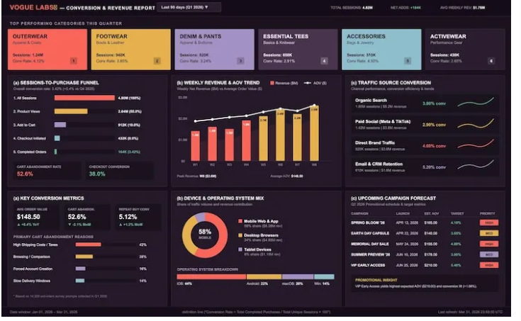

*Batch 2 · screenshot 14 — Dark aubergine VOGUE LABS conversion & revenue report: product category tiles, funnel, weekly revenue/AOV, acquisition channels, device mix and launch forecast*

**Reference:** batch 2 #14, "Vogue Labs" conversion/revenue image. **Format:** commercial analytics/business-growth performance monitor.

- **Observed grammar:** dark aubergine canvas; ranked product-family tiles with distinct muted color blocks; conversion funnel, weekly revenue+order-value time series, traffic-channel mini trends, conversion/return metrics, device mix and campaign forecast table.
- **Strengths:** coherent acquisition → conversion → revenue → retention narrative; each module contributes to a larger operational performance question; less arbitrary metric placement than a generic stock-scoreboard.
- **Potential weaknesses:** twelve-plus modules consume mobile reading bandwidth; differing percentage definitions and time windows require explicit comparability; apparent "forecasts" must not masquerade as actual observations.
- **PAM opportunity:** abstract the **evidence-to-outcome chain** for a company analysis (distribution → economics → cash generation) where validated business data permits, without copying its retail SaaS aesthetic, customer-conversion vocabulary or implying PAM has such business-data integrations.
- **Status:** \`CROSS-DOMAIN INSPIRATION\` only, not a direct finance-account competitor or proof of effective growth content.

### Cross-case lessons — batch 2

- **Not all references represent direct rivals.** Only a subset resemble Blossom posts; the rest are examples of presentation/reporting design. Never compare their "engagement performance" as though the audiences, medium and metrics matched.
- **One design principle repeats:** reveal what changed, why it matters and which uncertainty remains. Examples range from a top-ten portfolio change to budget variance and company risk, but the effective visual grammar is subject-dependent.
- **High information density is not equivalent to institutional trust.** Interactive desktop dashboards, one-page research reports and social feed visuals impose very different cognitive constraints.
- **Two particularly useful contrasts for PAM:** flamboyant ranked market posters versus one defensible source-traced insight; and multi-metric portfolio dashboards versus a small, honest source-linked performance explanation. These are hypotheses for future observation, **not** verified competitive superiority.
- **Current action:** \`NONE — OBSERVE\`. The batch does not authorize new templates, specific PAM metric claims, visual copying, publication, or a mandatory competitive checklist.

## CEO screenshot intake — 2026-10-23, batch 3 (15 references; 12 analytical cases)

**Source and classification:** Fifteen images supplied by the CEO in the PAM Marketing & GTM ChatGPT conversation, in the order listed below. This batch comprises **desktop BI dashboards, infographic/chart catalogues, valuation and portfolio-analysis UI, conceptual analytics imagery, and report/slide design**. These are **not established Blossom competitors or examples of proven social engagement**. Several resemble stock/mockup art and one pair is effectively a duplicate. This is visual market literacy for designers, not a new renderer backlog.

**Custody and limits:** The numbered descriptions and qualitative analyses now have matching CEO-supplied PNG screenshots stored privately under the local asset directory. No permanent original image URL, author identity, license, creator source-file resolution, usage rights or platform performance has been confirmed. Reference numbers are anchored to this CEO-supplied **batch 3 conversation**, not to external URL identities. Text, statistics, brands and product claims displayed within these images are **illustrative/unverified**. The descriptions and comparisons are observations or hypotheses, **not source verification or proof of market superiority**.

| Batch 3 image | Visible characteristics (observation, not verification) | Case | Source classification |
|---|---|---|---|
| **01** | Black, framed large-format analytics wall; multiple colorful bar, area and line charts, mini callouts, columns of small copy | [CVI-20261023-019](#cvi-20261023-019--dense-poster-style-analytics-wall) | Presentation/poster photo; creator and data unknown |
| **02** | Pale dashboard with world choropleth, concentric radial display, horizontal ranked sections and small charts | [CVI-20261023-020](#cvi-20261023-020--multi-panel-executive-dashboard) | Dashboard/design reference; original source unknown |
| **03** | Modular, flat coral/teal/yellow infographic canvas with stacked bands, donut indicators, pictograms and bars | [CVI-20261023-021](#cvi-20261023-021--flat-infographic-tile-system) | Generic infographic example; rights unknown |
| **04** | Person facing a wide wall of orange, white and charcoal dashboard screens | [CVI-20261023-022](#cvi-20261023-022--conceptual-analytics-hero-imagery) | Conceptual promotional illustration/photo, not evidenced analytics |
| **05** | Navy chart collection using lime and cyan lines, bars, map dots, circular gauges and card-like modules | [CVI-20261023-020](#cvi-20261023-020--multi-panel-executive-dashboard) | Chart/dashboard catalogue example; data unknown |
| **06** | Flat coral/teal/yellow modular infographic board substantially repeating image #03 | [CVI-20261023-021](#cvi-20261023-021--flat-infographic-tile-system) | **Near-duplicate of #03**, counted but not a separate lesson |
| **07** | White/gray editorial analytic sheets photographed diagonally, orange/yellow/black charts, circles and long labels | [CVI-20261023-023](#cvi-20261023-023--white-analytical-sheet-with-many-charts) | Design/print collage; no verified data source |
| **08** | Person typing at laptop/calculator with transparent holographic pie charts, bars and indicators superimposed | [CVI-20261023-022](#cvi-20261023-022--conceptual-analytics-hero-imagery) | Stock-style conceptual analytics photo; not product evidence |
| **09** | Two dark valuation widgets: future cash-flow value with \`22.0% Undervalued\` badge, and portfolio versus market P/E speedometer | [CVI-20261023-024](#cvi-20261023-024--compact-valuation-widgets) | Portfolio UI screenshot; valuation calculations **not verified** |
| **10** | White \`Optimizer / My Portfolio\` risk-return scatter, four highlighted alternatives, donut allocation and comparison bars | [CVI-20261023-025](#cvi-20261023-025--portfolio-optimizer-risk-return-map) | PortfolioCharts-branded UI appearance; source rights/results unknown |
| **11** | StockCharts-branded AMZN versus SPY multi-series percentage-performance time chart with many colored lines | [CVI-20261023-026](#cvi-20261023-026--relative-performance-multi-line-chart) | Third-party financial website screenshot; not reusable chart art |
| **12** | Portfolio weightings horizontal ranked bars beside overlapped growth-versus-dividend bubble/scatter plot | [CVI-20261023-027](#cvi-20261023-027--holdings-weighting-plus-bubble-comparison) | Analytics screenshot/composite; original source unknown |
| **13** | Turquoise, yellow and black \`INFOGRAPHICS 15\` chart/dashboard mockup tiles | [CVI-20261023-028](#cvi-20261023-028--infographic-chart-catalogue) | General-purpose chart-template catalogue |
| **14** | Role × month resource-utilization percentage heatmap in green, amber and red; expandable rows, month labels | [CVI-20261023-029](#cvi-20261023-029--operational-heatmap-matrix) | Project/resource planning UI, not investment chart |
| **15** | Cream, muted-teal and brick-red report/slide suite: multi-line chart, bars, a diagram and five-step horizontal path | [CVI-20261023-030](#cvi-20261023-030--report-and-slide-layout-family) | Generic presentation template, not published market analysis |

### CVI-20261023-019 — Dense poster-style analytics wall

Reference screenshots (1) — private archive

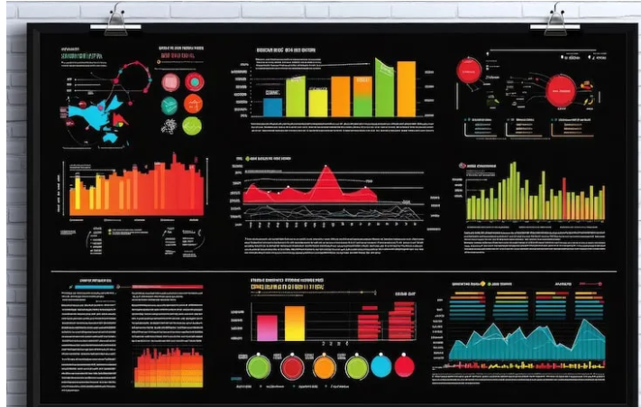

*Batch 3 · screenshot 01 — Black, framed large-format analytics wall; multiple colorful bar, area and line charts, mini callouts, columns of small copy*

**Reference:** batch 3 #01. **Subject/shape:** very dark, wide, framed analytics board resembling an exhibition wall or command-center poster; nine-ish regions with bright gradients, histograms, area/line charts and explanatory footnotes.

- **Visible strengths (editorial opinion):** strong visual spectacle, purposeful grouping of many subtopics, coherent black background with contrasting highlights; potentially useful for an exhibit or large-screen exploration.
- **Visible tradeoffs:** thumbnail-level text density, numerous equally loud panels and mixed chart scales prevent a single immediate takeaway; success on a wall is not evidence of readability in a Blossom phone feed.
- **Possible PAM lesson:** borrow only the principle of grouping related evidence and disciplined repeated scales. Reduce to a few evidence-bearing elements for a social post; don't imitate the full analytics-wall composition.
- **Status:** \`BACKGROUND REFERENCE\`. Engagement, accuracy and copyright: **UNKNOWN**.

### CVI-20261023-020 — Multi-panel executive dashboard

Reference screenshots (2) — private archive

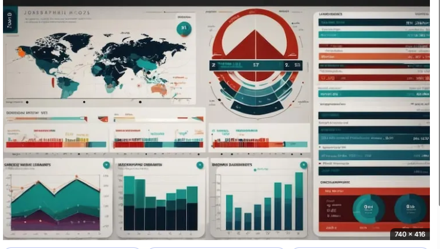

*Batch 3 · screenshot 02 — Pale dashboard with world choropleth, concentric radial display, horizontal ranked sections and small charts*

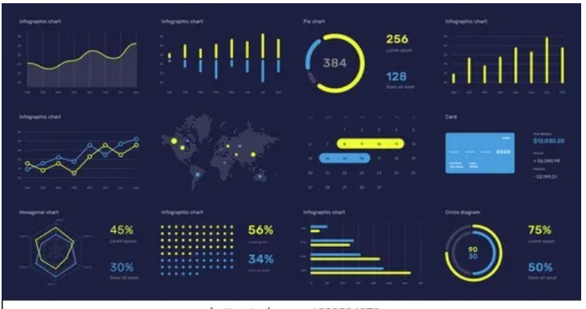

*Batch 3 · screenshot 05 — Navy chart collection using lime and cyan lines, bars, map dots, circular gauges and card-like modules*

**References:** batch 3 #02 and #05. **Subject/shape:** pale map-and-radial executive board versus dark navy data-visualization dashboard family. Both combine maps, trend plots, radial/gauge modules, distribution measures and small KPI or ranking elements.

- **Possible strengths:** compact overview of several metrics; recognizable color semantics within each local chart; map-plus-trend can locate and contextualize an issue when geographic units really belong together.
- **Tradeoffs:** crowded labels and gauge/map semantics are not obvious without interaction; maps need comparable underlying geography and source units; disconnected mini charts can become a generic catalog with no editorial focus.
- **PAM lesson:** overview → one meaningful comparison → uncertainty, not ten equal-priority widgets. A geographically bounded claim should use verified correct map geometry. Use neither screenshot as a required PAM layout.
- **Status:** \`DESIGN INTELLIGENCE ONLY\`. Original analytics and authorship unverified.

### CVI-20261023-021 — Flat infographic tile system

Reference screenshots (2) — private archive

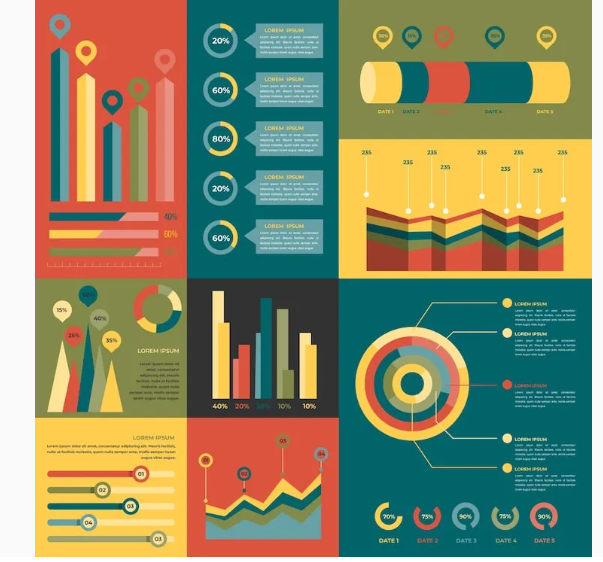

*Batch 3 · screenshot 03 — Modular, flat coral/teal/yellow infographic canvas with stacked bands, donut indicators, pictograms and bars*

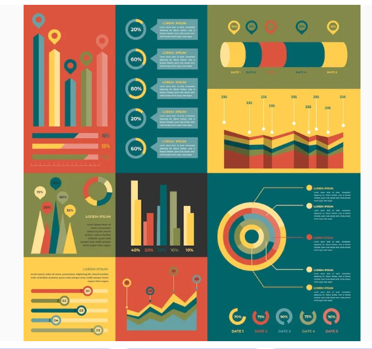

*Batch 3 · screenshot 06 — Flat coral/teal/yellow modular infographic board substantially repeating image #03*

**References:** batch 3 #03 and **near-duplicate** #06. **Subject/shape:** repeatable bright graphic tiles with stacked/striped bars, donut indicators, labeled circle nodes, stylized lines and callout panels on coral, mustard and teal backgrounds.

- **Possible strengths:** internally consistent modules, distinct visual identity, quick categorical separation and accessible flat illustrations.
- **Tradeoffs:** the repeating shapes and placeholder text can look illustrative rather than fact-driven; some encodings are decorative or incompletely labeled; saturated color across every panel weakens hierarchy.
- **PAM lesson:** modularity can be useful without adopting these particular colors, ornaments or grid. Any donut, category width or proportion must represent an actual verified denominator.
- **Status:** \`VISUAL GRAMMAR REFERENCE\`. #06 is counted as an image but does **not** justify a new case or extra template.

### CVI-20261023-022 — Conceptual analytics hero imagery

Reference screenshots (2) — private archive

*Batch 3 · screenshot 04 — Person facing a wide wall of orange, white and charcoal dashboard screens*

*Batch 3 · screenshot 08 — Person typing at laptop/calculator with transparent holographic pie charts, bars and indicators superimposed*

**References:** batch 3 #04 and #08. **Subject/shape:** a person examining dozens of dashboard panes, and an office worker using laptop/calculator with a holographic data overlay.

- **Potential strength:** communicates "analytics", decision support or digital tools at a glance without requiring the audience to decode a real data source.
- **Risk:** generic technology symbolism can imply a mature or live platform that does not exist; imagery has almost no verifiable information and does little for finance research credibility if used in place of an original chart.
- **PAM lesson:** reserve such imagery, if at all, for clearly conceptual communications with accurate capability claims. The public investing account should prioritize relevant sourced explanation instead of stock-style finance-technology scenes.
- **Status:** \`WHAT TO AVOID OVERUSING\`; no evidence of competing account performance.

### CVI-20261023-023 — White analytical sheet with many charts

Reference screenshots (1) — private archive

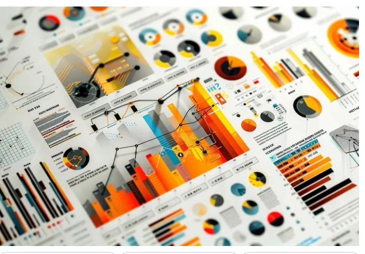

*Batch 3 · screenshot 07 — White/gray editorial analytic sheets photographed diagonally, orange/yellow/black charts, circles and long labels*

**Reference:** batch 3 #07. **Subject/shape:** brightly lit report sheets/collage with assorted bar, line and ring charts, orange/yellow accents and technical text on white paper.

- **Possible strengths:** research/reporting visual cues, legible contrasts at sheet scale and ability to compose multiple evidence views around a common question.
- **Tradeoffs:** photographic perspective, overlapping papers and numerous unrelated modules are weak choices for precise extraction of numeric information; not a ready-to-post mobile chart.
- **PAM lesson:** use this as an information-design reference only: clear charts on a neutral surface, then crop/split to one thesis per frame. No numeric value in the collage is validated.
- **Status:** \`BACKGROUND REFERENCE\`.

### CVI-20261023-024 — Compact valuation widgets

Reference screenshots (1) — private archive

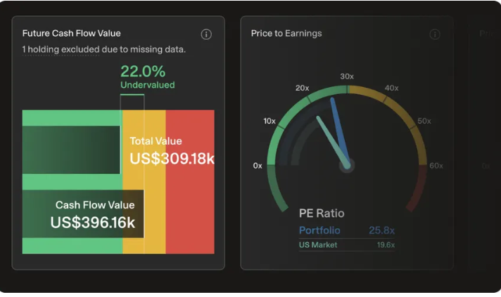

*Batch 3 · screenshot 09 — Two dark valuation widgets: future cash-flow value with 22.0% Undervalued badge, and portfolio versus market P/E speedometer*

**Reference:** batch 3 #09. **Subject/shape:** dark two-card UI, one comparing hypothetical or modelled future cash-flow value against displayed total value with "undervalued" output, the other a dial comparing portfolio P/E against a market P/E reference.

- **Possible strengths:** one question per module; instantly recognizable benchmark-versus-current framing; compact visual summary with a visible exclusion note for incomplete data.
- **Material risks:** future cash-flow value is model-dependent; P/E is not a bounded physical quantity that intrinsically warrants a green-to-red speedometer; a binary "undervalued" tag can overstate precision and imply an investment judgment. Missing holdings and valuation weights can bias aggregate interpretation.
- **PAM lesson:** separate **observed inputs, method, assumptions, missing-data coverage and model output**. If future product capability truly supports this analysis, expose uncertainty rather than asserting objective intrinsic value; never imply an unvalidated feature is live. No trading advice.
- **Status:** \`VALUATION COMMUNICATION REFERENCE\`, **not** endorsement of 22% discount or of any P/E values.

### CVI-20261023-025 — Portfolio optimizer risk-return map

Reference screenshots (1) — private archive

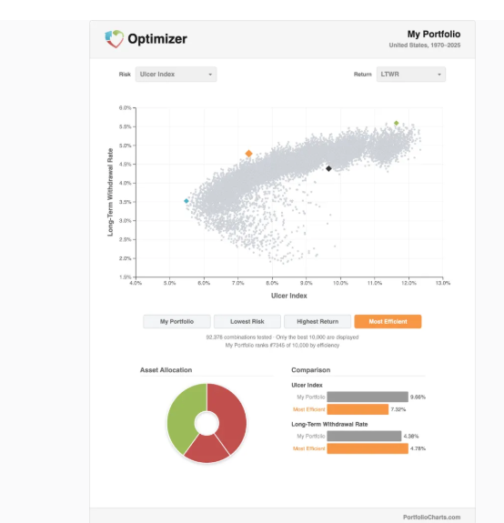

*Batch 3 · screenshot 10 — White Optimizer / My Portfolio risk-return scatter, four highlighted alternatives, donut allocation and comparison bars*

**Reference:** batch 3 #10. **Subject/shape:** light browser interface with grey scenario cloud of portfolios, several colored points, axes labeled Ulcer Index and long-term withdrawal rate, plus allocation donut and optimized-versus-current bars.

- **Possible strengths:** meaningful multi-objective tradeoff shown spatially, visibly highlights selected alternatives and preserves comparisons to a benchmark; chart and secondary allocation summary are logically connected.
- **Material limitations:** outcomes depend on data samples, simulated weights, method, rebalancing assumptions, selected risk/return measures and look-ahead/survivorship issues. A chart of possible outcomes is not a prediction or a personalized recommendation.
- **PAM lesson:** when portfolio intelligence is validated, identify the objective, metric meanings and assumptions; make the selected point and decision tradeoff comprehensible. Do not copy third-party optimization visuals or claim PAM already runs this methodology.
- **Status:** \`SPECIALIZED RESEARCH REFERENCE\`; no validated results or reuse permission.

### CVI-20261023-026 — Relative performance multi-line chart

Reference screenshots (1) — private archive

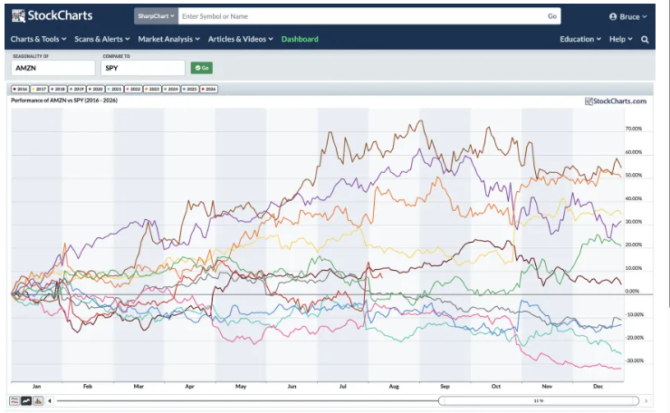

*Batch 3 · screenshot 11 — StockCharts-branded AMZN versus SPY multi-series percentage-performance time chart with many colored lines*

**Reference:** batch 3 #11. **Subject/shape:** StockCharts-branded website with many colored cumulative/relative return lines, common horizontal date scale and percentage levels.

- **Possible strengths:** same-base, same-period chart can reveal relative leadership, turning points and dispersion without a large table; historical context matters more than one-day snapshots.
- **Tradeoffs:** too many similar-color series obscure identities and movements; reference benchmark, dividend treatment, share class, currency, data clock and baseline date are essential before comparing results.
- **PAM lesson:** choose a small, hypothesis-relevant peer set and a clearly stated rebasing/return method. A source's branded plotted pixels are not automatically licensed for reposting.
- **Status:** \`EVIDENCE ENCODING REFERENCE\`; chart returns unverified.

### CVI-20261023-027 — Holdings weighting plus bubble comparison

Reference screenshots (1) — private archive

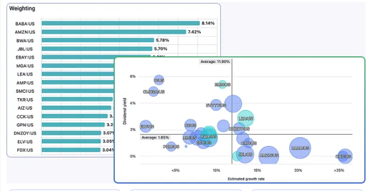

*Batch 3 · screenshot 12 — Portfolio weightings horizontal ranked bars beside overlapped growth-versus-dividend bubble/scatter plot*

**Reference:** batch 3 #12. **Subject/shape:** two overlaid analytical panels: ranked portfolio weights in horizontal teal bars; labelled bubbles placed against estimated growth and dividend-yield axes with average reference lines.

- **Possible strengths:** combines **exposure** (which holdings dominate) with **economic attributes** (growth/yield) and spotlights exceptions; means/reference lines provide context.
- **Risks:** overprinted chart regions, labels within bubbles and variable circle sizes create possible confusion about what size represents; estimated growth is not observed fact, and a portfolio-weight chart cannot be mixed with unweighted peer scatter without explanation.
- **PAM lesson:** separate weight-based concentration from company-factor comparison when the two arguments are different; make bubble size, universe, estimates and period explicit. Favor clear readable panels over overlapping decorative layers.
- **Status:** \`PORTFOLIO VISUAL GRAMMAR\`, not a ready-made feature or template.

### CVI-20261023-028 — Infographic chart catalogue

Reference screenshots (1) — private archive

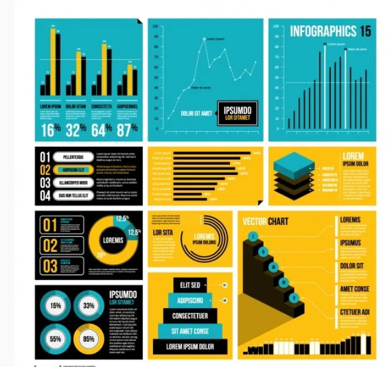

*Batch 3 · screenshot 13 — Turquoise, yellow and black INFOGRAPHICS 15 chart/dashboard mockup tiles*

**Reference:** batch 3 #13. **Subject/shape:** turquoise/yellow/black set of generic numbered infographics, stylized bars, circles, timelines, columns and faux-depth objects.

- **Potential benefit:** a visual vocabulary reminder that the same evidence can be presented with a few different, deliberately chosen encodings.
- **Limits:** decorative and faux-3D charts may distort proportional comparisons; "lots of chart options" says nothing about an account's popularity or a reader's comprehension.
- **PAM lesson:** choose an encoding *after* verifying units, denominator, time period and the intended explanation. Never use a catalogue as a quota or justification to invent a template.
- **Status:** \`CATALOGUE / BACKGROUND ONLY\`.

### CVI-20261023-029 — Operational heatmap matrix

Reference screenshots (1) — private archive

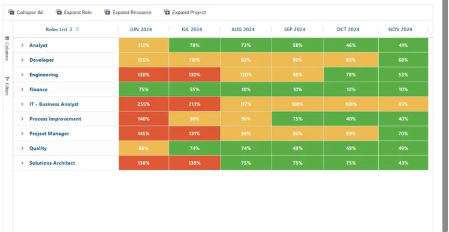

*Batch 3 · screenshot 14 — Role × month resource-utilization percentage heatmap in green, amber and red; expandable rows, month labels*

**Reference:** batch 3 #14. **Subject/shape:** role × month percentage grid, expandable row list, traffic-light cell fills and values directly printed on cells.

- **Possible strengths:** repeated measures over a consistent matrix reveal extremes, emerging pressure and changing patterns faster than a long table; numeric text survives without color.
- **Tradeoffs:** red/amber/green can encode good/bad without specifying what "good" means; percentages over 100% need definition; number of rows and small cells challenge phone readability. Capacity planning is **not** automatically a financial-investing use case.
- **PAM lesson:** a matrix/heatmap is appropriate only for a real multi-entity × multi-period comparison with compatible data and interpretable thresholds. Color needs labels and an accessible legend.
- **Status:** \`CROSS-DOMAIN INFORMATION DESIGN\`; no production action.

### CVI-20261023-030 — Report and slide layout family

Reference screenshots (1) — private archive

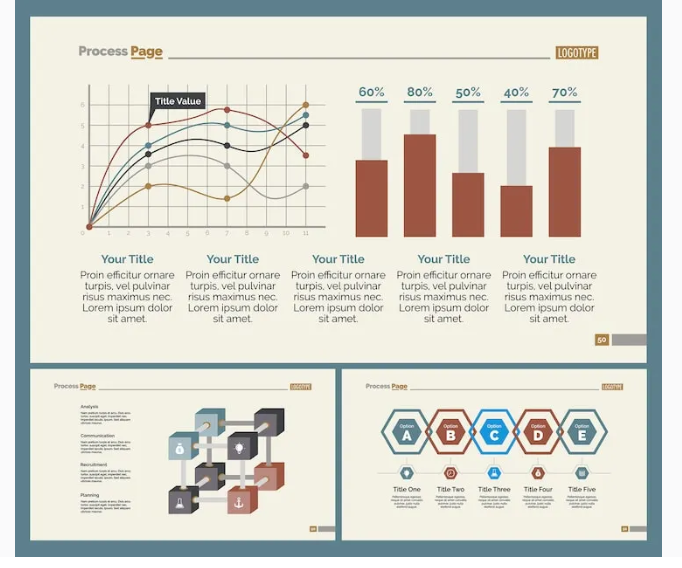

*Batch 3 · screenshot 15 — Cream, muted-teal and brick-red report/slide suite: multi-line chart, bars, a diagram and five-step horizontal path*

**Reference:** batch 3 #15. **Subject/shape:** warm-ivory report/slide pages with muted chart palettes, a primary page of side-by-side line and column charts, and smaller diagram/process panels beneath.

- **Possible strengths:** restrained print/editorial palette, clear main-page hierarchy and separation of visual evidence from prose; multiple pages can expand an argument without cramming it into one social tile.
- **Limitations:** placeholder copy and chart values convey no validated finance insight; slide and report structures usually require different dimensions and interaction than a Blossom 4:5 post.
- **PAM lesson:** borrow the **principle** of a strong primary thesis and deliberate secondary views; preserve current brand identity and adapt to the actual intended medium. Do not substitute a generic slide deck or modify the renderer because a template looks polished.
- **Status:** \`PRESENTATION STRUCTURE REFERENCE\`.

### Cross-case synthesis — batch 3

This batch sharpens a distinction: **dashboard quality, infographic novelty and mobile editorial performance are three different questions**. A sophisticated desktop screen can be useful to its operator while being completely ineffective as a static image in Blossom. Conversely, a one-metric chart can outperform a full dashboard for comprehension without proving greater engagement.

- **Most directly relevant to future PAM research communication:** compact but carefully qualified valuation comparisons (#09), portfolio objective/tradeoff plots (#10), and selected-series performance histories (#11); all require independently validated data and methods before any real post.
- **Useful mainly for layout judgment:** modular consistency (#03/#06), information grouping (#02/#05), heatmaps for true matrix questions (#14), report hierarchy (#15).
- **Signals to avoid overusing:** generic stock-analytics hero photos (#04/#08), decorative chart menus (#13), dense poster walls (#01) and source-unreadable collages (#07).
- **No performance inference:** zero competitor audience measurements or original post identities were established from these uploads.
- **No action requested by these observations:** \`OBSERVE / OPTIONAL REFERENCE\`; no implementation ticket, new dashboard product claim, new template, renderer changes, publication or routine monitoring.

## CEO screenshot intake — 2026-10-23, batch 4 (7 references; 6 analytical cases)

**Source and classification:** Seven screenshots supplied by the CEO in the PAM Marketing & GTM ChatGPT conversation on 2026-10-23. Six show TradingView-branded interactive stock/issuer screens (one broad stock screener, five Tesla detail views) and one shows Zacks Research's Micron research interface. They are **product-interface / research-visualization references**, **not verified original Blossom posts**, not evidence of account growth, and not validated security or analyst data. The screenshot UI shows vendor functionality; its presence here **does not establish equivalent PAM capabilities**.

**Intake custody:** This repository records the **order, observed content and analytical lessons** of all seven screenshots. The matching CEO-uploaded screenshot PNGs are now present in the private asset directory and mapped by the manifest. No original screen permalink, rights to redistribute the UI, verified feed data or independent verification of displayed Tesla/Micron prices, earnings, market capitalizations, options or forecasts has been established. The conversation's image upload is the intake evidence but is not a permanent repository-hosted original. Market screens may contain stale, vendor-specific, estimated or inconsistent readings; **do not reuse the displayed figures as authenticated market facts**. No template is added or modified.

| Batch 4 image | Visible image / interface content (not fact-checked) | Case | Medium / provenance |
|---|---|---|---|
| **01** | TradingView **All stocks** screen: filter chips (market, index, price, market cap, growth, sector, ROE, etc.), view tabs, ranked stock table with ticker, price, change, valuation/earnings and analyst-rating columns | [CVI-20261023-031](#cvi-20261023-031--multi-factor-stock-screener) | Vendor-branded screener screenshot; full result universe/values/rights unverified |
| **02** | TradingView **Tesla Earnings** detail: recent reporting header, reported-versus-estimated EPS by year, surprise table, upcoming shaded forecasts and revenue section | [CVI-20261023-032](#cvi-20261023-032--issuer-financial-facts-and-forecast-boundaries) | Vendor-branded research UI; reported/forecast values not authenticated |
| **03** | TradingView **Tesla Financials Overview**: valuation multiples history, growth/profitability charts, revenue-to-income waterfall, watchlist on the side | [CVI-20261023-032](#cvi-20261023-032--issuer-financial-facts-and-forecast-boundaries) | Vendor-branded multi-panel financial UI; metric basis unverified |
| **04** | TradingView **Tesla Seasonals**: annual traces for different years on a common January–December axis, labels and user-selectable year window | [CVI-20261023-033](#cvi-20261023-033--annual-seasonality-overlay) | Interactive price seasonality interface, no outcome claims verified |
| **05** | TradingView **Tesla Forecast**: historic price path transitioning to an analyst 1-year target range, average/low/high shading, rating gauge and count bars | [CVI-20261023-034](#cvi-20261023-034--analyst-targets-and-consensus-uncertainty) | Vendor-branded external-analyst consensus UI; forecast not fact |
| **06** | TradingView **Tesla option chain**: symmetric calls/puts table around strikes, expiration, bid/ask, implied volatility, delta, volume and open interest | [CVI-20261023-035](#cvi-20261023-035--options-chain-information-density) | Vendor-branded trading-data interface; no live quote/license validation |
| **07** | **Zacks Research Micron (MU)** page: price/consensus/EPS-surprise historical chart, quote overview, earnings/forward estimates and sales/EPS growth sections | [CVI-20261023-036](#cvi-20261023-036--research-portal-evidence-hierarchy) | Vendor-branded desktop research portal; figures and forecast vintages unverified |

**Specific source caveat:** Image #01 visibly includes symbols, names and prices that may not match real-world tradability or each other. For example, the row naming Space Exploration Technologies Corp / \`SPCX\` is **not evidence** that an exchange-traded SpaceX common stock exists. Images #02–#06 may reflect different date windows and metric definitions. This file deliberately does not reconcile or endorse their numerical claims. Platform UI chrome, tabs and side watchlists are not part of a standalone Blossom image design.

### CVI-20261023-031 — Multi-factor stock screener

Reference screenshots (1) — private archive

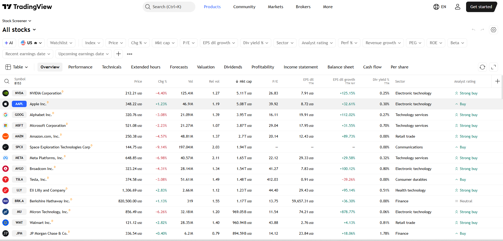

*Batch 4 · screenshot 01 — TradingView All stocks screen: filter chips (market, index, price, market cap, growth, sector, ROE, etc.), view tabs, ranked stock table with ticker, price, change, valuation/earnings and analyst-rating columns*

**Reference:** batch 4 #01. **Medium:** interactive table for exploring a large financial universe.

- **Observed grammar:** a compact filter ribbon above multiple analysis-category tabs, sortable multi-column rows, neutral backgrounds, alignment for numbers and colored signs for gains/losses and ratings. The table is evidently designed for user filtering, sorting and drill-down rather than phone-feed reading.
- **Potential strength (judgment):** gives users an immediately legible *comparison vocabulary* (growth, valuation, sector, volume, rating); consistent columns make relative differences easy to inspect. Small color accents don't replace labels.
- **Tradeoffs:** crowded horizontal density, dependence on interactive filters and non-obvious source-vintage differences; value judgments like "Strong buy" are external consensus labels, not established investment quality. Some displayed security identities should be independently verified.
- **Possible PAM design lesson:** choose only the two or three dimensions needed for one defensible research comparison; identify universe, ranking/sort rule, quote session, units and missing-data coverage; treat screening output as a starting point for analysis, **never an instruction to buy**. Do not reproduce this table or claim PAM has a live global screener.
- **Action/outcome:** \`UI REFERENCE ONLY\`; neither a new template nor a live product requirement.

### CVI-20261023-032 — Issuer financial facts and forecast boundaries

Reference screenshots (2) — private archive

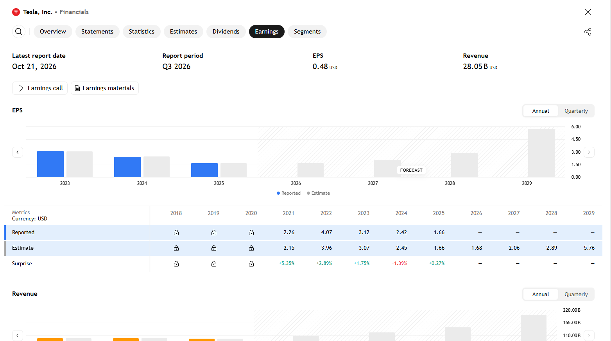

*Batch 4 · screenshot 02 — TradingView Tesla Earnings detail: recent reporting header, reported-versus-estimated EPS by year, surprise table, upcoming shaded forecasts and revenue section*

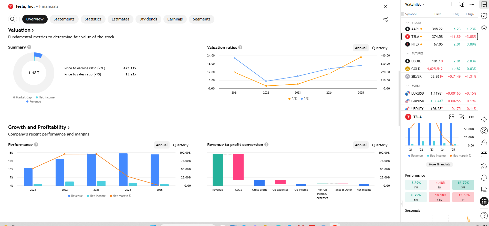

*Batch 4 · screenshot 03 — TradingView Tesla Financials Overview: valuation multiples history, growth/profitability charts, revenue-to-income waterfall, watchlist on the side*

**References:** batch 4 #02 (earnings tab) and #03 (financials overview). **Medium:** deep issuer research UI, intentionally grouped into one case because both serve the same user journey.

- **Observed grammar (#02):** metric-specific EPS and revenue charts, year selector, reported-versus-estimate legends, shaded future periods, tabular historical surprises and concise reporting-period context. The shading communicates a **known-versus-not-yet-reported** boundary.
- **Observed grammar (#03):** separate blocks for valuation ratios, operating growth/profitability and a revenue-to-income waterfall. Distinct chart types encode different financial questions, rather than filling identical cards. A side watchlist and navigation chrome add interaction context but are not part of a publication graphic.
- **Potential strengths:** clearly segmented research tasks, persistent metric names and units, explicit actual/estimate distinction, meaningful decomposition from top-line revenue toward reported profit.
- **Tradeoffs:** multiple chart axes and ratios increase explanation burden; EPS, P/E, P/S, valuation gauges, operating margins and financial statement data may have incompatible bases (TTM vs fiscal year, GAAP vs adjusted, shares/currency/vintage). Donut-like summaries may conflate quantities measured in different units if misunderstood.
- **Possible PAM lesson:** for E1 or future research **only when technically supported**, make reported facts, consensus estimates and interpretations visibly distinct; organize \`signal → source-bound evidence → interpretation/uncertainty\`, and use the chart type that fits the financial relationship. Do not clone the interface, infer that PAM renders these chart families or accept external vendor figures without verification.
- **Action/outcome:** \`RESEARCH-STRUCTURE REFERENCE\`, not a product maturity assertion or renderer change.

### CVI-20261023-033 — Annual seasonality overlay

Reference screenshots (1) — private archive

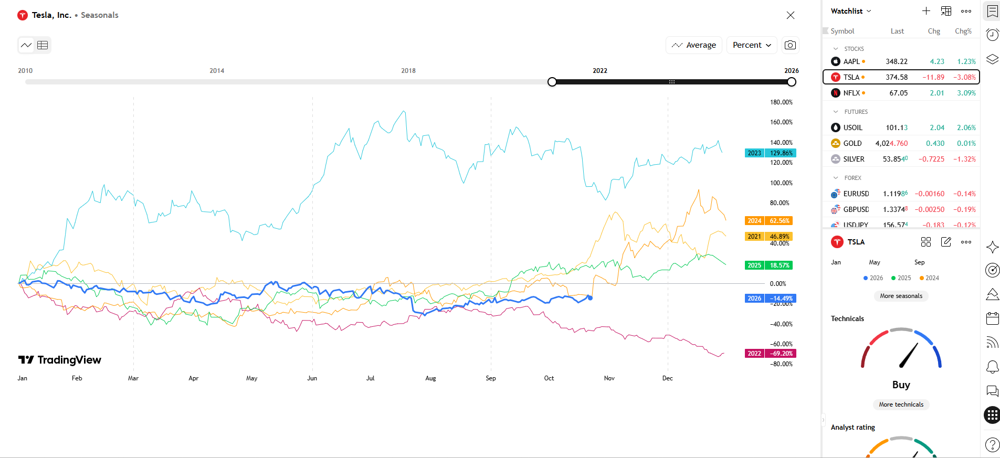

*Batch 4 · screenshot 04 — TradingView Tesla Seasonals: annual traces for different years on a common January–December axis, labels and user-selectable year window*

**Reference:** batch 4 #04. **Medium:** interactive yearly performance comparison.

- **Observed grammar:** several calendar-year cumulative traces rebased onto a shared January–December x-axis, separate colored end labels for years, a year-range selector and a conspicuous current/incomplete-year trace.
- **Potential strengths:** visually reveals recurrent windows, unusual years and differences in path dependency; normalized calendar positioning can be easier to compare than five consecutive raw-price histories.
- **Material caveats:** percentage rebasing, total-vs-price return, currency, trading-day alignment, partial current years, splits/dividends and selection of historical windows materially affect the story. Similar shapes are **not evidence of reliable predictive seasonality**.
- **Possible PAM lesson:** seasonality comparisons need exact rebasing, sample length and uncertainty, plus an explanation of why the period is economically relevant. At mobile size, restrict or highlight only useful comparator years.
- **Action/outcome:** \`OPTIONAL GRAPHICAL REFERENCE\`; not evidence that PAM can compute or forecast seasonality.

### CVI-20261023-034 — Analyst targets and consensus uncertainty

Reference screenshots (1) — private archive

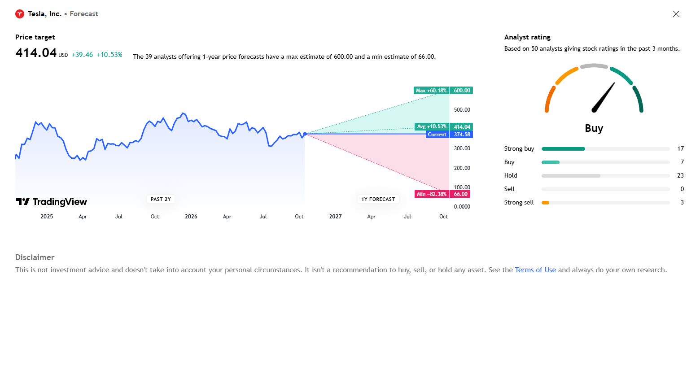

*Batch 4 · screenshot 05 — TradingView Tesla Forecast: historic price path transitioning to an analyst 1-year target range, average/low/high shading, rating gauge and count bars*

**Reference:** batch 4 #05. **Medium:** vendor analyst-expectation display.

- **Observed grammar:** a historical observed price line enters a fan-shaped future area colored for analyst minimum/average/maximum targets; a separate dial and count bars summarize rating distribution. The screenshot visibly distinguishes historical prices from a forecast period.
- **Potential strengths:** shows **dispersion** as well as the headline average, keeps an observed base level, and makes the analyst-count and ratings context inspectable rather than hiding disagreement behind one target.
- **Risks:** min/average/max endpoints are **analyst opinions**, not outcome probabilities or a statistical confidence interval; straight fan-like polygon edges can misleadingly suggest paths through time. A dial saying "Buy" can imply prescriptive advice and should not be imported wholesale into a research account. Target definition, timestamps, universe selection and stale estimates matter.
- **Possible PAM lesson:** separate observed price, outside consensus and PAM's own conditional hypotheses; foreground **assumption sensitivity and forecast disagreement** rather than implying target-price inevitability or an investment recommendation.
- **Action/outcome:** \`UNCERTAINTY-PRESENTATION REFERENCE\`; no endorsement of any rating or target.

### CVI-20261023-035 — Options-chain information density

Reference screenshots (1) — private archive

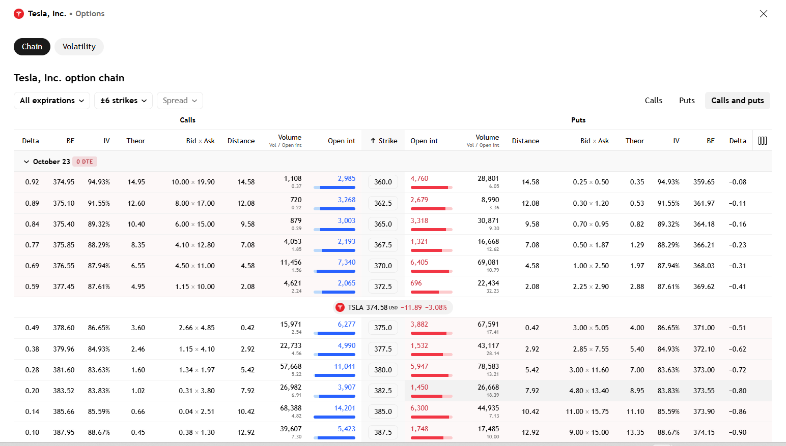

*Batch 4 · screenshot 06 — TradingView Tesla option chain: symmetric calls/puts table around strikes, expiration, bid/ask, implied volatility, delta, volume and open interest*

**Reference:** batch 4 #06. **Medium:** specialist derivative market-data table.

- **Observed grammar:** mirror-image calls and puts columns anchored by a central strike, expiry-specific grouping, colored horizontal bars for open interest and dozens of numerical fields (delta, bid/ask, theoretical value, implied volatility, volume, breakeven).
- **Potential strengths:** symmetry makes the call/put comparison natural; strikes remain central, while in-cell bars expose relative activity; expiration filter keeps each contract family coherent.
- **Tradeoffs:** a dense trading interface is not a public-facing mobile infographic. Quotes, exchange, moneyness, expiry/time zone, delayed/live status, Greeks computation, stale/wide spreads and contract specification would need careful provenance. Implied volatility is not a realized-price forecast.
- **Possible PAM lesson:** use this as **information hierarchy** inspiration only if a genuinely relevant, source-licensed options fact is the editorial story. Condense one interpretable asymmetry into a sourced chart; avoid reproducing a trading chain, prescribing option positions or claiming options-data capabilities.
- **Action/outcome:** \`SPECIALIST UI REFERENCE\`; no template or data integration approved.

### CVI-20261023-036 — Research portal evidence hierarchy

Reference screenshots (1) — private archive

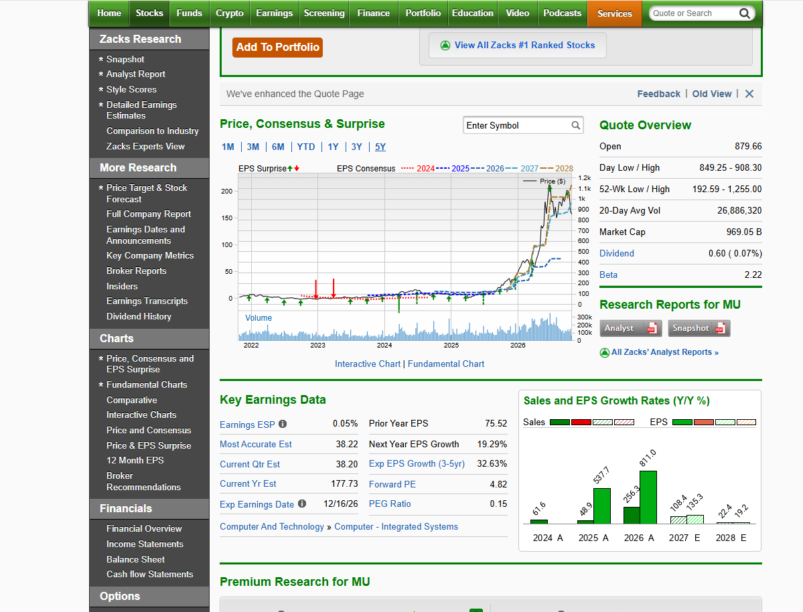

*Batch 4 · screenshot 07 — Zacks Research Micron (MU) page: price/consensus/EPS-surprise historical chart, quote overview, earnings/forward estimates and sales/EPS growth sections*

**Reference:** batch 4 #07 (Zacks Research / Micron MU). **Medium:** large desktop equity research portal.

- **Observed grammar:** persistent categorical sidebar, central chart marrying share price, earnings consensus and EPS surprises across years, quote summary to the right and lower fundamental estimate/growth tables. A heavily populated page serves multiple research questions through tabbed navigation and detail links.
- **Potential strengths:** multiple evidence types can be cross-referenced while exploring an issuer; historical and forward expectations are presented in one workspace; summary plus drilldown gives experienced readers control.
- **Tradeoffs:** overlays may share incompatible left/right axes, some value changes can reflect estimator revisions rather than reported fundamentals, forecast horizons differ and small legends can cause confusion. Desktop density and promotional calls to action would overwhelm a static Blossom post.
- **Possible PAM lesson:** retain a crisp division between **issuer history, estimates, surprise/revision context and market response**, with source-vintage disclosures. An editorial graphic should answer a narrower question than this entire portal. No claim that Zacks' proprietary data is available to PAM or that its visuals may be copied.
- **Action/outcome:** \`RESEARCH-PORTAL COMPARISON\`; publication impact **UNKNOWN**.

### Cross-case synthesis — batch 4

This batch illustrates that financial research platforms can offer broad exploration **because they are interactive**; a static Blossom image must be more selective. The most transferable conventions are **consistent financial units, easy comparisons, explicit reported-vs-estimated boundaries, shared time axes and meaningful variance/dispersion labels**.

- **Useful for future conversation with designers:** the screener's metric-selection discipline, issuer financials' evidence groups, seasonality's same-calendar rebasing and forecast-range's depiction of disagreement.
- **Especially easy to misuse:** extrapolating current prices into analyst-target fans, visually predicting cycles from a few seasonality lines, treating P/E dials as intrinsic-value truth or adding derivative-chain information without explaining its risk.
- **Do not overread the reference:** neither TradingView nor Zacks screenshots are direct Blossom engagement benchmarks; these are product UX/source-presentation references. Displayed figures, licenses and account-level conversions were not verified.
- **Current action:** \`NONE — OBSERVE\`. Do not implement new PAM research capabilities, alter the existing E1/M4/T-family templates, create a copying brief or imply an independent factual audit.

## CEO screenshot intake — 2026-10-23, batch 5 (3 references; 3 analytical cases)

**Intake and custody:** Three CEO-supplied screenshots, in displayed order, archived as original unmodified PNG bytes in the private `competitive_visual_assets/` directory. Each file is indexed in `ASSET_MANIFEST.json` with a SHA-256 checksum, byte count, dimensions, descriptive title and case reference. No original creator URL, redistribution license or performance data has been independently verified. These are **dashboard, infographic and analytics-UI design references**, not verified Blossom competitors, market evidence or PAM feature demonstrations.

| Batch 5 screenshot | Observed reference | Analytical case | Medium / provenance |
|---|---|---|---|
| **01** | Three-column modular infographic featuring numbered callouts, compact charts, progress/battery bars, doughnuts and contrasting red/teal/navy blocks | [CVI-20261023-037](#cvi-20261023-037--modular-infographic-grammar) | CEO-supplied template-like screenshot; source and rights unverified |
| **02** | “4. YTD Dashboard” finance operations interface: sales, receivables, cash flow, monthly comparison, debt aging, concentration gauges | [CVI-20261023-038](#cvi-20261023-038--finance-kpi-and-receivables-hierarchy) | CEO-supplied operational dashboard screenshot; underlying numbers unverified |
| **03** | Mosaic of dashboard screenshots and UI examples from multiple domains, with charts, tables, cards, heatmaps and visualizations | [CVI-20261023-039](#cvi-20261023-039--multi-dashboard-landscape-board) | CEO-supplied collage/screen capture; individual creators and rights unknown |

### CVI-20261023-037 — Modular infographic grammar

Reference screenshot (1) — private archive

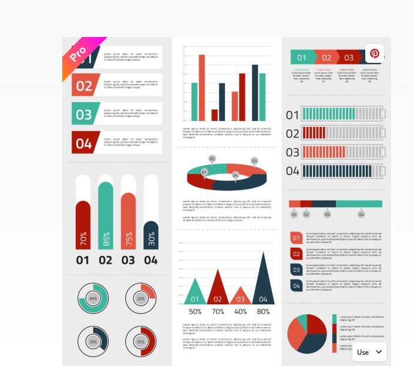

*Batch 5 · screenshot 01 — numbered three-column infographic with recurring coral, teal and navy motifs*

**Reference:** batch 5 #01. **Medium:** stylized infographic/template, not a sourced market update.

- **Observed grammar:** three narrow vertical columns combine numbered colored blocks, vertical percentage capsules, small concentric rings, a short bar chart, flattened ring, segmented bars and triangle-shaped visual indicators. A restrained coral/red, teal and deep-navy palette ties deliberately varied widgets together.
- **Potential strengths (editorial judgment):** repeatable modules, strong color grouping and consistent spacing create a recognizable visual language across heterogeneous charts. Numbered callouts make dense information appear approachable.
- **Limitations:** the image is mostly placeholder copy; its percentages and chart values are illustrative, not authenticated economic observations. The many widgets compete with one another, and substantial copy is tiny at feed size; circles and triangles can be decorative rather than analytically necessary.
- **Possible PAM lesson (IDEA):** reuse a **disciplined component vocabulary** where charts represent specific questions, but keep one dominant thesis per static Blossom graphic. Repeated colors should communicate stable semantics, not simply look coordinated.
- **Action/outcome:** `MODULARITY REFERENCE — OBSERVE`. No template edit or copying instruction; engagement unknown.

### CVI-20261023-038 — Finance KPI and receivables hierarchy

Reference screenshot (1) — private archive

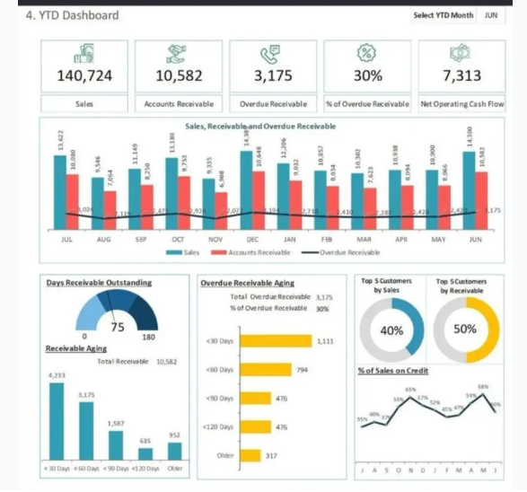

*Batch 5 · screenshot 02 — YTD finance dashboard with KPI strip, monthly series, receivable-age diagnostics and customer-concentration widgets*

**Reference:** batch 5 #02. **Medium:** business finance/receivables dashboard, not investor advice or a verified earnings figure.

- **Observed grammar:** a five-tile headline KPI strip for sales, receivables, overdue receivables, overdue percentage and operating cash flow; a twelve-month grouped-bar overview; smaller supporting panels for days receivable outstanding, aging distributions, top-customer concentration and credit-sales trend.
- **Potential strengths:** the broad-to-specific reading order makes the headline status scannable before readers inspect causes and cohorts; aging buckets and concentration panels expose distinct operational risks behind summary totals.
- **Limitations:** many legends and monthly labels are tiny. Different metrics (cash flow, sales, overdue balances and credit percentages) need unit/time definitions; the screenshot's displayed values are **UNVERIFIED** and cannot be republished as sourced company financials.
- **Possible PAM lesson (IDEA):** for future evidence-backed finance research, lead with a few headline metrics, then show the **one diagnostic breakdown** that explains an interesting economic change. Reserve a full interactive dashboard density for a genuine software interface, not one social image.
- **Action/outcome:** `INFORMATION-HIERARCHY REFERENCE — OBSERVE`; no PAM feature, source coverage or post format approved.

### CVI-20261023-039 — Multi-dashboard landscape board

Reference screenshot (1) — private archive

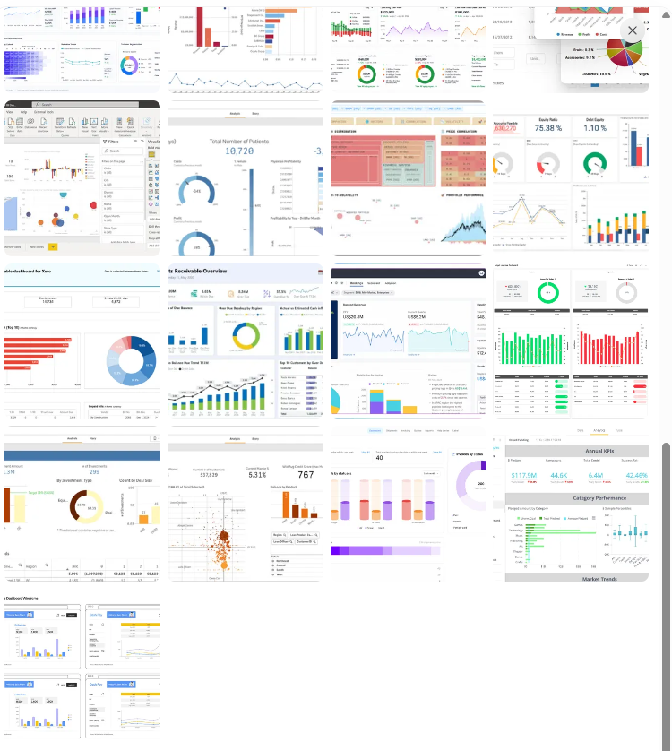

*Batch 5 · screenshot 03 — heterogeneous visual survey of dashboard and BI interface patterns*

**Reference:** batch 5 #03. **Medium:** composite screen capture showing multiple unrelated UI/dashboard examples; it is not a single creator-owned dashboard.

- **Observed grammar:** many thumbnails vary in scale and visual design. Recognizable patterns include metric ribbons, paired trend lines, categorized bar charts, pie/doughnut widgets, gauges, matrix-like displays, treemaps, bubble plots, scatterplots and analytic tables. The bottom part includes smaller reporting/report-builder views.
- **Potential strengths:** broad visual comparison makes recurring dashboard conventions visible in one place. It is useful for discussing hierarchy, clutter, color consistency and tradeoffs among BI/reporting design families.
- **Limitations:** original authors, context, licenses and individual screenshots' purposes are unknown. Subviews are too small to read or verify, and the collage gives **no empirical engagement, research quality or commercial performance evidence**.
- **Possible PAM lesson (IDEA):** treat this as a **survey board**, not a design target; contrast presentation patterns only after deciding which investing question requires an answer. Avoid turning a static macro infographic into a decorative collection of BI widgets.
- **Action/outcome:** `LANDSCAPE REFERENCE — OBSERVE`; no new template, renderer modification, or performance claim.

### Cross-case synthesis — batch 5

Together, these examples distinguish (i) consistent infographic building blocks, (ii) structured finance-diagnostic hierarchy and (iii) a broad visual pattern catalogue. **Transferable lessons** are consistent color semantics, defensible metric grouping and top-line-to-detail organization. **Non-transferable assumptions** are that more widgets improve an investor's understanding, that a nice dashboard implies trusted data, or that unrelated BI screens establish what engages Blossom readers. Keep the original images for **private comparative analysis only**; do not copy source layouts or publish the screenshots.

- **Current action:** `NONE — OBSERVE`. This intake does not authorize a PAM template change, product claim, marketing experiment or publication.

## CEO screenshot intake — batch 6 (10 original references; 10 cases)

**Received / archived:** 2026-10-24. **Case numbering:** `CVI-20261023-040` through `CVI-20261023-049` preserves the already proposed case IDs from the preceding CEO intake discussion. **Custody:** exact unaltered original PNG uploads in the private repository; each image below is visibly embedded in Markdown **and** linked to the full original file. Authorized agents with repository access can inspect the pixels by opening the PNG or rendered library page. The manifest independently records filename, case, dimensions, byte size and SHA-256.

**Evidence classification:** descriptive design observations only; depicted sector returns, account balances, yields, financial statements, event-study results, earnings surprises, creators' licensing and social engagement are **UNVERIFIED**. No screenshot authorizes publication, copying source designs or implying PAM currently has the pictured functionality.

| Image | Case | Visual family | Original file |
|---|---|---|---|
| 01 | CVI-20261023-040 | Sector leadership and risk-regime comparison | [PNG](competitive_visual_assets/cvi_batch06_01.png) |
| 02 | CVI-20261023-041 | Premium dark-mode passive-income portfolio dashboard | [PNG](competitive_visual_assets/cvi_batch06_02.png) |
| 03 | CVI-20261023-042 | Netflix quarterly operating income versus margin | [PNG](competitive_visual_assets/cvi_batch06_03.png) |
| 04 | CVI-20261023-043 | Illustrated earnings beat with oversized headline | [PNG](competitive_visual_assets/cvi_batch06_04.png) |
| 05 | CVI-20261023-044 | ETF distribution update with paired dark line charts | [PNG](competitive_visual_assets/cvi_batch06_05.png) |
| 06 | CVI-20261023-045 | Oil-price inflation narrative illustration | [PNG](competitive_visual_assets/cvi_batch06_06.png) |
| 07 | CVI-20261023-046 | Canadian all-equity ETF comparative scorecard | [PNG](competitive_visual_assets/cvi_batch06_07.png) |
| 08 | CVI-20261023-047 | Five-company quarterly AI spending editorial scorecard | [PNG](competitive_visual_assets/cvi_batch06_08.png) |
| 09 | CVI-20261023-048 | Canada versus United States ten-year yield chart | [PNG](competitive_visual_assets/cvi_batch06_09.png) |
| 10 | CVI-20261023-049 | S&P 500 extreme-down-day forward-return event study | [PNG](competitive_visual_assets/cvi_batch06_10.png) |

### CVI-20261023-040 — Sector leadership and risk-regime comparison

*[Open the original 890 × 729 PNG](competitive_visual_assets/cvi_batch06_01.png) · Batch 6 screenshot 01 · Private design-reference asset*

- **Observed composition:** A Blossom feed screenshot combines a short risk-off sector commentary with a zero-centered horizontal ranking of weekly sector ETF moves. Positive sectors are blue, negative sectors red; the text highlights staples, utilities, financials and communication services.
- **Strength / tradeoff (editorial judgment):** A single legible ranked comparison supports the written thesis and enables fast leader/laggard scanning. Blue/red direction cues and concise category names create clear reading order.
- **Potential PAM application (IDEA, not an approved template):** For M2 or one-off sector research, show comparable sectors and one carefully defined time window; use the ranking to advance a specific leadership/breadth interpretation rather than list returns alone.
- **Limitations and source status:** All ETF returns, regime classification and week-over-week gaps are unverified screenshot claims. The visible image is cropped at the bottom; the post's complete original source and social performance are unknown.
- **Classification:** `SECTOR-RANKING / OBSERVE` — no engagement inference or design authorization.

### CVI-20261023-041 — Premium dark-mode passive-income portfolio dashboard

*[Open the original 839 × 743 PNG](competitive_visual_assets/cvi_batch06_02.png) · Batch 6 screenshot 02 · Private design-reference asset*

- **Observed composition:** A purple/black portfolio summary prominently presents monthly and annualized passive income, market value, annual receipts, combined return, and six holding-level progress bars with per-month income and return figures.
- **Strength / tradeoff (editorial judgment):** Strong hierarchy and grouping: aggregate monthly cash generation dominates, while granular contributors and yield labels remain directly available. Typographic and color hierarchy helps scanning.
- **Potential PAM application (IDEA, not an approved template):** Use as an information-architecture and interface reference for a future portfolio-income dashboard, not as evidence that PAM already provides these features. Highlight concentration and methodology if adapting.
- **Limitations and source status:** The figures, unusually large indicated yields and returns are not independently verified and may reflect unusual securities/distributions. It is a third-party portfolio screenshot, not a PAM capability or redistribution asset.
- **Classification:** `PORTFOLIO-INCOME UI / OBSERVE` — no engagement inference or design authorization.

### CVI-20261023-042 — Netflix quarterly operating income versus margin

*[Open the original 914 × 737 PNG](competitive_visual_assets/cvi_batch06_03.png) · Batch 6 screenshot 03 · Private design-reference asset*

- **Observed composition:** A white-background 2021–2026 quarterly chart pairs red operating-income bars against a black operating-margin percentage line on separate vertical scales. Caption copy draws attention to operating-margin expansion.
- **Strength / tradeoff (editorial judgment):** Pairing absolute earnings with an efficiency ratio makes operating leverage interpretable at a glance; a short caption anchors the analytical question.
- **Potential PAM application (IDEA, not an approved template):** A company-research image can tell a stronger story using two economically linked measures than by crowding in disconnected KPIs. Clearly label both axes, basis and reporting periods.
- **Limitations and source status:** The screenshot's quarter labels, operating-income numbers and margins are unverified. Mixed units and dual axes demand explicit validation and care; source logo/branding must not be copied.
- **Classification:** `EARNINGS-COMBO-CHART / OBSERVE` — no engagement inference or design authorization.

### CVI-20261023-043 — Illustrated earnings beat with oversized headline

*[Open the original 1223 × 778 PNG](competitive_visual_assets/cvi_batch06_04.png) · Batch 6 screenshot 04 · Private design-reference asset*

- **Observed composition:** A prominent neon cyan/green animated illustration of currency and a money bag is covered with a bold rectangular earnings-beat callout. The surrounding feed chrome suggests motion/video content rather than a static analytical data chart.
- **Strength / tradeoff (editorial judgment):** Large shorthand headline has immediate feed visibility and demonstrates a different, emotion-led attention mechanism.
- **Potential PAM application (IDEA, not an approved template):** Contrast/reference for selective expressive imagery: an occasional bold hook may help, but PAM should reserve attention for the verified earnings surprise, consensus basis and economic significance.
- **Limitations and source status:** No earnings source, consensus methodology or performance impact is independently verified. High-saturation retail illustration clashes with PAM's default restrained research-note identity; do not copy graphic elements.
- **Classification:** `RETAIL-ILLUSTRATION / CAUTION` — no engagement inference or design authorization.

### CVI-20261023-044 — ETF distribution update with paired dark line charts

*[Open the original 936 × 743 PNG](competitive_visual_assets/cvi_batch06_05.png) · Batch 6 screenshot 05 · Private design-reference asset*

- **Observed composition:** The post presents a distribution-news hook with a pair of dark charts plotting two contrasting investment paths, alongside context about ETF distributions and fund symbols.
- **Strength / tradeoff (editorial judgment):** A narrow investor question and two directly comparable plots are more memorable than a long unstructured ticker list. Dark charts can integrate into a finance-themed feed.
- **Potential PAM application (IDEA, not an approved template):** For distribution stories, make payout basis and reinvestment assumptions explicit and distinguish price, total return, cash yield and income growth. Use paired charts only when their units and baselines align.
- **Limitations and source status:** The underlying instruments, return calculations, distributions and screenshot commentary are not verified. Small axes/labels are hard to read at feed scale; the right to reproduce chart design or original branding is unknown.
- **Classification:** `DISTRIBUTION-COMPARISON / OBSERVE` — no engagement inference or design authorization.

### CVI-20261023-045 — Oil-price inflation narrative illustration

*[Open the original 1021 × 777 PNG](competitive_visual_assets/cvi_batch06_06.png) · Batch 6 screenshot 06 · Private design-reference asset*

- **Observed composition:** A short macro post relates energy, inflation and the Federal Reserve, supported by a cinematic oilfield/pumpjack illustration and a downward market-graph motif rather than sourced plotted price history.
- **Strength / tradeoff (editorial judgment):** A recognizable commodity symbol makes a broad issue instantly intelligible; not every editorial visual must be a dense numeric chart.
- **Potential PAM application (IDEA, not an approved template):** Use narrative art sparingly for conceptual macro explainers when a verified numerical chart adds little. Distinguish mood symbolism from actual market evidence.
- **Limitations and source status:** The illustrated line must not be confused with a genuine historical series. The post's real-time macro claims and observable engagement are not independently authenticated; a dark dramatic effect is not a substitute for analysis.
- **Classification:** `MACRO-ILLUSTRATION / LIMITED` — no engagement inference or design authorization.

### CVI-20261023-046 — Canadian all-equity ETF comparative scorecard

*[Open the original 1004 × 731 PNG](competitive_visual_assets/cvi_batch06_07.png) · Batch 6 screenshot 07 · Private design-reference asset*

- **Observed composition:** A weekly ETF-comparison post shows five Canadian all-equity portfolios. Its two-panel embedded graphic combines cumulative-return lines with horizon-by-horizon grouped bars and a small tabular legend.
- **Strength / tradeoff (editorial judgment):** Multiple views serve a coherent comparison question: relative performance over time and over specific periods. The dense tabular supplement offers precision beyond the chart.
- **Potential PAM application (IDEA, not an approved template):** Build a comparable ETF scorecard with normalized starting levels, consistent observation dates, clearly defined total/price return and sensible labeling; reserve tabular details for readable companion material.
- **Limitations and source status:** Displayed returns, dates and comparative rankings are unverified. At mobile width several table/legend labels shrink below useful size; screenshot has no verified historical fund-series provenance.
- **Classification:** `ETF-PEER-SCORECARD / OBSERVE` — no engagement inference or design authorization.

### CVI-20261023-047 — Five-company quarterly AI spending editorial scorecard

*[Open the original 808 × 705 PNG](competitive_visual_assets/cvi_batch06_08.png) · Batch 6 screenshot 08 · Private design-reference asset*

- **Observed composition:** A highly designed navy/gold announcement uses a large title, five illustrated company columns, a checklist of proposed tracked metrics (CapEx, growth, AI performance, free cash flow and management guidance), plus thematic editorial questions.
- **Strength / tradeoff (editorial judgment):** Thematic packaging communicates a recurring research agenda and cross-company scope before the first issue; modular columns and lower framework establish expectations.
- **Potential PAM application (IDEA, not an approved template):** For PAM research series, adapt the thematic scorecard approach to a genuinely comparable accounting/economic question and source cadence. Keep measured data separate from illustrative company positioning.
- **Limitations and source status:** No actual quarterly company series or accounting harmonization is shown here, and SpaceX is not an SEC-reporting public-company peer to the other four. Third-party logos and photos have separate rights; the busy text is small for mobile.
- **Classification:** `THEMATIC-RESEARCH-SERIES / OBSERVE` — no engagement inference or design authorization.

### CVI-20261023-048 — Canada versus United States ten-year yield chart

*[Open the original 910 × 565 PNG](competitive_visual_assets/cvi_batch06_09.png) · Batch 6 screenshot 09 · Private design-reference asset*

- **Observed composition:** A restrained white panel shows two labeled 10-year government-bond yield lines from 2021 through 2026, final-value labels, a small legend, sources printed near the bottom and ample horizontal scale.
- **Strength / tradeoff (editorial judgment):** Minimal ornamentation, direct end labels and just two series communicate a relative-yield divergence clearly. White space keeps the macro point easy to read.
- **Potential PAM application (IDEA, not an approved template):** Use two-source comparative yield charts when the story is a divergence; maintain matching maturity, frequency, as-of dates and source conventions, with short labels and one precise analytic takeaway.
- **Limitations and source status:** The pictured yield levels, dates and implied causes are unverified screenshot content. Direct data retrieval and national basis/taxonomy checks remain necessary for any actual PAM post.
- **Classification:** `TWO-SERIES-MACRO-CHART / HIGH-VALUE` — no engagement inference or design authorization.

### CVI-20261023-049 — S&P 500 extreme-down-day forward-return event study

*[Open the original 888 × 730 PNG](competitive_visual_assets/cvi_batch06_10.png) · Batch 6 screenshot 10 · Private design-reference asset*

- **Observed composition:** The original image pairs a multicolor post-selloff horizon-return bar chart with a date-indexed table of the market's worst one-day declines and subsequent forward returns across several horizons.
- **Strength / tradeoff (editorial judgment):** A useful event-study template for separating immediate drawdowns from longer horizons; a chart communicates shape while the adjacent table provides inspectable detail.
- **Potential PAM application (IDEA, not an approved template):** For historical-market context, make event inclusion, survivorship/overlap, return type, horizon start and missing outcomes explicit. A smaller set of carefully sourced cases may beat a dense all-in-one panel at Blossom size.
- **Limitations and source status:** Displayed data and averages are not independently recalculated. Overlapping event windows and hindsight selection can mislead, and past outcomes do not establish investment advice or predictions.
- **Classification:** `HISTORICAL-EVENT-STUDY / HIGH-VALUE` — no engagement inference or design authorization.

### Cross-case synthesis — batch 6

These ten images compare five editorial functions: (1) clear relative-performance/rate charts, (2) structured company earnings and historical event studies, (3) peer-fund and multi-issuer comparison boards, (4) portfolio-interface information hierarchy, and (5) attention-first illustration. Their common reusable principles are **a specific investor question, accountable measure definitions, purposeful chart selection and mobile-first labels**. Their differences caution against assuming that decorative density, flashy illustrations, or an impressive dashboard imply either research quality or user engagement.

For PAM Prompt 2, select the topic and evidence first, then selectively consult only relevant cases and produce an original subject-appropriate PAM composition. Keep the approved brand identity, accurate data/geometry, independent exact-post review, and CEO publication approval. Competitor/reference imagery remains private; do not redistribute or imitate distinctive third-party art.

- **Archive action:** `REGISTERED — OBSERVE ONLY`. No PAM production template, product capability, content claim, social post or publishing permission is changed by this intake.

## How to consume this without restricting creative work

1. **Creating a new image:** first identify a useful story and evidence, then optionally scan relevant CVI cases to understand common market presentation. Use the ideas critically; do not inherit the example's modules or style.
2. **Developing an existing template:** reference a case when a specific design tradeoff is under discussion (e.g. density versus mobile legibility), then verify against PAM's actual output and reader needs. Do not propose a change merely because a competitor uses a feature.
3. **Auditing a post (Prompt 3):** audit factual/visual *materiality* against its actual evidence and PAM's approved rules. Competitive taste and resemblance alone **cannot** cause HOLD or REJECT.
4. **Learning from results (Prompt 5):** compare only PAM's observed, age/context-compatible performance; any competitor outcome requires independent verifiable evidence. Do not substitute outside impressions for account analytics.

**Update discipline:** append a qualified case only when it adds a distinct lesson; prune/revise stale judgments when later evidence warrants it, preserving the source and date. No blanket daily competitor scan, follower surveillance or scoring quota.
