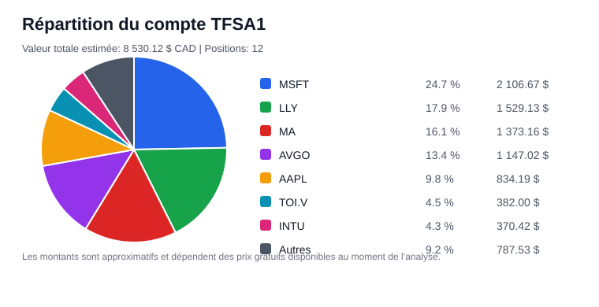
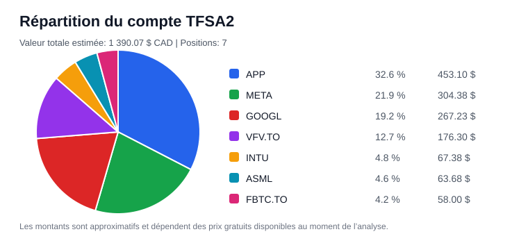

# Rapport trimestriel d’investissement

- Date: 2026-06-18
- Mode utilisé: high-cagr
- Version des règles: 2026-05-12-high-cagr-stability-v3
- Capital analysé: 270.00 $
- Valeur totale du portefeuille: 9 920.19 $
- Moyenne pondérée des scores hors VFV: 7.95
- Légende ticker: `*` = données très insuffisantes, absence de prix, ou compagnie à vérifier. Un alias simple est affiché entre parenthèses.

> Ceci n’est pas un conseil financier. Ce rapport applique seulement les règles mécaniques du guide fourni. Les données gratuites peuvent être incomplètes, retardées ou erronées. Toute décision finale doit être validée manuellement.

## 1. Résumé exécutif

- Allocation recommandée de la cotisation: VFV.TO 54.00 $, AAPL 81.00 $, MSFT 54.00 $, ANET 81.00 $
- Changement principal d’allocation: APP: REMOVED_OR_REDIRECTED (Allocation réduite: capital_allocation_score baisse de -6.7; score fondamental baisse de -1.0; statut WATCH: sizing volontairement limité; stabilité mensuelle: RESET_IF_NOT_ADDABLE.)
- Robustesse de l’allocation: HIGHLY_SENSITIVE (64.4/100) - L’allocation est sensible aux hypothèses prudentes et le meilleur choix change; valider les données prioritaires avant d’augmenter fortement la cotisation.
- Qualité de décision: LOW (48.0/100) - Recommandation mécanique prudente: AAPL, MSFT, ANET; VFV total=20%, redirection=10%.
- Meilleur achat actuel: AAPL
- Meilleure opportunité actuelle: AAPL
- Allocation VFV: 10 % obligatoire avant redirections.
- ETF défensifs: Désactivé pour ce mode.
- Régime de marché: BUBBLE_RISK (70.2/100) - Un thème de croissance/tech/semi semble très dominant; le modèle limite modérément la surexposition au thème chaud.
- Euphorie sectorielle: ACTIVE (96.0/100) - Secteurs dominants: semiconductors (96.0/100), technology (93.7/100)
- Positions exclues de cette moyenne, mais toujours considérées pour les cotisations: ANET, CSU.TO, SBGSY, ASML, LRCX, WSP.TO, NANO.TO, SIEGY, TMC, TSLA
- Signaux de vente: META=WATCH, NANO.TO (NANO)*=WATCH, SIEGY=WATCH, TMC*=WATCH
- Alertes de surveillance non liées à une vente: MSFT=WATCH, WSP.TO (WSP)=MANUAL_REVIEW, TSLA=MANUAL_REVIEW, TOI.V (TOI)*=MANUAL_REVIEW, TMC*=MANUAL_REVIEW, SIEGY=MANUAL_REVIEW, SBGSY (SCHN)=MANUAL_REVIEW, NANO.TO (NANO)*=MANUAL_REVIEW
- Opportunités quality drawdown: APP=opportunité potentielle, AVGO=opportunité potentielle, CSU.TO (CSU)=opportunité potentielle, INTU=opportunité potentielle, MA=opportunité potentielle, META=opportunité potentielle
- Protection des winners: Aucun winner ne demande une protection spéciale.
- Meilleures candidates surveillance externe: Aucune
- Nouvelles idées à ajouter au market_universe: Aucune
- Candidates à promouvoir manuellement: Aucune
- Tendances historiques à surveiller: APP=DETERIORATING, AVGO=SOLIDIFYING, CSU.TO=DEVELOPING, GOOGL=DETERIORATING, META=DETERIORATING, NANO.TO=DEVELOPING, TSLA=DETERIORATING, WSP.TO=DEVELOPING
- Risque cycle/bulle/tendance dominant: AVGO=EXTREME, ASML=EXTREME, LRCX=EXTREME, ANET=EXTREME, AAPL=EXTREME, SIEGY=HIGH
- Durabilité 15-30 ans: compounders très durables=APP, MSFT, GOOGL, MA, META; fragiles/non prouvés=TOI.V (TOI)*, WSP.TO (WSP), TSLA, SIEGY, TMC*
- Thèse de croissance de marché: vents structurels=BAM, MSFT, META, APP, MA; risque hype=AVGO, ASML
- Fraîcheur des données: à surveiller=CLS.TO
- Santé des sources: 2 source(s) à surveiller; point le plus faible: Automatic proxy estimates (DEGRADED, 69.0/100).
- Contradictions entre sources: 15 ticker(s) prioritaire(s) avec contradictions visibles, dont 10 à revoir: AVGO, APP, MA, NANO.TO, TSLA.
- Mémoire ticker: 6 ticker(s) à valider ou mal couverts: FI, NANO.TO, TFII.TO, TMC, TOI.V.
- Anomalies post-analyse: 14 signal(aux): 0 HIGH, 14 MEDIUM. A lire comme garde-fou, sans modifier automatiquement l'allocation.
- Cache de marché: WARN: 308 cache(s) marché, 307 dernière(s) bonne(s) donnée(s), 1 cache(s) auxiliaire(s).
- Journal d'exécution: 7 avertissement(s) non bloquant(s). Lire latest_run_log.csv si la recommandation surprend.
- Donnée à valider en priorité: AVGO - Croissance EPS estimée 3-5 ans (TRES_HAUTE)
- Risque principal du portefeuille: forte exposition USD

## 2. Historique automatique des changements du portefeuille

Cette section se met à jour automatiquement quand `portfolio.csv` change. L’agent compare les actions et les comptes de cette analyse avec l’état précédent, puis inscrit les ajouts, réductions, ventes, transferts possibles et changements de coût moyen.

`portfolio.csv` reste l’état actuel du portefeuille. L’historique automatique est conservé dans `data/portfolio_change_history.csv` et recopié dans les rapports.

### Changements détectés depuis la dernière analyse

| date | ticker | account_type | change_type | shares_before | shares_after | shares_change | estimated_change_value_cad | current_value_cad_after | reason |
| --- | --- | --- | --- | --- | --- | --- | --- | --- | --- |
| 2026-06-18 | APP | TFSA2 | COST_BASIS_UPDATED | 0.6878 | 0.6878 | 0.0 | 0.00 $ | 453.10 $ | Cout moyen ou devise du cout moyen modifie dans portfolio.csv. |
| 2026-06-18 | ASML | TFSA2 | COST_BASIS_UPDATED | 0.0235 | 0.0235 | 0.0 | 0.00 $ | 63.68 $ | Cout moyen ou devise du cout moyen modifie dans portfolio.csv. |
| 2026-06-18 | GOOGL | TFSA2 | COST_BASIS_UPDATED | 0.5253 | 0.5253 | 0.0 | 0.00 $ | 267.23 $ | Cout moyen ou devise du cout moyen modifie dans portfolio.csv. |
| 2026-06-18 | INTU | TFSA2 | COST_BASIS_UPDATED | 0.1819 | 0.1819 | 0.0 | 0.00 $ | 67.38 $ | Cout moyen ou devise du cout moyen modifie dans portfolio.csv. |
| 2026-06-18 | META | TFSA2 | COST_BASIS_UPDATED | 0.3803 | 0.3803 | 0.0 | 0.00 $ | 304.38 $ | Cout moyen ou devise du cout moyen modifie dans portfolio.csv. |

### Résumé par compte et titre

| account_type | account_tax_category | ticker | buy_or_add_count | sell_or_reduce_count | transfer_count | cost_update_count | net_shares_change | estimated_net_add_value_cad | first_change_date | last_change_date |
| --- | --- | --- | --- | --- | --- | --- | --- | --- | --- | --- |
| TFSA1 | TFSA | AAPL | 1 | 0 | 0 | 0 | 2.0 | 0.00 $ | 2026-05-12 | 2026-05-12 |
| TFSA1 | TFSA | AVGO | 1 | 0 | 0 | 0 | 2.0 | 0.00 $ | 2026-05-12 | 2026-05-12 |
| TFSA1 | TFSA | BAM | 1 | 0 | 0 | 0 | 5.0 | 0.00 $ | 2026-05-12 | 2026-05-12 |
| TFSA1 | TFSA | INTU | 1 | 0 | 0 | 0 | 1.0 | 0.00 $ | 2026-05-12 | 2026-05-12 |
| TFSA1 | TFSA | LLY | 1 | 0 | 0 | 0 | 1.0 | 0.00 $ | 2026-05-12 | 2026-05-12 |
| TFSA1 | TFSA | MA | 1 | 0 | 0 | 0 | 2.0 | 0.00 $ | 2026-05-12 | 2026-05-12 |
| TFSA1 | TFSA | MSFT | 1 | 0 | 0 | 0 | 4.0 | 0.00 $ | 2026-05-12 | 2026-05-12 |
| TFSA1 | TFSA | NANO.TO | 1 | 0 | 0 | 0 | 107.0 | 101.65 $ | 2026-05-12 | 2026-05-12 |
| TFSA1 | TFSA | QQC.TO | 1 | 0 | 0 | 0 | 1.0 | 47.50 $ | 2026-05-12 | 2026-05-12 |
| TFSA1 | TFSA | TMC | 1 | 0 | 0 | 0 | 8.0 | 0.00 $ | 2026-05-12 | 2026-05-12 |
| TFSA1 | TFSA | TOI.V | 1 | 0 | 0 | 0 | 4.0 | 374.16 $ | 2026-05-12 | 2026-05-12 |
| TFSA1 | TFSA | XUS.TO | 1 | 0 | 0 | 0 | 4.0 | 250.52 $ | 2026-05-12 | 2026-05-12 |
| TFSA2 | TFSA | APP | 4 | 0 | 0 | 7 | 0.6878 | 523.58 $ | 2026-05-21 | 2026-06-18 |
| TFSA2 | TFSA | ASML | 1 | 0 | 0 | 10 | 0.0235 | 0.00 $ | 2026-05-12 | 2026-06-18 |
| TFSA2 | TFSA | FBTC.TO | 4 | 0 | 0 | 0 | 1.9662 | 66.13 $ | 2026-05-21 | 2026-06-08 |
| TFSA2 | TFSA | GOOGL | 4 | 0 | 0 | 11 | 0.5253 | 181.56 $ | 2026-05-12 | 2026-06-18 |
| TFSA2 | TFSA | INTU | 1 | 0 | 0 | 11 | 0.1819 | 0.00 $ | 2026-05-12 | 2026-06-18 |
| TFSA2 | TFSA | META | 4 | 0 | 0 | 11 | 0.3803 | 120.92 $ | 2026-05-12 | 2026-06-18 |
| TFSA2 | TFSA | VFV.TO | 5 | 0 | 0 | 1 | 0.9365 | 169.80 $ | 2026-05-12 | 2026-06-08 |

### Derniers changements historiques

| date | ticker | account_type | change_type | shares_before | shares_after | shares_change | estimated_change_value_cad | reason |
| --- | --- | --- | --- | --- | --- | --- | --- | --- |
| 2026-06-18 | APP | TFSA2 | COST_BASIS_UPDATED | 0.6878 | 0.6878 | 0.0 | 0.00 $ | Cout moyen ou devise du cout moyen modifie dans portfolio.csv. |
| 2026-06-18 | ASML | TFSA2 | COST_BASIS_UPDATED | 0.0235 | 0.0235 | 0.0 | 0.00 $ | Cout moyen ou devise du cout moyen modifie dans portfolio.csv. |
| 2026-06-18 | GOOGL | TFSA2 | COST_BASIS_UPDATED | 0.5253 | 0.5253 | 0.0 | 0.00 $ | Cout moyen ou devise du cout moyen modifie dans portfolio.csv. |
| 2026-06-18 | INTU | TFSA2 | COST_BASIS_UPDATED | 0.1819 | 0.1819 | 0.0 | 0.00 $ | Cout moyen ou devise du cout moyen modifie dans portfolio.csv. |
| 2026-06-18 | META | TFSA2 | COST_BASIS_UPDATED | 0.3803 | 0.3803 | 0.0 | 0.00 $ | Cout moyen ou devise du cout moyen modifie dans portfolio.csv. |
| 2026-06-08 | APP | TFSA2 | COST_BASIS_UPDATED | 0.602 | 0.602 | 0.0 | 0.00 $ | Cout moyen ou devise du cout moyen modifie dans portfolio.csv. |
| 2026-06-08 | ASML | TFSA2 | COST_BASIS_UPDATED | 0.0235 | 0.0235 | 0.0 | 0.00 $ | Cout moyen ou devise du cout moyen modifie dans portfolio.csv. |
| 2026-06-08 | GOOGL | TFSA2 | COST_BASIS_UPDATED | 0.5253 | 0.5253 | 0.0 | 0.00 $ | Cout moyen ou devise du cout moyen modifie dans portfolio.csv. |
| 2026-06-08 | INTU | TFSA2 | COST_BASIS_UPDATED | 0.1819 | 0.1819 | 0.0 | 0.00 $ | Cout moyen ou devise du cout moyen modifie dans portfolio.csv. |
| 2026-06-08 | META | TFSA2 | COST_BASIS_UPDATED | 0.3516 | 0.3516 | 0.0 | 0.00 $ | Cout moyen ou devise du cout moyen modifie dans portfolio.csv. |
| 2026-06-08 | APP | TFSA2 | SHARES_INCREASED | 0.602 | 0.6878 | 0.0858 | 67.54 $ | Nombre d'actions augmente dans portfolio.csv depuis la derniere analyse. |
| 2026-06-08 | FBTC.TO | TFSA2 | SHARES_INCREASED | 1.9196 | 1.9662 | 0.0466 | 1.36 $ | Nombre d'actions augmente dans portfolio.csv depuis la derniere analyse. |

### Transactions déduites automatiquement

Ce registre est généré automatiquement à partir des changements détectés dans `portfolio.csv`. Il sert à améliorer la comparaison avec VFV.TO, mais il reste approximatif: le vrai prix de transaction, les frais et l’heure exacte ne sont pas connus.

| date | ticker | account_type | inferred_transaction_type | shares_change | estimated_value_cad | external_flow_cad | sp500_proxy_price_at_flow | confidence | notes |
| --- | --- | --- | --- | --- | --- | --- | --- | --- | --- |
| 2026-06-18 | APP | TFSA2 | INFERRED_COST_UPDATE | 0.0 | 0.00 $ |  |  | INFO_ONLY | Changement de coût moyen; pas traité comme flux externe. |
| 2026-06-18 | ASML | TFSA2 | INFERRED_COST_UPDATE | 0.0 | 0.00 $ |  |  | INFO_ONLY | Changement de coût moyen; pas traité comme flux externe. |
| 2026-06-18 | GOOGL | TFSA2 | INFERRED_COST_UPDATE | 0.0 | 0.00 $ |  |  | INFO_ONLY | Changement de coût moyen; pas traité comme flux externe. |
| 2026-06-18 | INTU | TFSA2 | INFERRED_COST_UPDATE | 0.0 | 0.00 $ |  |  | INFO_ONLY | Changement de coût moyen; pas traité comme flux externe. |
| 2026-06-18 | META | TFSA2 | INFERRED_COST_UPDATE | 0.0 | 0.00 $ |  |  | INFO_ONLY | Changement de coût moyen; pas traité comme flux externe. |
| 2026-06-08 | APP | TFSA2 | INFERRED_COST_UPDATE | 0.0 | 0.00 $ |  |  | INFO_ONLY | Changement de coût moyen; pas traité comme flux externe. |
| 2026-06-08 | APP | TFSA2 | INFERRED_BUY | 0.0858 | 67.54 $ | 67.54 $ | 184.23 $ | MEDIUM | Transaction approximative déduite d’un changement dans portfolio.csv. |
| 2026-06-08 | APP | TFSA2 | INFERRED_COST_UPDATE | 0.0 | 0.00 $ |  |  | INFO_ONLY | Changement de coût moyen; pas traité comme flux externe. |
| 2026-06-08 | ASML | TFSA2 | INFERRED_COST_UPDATE | 0.0 | 0.00 $ |  |  | INFO_ONLY | Changement de coût moyen; pas traité comme flux externe. |
| 2026-06-08 | ASML | TFSA2 | INFERRED_COST_UPDATE | 0.0 | 0.00 $ |  |  | INFO_ONLY | Changement de coût moyen; pas traité comme flux externe. |
| 2026-06-08 | FBTC.TO | TFSA2 | INFERRED_BUY | 0.0466 | 1.36 $ | 1.36 $ | 184.23 $ | MEDIUM | Transaction approximative déduite d’un changement dans portfolio.csv. |
| 2026-06-08 | GOOGL | TFSA2 | INFERRED_COST_UPDATE | 0.0 | 0.00 $ |  |  | INFO_ONLY | Changement de coût moyen; pas traité comme flux externe. |

### Registre manuel optionnel

Ce tableau est seulement utile si vous voulez inscrire manuellement une cotisation en espèces, un dividende ou une note de transaction. Il n’est pas nécessaire pour détecter les changements de positions.

| date | ticker | account_type | transaction_type | shares | trade_value_cad | net_contribution_cad | income_cad | notes |
| --- | --- | --- | --- | --- | --- | --- | --- | --- |
|  |  |  |  |  |  |  |  | Aucune transaction manuelle inscrite. |

### Répartition actuelle par compte

Ces diagrammes utilisent la valeur actuelle estimée en CAD. Les petites lignes peuvent être regroupées dans `Autres` pour garder le graphique lisible.

#### TFSA1

#### TFSA2

| account_type | total_value_cad | positions_count | top_positions | note |
| --- | --- | --- | --- | --- |
| TFSA1 | 8 530.12 $ | 12 | MSFT 25 %, LLY 18 %, MA 16 %, AVGO 13 %, AAPL 10 % | Certaines petites positions sont regroupées dans Autres. |
| TFSA2 | 1 390.07 $ | 7 | APP 33 %, META 22 %, GOOGL 19 %, VFV.TO 13 %, INTU 5 % | Toutes les positions positives du compte sont affichées. |

### Performance par compte vs S&P 500

Cette section compare la performance estimée des comptes à VFV.TO, utilisé comme proxy S&P 500 en CAD. La colonne `valeur ajoutée vs S&P 500` tient maintenant compte des transactions déduites automatiquement quand le prix VFV du jour est disponible; elle reste approximative parce que les vrais frais et prix de transaction ne sont pas connus.

Lecture du calcul:

- Proxy utilisé: `VFV.TO`, car il représente le S&P 500 en dollars canadiens dans le modèle.
- Base de rendement du benchmark: si disponible, l’agent utilise `Adj Close` de yfinance comme proxy gratuit de rendement total approximatif, donc les distributions de VFV sont intégrées dans la comparaison. Si `Adj Close` est indisponible, il revient au prix `Close`.
- Date de départ: la première analyse locale exploitable conservée dans `data/account_performance_history.csv` pour chaque compte.
- Rendement du compte: `valeur actuelle du compte / valeur du compte à la date de départ - 1`.
- Rendement S&P 500: `prix VFV.TO actuel / prix VFV.TO à la date de départ - 1`.
- Écart vs S&P 500: `rendement du compte - rendement VFV.TO`.
- Protection anti-erreur: si des cotisations, retraits, achats ou ventes sont détectés depuis la date de départ, le rapport masque le rendement simple du compte et l’écart simple vs S&P 500, car ces chiffres peuvent confondre argent ajouté et vraie performance.
- TWR du portefeuille: rendement chaîné approximatif entre snapshots locaux; à chaque période, les cotisations/retraits détectés sont retirés du calcul afin de mieux mesurer le mouvement des titres et la qualité de la stratégie.
- TWR du S&P 500: rendement VFV.TO chaîné sur les mêmes dates de snapshots.
- Écart TWR vs S&P 500: `TWR du portefeuille - TWR VFV.TO`. C’est la lecture principale pour juger la stratégie indépendamment du timing des cotisations.
- Valeur équivalente S&P 500: l’agent simule la valeur qu’aurait eue le compte si la valeur de départ, puis les cotisations/retraits détectés, avaient suivi VFV.TO.
- Valeur ajoutée vs S&P 500: `valeur actuelle du compte - valeur équivalente S&P 500`.
- XIRR du portefeuille: rendement annualisé pondéré par l’argent, calculé avec la valeur de départ comme investissement initial, les cotisations/retraits datés, puis la valeur actuelle comme valeur finale.
- XIRR du S&P 500: même logique, mais en simulant que les mêmes flux datés auraient été investis dans VFV.TO.
- Écart XIRR vs S&P 500: `XIRR du portefeuille - XIRR VFV.TO`. C’est la lecture la plus fidèle lorsque les flux et les prix VFV aux dates utiles sont disponibles.
- Prudence: si l’historique local est inférieur à environ 90 jours, le XIRR annualisé peut devenir très extrême; le rapport l’indique alors comme historique trop court au lieu d’en faire une conclusion.

Limite importante: ce calcul est approximatif. Il dépend de l’historique local conservé, des changements détectés automatiquement dans `portfolio.csv`, des transactions réelles si tu les inscris dans `portfolio_transactions.csv`, du prix VFV disponible aux dates utiles, et ne connaît pas parfaitement les frais, impôts, écarts de prix exacts ou transactions intrajournalières.

| indicateur | à quoi ça sert | comment l’interpréter |
| --- | --- | --- |
| preferred_performance_summary | Résumé choisi par le modèle. | Lis cette phrase en premier: elle privilégie l’indicateur le plus fiable selon les flux détectés. |
| portfolio_twr | Mesure la performance de la stratégie du compte. | Neutralise les cotisations/retraits détectés; c’est la meilleure lecture pour juger le mouvement réel des titres. |
| twr_excess_vs_sp500 | Compare la stratégie à VFV.TO. | Positif = la stratégie bat VFV sur l’historique local; négatif = elle est derrière VFV. |
| value_added_vs_sp500_cad | Montant gagné ou perdu vs un scénario VFV. | Estime la différence en dollars si les mêmes flux avaient été investis dans VFV.TO. |
| portfolio_return_since_tracking | Rendement simple depuis le début du suivi. | Utile seulement sans flux importants; sinon le rapport affiche N/D pour éviter de confondre cotisation et rendement. |
| xirr_excess_vs_sp500 | Compare le rendement annualisé personnel à VFV. | Très utile après plusieurs mois/années; si l’historique est court, le rapport évite d’en tirer une conclusion. |
| benchmark_return_basis | Indique la base utilisée pour VFV. | `ADJUSTED_CLOSE_TOTAL_RETURN_PROXY` est préférable: la comparaison inclut approximativement les distributions réinvesties. |
| sp500_twr | TWR de VFV.TO sur les mêmes dates. | C’est le point de comparaison principal pour savoir si la stratégie fait mieux que le S&P 500 en CAD. |
| sp500_equivalent_value_cad | Valeur théorique du compte en version VFV. | Montre combien le compte vaudrait environ si la valeur initiale et les flux avaient suivi VFV.TO. |
| external_flows_cad | Flux détectés depuis le début du suivi. | Montant de cotisations/retraits/achats déduits qui sont neutralisés dans les lectures ajustées. |
| twr_status / xirr_status | Qualité ou état du calcul. | Indique si le calcul est ajusté des flux, si l’historique est court ou si des données manquent. |

| account_type | current_value_cad | unrealized_gain_percent | tracking_start_date | benchmark_return_basis | portfolio_return_since_tracking | sp500_return_since_tracking | excess_return_vs_sp500 | portfolio_twr | sp500_twr | twr_excess_vs_sp500 | twr_status | twr_period_count | twr_method | portfolio_xirr | sp500_xirr | xirr_excess_vs_sp500 | xirr_status | xirr_flow_count | xirr_method | external_flows_cad | sp500_equivalent_value_cad | value_added_vs_sp500_cad | value_added_vs_sp500_percent | flow_adjusted_status | comparison_status | simple_return_status | preferred_performance_read | preferred_performance_summary | interpretation |
| --- | --- | --- | --- | --- | --- | --- | --- | --- | --- | --- | --- | --- | --- | --- | --- | --- | --- | --- | --- | --- | --- | --- | --- | --- | --- | --- | --- | --- | --- |
| ALL_ACCOUNTS | 9 920.19 $ | -7.7 % | 2026-05-15 | ADJUSTED_CLOSE_TOTAL_RETURN_PROXY | N/D (flux détectés) | 4.1 % | N/D (flux détectés) | -0.1 % | 4.1 % | -4.2 % | TWR_FLOW_ADJUSTED_BEHIND_SP500 | 14 | TWR approximatif chaîné sur 14 période(s) entre snapshots locaux; neutralise les cotisations/retraits détectés; 18 flux déduit(s) automatiquement de portfolio.csv. | N/D (historique < 90 jours) | N/D (historique < 90 jours) | N/D (historique < 90 jours) | XIRR_AVAILABLE_SHORT_HISTORY | 18 | XIRR annualisé avec flux datés; 18 flux déduit(s) automatiquement de portfolio.csv. | 962.07 $ | 10 364.48 $ | -444.29 $ | -4.3 % | BEHIND_SP500_FLOW_ADJUSTED | APPROXIMATE_CONTRIBUTIONS_CHANGED | FLOW_DISTORTED_BY_CONTRIBUTIONS | TWR_EXCESS | Lecture recommandée: TWR, la stratégie du compte est derrière VFV.TO d’environ 4.2 points depuis le début du suivi après neutralisation des cotisations/retraits détectés. | Comparaison approximative: le compte a probablement reçu des cotisations, achats ou ventes depuis la base. Une mesure exacte demanderait les transactions datées et les prix historiques du benchmark. |
| TFSA1 | 8 530.12 $ | -7.4 % | 2026-05-15 | ADJUSTED_CLOSE_TOTAL_RETURN_PROXY | 0.6 % | 4.1 % | -3.5 % | 0.6 % | 4.1 % | -3.5 % | TWR_NO_EXTERNAL_FLOWS_BEHIND_SP500 | 14 | TWR approximatif chaîné sur 14 période(s) entre snapshots locaux; aucun flux externe détecté entre les snapshots. | N/D (historique < 90 jours) | N/D (historique < 90 jours) | N/D (historique < 90 jours) | XIRR_AVAILABLE_SHORT_HISTORY | 0 | XIRR annualisé depuis la première analyse locale, sans flux externe détecté depuis la base. | 0.00 $ | 8 827.00 $ | -296.88 $ | -3.4 % | NO_EXTERNAL_FLOWS_SINCE_BASELINE | BEHIND_SP500 | CLEAN_NO_EXTERNAL_FLOW | TWR_EXCESS | Lecture recommandée: TWR, la stratégie du compte est derrière VFV.TO d’environ 3.5 points depuis le début du suivi. | Le compte est derrière le proxy S&P 500 depuis le début du suivi local d’environ 3.5 points. |
| TFSA2 | 1 390.07 $ | -9.4 % | 2026-05-15 | ADJUSTED_CLOSE_TOTAL_RETURN_PROXY | N/D (flux détectés) | 4.1 % | N/D (flux détectés) | -6.6 % | 4.1 % | -10.7 % | TWR_FLOW_ADJUSTED_BEHIND_SP500 | 14 | TWR approximatif chaîné sur 14 période(s) entre snapshots locaux; neutralise les cotisations/retraits détectés; 18 flux déduit(s) automatiquement de portfolio.csv. | N/D (historique < 90 jours) | N/D (historique < 90 jours) | N/D (historique < 90 jours) | XIRR_AVAILABLE_SHORT_HISTORY | 18 | XIRR annualisé avec flux datés; 18 flux déduit(s) automatiquement de portfolio.csv. | 962.07 $ | 1 537.48 $ | -147.41 $ | -9.6 % | BEHIND_SP500_FLOW_ADJUSTED | APPROXIMATE_CONTRIBUTIONS_CHANGED | FLOW_DISTORTED_BY_CONTRIBUTIONS | TWR_EXCESS | Lecture recommandée: TWR, la stratégie du compte est derrière VFV.TO d’environ 10.7 points depuis le début du suivi après neutralisation des cotisations/retraits détectés. | Comparaison approximative: le compte a probablement reçu des cotisations, achats ou ventes depuis la base. Une mesure exacte demanderait les transactions datées et les prix historiques du benchmark. |

## 3. Allocation de la cotisation

Le cap fiabilité ne change pas le score d’une entreprise: il limite seulement la taille d’un gros bloc quand les preuves ne sont pas encore assez solides.

| ticker | amount | percentage | reason | confidence | allocation_type | cap_fiabilité | decision_quality |
| --- | --- | --- | --- | --- | --- | --- | --- |
| VFV.TO | 54.00 $ | 20.0 % | Filet de sécurité S&P 500 selon moyenne des scores. / Solde non plaçable sans violer les plafonds de concentration ou de qualité. | HIGH | Allocation VFV obligatoire / Redirection VFV | aucun | LOW |
| AAPL | 81.00 $ | 30.0 % | Allocation réduite: entreprise de qualité possible, mais thème/cycle déjà chaud ou cyclique; le sizing limite le risque de payer une tendance. | HIGH | Optimisation mensuelle high-CAGR | CAUTION non appliqué max 40 % | LOW |
| MSFT | 54.00 $ | 20.0 % | Allocation high-CAGR: VFV reste le filet de sécurité, mais le surplus est réalloué vers un titre admissible avec thèse intacte et avantage clair face à VFV. | HIGH | Optimisation mensuelle high-CAGR | aucun | LOW |
| ANET | 81.00 $ | 30.0 % | Allocation réduite: entreprise de qualité possible, mais thème/cycle déjà chaud ou cyclique; le sizing limite le risque de payer une tendance. | HIGH | Optimisation mensuelle high-CAGR | CAUTION non appliqué max 40 % | LOW |

### Defensive ETF Fallback

Cette couche sert seulement de stabilisateur dans les modes plus prudents. Elle est désactivée en `high-cagr`; en `rational-aggressive`, elle reste volontairement très plafonnée.

| ticker | statut | score | rôle | raison |
| --- | --- | --- | --- | --- |
|  | DESACTIVE |  |  | Couche ETF défensive inactive pour ce mode. |

### ETF externes possibles

Cette couche analyse les ETF présents dans les listes externes avec une logique ETF: rôle de portefeuille, volatilité, drawdown, tendance, risque de concentration et adéquation au mode. Elle ne s’active pas en `high-cagr`.

| ticker | statut | score | fit_mode | raison |
| --- | --- | --- | --- | --- |
|  | AUCUN_ETF_EXTERNE |  |  | Aucun ETF externe admissible ou à surveiller dans les listes externes. |

### Régime de marché et contexte institutionnel léger

Cette couche lit des ETF/indices gratuits pour détecter le climat général: risk-on, risk-off, stress de taux, risque de bulle/tendance ou risque de récession. Elle influence seulement le sizing avec un impact plafonné; elle ne vend rien, ne garde pas de cash volontairement et ne remplace jamais les fondamentaux.

| metric | status | value | interpretation | impact |
| --- | --- | --- | --- | --- |
| Régime de marché | BUBBLE_RISK | 70.2 | Un thème de croissance/tech/semi semble très dominant; le modèle limite modérément la surexposition au thème chaud. | Contexte de sizing seulement; ne déclenche jamais une vente ou du cash volontaire. |
| Signaux principaux | INFO | tech/IA/semi surperforme le marché large sur 6 mois (49.8 %); semi-conducteurs très forts sur 6 mois (124.1 %); semi-conducteurs très forts sur 1 an (183.2 %); VIX bas (17.0) pendant leadership de croissance | Lecture basée sur ETF/indices gratuits et données yfinance. | Aide à réduire les allocations trop concentrées dans un thème de marché extrême. |
| Euphorie sectorielle | ACTIVE | 96.0 | Secteurs dominants: semiconductors (96.0/100), technology (93.7/100) | Impact séparé, léger et plafonné sur les titres directement exposés seulement. |
| Garde-fou anti-surcorrection | ACTIVE | impact plafonné | Le régime ne remplace pas les fondamentaux, la thèse, la valorisation ou VFV. | Protège le profil long terme contre le market timing macro. |
| Sources gratuites suivies | YFINANCE_PROXY | FBTC, GLD, ITA, IWM, KRE, QQQ, SOXX, SPY, TLT, URA, UUP, VFV.TO, XBI, XLB, XLC, XLE, XLF, XLI, XLK, XLP, XLRE, XLU, XLV, XLY, ^TNX, ^VIX | ETF/indices utilisés comme proxys de climat de marché. | Sources gratuites imparfaites, mais répétables et compatibles avec un agent local. |

| universe | ticker | market_regime_status | market_regime_score | market_regime_allocation_adjustment | market_regime_exposure_intensity | market_regime_exposure_level | market_regime_exposure | market_regime_reason | market_regime_guardrail |
| --- | --- | --- | --- | --- | --- | --- | --- | --- | --- |
| DISCOVERY_IDEAS | ARM | BUBBLE_RISK | 70.2 | -4.0 | 98 | VERY_HIGH | tech_ai_semi, cyclical, recession_sensitive, high_beta, hot_valuation, strong_balance | régime euphorique: exposition réelle VERY_HIGH (98/100); valorisation chaude: pénalité anti-bulle amplifiée; thème tech/IA/semi directement favorisé par le marché récent | Impact plafonné: aucun achat/vente automatique, aucun market timing, aucun cash volontaire. Mode high-cagr: ajustement max -4.0/+1.5 points. |
| DISCOVERY_IDEAS | CDNS | BUBBLE_RISK | 70.2 | -3.87 | 88 | VERY_HIGH | tech_ai_semi, cyclical, recession_sensitive, hot_valuation, strong_balance | régime euphorique: exposition réelle VERY_HIGH (88/100); valorisation chaude: pénalité anti-bulle amplifiée; thème tech/IA/semi directement favorisé par le marché récent | Impact plafonné: aucun achat/vente automatique, aucun market timing, aucun cash volontaire. Mode high-cagr: ajustement max -4.0/+1.5 points. |
| CORE_PORTFOLIO | ASML | BUBBLE_RISK | 70.2 | -3.43 | 78 | VERY_HIGH | tech_ai_semi, cyclical, recession_sensitive, high_beta, strong_balance | régime euphorique: exposition réelle VERY_HIGH (78/100); thème tech/IA/semi directement favorisé par le marché récent | Impact plafonné: aucun achat/vente automatique, aucun market timing, aucun cash volontaire. Mode high-cagr: ajustement max -4.0/+1.5 points. |
| CORE_PORTFOLIO | LRCX | BUBBLE_RISK | 70.2 | -3.43 | 78 | VERY_HIGH | tech_ai_semi, cyclical, recession_sensitive, high_beta, strong_balance | régime euphorique: exposition réelle VERY_HIGH (78/100); thème tech/IA/semi directement favorisé par le marché récent | Impact plafonné: aucun achat/vente automatique, aucun market timing, aucun cash volontaire. Mode high-cagr: ajustement max -4.0/+1.5 points. |
| MARKET_SCANNER | ALAB | BUBBLE_RISK | 70.2 | -3.43 | 78 | VERY_HIGH | tech_ai_semi, cyclical, recession_sensitive, high_beta, strong_balance | régime euphorique: exposition réelle VERY_HIGH (78/100); thème tech/IA/semi directement favorisé par le marché récent | Impact plafonné: aucun achat/vente automatique, aucun market timing, aucun cash volontaire. Mode high-cagr: ajustement max -4.0/+1.5 points. |
| MARKET_SCANNER | AMAT | BUBBLE_RISK | 70.2 | -3.43 | 78 | VERY_HIGH | tech_ai_semi, cyclical, recession_sensitive, high_beta, strong_balance | régime euphorique: exposition réelle VERY_HIGH (78/100); thème tech/IA/semi directement favorisé par le marché récent | Impact plafonné: aucun achat/vente automatique, aucun market timing, aucun cash volontaire. Mode high-cagr: ajustement max -4.0/+1.5 points. |
| MARKET_SCANNER | INTC | BUBBLE_RISK | 70.2 | -3.43 | 78 | VERY_HIGH | tech_ai_semi, cyclical, recession_sensitive, high_beta, strong_balance | régime euphorique: exposition réelle VERY_HIGH (78/100); thème tech/IA/semi directement favorisé par le marché récent | Impact plafonné: aucun achat/vente automatique, aucun market timing, aucun cash volontaire. Mode high-cagr: ajustement max -4.0/+1.5 points. |
| MARKET_SCANNER | KLAC | BUBBLE_RISK | 70.2 | -3.43 | 78 | VERY_HIGH | tech_ai_semi, cyclical, recession_sensitive, high_beta, strong_balance | régime euphorique: exposition réelle VERY_HIGH (78/100); thème tech/IA/semi directement favorisé par le marché récent | Impact plafonné: aucun achat/vente automatique, aucun market timing, aucun cash volontaire. Mode high-cagr: ajustement max -4.0/+1.5 points. |
| MARKET_SCANNER | MU | BUBBLE_RISK | 70.2 | -3.43 | 78 | VERY_HIGH | tech_ai_semi, cyclical, recession_sensitive, high_beta, strong_balance | régime euphorique: exposition réelle VERY_HIGH (78/100); thème tech/IA/semi directement favorisé par le marché récent | Impact plafonné: aucun achat/vente automatique, aucun market timing, aucun cash volontaire. Mode high-cagr: ajustement max -4.0/+1.5 points. |
| DISCOVERY_IDEAS | MRVL | BUBBLE_RISK | 70.2 | -3.43 | 78 | VERY_HIGH | tech_ai_semi, cyclical, recession_sensitive, high_beta, strong_balance | régime euphorique: exposition réelle VERY_HIGH (78/100); thème tech/IA/semi directement favorisé par le marché récent | Impact plafonné: aucun achat/vente automatique, aucun market timing, aucun cash volontaire. Mode high-cagr: ajustement max -4.0/+1.5 points. |
| MARKET_SCANNER | MPWR | BUBBLE_RISK | 70.2 | -3.08 | 70 | HIGH | tech_ai_semi, cyclical, recession_sensitive, high_beta, strong_balance, quality_drawdown | régime euphorique: exposition réelle HIGH (70/100); thème tech/IA/semi directement favorisé par le marché récent | Impact plafonné: aucun achat/vente automatique, aucun market timing, aucun cash volontaire. Mode high-cagr: ajustement max -4.0/+1.5 points. |
| MARKET_SCANNER | QCOM | BUBBLE_RISK | 70.2 | -3.08 | 70 | HIGH | tech_ai_semi, cyclical, recession_sensitive, high_beta, strong_balance, quality_drawdown | régime euphorique: exposition réelle HIGH (70/100); thème tech/IA/semi directement favorisé par le marché récent | Impact plafonné: aucun achat/vente automatique, aucun market timing, aucun cash volontaire. Mode high-cagr: ajustement max -4.0/+1.5 points. |
| DISCOVERY_IDEAS | MCHP | BUBBLE_RISK | 70.2 | -3.08 | 70 | HIGH | tech_ai_semi, cyclical, recession_sensitive, high_beta, strong_balance, quality_drawdown | régime euphorique: exposition réelle HIGH (70/100); thème tech/IA/semi directement favorisé par le marché récent | Impact plafonné: aucun achat/vente automatique, aucun market timing, aucun cash volontaire. Mode high-cagr: ajustement max -4.0/+1.5 points. |
| CORE_PORTFOLIO | TSLA | BUBBLE_RISK | 70.2 | -3.04 | 69 | HIGH | tech_ai_semi, cyclical, recession_sensitive, rate_sensitive, high_beta, hot_valuation, strong_balance | régime euphorique: exposition réelle HIGH (69/100); valorisation chaude: pénalité anti-bulle amplifiée; thème tech/IA/semi directement favorisé par le marché récent | Impact plafonné: aucun achat/vente automatique, aucun market timing, aucun cash volontaire. Mode high-cagr: ajustement max -4.0/+1.5 points. |
| MARKET_SCANNER | CRWD | BUBBLE_RISK | 70.2 | -2.99 | 68 | HIGH | tech_ai_semi, hot_valuation, strong_balance | régime euphorique: exposition réelle HIGH (68/100); valorisation chaude: pénalité anti-bulle amplifiée; thème tech/IA/semi directement favorisé par le marché récent | Impact plafonné: aucun achat/vente automatique, aucun market timing, aucun cash volontaire. Mode high-cagr: ajustement max -4.0/+1.5 points. |
| MARKET_SCANNER | FTNT | BUBBLE_RISK | 70.2 | -2.99 | 68 | HIGH | tech_ai_semi, hot_valuation, strong_balance | régime euphorique: exposition réelle HIGH (68/100); valorisation chaude: pénalité anti-bulle amplifiée; thème tech/IA/semi directement favorisé par le marché récent | Impact plafonné: aucun achat/vente automatique, aucun market timing, aucun cash volontaire. Mode high-cagr: ajustement max -4.0/+1.5 points. |
| MARKET_SCANNER | SNOW | BUBBLE_RISK | 70.2 | -2.77 | 63 | HIGH | tech_ai_semi, high_beta, hot_valuation, strong_balance | régime euphorique: exposition réelle HIGH (63/100); valorisation chaude: pénalité anti-bulle amplifiée; thème tech/IA/semi directement favorisé par le marché récent | Impact plafonné: aucun achat/vente automatique, aucun market timing, aucun cash volontaire. Mode high-cagr: ajustement max -4.0/+1.5 points. |
| DISCOVERY_IDEAS | WBD | BUBBLE_RISK | 70.2 | -2.77 | 63 | HIGH | tech_ai_semi, high_beta, hot_valuation, strong_balance | régime euphorique: exposition réelle HIGH (63/100); valorisation chaude: pénalité anti-bulle amplifiée; thème tech/IA/semi directement favorisé par le marché récent | Impact plafonné: aucun achat/vente automatique, aucun market timing, aucun cash volontaire. Mode high-cagr: ajustement max -4.0/+1.5 points. |
| DISCOVERY_IDEAS | VRSN | BUBBLE_RISK | 70.2 | -2.33 | 53 | MEDIUM | tech_ai_semi, hot_valuation, strong_balance | régime euphorique: exposition réelle MEDIUM (53/100); valorisation chaude: pénalité anti-bulle amplifiée; thème tech/IA/semi directement favorisé par le marché récent | Impact plafonné: aucun achat/vente automatique, aucun market timing, aucun cash volontaire. Mode high-cagr: ajustement max -4.0/+1.5 points. |
| MARKET_SCANNER | BRK-B | BUBBLE_RISK | 70.2 | -2.2 | 50 | MEDIUM | cyclical, recession_sensitive, hot_valuation, strong_balance | régime euphorique: exposition réelle MEDIUM (50/100); valorisation chaude: pénalité anti-bulle amplifiée | Impact plafonné: aucun achat/vente automatique, aucun market timing, aucun cash volontaire. Mode high-cagr: ajustement max -4.0/+1.5 points. |

### Euphorie sectorielle universelle

Cette sous-couche surveille plusieurs ETF sectoriels gratuits pour détecter si un secteur précis devient très dominant. L’impact reste léger, plafonné et limité aux titres directement exposés; il ne déclenche jamais une vente et ne remplace jamais les fondamentaux.

| sector | ticker | sector_euphoria_status | sector_euphoria_score | return_6m | relative_6m_vs_market | return_1y | relative_1y_vs_market | above_sma_200 | reason |
| --- | --- | --- | --- | --- | --- | --- | --- | --- | --- |
| semiconductors | SOXX | ACTIVE | 96.0 | 1.2414 | 1.1237 | 1.8319 | 1.5687 | True | surperformance 6 mois vs marché 112.4 %; surperformance 1 an vs marché 156.9 %; hausse 6 mois forte 124.1 %; hausse 1 an forte 183.2 %; prix au-dessus SMA 200 |
| technology | XLK | ACTIVE | 93.7 | 0.3739 | 0.2562 | 0.5899 | 0.3267 | True | surperformance 6 mois vs marché 25.6 %; surperformance 1 an vs marché 32.7 %; hausse 6 mois forte 37.4 %; hausse 1 an forte 59.0 %; prix au-dessus SMA 200 |
| biotech | XBI | INACTIVE | 46.0 | 0.1539 | 0.0363 | 0.6889 | 0.4257 | True | surperformance 1 an vs marché 42.6 %; hausse 1 an forte 68.9 %; prix au-dessus SMA 200 |
| communication | XLC | INACTIVE | 0.0 | -0.0501 | -0.1677 | 0.0695 | -0.1937 | False | pas d’euphorie sectorielle matérielle détectée |
| consumer_discretionary | XLY | INACTIVE | 0.0 | -0.0277 | -0.1454 | 0.1181 | -0.1451 | False | pas d’euphorie sectorielle matérielle détectée |
| financials | XLF | INACTIVE | 0.0 | -0.0038 | -0.1215 | 0.091 | -0.1722 | True | pas d’euphorie sectorielle matérielle détectée |
| industrials | XLI | INACTIVE | 0.0 | 0.1914 | 0.0738 | 0.2955 | 0.0323 | True | pas d’euphorie sectorielle matérielle détectée |
| healthcare | XLV | INACTIVE | 0.0 | -0.0235 | -0.1411 | 0.1377 | -0.1255 | False | pas d’euphorie sectorielle matérielle détectée |
| energy | XLE | INACTIVE | 0.0 | 0.2143 | 0.0966 | 0.2553 | -0.0079 | True | pas d’euphorie sectorielle matérielle détectée |
| materials | XLB | INACTIVE | 0.0 | 0.1656 | 0.0479 | 0.2227 | -0.0405 | True | pas d’euphorie sectorielle matérielle détectée |
| utilities | XLU | INACTIVE | 0.0 | 0.0709 | -0.0468 | 0.1524 | -0.1108 | True | pas d’euphorie sectorielle matérielle détectée |
| consumer_staples | XLP | INACTIVE | 0.0 | 0.0635 | -0.0541 | 0.0677 | -0.1955 | True | pas d’euphorie sectorielle matérielle détectée |
| real_estate | XLRE | INACTIVE | 0.0 | 0.1042 | -0.0135 | 0.0929 | -0.1703 | True | pas d’euphorie sectorielle matérielle détectée |
| regional_banks | KRE | INACTIVE | 0.0 | 0.0764 | -0.0412 | 0.2981 | 0.0349 | True | pas d’euphorie sectorielle matérielle détectée |
| gold | GLD | INACTIVE | 0.0 | -0.0238 | -0.1415 | 0.2563 | -0.0069 | False | pas d’euphorie sectorielle matérielle détectée |
| uranium | URA | INACTIVE | 0.0 | 0.177 | 0.0594 | 0.331 | 0.0677 | False | pas d’euphorie sectorielle matérielle détectée |
| defense_aerospace | ITA | INACTIVE | 0.0 | 0.173 | 0.0554 | 0.3488 | 0.0855 | True | pas d’euphorie sectorielle matérielle détectée |
| crypto | FBTC | INACTIVE | 0.0 | -0.2625 | -0.3802 | -0.3909 | -0.6541 | False | pas d’euphorie sectorielle matérielle détectée |

| universe | ticker | sector_euphoria_status | sector_euphoria_score | sector_euphoria_allocation_adjustment | sector_euphoria_exposure_intensity | sector_euphoria_exposure | sector_euphoria_reason | sector_euphoria_guardrail |
| --- | --- | --- | --- | --- | --- | --- | --- | --- |
| CORE_PORTFOLIO | ASML | ACTIVE | 96.0 | -2.5 | 96 | semiconductors | secteur euphorique: exposition VERY_HIGH (96/100); risque cycle/bulle déjà élevé sur le titre | Impact plafonné et secondaire: aucune vente automatique, aucun cash volontaire, mode high-cagr: max -2.5/+0.5 points. |
| CORE_PORTFOLIO | TOI.V (TOI)* | ACTIVE | 96.0 | -2.5 | 94 | technology | secteur euphorique: exposition VERY_HIGH (94/100) | Impact plafonné et secondaire: aucune vente automatique, aucun cash volontaire, mode high-cagr: max -2.5/+0.5 points. |
| DISCOVERY_IDEAS | ARM | ACTIVE | 96.0 | -2.5 | 77 | semiconductors | secteur euphorique: exposition VERY_HIGH (77/100); valorisation chaude dans un secteur déjà favorisé; risque cycle/bulle déjà élevé sur le titre | Impact plafonné et secondaire: aucune vente automatique, aucun cash volontaire, mode high-cagr: max -2.5/+0.5 points. |
| DISCOVERY_IDEAS | CDNS | ACTIVE | 96.0 | -2.5 | 77 | semiconductors | secteur euphorique: exposition VERY_HIGH (77/100); valorisation chaude dans un secteur déjà favorisé; risque cycle/bulle déjà élevé sur le titre | Impact plafonné et secondaire: aucune vente automatique, aucun cash volontaire, mode high-cagr: max -2.5/+0.5 points. |
| CORE_PORTFOLIO | LRCX | ACTIVE | 96.0 | -2.26 | 77 | semiconductors | secteur euphorique: exposition VERY_HIGH (77/100); risque cycle/bulle déjà élevé sur le titre | Impact plafonné et secondaire: aucune vente automatique, aucun cash volontaire, mode high-cagr: max -2.5/+0.5 points. |
| MARKET_SCANNER | ALAB | ACTIVE | 96.0 | -2.26 | 77 | semiconductors | secteur euphorique: exposition VERY_HIGH (77/100); risque cycle/bulle déjà élevé sur le titre | Impact plafonné et secondaire: aucune vente automatique, aucun cash volontaire, mode high-cagr: max -2.5/+0.5 points. |
| MARKET_SCANNER | AMAT | ACTIVE | 96.0 | -2.26 | 77 | semiconductors | secteur euphorique: exposition VERY_HIGH (77/100); risque cycle/bulle déjà élevé sur le titre | Impact plafonné et secondaire: aucune vente automatique, aucun cash volontaire, mode high-cagr: max -2.5/+0.5 points. |
| MARKET_SCANNER | INTC | ACTIVE | 96.0 | -2.26 | 77 | semiconductors | secteur euphorique: exposition VERY_HIGH (77/100); risque cycle/bulle déjà élevé sur le titre | Impact plafonné et secondaire: aucune vente automatique, aucun cash volontaire, mode high-cagr: max -2.5/+0.5 points. |
| MARKET_SCANNER | KLAC | ACTIVE | 96.0 | -2.26 | 77 | semiconductors | secteur euphorique: exposition VERY_HIGH (77/100); risque cycle/bulle déjà élevé sur le titre | Impact plafonné et secondaire: aucune vente automatique, aucun cash volontaire, mode high-cagr: max -2.5/+0.5 points. |
| MARKET_SCANNER | MPWR | ACTIVE | 96.0 | -2.26 | 77 | semiconductors | secteur euphorique: exposition VERY_HIGH (77/100); risque cycle/bulle déjà élevé sur le titre | Impact plafonné et secondaire: aucune vente automatique, aucun cash volontaire, mode high-cagr: max -2.5/+0.5 points. |
| MARKET_SCANNER | MU | ACTIVE | 96.0 | -2.26 | 77 | semiconductors | secteur euphorique: exposition VERY_HIGH (77/100); risque cycle/bulle déjà élevé sur le titre | Impact plafonné et secondaire: aucune vente automatique, aucun cash volontaire, mode high-cagr: max -2.5/+0.5 points. |
| MARKET_SCANNER | QCOM | ACTIVE | 96.0 | -2.26 | 77 | semiconductors | secteur euphorique: exposition VERY_HIGH (77/100); risque cycle/bulle déjà élevé sur le titre | Impact plafonné et secondaire: aucune vente automatique, aucun cash volontaire, mode high-cagr: max -2.5/+0.5 points. |
| MARKET_SCANNER | SNPS | ACTIVE | 96.0 | -2.26 | 77 | semiconductors | secteur euphorique: exposition VERY_HIGH (77/100); risque cycle/bulle déjà élevé sur le titre | Impact plafonné et secondaire: aucune vente automatique, aucun cash volontaire, mode high-cagr: max -2.5/+0.5 points. |
| DISCOVERY_IDEAS | MCHP | ACTIVE | 96.0 | -2.26 | 77 | semiconductors | secteur euphorique: exposition VERY_HIGH (77/100); risque cycle/bulle déjà élevé sur le titre | Impact plafonné et secondaire: aucune vente automatique, aucun cash volontaire, mode high-cagr: max -2.5/+0.5 points. |
| DISCOVERY_IDEAS | MRVL | ACTIVE | 96.0 | -2.26 | 77 | semiconductors | secteur euphorique: exposition VERY_HIGH (77/100); risque cycle/bulle déjà élevé sur le titre | Impact plafonné et secondaire: aucune vente automatique, aucun cash volontaire, mode high-cagr: max -2.5/+0.5 points. |
| CORE_PORTFOLIO | TSLA | ACTIVE | 96.0 | -2.07 | 61 | technology | secteur euphorique: exposition HIGH (61/100); valorisation chaude dans un secteur déjà favorisé; risque cycle/bulle déjà élevé sur le titre | Impact plafonné et secondaire: aucune vente automatique, aucun cash volontaire, mode high-cagr: max -2.5/+0.5 points. |
| CORE_PORTFOLIO | INTU | ACTIVE | 96.0 | -2.02 | 75 | technology | secteur euphorique: exposition VERY_HIGH (75/100) | Impact plafonné et secondaire: aucune vente automatique, aucun cash volontaire, mode high-cagr: max -2.5/+0.5 points. |
| CORE_PORTFOLIO | MSFT | ACTIVE | 96.0 | -2.02 | 75 | technology | secteur euphorique: exposition VERY_HIGH (75/100) | Impact plafonné et secondaire: aucune vente automatique, aucun cash volontaire, mode high-cagr: max -2.5/+0.5 points. |
| MARKET_SCANNER | CRWD | ACTIVE | 96.0 | -1.93 | 56 | technology | secteur euphorique: exposition HIGH (56/100); valorisation chaude dans un secteur déjà favorisé; risque cycle/bulle déjà élevé sur le titre | Impact plafonné et secondaire: aucune vente automatique, aucun cash volontaire, mode high-cagr: max -2.5/+0.5 points. |
| MARKET_SCANNER | FTNT | ACTIVE | 96.0 | -1.93 | 56 | technology | secteur euphorique: exposition HIGH (56/100); valorisation chaude dans un secteur déjà favorisé; risque cycle/bulle déjà élevé sur le titre | Impact plafonné et secondaire: aucune vente automatique, aucun cash volontaire, mode high-cagr: max -2.5/+0.5 points. |

### Justification de chaque montant recommandé

Cette section explique seulement les titres qui reçoivent une partie de la cotisation. Elle relie le choix actuel aux scores, au sizing, à la dernière recommandation et aux derniers changements détectés dans `portfolio.csv`.

#### Synthèse longue de la recommandation

En excluant VFV.TO, la cotisation va vers AAPL, ANET, MSFT parce que ces positions ressortent comme les meilleurs compromis actuels entre qualité d’entreprise, potentiel de composition long terme, thèse intacte, valorisation acceptable et risque de portefeuille. L’agent ne récompense pas seulement une hausse ou une baisse de prix: il exige que l’avantage attendu reste supérieur au coût d’opportunité de VFV.TO. Les textes ci-dessous détaillent chaque titre recommandé séparément.

**AAPL (Apple Inc.) — justification détaillée.** AAPL (Apple Inc.) reçoit 81.00 $ (30.0 %) comme première destination hors VFV. Son profil est le suivant: profil Compounder croissance/qualité, secteur Technology, industrie Consumer Electronics. Profil par défaut pour compounders de qualité et croissance. Le titre est retenu parce qu’il combine score d’allocation 77.4/100, conviction 100/100, un potentiel qualitatif très élevé, une thèse intacte, un statut de vente vert et un avantage vs VFV jugé clairement meilleur que VFV. Le modèle ne le choisit donc pas pour une simple tendance de prix: il estime que le compromis qualité, croissance, valorisation et risque marginal est actuellement meilleur que VFV.TO. Le montant reflète un sizing normal lié à allocation réduite: entreprise de qualité possible, mais thème/cycle déjà chaud ou cyclique; le sizing limite le risque de payer une tendance, une valorisation non extrême face à la juste valeur disponible, un risque cycle/bulle extreme, un niveau de fiabilité des données élevé et l’effet de concentration après achat. Fiche qualitative automatique de AAPL (Apple Inc.): niveau de preuve FULL_SOURCE_BACKED, sources utilisées: rapports locaux BNCD/Morningstar/annuel: AAPL_MORNINGSTAR_STOCK_ANALYST_REPORT_06-09-2026.pdf, profil d'activité Yahoo Finance/yfinance, SEC EDGAR companyfacts et nouvelles publiques gratuites. AAPL (Apple Inc.) est classée dans Technology / Consumer Electronics; le profil gratuit détecte surtout cloud, publicité, abonnements, paiements et commerce de détail. Avantage concurrentiel et rempart: Les sources locales mentionnent écosystème, coûts de changement, effets de réseau, actifs incorporels et marque forte comme éléments d'avantage concurrentiel. Protection en crise: Les sources locales indiquent bilan solide, flux de trésorerie solides et abonnements comme protections possibles en période difficile. Pouvoir de prix: Les sources locales mentionnent offre premium, pouvoir de prix, clients captifs ou produit critique, hausses de prix et marges soutenues comme indices de pouvoir de prix. Gestion et secteur: qualité de gestion marquée favorable; bilan solide; marge FCF 23.7%; variation du nombre d'actions -3.1%; discipline actionnariale acceptable_dilution. thèse de marché mature or low growth; score de thèse 61/100; benchmark 5 ans 22.6%. Risques à surveiller: risque réglementaire élevé, risque géopolitique élevé et risque cycle/bulle extreme. Fit portefeuille: score allocation 77.4/100, conviction 100/100, qualité CAGR very high, thèse intact, coût d'opportunité clearly better than vfv. La position reçoit du capital parce que ce profil reste admissible après concentration et garde-fous. Sur l’équipe de gestion, la qualité de gestion est traitée comme favorable; le bilan est jugé solide; cash-flow: marge de free cash flow autour de 23.7%, conversion FCF/bénéfice 0.88x, dette nette/FCF 0.38x; discipline actionnariale: variation du nombre d’actions -2.6%, SBC/revenus 3.1%. L’agent ne rencontre évidemment pas les dirigeants; il évalue plutôt les traces mesurables: rentabilité, free cash flow, bilan, dilution, rachats ou émission d’actions. Ici, le cash-flow est solide et la discipline actionnariale acceptable; cela indique si la croissance peut devenir de la valeur par action plutôt qu’une simple expansion du chiffre d’affaires. Côté secteur, croissance sectorielle estimée autour de 22.6 %; benchmark sectoriel 5 ans à 22.6%; benchmark au-dessus de sa moyenne 200 jours; thèse de marché mature or low growth; confiance faible. La thèse de marché est mature or low growth et la durabilité 15-30 ans durable but cyclical. Pour ton profil, le secteur doit être assez grand et assez sain pour laisser l’entreprise réinvestir longtemps; s’il est cyclique ou sensible à une mode, le modèle limite le sizing au lieu de rejeter automatiquement. Le moat reste le point central. Le modèle voit un avantage concurrentiel cohérent avec Compounder croissance/qualité: capacité à maintenir des marges, à défendre la relation client et à réinvestir sans dépendre seulement d’un cycle favorable. La durabilité long terme est classée durable but cyclical avec un score de 90.4/100. Le moat est considéré clair par les données disponibles. L’avantage recherché est la capacité à protéger les marges, conserver les clients, monétiser mieux sans détruire la demande et réinvestir à rendement élevé. Le titre est donc choisi parce qu’il combine qualité d’entreprise, santé sectorielle, discipline de gestion, moat, valorisation non excessive et compatibilité avec ton horizon 15-30 ans. Sources utilisées: SEC EDGAR companyfacts, AAPL_MORNINGSTAR_STOCK_ANALYST_REPORT_06-09-2026.pdf, yfinance+official, SEC EDGAR/company filings, free recent news context, local BNCD/Morningstar reports, ... (+4).

**ANET (Arista Networks, Inc.) — justification détaillée.** ANET (Arista Networks, Inc.) reçoit 81.00 $ (30.0 %) comme destination #2 hors VFV. Son profil est le suivant: profil Compounder croissance/qualité, secteur Technology, industrie Computer Hardware. Profil par défaut pour compounders de qualité et croissance. Le titre est retenu parce qu’il combine score d’allocation 71.4/100, conviction 100/100, un potentiel qualitatif très élevé, une thèse intacte, un statut de vente vert et un avantage vs VFV jugé clairement meilleur que VFV. Le modèle ne le choisit donc pas pour une simple tendance de prix: il estime que le compromis qualité, croissance, valorisation et risque marginal est actuellement meilleur que VFV.TO. Le montant reflète un sizing normal lié à allocation réduite: entreprise de qualité possible, mais thème/cycle déjà chaud ou cyclique; le sizing limite le risque de payer une tendance, une valorisation non extrême face à la juste valeur disponible, un risque cycle/bulle extreme, un niveau de fiabilité des données élevé et l’effet de concentration après achat. Par rapport à la dernière recommandation comparable: INCREASED, de 10.00 $ à 81.00 $. Allocation augmentée: capital_allocation_score baisse de -5.2; score fondamental hausse de 0.5; risque cycle/bulle EXTREME: allocation plafonnée; stabilité mensuelle: NEUTRAL_WATCHED_NAME. Fiche qualitative automatique de ANET (Arista Networks, Inc.): niveau de preuve FULL_SOURCE_BACKED, sources utilisées: rapports locaux BNCD/Morningstar/annuel: ANET_MORNINGSTAR_STOCK_ANALYST_REPORT_06-05-2026.pdf; ANET_MORNINGSTAR_DATA_TEAR_SHEET_06-12-2026.pdf, profil d'activité Yahoo Finance/yfinance, SEC EDGAR companyfacts et nouvelles publiques gratuites. ANET (Arista Networks, Inc.) est classée dans Technology / Computer Hardware; le profil gratuit détecte surtout cloud, logiciels, industrie et données. Avantage concurrentiel et rempart: Les sources locales mentionnent actifs incorporels, coûts de changement, écosystème, effets de réseau et avantage de coût comme éléments d'avantage concurrentiel. Protection en crise: Les sources locales indiquent flux de trésorerie solides et bilan solide comme protections possibles en période difficile. Pouvoir de prix: Les sources locales mentionnent marges soutenues, pouvoir de prix, clients captifs ou produit critique et offre premium comme indices de pouvoir de prix. Gestion et secteur: qualité de gestion marquée favorable; bilan solide; marge FCF 47.2%; variation du nombre d'actions 74.2%; discipline actionnariale dilution_watch. thèse de marché mature or low growth; score de thèse 61/100; benchmark 5 ans 22.6%. Risques à surveiller: risque cycle/bulle extreme. Fit portefeuille: score allocation 71.4/100, conviction 100/100, qualité CAGR very high, thèse intact, coût d'opportunité clearly better than vfv. La position reçoit du capital parce que ce profil reste admissible après concentration et garde-fous. Sur l’équipe de gestion, la qualité de gestion est traitée comme favorable; le bilan est jugé solide; cash-flow: marge de free cash flow autour de 47.2%, conversion FCF/bénéfice 1.21x, dette nette/FCF -2.90x; discipline actionnariale: variation du nombre d’actions -0.4%, SBC/revenus 4.9%. L’agent ne rencontre évidemment pas les dirigeants; il évalue plutôt les traces mesurables: rentabilité, free cash flow, bilan, dilution, rachats ou émission d’actions. Ici, le cash-flow est excellent et la discipline actionnariale à surveiller; cela indique si la croissance peut devenir de la valeur par action plutôt qu’une simple expansion du chiffre d’affaires. Côté secteur, croissance sectorielle estimée autour de 22.6 %; benchmark sectoriel 5 ans à 22.6%; benchmark au-dessus de sa moyenne 200 jours; thèse de marché mature or low growth; confiance faible. La thèse de marché est mature or low growth et la durabilité 15-30 ans durable but cyclical. Pour ton profil, le secteur doit être assez grand et assez sain pour laisser l’entreprise réinvestir longtemps; s’il est cyclique ou sensible à une mode, le modèle limite le sizing au lieu de rejeter automatiquement. Le moat reste le point central. Le modèle voit un avantage concurrentiel cohérent avec Compounder croissance/qualité: capacité à maintenir des marges, à défendre la relation client et à réinvestir sans dépendre seulement d’un cycle favorable. La durabilité long terme est classée durable but cyclical avec un score de 90.0/100. Le moat est considéré clair par les données disponibles. L’avantage recherché est la capacité à protéger les marges, conserver les clients, monétiser mieux sans détruire la demande et réinvestir à rendement élevé. Le titre est donc choisi parce qu’il combine qualité d’entreprise, santé sectorielle, discipline de gestion, moat, valorisation non excessive et compatibilité avec ton horizon 15-30 ans. Sources utilisées: SEC EDGAR companyfacts, ANET_MORNINGSTAR_DATA_TEAR_SHEET_06-12-2026.pdf, ANET_MORNINGSTAR_STOCK_ANALYST_REPORT_06-05-2026.pdf, yfinance+official, SEC EDGAR/company filings, free recent news context, ... (+5).

**MSFT (Microsoft Corporation) — justification détaillée.** MSFT (Microsoft Corporation) reçoit 54.00 $ (20.0 %) comme destination #3 hors VFV. Son profil est le suivant: profil Compounder croissance/qualité, secteur Cloud Computing, industrie Software - Infrastructure. Profil par défaut pour compounders de qualité et croissance. Le titre est retenu parce qu’il combine score d’allocation 75.7/100, conviction 95/100, un potentiel qualitatif moyen, une thèse intacte, un statut de vente vert et un avantage vs VFV jugé similaire à VFV. Le modèle ne le choisit donc pas pour une simple tendance de prix: il estime que le compromis qualité, croissance, valorisation et risque marginal est actuellement meilleur que VFV.TO. Le montant reflète un sizing limité lié à allocation high-cagr: vfv reste le filet de sécurité, mais le surplus est réalloué vers un titre admissible avec thèse intacte et avantage clair face à vfv, une valorisation non extrême face à la juste valeur disponible, un risque cycle/bulle faible, un niveau de fiabilité des données élevé et l’effet de concentration après achat. Fiche qualitative automatique de MSFT (Microsoft Corporation): niveau de preuve FULL_SOURCE_BACKED, sources utilisées: rapports locaux BNCD/Morningstar/annuel: MSFT_MORNINGSTAR_STOCK_ANALYST_REPORT_06-10-2026.pdf, profil d'activité Yahoo Finance/yfinance, SEC EDGAR companyfacts et nouvelles publiques gratuites. MSFT (Microsoft Corporation) est classée dans Cloud Computing / Software - Infrastructure; le profil gratuit détecte surtout cloud, publicité, recherche, logiciels et abonnements. Avantage concurrentiel et rempart: Les sources locales mentionnent base installée, coûts de changement, effets de réseau, écosystème et actifs incorporels comme éléments d'avantage concurrentiel. Protection en crise: Les sources locales indiquent abonnements, bilan solide et flux de trésorerie solides comme protections possibles en période difficile. Pouvoir de prix: Les sources locales mentionnent clients captifs ou produit critique et offre premium comme indices de pouvoir de prix. Gestion et secteur: qualité de gestion marquée favorable; bilan solide; marge FCF 25.4%; variation du nombre d'actions -0.6%; discipline actionnariale acceptable_dilution. thèse de marché structural tailwind; score de thèse 75/100; benchmark 5 ans 3.2%; thèmes: AI_CLOUD_SOFTWARE. Risques à surveiller: risque cycle/bulle low. Fit portefeuille: score allocation 75.7/100, conviction 95/100, qualité CAGR medium, thèse intact, coût d'opportunité similar to vfv. La position reçoit du capital parce que ce profil reste admissible après concentration et garde-fous. Sur l’équipe de gestion, la qualité de gestion est traitée comme favorable; le bilan est jugé solide; cash-flow: marge de free cash flow autour de 25.4%, conversion FCF/bénéfice 0.70x, dette nette/FCF 0.11x; discipline actionnariale: variation du nombre d’actions -0.1%, SBC/revenus 4.3%. L’agent ne rencontre évidemment pas les dirigeants; il évalue plutôt les traces mesurables: rentabilité, free cash flow, bilan, dilution, rachats ou émission d’actions. Ici, le cash-flow est solide et la discipline actionnariale acceptable; cela indique si la croissance peut devenir de la valeur par action plutôt qu’une simple expansion du chiffre d’affaires. Côté secteur, croissance sectorielle estimée autour de 3.2 %; benchmark sectoriel 5 ans à 3.2%; benchmark sous sa moyenne 200 jours; thèse de marché portée par un vent structurel; confiance élevé; thèmes: AI_CLOUD_SOFTWARE. La thèse de marché est portée par un vent structurel et la durabilité 15-30 ans très durable. Pour ton profil, le secteur doit être assez grand et assez sain pour laisser l’entreprise réinvestir longtemps; s’il est cyclique ou sensible à une mode, le modèle limite le sizing au lieu de rejeter automatiquement. Le moat reste le point central. Le modèle voit un avantage concurrentiel cohérent avec Compounder croissance/qualité: capacité à maintenir des marges, à défendre la relation client et à réinvestir sans dépendre seulement d’un cycle favorable. La durabilité long terme est classée très durable avec un score de 92.0/100. Le moat est considéré clair par les données disponibles. L’avantage recherché est la capacité à protéger les marges, conserver les clients, monétiser mieux sans détruire la demande et réinvestir à rendement élevé. Le titre est donc choisi parce qu’il combine qualité d’entreprise, santé sectorielle, discipline de gestion, moat, valorisation non excessive et compatibilité avec ton horizon 15-30 ans. Sources utilisées: SEC EDGAR companyfacts, MSFT_MORNINGSTAR_STOCK_ANALYST_REPORT_06-10-2026.pdf, yfinance+official, OECD digital economy, SEC EDGAR/company filings, SEC/company filings, ... (+7).

Cette lecture reste une recommandation mécanique et probabiliste: elle indique où le prochain dollar semble le mieux aligné avec ton profil haut CAGR 15-30 ans, avec garde-fous contre concentration, mode de marché, valorisation extrême et thèse qui se détériore.

| ticker | montant | pourquoi_ce_titre | pourquoi_ce_montant | vs_dernière_recommandation | lien_avec_portefeuille |
| --- | --- | --- | --- | --- | --- |
| VFV.TO | 54.00 $ (20.0 %) | VFV sert de filet de sécurité mécanique quand une partie du capital doit rester exposée au marché large au lieu d’être forcée vers un titre individuel. | Allocation VFV obligatoire / Redirection VFV. Filet de sécurité S&P 500 selon moyenne des scores. / Solde non plaçable sans violer les plafonds de concentration ou de qualité | Avant: 16.94 $; maintenant: 54.00 $; variation: 37.06 $; statut: INCREASED. Filet de sécurité S&P 500 selon moyenne des scores. / Solde non plaçable sans violer les plafonds de concentration ou de qualité. Référence: 2026-06-08, 2026-06-05, 2026-06-04, 2026-06-01. | Dernier changement du titre: 2026-06-08: SHARES_INCREASED sur VFV.TO dans TFSA2 (variation 0.027 action(s), valeur estimée 4.97 $). |
| AAPL | 81.00 $ (30.0 %) | score d’allocation 77.4/100; CAGR qualitatif VERY_HIGH; vs VFV: CLEARLY_BETTER_THAN_VFV; thèse INTACT, liquidation GREEN; BUY / ADD. | Optimisation mensuelle high-CAGR; sizing permis: NORMAL; risque cycle/bulle: EXTREME; stabilité: NEUTRAL_WATCHED_NAME; cap fiabilité: CAUTION non appliqué max 40 %. Allocation réduite: entreprise de qualité possible, mais thème/cycle déjà chaud ou cyclique; le sizing limite le risque de payer une tendance. | Avant: 0.00 $; maintenant: 81.00 $; variation: 81.00 $; statut: NEW_OR_RETURNED. Aucune référence historique d’allocation distincte; la ligne sert de point de départ. | Aucun changement récent détecté sur ce titre; dernier changement réel du portefeuille: 2026-06-08: SHARES_INCREASED sur APP dans TFSA2 (variation 0.0858 action(s), valeur estimée 67.54 $). |
| MSFT | 54.00 $ (20.0 %) | score d’allocation 75.7/100; CAGR qualitatif MEDIUM; vs VFV: SIMILAR_TO_VFV; thèse INTACT, liquidation GREEN; BUY / ADD. | Optimisation mensuelle high-CAGR; sizing permis: LIMITED; surveillance: WATCH; stabilité: NEUTRAL_WATCHED_NAME. Allocation high-CAGR: VFV reste le filet de sécurité, mais le surplus est réalloué vers un titre admissible avec thèse intacte et avantage clair face à VFV. | Avant: 0.00 $; maintenant: 54.00 $; variation: 54.00 $; statut: NEW_OR_RETURNED. Aucune référence historique d’allocation distincte; la ligne sert de point de départ. | Aucun changement récent détecté sur ce titre; dernier changement réel du portefeuille: 2026-06-08: SHARES_INCREASED sur APP dans TFSA2 (variation 0.0858 action(s), valeur estimée 67.54 $). |
| ANET | 81.00 $ (30.0 %) | score d’allocation 71.4/100; CAGR qualitatif VERY_HIGH; vs VFV: CLEARLY_BETTER_THAN_VFV; thèse INTACT, liquidation GREEN; BUY / ADD. | Optimisation mensuelle high-CAGR; sizing permis: NORMAL; risque cycle/bulle: EXTREME; stabilité: NEUTRAL_WATCHED_NAME; cap fiabilité: CAUTION non appliqué max 40 %. Allocation réduite: entreprise de qualité possible, mais thème/cycle déjà chaud ou cyclique; le sizing limite le risque de payer une tendance. | Avant: 10.00 $; maintenant: 81.00 $; variation: 71.00 $; statut: INCREASED. Allocation augmentée: capital_allocation_score baisse de -5.2; score fondamental hausse de 0.5; risque cycle/bulle EXTREME: allocation plafonnée; stabilité mensuelle: NEUTRAL_WATCHED_NAME. Référence: 2026-06-05, 2026-06-01. | Aucun changement récent détecté sur ce titre; dernier changement réel du portefeuille: 2026-06-08: SHARES_INCREASED sur APP dans TFSA2 (variation 0.0858 action(s), valeur estimée 67.54 $). |

### Lecture qualitative sourcée des titres retenus ou admissibles

Cette section ajoute une couche qualitative, mais seulement à partir de rapports locaux fiables comme BNCD/Morningstar, NBF, rapports annuels ou présentations investisseurs déposés dans `data/research_reports/bncd_morningstar`. Si aucune source exploitable n’est trouvée, l’agent refuse d’inventer une histoire qualitative.

**AAPL — RECOMMANDÉ.** Les sources locales utilisées décrivent Apple Inc. comme une entreprise à wide moat et mentionnent surtout écosystème, coûts de changement, effets de réseau, actifs incorporels, marque forte et avantage de coût comme sources d’avantage concurrentiel. Le rempart le plus spécifique qui ressort est lié à écosystème, coûts de changement et effets de réseau, ce qui peut rendre l’offre plus difficile à remplacer si ces éléments restent confirmés. Pour les périodes de crise, les protections documentées tournent autour de bilan solide, flux de trésorerie solides et abonnements, ce qui peut soutenir la résilience sans supprimer le risque propre à l’entreprise. Le pouvoir de prix semble appuyé par offre premium, pouvoir de prix, clients captifs ou produit critique, hausses de prix et marges soutenues, mais l’agent le traite comme une observation sourcée à surveiller plutôt qu’une garantie. Sources: AAPL_MORNINGSTAR_STOCK_ANALYST_REPORT_06-09-2026.pdf.

**ANET — RECOMMANDÉ.** Les sources locales utilisées décrivent Arista Networks, Inc. comme une entreprise à narrow moat et mentionnent surtout actifs incorporels, coûts de changement, écosystème, effets de réseau, avantage de coût et échelle efficiente comme sources d’avantage concurrentiel. Le rempart le plus spécifique qui ressort est lié à actifs incorporels, coûts de changement et écosystème, ce qui peut rendre l’offre plus difficile à remplacer si ces éléments restent confirmés. Pour les périodes de crise, les protections documentées tournent autour de flux de trésorerie solides et bilan solide, ce qui peut soutenir la résilience sans supprimer le risque propre à l’entreprise. Le pouvoir de prix semble appuyé par marges soutenues, pouvoir de prix, clients captifs ou produit critique et offre premium, mais l’agent le traite comme une observation sourcée à surveiller plutôt qu’une garantie. Sources: ANET_MORNINGSTAR_STOCK_ANALYST_REPORT_06-05-2026.pdf; ANET_MORNINGSTAR_DATA_TEAR_SHEET_06-12-2026.pdf.

**MSFT — RECOMMANDÉ.** Les sources locales utilisées décrivent Microsoft Corporation comme une entreprise à wide moat et mentionnent surtout base installée, coûts de changement, effets de réseau, écosystème, actifs incorporels et brevets ou propriété intellectuelle comme sources d’avantage concurrentiel. Le rempart le plus spécifique qui ressort est lié à base installée, coûts de changement et effets de réseau, ce qui peut rendre l’offre plus difficile à remplacer si ces éléments restent confirmés. Pour les périodes de crise, les protections documentées tournent autour de abonnements, bilan solide et flux de trésorerie solides, ce qui peut soutenir la résilience sans supprimer le risque propre à l’entreprise. Le pouvoir de prix semble appuyé par clients captifs ou produit critique et offre premium, mais l’agent le traite comme une observation sourcée à surveiller plutôt qu’une garantie. Sources: MSFT_MORNINGSTAR_STOCK_ANALYST_REPORT_06-10-2026.pdf.

**VFV.TO — RECOMMANDÉ.** VFV.TO est un ETF de marché large, pas une entreprise avec moat, management et pouvoir de prix à analyser comme une action individuelle. Son rôle qualitatif dans le modèle est de servir de coût d’opportunité et de filet de sécurité quand les titres individuels ne compensent pas assez le risque. La résilience vient surtout de la diversification du S&P 500, pas d’un avantage concurrentiel propre à une seule compagnie. Source: classification interne du modèle et structure connue de VFV.TO comme ETF S&P 500.

**AVGO — ÉLIGIBLE_NON_RETENU.** Les sources locales utilisées décrivent Broadcom Inc. comme une entreprise à wide moat et mentionnent surtout coûts de changement, actifs incorporels, marque forte, effets de réseau, avantage de coût et échelle efficiente comme sources d’avantage concurrentiel. Le rempart le plus spécifique qui ressort est lié à coûts de changement, actifs incorporels et marque forte, ce qui peut rendre l’offre plus difficile à remplacer si ces éléments restent confirmés. Pour les périodes de crise, les protections documentées tournent autour de flux de trésorerie solides, revenus récurrents et bilan solide, ce qui peut soutenir la résilience sans supprimer le risque propre à l’entreprise. Le pouvoir de prix semble appuyé par clients captifs ou produit critique et offre premium, mais l’agent le traite comme une observation sourcée à surveiller plutôt qu’une garantie. Sources: AVGO_MORNINGSTAR_STOCK_ANALYST_REPORT_06-04-2026 (1).pdf.

**ADI — ÉLIGIBLE_NON_RETENU.** Analyse qualitative sourcée non disponible pour ADI avec les rapports locaux actuels. Pour éviter un texte générique, l’agent n’invente pas son avantage concurrentiel, son rempart spécifique, sa résistance en crise ou son pouvoir de prix. Ajoutez un rapport BNCD/Morningstar, NBF, un rapport annuel ou une présentation investisseurs dont le nom contient le ticker pour activer cette section. Raison technique: Aucun rapport local fiable trouvé pour ce ticker.

**ADSK — ÉLIGIBLE_NON_RETENU.** Analyse qualitative sourcée non disponible pour ADSK avec les rapports locaux actuels. Pour éviter un texte générique, l’agent n’invente pas son avantage concurrentiel, son rempart spécifique, sa résistance en crise ou son pouvoir de prix. Ajoutez un rapport BNCD/Morningstar, NBF, un rapport annuel ou une présentation investisseurs dont le nom contient le ticker pour activer cette section. Raison technique: Aucun rapport local fiable trouvé pour ce ticker.

**AEM.TO — ÉLIGIBLE_NON_RETENU.** Analyse qualitative sourcée non disponible pour AEM.TO avec les rapports locaux actuels. Pour éviter un texte générique, l’agent n’invente pas son avantage concurrentiel, son rempart spécifique, sa résistance en crise ou son pouvoir de prix. Ajoutez un rapport BNCD/Morningstar, NBF, un rapport annuel ou une présentation investisseurs dont le nom contient le ticker pour activer cette section. Raison technique: Aucun rapport local fiable trouvé pour ce ticker.

**AMD — ÉLIGIBLE_NON_RETENU.** Les sources locales utilisées décrivent Advanced Micro Devices comme une entreprise à wide moat et mentionnent surtout actifs incorporels, brevets ou propriété intellectuelle, coûts de changement, écosystème, effets de réseau et avantage de coût comme sources d’avantage concurrentiel. Le rempart le plus spécifique qui ressort est lié à actifs incorporels, brevets ou propriété intellectuelle et coûts de changement, ce qui peut rendre l’offre plus difficile à remplacer si ces éléments restent confirmés. Pour les périodes de crise, les protections documentées tournent autour de bilan solide et flux de trésorerie solides, ce qui peut soutenir la résilience sans supprimer le risque propre à l’entreprise. Le pouvoir de prix semble appuyé par clients captifs ou produit critique, marges soutenues et offre premium, mais l’agent le traite comme une observation sourcée à surveiller plutôt qu’une garantie. Sources: AMD_MORNINGSTAR_STOCK_ANALYST_REPORT_05-07-2026.pdf; AMD_MORNINGSTAR_DATA_TEAR_SHEET_06-12-2026.pdf.

**APH — ÉLIGIBLE_NON_RETENU.** Les sources locales utilisées décrivent Amphenol comme une entreprise à narrow moat et mentionnent surtout coûts de changement, produit ou service critique, actifs incorporels, effets de réseau, avantage de coût et échelle efficiente comme sources d’avantage concurrentiel. Le rempart le plus spécifique qui ressort est lié à coûts de changement, produit ou service critique et actifs incorporels, ce qui peut rendre l’offre plus difficile à remplacer si ces éléments restent confirmés. Pour les périodes de crise, les protections documentées tournent autour de diversification, produit ou service critique, bilan solide et flux de trésorerie solides, ce qui peut soutenir la résilience sans supprimer le risque propre à l’entreprise. Le pouvoir de prix semble appuyé par clients captifs ou produit critique, pouvoir de prix et offre premium, mais l’agent le traite comme une observation sourcée à surveiller plutôt qu’une garantie. Sources: APH_MORNINGSTAR_STOCK_ANALYST_REPORT_05-26-2026.pdf.

**BKNG — ÉLIGIBLE_NON_RETENU.** Les sources locales utilisées décrivent Booking Holdings Inc. comme une entreprise à narrow moat et mentionnent surtout coûts de changement, effets de réseau, marque forte, actifs incorporels, avantage de coût et échelle efficiente comme sources d’avantage concurrentiel. Le rempart le plus spécifique qui ressort est lié à coûts de changement, effets de réseau et marque forte, ce qui peut rendre l’offre plus difficile à remplacer si ces éléments restent confirmés. Pour les périodes de crise, les protections documentées tournent autour de flux de trésorerie solides et résilience, ce qui peut soutenir la résilience sans supprimer le risque propre à l’entreprise. Le pouvoir de prix semble appuyé par clients captifs ou produit critique, marges soutenues et offre premium, mais l’agent le traite comme une observation sourcée à surveiller plutôt qu’une garantie. Sources: BKNG_MORNINGSTAR_STOCK_ANALYST_REPORT_05-04-2026.pdf.

**BX — ÉLIGIBLE_NON_RETENU.** Les sources locales utilisées décrivent Blackstone Inc. comme une entreprise à narrow moat et mentionnent surtout coûts de changement, avantage de coût, effets de réseau, actifs incorporels et échelle efficiente comme sources d’avantage concurrentiel. Le rempart le plus spécifique qui ressort est lié à coûts de changement, avantage de coût et effets de réseau, ce qui peut rendre l’offre plus difficile à remplacer si ces éléments restent confirmés. Pour les périodes de crise, les protections documentées tournent autour de diversification, bilan solide et flux de trésorerie solides, ce qui peut soutenir la résilience sans supprimer le risque propre à l’entreprise. Le pouvoir de prix semble appuyé par clients captifs ou produit critique, pouvoir de prix et offre premium, mais l’agent le traite comme une observation sourcée à surveiller plutôt qu’une garantie. Sources: BX_MORNINGSTAR_DATA_TEAR_SHEET_06-12-2026 (2).pdf.

**CB — ÉLIGIBLE_NON_RETENU.** Les sources locales utilisées décrivent Chubb Limited comme une entreprise à narrow moat et mentionnent surtout actifs incorporels, coûts de changement, effets de réseau, avantage de coût et échelle efficiente comme sources d’avantage concurrentiel. Le rempart le plus spécifique qui ressort est lié à actifs incorporels, coûts de changement et effets de réseau, ce qui peut rendre l’offre plus difficile à remplacer si ces éléments restent confirmés. Pour les périodes de crise, les protections documentées tournent autour de diversification et flux de trésorerie solides, ce qui peut soutenir la résilience sans supprimer le risque propre à l’entreprise. Le pouvoir de prix semble appuyé par hausses de prix, capacité de répercuter l’inflation, offre premium et clients captifs ou produit critique, mais l’agent le traite comme une observation sourcée à surveiller plutôt qu’une garantie. Sources: CB_MORNINGSTAR_DATA_TEAR_SHEET_06-12-2026 (2).pdf.

**CME — ÉLIGIBLE_NON_RETENU.** Analyse qualitative sourcée non disponible pour CME avec les rapports locaux actuels. Pour éviter un texte générique, l’agent n’invente pas son avantage concurrentiel, son rempart spécifique, sa résistance en crise ou son pouvoir de prix. Ajoutez un rapport BNCD/Morningstar, NBF, un rapport annuel ou une présentation investisseurs dont le nom contient le ticker pour activer cette section. Raison technique: Aucun rapport local fiable trouvé pour ce ticker.

**CS.TO — ÉLIGIBLE_NON_RETENU.** Les sources locales utilisées pour Capstone Copper Corp. ne fournissent pas assez d’éléments exploitables pour décrire précisément son avantage concurrentiel sans extrapoler. Le rempart unique spécifique n’est donc pas assez documenté dans les sources locales disponibles. La résistance aux crises n’est pas assez confirmée par les sources locales actuelles; elle doit être validée avec un rapport analyste ou un rapport annuel plus détaillé. Le pouvoir de prix semble appuyé par capacité de répercuter l’inflation, mais l’agent le traite comme une observation sourcée à surveiller plutôt qu’une garantie. Sources: CS.TO_NBF_COMPANY_REPORT_04-30-2026.pdf.

**DXCM — ÉLIGIBLE_NON_RETENU.** Analyse qualitative sourcée non disponible pour DXCM avec les rapports locaux actuels. Pour éviter un texte générique, l’agent n’invente pas son avantage concurrentiel, son rempart spécifique, sa résistance en crise ou son pouvoir de prix. Ajoutez un rapport BNCD/Morningstar, NBF, un rapport annuel ou une présentation investisseurs dont le nom contient le ticker pour activer cette section. Raison technique: Aucun rapport local fiable trouvé pour ce ticker.

**FNV.TO — ÉLIGIBLE_NON_RETENU.** Analyse qualitative sourcée non disponible pour FNV.TO avec les rapports locaux actuels. Pour éviter un texte générique, l’agent n’invente pas son avantage concurrentiel, son rempart spécifique, sa résistance en crise ou son pouvoir de prix. Ajoutez un rapport BNCD/Morningstar, NBF, un rapport annuel ou une présentation investisseurs dont le nom contient le ticker pour activer cette section. Raison technique: Aucun rapport local fiable trouvé pour ce ticker.

**GWO.TO — ÉLIGIBLE_NON_RETENU.** Analyse qualitative sourcée non disponible pour GWO.TO avec les rapports locaux actuels. Pour éviter un texte générique, l’agent n’invente pas son avantage concurrentiel, son rempart spécifique, sa résistance en crise ou son pouvoir de prix. Ajoutez un rapport BNCD/Morningstar, NBF, un rapport annuel ou une présentation investisseurs dont le nom contient le ticker pour activer cette section. Raison technique: Aucun rapport local fiable trouvé pour ce ticker.

**ICE — ÉLIGIBLE_NON_RETENU.** Analyse qualitative sourcée non disponible pour ICE avec les rapports locaux actuels. Pour éviter un texte générique, l’agent n’invente pas son avantage concurrentiel, son rempart spécifique, sa résistance en crise ou son pouvoir de prix. Ajoutez un rapport BNCD/Morningstar, NBF, un rapport annuel ou une présentation investisseurs dont le nom contient le ticker pour activer cette section. Raison technique: Aucun rapport local fiable trouvé pour ce ticker.

**MCHP — ÉLIGIBLE_NON_RETENU.** Analyse qualitative sourcée non disponible pour MCHP avec les rapports locaux actuels. Pour éviter un texte générique, l’agent n’invente pas son avantage concurrentiel, son rempart spécifique, sa résistance en crise ou son pouvoir de prix. Ajoutez un rapport BNCD/Morningstar, NBF, un rapport annuel ou une présentation investisseurs dont le nom contient le ticker pour activer cette section. Raison technique: Aucun rapport local fiable trouvé pour ce ticker.

**MFC.TO — ÉLIGIBLE_NON_RETENU.** Analyse qualitative sourcée non disponible pour MFC.TO avec les rapports locaux actuels. Pour éviter un texte générique, l’agent n’invente pas son avantage concurrentiel, son rempart spécifique, sa résistance en crise ou son pouvoir de prix. Ajoutez un rapport BNCD/Morningstar, NBF, un rapport annuel ou une présentation investisseurs dont le nom contient le ticker pour activer cette section. Raison technique: Aucun rapport local fiable trouvé pour ce ticker.

**MOD — ÉLIGIBLE_NON_RETENU.** Analyse qualitative sourcée non disponible pour MOD avec les rapports locaux actuels. Pour éviter un texte générique, l’agent n’invente pas son avantage concurrentiel, son rempart spécifique, sa résistance en crise ou son pouvoir de prix. Ajoutez un rapport BNCD/Morningstar, NBF, un rapport annuel ou une présentation investisseurs dont le nom contient le ticker pour activer cette section. Raison technique: Aucun rapport local fiable trouvé pour ce ticker.

**NTR.TO — ÉLIGIBLE_NON_RETENU.** Les sources locales utilisées décrivent Nutrien comme une entreprise à narrow moat et mentionnent surtout avantage de coût, marque forte, coûts de changement, effets de réseau, actifs incorporels et échelle efficiente comme sources d’avantage concurrentiel. Le rempart le plus spécifique qui ressort est lié à avantage de coût, marque forte et coûts de changement, ce qui peut rendre l’offre plus difficile à remplacer si ces éléments restent confirmés. Pour les périodes de crise, les protections documentées tournent autour de flux de trésorerie solides, ce qui peut soutenir la résilience sans supprimer le risque propre à l’entreprise. Le pouvoir de prix semble appuyé par pouvoir de prix, clients captifs ou produit critique, hausses de prix, capacité de répercuter l’inflation et offre premium, mais l’agent le traite comme une observation sourcée à surveiller plutôt qu’une garantie. Sources: NTR.TO_MORNINGSTAR_STOCK_ANALYST_REPORT_05-07-2026.pdf.

**NVDA — ÉLIGIBLE_NON_RETENU.** Les sources locales utilisées décrivent NVIDIA Corporation comme une entreprise à narrow moat et mentionnent surtout coûts de changement, actifs incorporels, écosystème, effets de réseau, avantage de coût et échelle efficiente comme sources d’avantage concurrentiel. Le rempart le plus spécifique qui ressort est lié à coûts de changement, actifs incorporels et écosystème, ce qui peut rendre l’offre plus difficile à remplacer si ces éléments restent confirmés. Pour les périodes de crise, les protections documentées tournent autour de diversification, bilan solide et flux de trésorerie solides, ce qui peut soutenir la résilience sans supprimer le risque propre à l’entreprise. Le pouvoir de prix semble appuyé par clients captifs ou produit critique, pouvoir de prix et offre premium, mais l’agent le traite comme une observation sourcée à surveiller plutôt qu’une garantie. Sources: NVDA_MORNINGSTAR_DATA_TEAR_SHEET_06-12-2026 (2).pdf.

**NVT — ÉLIGIBLE_NON_RETENU.** Les sources locales utilisées décrivent nVent Electric comme une entreprise à narrow moat et mentionnent surtout coûts de changement, actifs incorporels, marque forte, produit ou service critique, effets de réseau et avantage de coût comme sources d’avantage concurrentiel. Le rempart le plus spécifique qui ressort est lié à coûts de changement, actifs incorporels et marque forte, ce qui peut rendre l’offre plus difficile à remplacer si ces éléments restent confirmés. Pour les périodes de crise, les protections documentées tournent autour de flux de trésorerie solides, produit ou service critique et bilan solide, ce qui peut soutenir la résilience sans supprimer le risque propre à l’entreprise. Le pouvoir de prix semble appuyé par clients captifs ou produit critique, marges soutenues, hausses de prix, capacité de répercuter l’inflation et offre premium, mais l’agent le traite comme une observation sourcée à surveiller plutôt qu’une garantie. Sources: NVT_MORNINGSTAR_DATA_TEAR_SHEET_06-12-2026 (2).pdf.

**NXPI — ÉLIGIBLE_NON_RETENU.** Les sources locales utilisées décrivent NXP Semiconductors comme une entreprise à wide moat et mentionnent surtout coûts de changement, actifs incorporels, écosystème, effets de réseau, avantage de coût et échelle efficiente comme sources d’avantage concurrentiel. Le rempart le plus spécifique qui ressort est lié à coûts de changement, actifs incorporels et écosystème, ce qui peut rendre l’offre plus difficile à remplacer si ces éléments restent confirmés. Pour les périodes de crise, les protections documentées tournent autour de diversification, flux de trésorerie solides et bilan solide, ce qui peut soutenir la résilience sans supprimer le risque propre à l’entreprise. Le pouvoir de prix semble appuyé par clients captifs ou produit critique, marges soutenues, pouvoir de prix et offre premium, mais l’agent le traite comme une observation sourcée à surveiller plutôt qu’une garantie. Sources: NXPI_MORNINGSTAR_STOCK_ANALYST_REPORT_04-29-2026.pdf.

**POW.TO — ÉLIGIBLE_NON_RETENU.** Analyse qualitative sourcée non disponible pour POW.TO avec les rapports locaux actuels. Pour éviter un texte générique, l’agent n’invente pas son avantage concurrentiel, son rempart spécifique, sa résistance en crise ou son pouvoir de prix. Ajoutez un rapport BNCD/Morningstar, NBF, un rapport annuel ou une présentation investisseurs dont le nom contient le ticker pour activer cette section. Raison technique: Aucun rapport local fiable trouvé pour ce ticker.

**PYPL — ÉLIGIBLE_NON_RETENU.** Analyse qualitative sourcée non disponible pour PYPL avec les rapports locaux actuels. Pour éviter un texte générique, l’agent n’invente pas son avantage concurrentiel, son rempart spécifique, sa résistance en crise ou son pouvoir de prix. Ajoutez un rapport BNCD/Morningstar, NBF, un rapport annuel ou une présentation investisseurs dont le nom contient le ticker pour activer cette section. Raison technique: Aucun rapport local fiable trouvé pour ce ticker.

**RBA.TO — ÉLIGIBLE_NON_RETENU.** Analyse qualitative sourcée non disponible pour RBA.TO avec les rapports locaux actuels. Pour éviter un texte générique, l’agent n’invente pas son avantage concurrentiel, son rempart spécifique, sa résistance en crise ou son pouvoir de prix. Ajoutez un rapport BNCD/Morningstar, NBF, un rapport annuel ou une présentation investisseurs dont le nom contient le ticker pour activer cette section. Raison technique: Aucun rapport local fiable trouvé pour ce ticker.

**RHM.DE — ÉLIGIBLE_NON_RETENU.** Analyse qualitative sourcée non disponible pour RHM.DE avec les rapports locaux actuels. Pour éviter un texte générique, l’agent n’invente pas son avantage concurrentiel, son rempart spécifique, sa résistance en crise ou son pouvoir de prix. Ajoutez un rapport BNCD/Morningstar, NBF, un rapport annuel ou une présentation investisseurs dont le nom contient le ticker pour activer cette section. Raison technique: Aucun rapport local fiable trouvé pour ce ticker.

**SNPS — ÉLIGIBLE_NON_RETENU.** Les sources locales utilisées décrivent Synopsys comme une entreprise à wide moat et mentionnent surtout brevets ou propriété intellectuelle, coûts de changement, actifs incorporels, marque forte, avantage de coût et effets de réseau comme sources d’avantage concurrentiel. Le rempart le plus spécifique qui ressort est lié à brevets ou propriété intellectuelle, coûts de changement et actifs incorporels, ce qui peut rendre l’offre plus difficile à remplacer si ces éléments restent confirmés. Pour les périodes de crise, les protections documentées tournent autour de abonnements, revenus récurrents, résilience, bilan solide et diversification, ce qui peut soutenir la résilience sans supprimer le risque propre à l’entreprise. Le pouvoir de prix semble appuyé par clients captifs ou produit critique, offre premium et hausses de prix, mais l’agent le traite comme une observation sourcée à surveiller plutôt qu’une garantie. Sources: SNPS_MORNINGSTAR_DATA_TEAR_SHEET_06-12-2026 (2).pdf.

**TSM — ÉLIGIBLE_NON_RETENU.** Les sources locales utilisées décrivent TSMC comme une entreprise à wide moat et mentionnent surtout écosystème, actifs incorporels, avantage de coût, coûts de changement, effets de réseau et brevets ou propriété intellectuelle comme sources d’avantage concurrentiel. Le rempart le plus spécifique qui ressort est lié à écosystème, actifs incorporels et avantage de coût, ce qui peut rendre l’offre plus difficile à remplacer si ces éléments restent confirmés. Pour les périodes de crise, les protections documentées tournent autour de résilience et flux de trésorerie solides, ce qui peut soutenir la résilience sans supprimer le risque propre à l’entreprise. Le pouvoir de prix semble appuyé par offre premium, clients captifs ou produit critique, pouvoir de prix et hausses de prix, mais l’agent le traite comme une observation sourcée à surveiller plutôt qu’une garantie. Sources: TSM_MORNINGSTAR_STOCK_ANALYST_REPORT_05-26-2026.pdf; TSM_MORNINGSTAR_DATA_TEAR_SHEET_06-12-2026.pdf.

**TXN — ÉLIGIBLE_NON_RETENU.** Les sources locales utilisées décrivent Texas Instruments comme une entreprise à narrow moat et mentionnent surtout coûts de changement, actifs incorporels, avantage de coût, effets de réseau et échelle efficiente comme sources d’avantage concurrentiel. Le rempart le plus spécifique qui ressort est lié à coûts de changement, actifs incorporels et avantage de coût, ce qui peut rendre l’offre plus difficile à remplacer si ces éléments restent confirmés. Pour les périodes de crise, les protections documentées tournent autour de flux de trésorerie solides et bilan solide, ce qui peut soutenir la résilience sans supprimer le risque propre à l’entreprise. Le pouvoir de prix semble appuyé par clients captifs ou produit critique, marges soutenues, pouvoir de prix, capacité de répercuter l’inflation et offre premium, mais l’agent le traite comme une observation sourcée à surveiller plutôt qu’une garantie. Sources: TXN_MORNINGSTAR_DATA_TEAR_SHEET_06-12-2026 (2).pdf.

**WAB* — ÉLIGIBLE_NON_RETENU.** Analyse qualitative sourcée non disponible pour WAB avec les rapports locaux actuels. Pour éviter un texte générique, l’agent n’invente pas son avantage concurrentiel, son rempart spécifique, sa résistance en crise ou son pouvoir de prix. Ajoutez un rapport BNCD/Morningstar, NBF, un rapport annuel ou une présentation investisseurs dont le nom contient le ticker pour activer cette section. Raison technique: Aucun rapport local fiable trouvé pour ce ticker.

**WPM.TO — ÉLIGIBLE_NON_RETENU.** Analyse qualitative sourcée non disponible pour WPM.TO avec les rapports locaux actuels. Pour éviter un texte générique, l’agent n’invente pas son avantage concurrentiel, son rempart spécifique, sa résistance en crise ou son pouvoir de prix. Ajoutez un rapport BNCD/Morningstar, NBF, un rapport annuel ou une présentation investisseurs dont le nom contient le ticker pour activer cette section. Raison technique: Aucun rapport local fiable trouvé pour ce ticker.

### Fiches qualitatives automatiques multi-sources

Ces fiches combinent les rapports locaux disponibles, yfinance/Yahoo Finance, SEC EDGAR ou sources canadiennes gratuites quand disponibles, nouvelles gratuites, thèse de marché, métriques de cash-flow et historique local. Elles ne remplacent pas une analyse professionnelle, mais elles rendent la justification moins générique.

| ticker | statut | niveau_sources | lecture | sources_manquantes |
| --- | --- | --- | --- | --- |
| AAPL | RECOMMANDÉ | FULL_SOURCE_BACKED | Fiche qualitative automatique de AAPL (Apple Inc.): niveau de preuve FULL_SOURCE_BACKED, sources utilisées: rapports locaux BNCD/Morningstar/annuel: AAPL_MORNINGSTAR_STOCK_ANALYST_REPORT_06-09-2026.pdf, profil d'activité Yahoo Finance/yfinance, SEC EDGAR companyfacts et nouvelles publiques gratuites. AAPL (Apple Inc.) est classée dans Technology / Consume... | données SEC exploitables |
| ANET | RECOMMANDÉ | FULL_SOURCE_BACKED | Fiche qualitative automatique de ANET (Arista Networks, Inc.): niveau de preuve FULL_SOURCE_BACKED, sources utilisées: rapports locaux BNCD/Morningstar/annuel: ANET_MORNINGSTAR_STOCK_ANALYST_REPORT_06-05-2026.pdf; ANET_MORNINGSTAR_DATA_TEAR_SHEET_06-12-2026.pdf, profil d'activité Yahoo Finance/yfinance, SEC EDGAR companyfacts et nouvelles publiques gratui... | données SEC exploitables |
| MSFT | RECOMMANDÉ | FULL_SOURCE_BACKED | Fiche qualitative automatique de MSFT (Microsoft Corporation): niveau de preuve FULL_SOURCE_BACKED, sources utilisées: rapports locaux BNCD/Morningstar/annuel: MSFT_MORNINGSTAR_STOCK_ANALYST_REPORT_06-10-2026.pdf, profil d'activité Yahoo Finance/yfinance, SEC EDGAR companyfacts et nouvelles publiques gratuites. MSFT (Microsoft Corporation) est classée dan... | données SEC exploitables |
| C | VENTE_A_VALIDER | PARTIAL_SOURCE_BACKED | Fiche qualitative automatique de C (Citigroup): niveau de preuve PARTIAL_SOURCE_BACKED, sources utilisées: profil d'activité Yahoo Finance/yfinance, SEC EDGAR companyfacts, nouvelles publiques gratuites et sources publiques de thèse de marché. C (Citigroup) est classée dans Financial Services / Banks - Diversified; le profil gratuit détecte surtout commer... | rapport local BNCD/Morningstar/annuel; données SEC exploitables |
| CSCO | VENTE_A_VALIDER | PARTIAL_SOURCE_BACKED | Fiche qualitative automatique de CSCO (Cisco): niveau de preuve PARTIAL_SOURCE_BACKED, sources utilisées: profil d'activité Yahoo Finance/yfinance, SEC EDGAR companyfacts, nouvelles publiques gratuites et sources publiques de thèse de marché. CSCO (Cisco) est classée dans Technology / Communication Equipment; le profil gratuit détecte surtout cloud, logic... | rapport local BNCD/Morningstar/annuel; données SEC exploitables |
| MU | VENTE_A_VALIDER | PARTIAL_SOURCE_BACKED | Fiche qualitative automatique de MU (Micron Technology): niveau de preuve PARTIAL_SOURCE_BACKED, sources utilisées: profil d'activité Yahoo Finance/yfinance, SEC EDGAR companyfacts, nouvelles publiques gratuites et sources publiques de thèse de marché. MU (Micron Technology) est classée dans Technology / Semiconductors; le profil gratuit détecte surtout c... | rapport local BNCD/Morningstar/annuel; données SEC exploitables |
| NEM | VENTE_A_VALIDER | PARTIAL_SOURCE_BACKED | Fiche qualitative automatique de NEM (Newmont): niveau de preuve PARTIAL_SOURCE_BACKED, sources utilisées: profil d'activité Yahoo Finance/yfinance, SEC EDGAR companyfacts, nouvelles publiques gratuites et sources publiques de thèse de marché. NEM (Newmont) est classée dans Basic Materials / Gold; le modèle utilise cette classification pour cadrer l'analy... | rapport local BNCD/Morningstar/annuel; données SEC exploitables |
| ROP | VENTE_A_VALIDER | PARTIAL_SOURCE_BACKED | Fiche qualitative automatique de ROP (Roper Technologies): niveau de preuve PARTIAL_SOURCE_BACKED, sources utilisées: profil d'activité Yahoo Finance/yfinance, SEC EDGAR companyfacts, nouvelles publiques gratuites et sources publiques de thèse de marché. ROP (Roper Technologies) est classée dans Technology / Software - Application; le profil gratuit détec... | rapport local BNCD/Morningstar/annuel; données SEC exploitables |
| SNDK | VENTE_A_VALIDER | PARTIAL_SOURCE_BACKED | Fiche qualitative automatique de SNDK (Sandisk): niveau de preuve PARTIAL_SOURCE_BACKED, sources utilisées: profil d'activité Yahoo Finance/yfinance, SEC EDGAR companyfacts, nouvelles publiques gratuites et sources publiques de thèse de marché. SNDK (Sandisk) est classée dans Technology / Computer Hardware; le profil gratuit détecte surtout cloud, commerc... | rapport local BNCD/Morningstar/annuel; données SEC exploitables |
| STX | VENTE_A_VALIDER | PARTIAL_SOURCE_BACKED | Fiche qualitative automatique de STX (Seagate Technology Holdings PLC): niveau de preuve PARTIAL_SOURCE_BACKED, sources utilisées: profil d'activité Yahoo Finance/yfinance, SEC EDGAR companyfacts, nouvelles publiques gratuites et sources publiques de thèse de marché. STX (Seagate Technology Holdings PLC) est classée dans Technology / Computer Hardware; le... | rapport local BNCD/Morningstar/annuel |
| WDC | VENTE_A_VALIDER | PARTIAL_SOURCE_BACKED | Fiche qualitative automatique de WDC (Western Digital): niveau de preuve PARTIAL_SOURCE_BACKED, sources utilisées: profil d'activité Yahoo Finance/yfinance, SEC EDGAR companyfacts, nouvelles publiques gratuites et sources publiques de thèse de marché. WDC (Western Digital) est classée dans Technology / Computer Hardware; le profil gratuit détecte surtout... | rapport local BNCD/Morningstar/annuel; données SEC exploitables |
| AMD | ÉLIGIBLE_NON_RETENU | FULL_SOURCE_BACKED | Fiche qualitative automatique de AMD (Advanced Micro Devices): niveau de preuve FULL_SOURCE_BACKED, sources utilisées: rapports locaux BNCD/Morningstar/annuel: AMD_MORNINGSTAR_STOCK_ANALYST_REPORT_05-07-2026.pdf; AMD_MORNINGSTAR_DATA_TEAR_SHEET_06-12-2026.pdf, profil d'activité Yahoo Finance/yfinance, SEC EDGAR companyfacts et nouvelles publiques gratuite... | données SEC exploitables |

### Qualité de décision

Cette section indique à quel point la recommandation est robuste avec les preuves disponibles aujourd’hui. Elle n’ajoute pas une nouvelle allocation: elle qualifie la décision finale.

| decision_quality_level | decision_quality_score | summary | profile_calibration | vfv_total_percent | vfv_redirection_percent | core_allocation_percent | data_quality_status | risk_status | stability_status | sensitivity_status |
| --- | --- | --- | --- | --- | --- | --- | --- | --- | --- | --- |
| LOW | 48.0 | Recommandation mécanique prudente: AAPL, MSFT, ANET; VFV total=20%, redirection=10%. | HIGH_CAGR_LONG_TERM | 20.0 % | 10.0 % | 80.0 % | ROBUST | ELEVATED | STABLE | HIGHLY_SENSITIVE |

- Interprétation du score: Sous 55 indique une recommandation faible: l’agent préfère probablement VFV ou manque de preuves suffisantes; une validation manuelle est nécessaire avant d’agir.
- Raisons principales: La cotisation est investie dans au moins une position core admissible, pas seulement dans VFV., 4 position(s) core passent les principaux garde-fous d’ajout., Les titres recommandés ont des données suffisamment fiables pour une décision mécanique., Certaines positions ont une surveillance de fiabilité, mais le cap n’a pas réduit l’allocation finale: AAPL, ANET., Garde-fou cluster caché actif sur: AAPL (EXTREME), MSFT (EXTREME), ANET (EXTREME). Il réduit légèrement le sizing quand la cotisation renforcerait un pari sous-jacent déjà chargé., La recommandation ne semble pas provenir d’un changement historique non expliqué.
- Points à surveiller: Fourchette de confiance large sur: AAPL, ANET, VFV reçoit une redirection modérée parce que certains titres sont limités par les garde-fous., AAPL reçoit du capital malgré un risque cycle/bulle EXTREME., MSFT reçoit 20% de la cotisation avec une surveillance active; le score tient compte du sizing réel., ANET reçoit du capital malgré un risque cycle/bulle EXTREME., 4 alerte(s) de concentration ou facteur commun existent dans le portefeuille., Les meilleurs candidats sont proches; la décision est correcte mais sensible aux scores., L’allocation est sensible aux hypothèses prudentes et le meilleur choix change; valider les données prioritaires avant d’augmenter fortement la cotisation.
- Ce qui empêche HIGH: Il manque environ 34 point(s) pour atteindre HIGH., VFV reçoit 10% de redirection, signe que certains titres sont limités par les garde-fous., Le portefeuille contient encore des risques de concentration, devise ou facteur commun à surveiller., Allocation vers des titres sous surveillance: MSFT., Risque cycle/bulle/tendance sur: AAPL, ANET.

### Pourquoi l’allocation a changé

Cette section explique les variations par rapport aux analyses précédentes. Elle n’ancre pas la décision: elle décrit seulement pourquoi le moteur a choisi différemment ou non.

| ticker | previous_amount | current_amount | change_amount | change_status | main_explanation | decision_impact |
| --- | --- | --- | --- | --- | --- | --- |
| AAPL | 0.00 $ | 81.00 $ | 81.00 $ | NEW_OR_RETURNED | Aucune référence historique d’allocation distincte; la ligne sert de point de départ. | Explication seulement; ne modifie pas le choix des titres ni les montants. |
| ANET | 10.00 $ | 81.00 $ | 71.00 $ | INCREASED | Allocation augmentée: capital_allocation_score baisse de -5.2; score fondamental hausse de 0.5; risque cycle/bulle EXTREME: allocation plafonnée; stabilité mensuelle: NEUTRAL_WATCHED_NAME. | Explication seulement; ne modifie pas le choix des titres ni les montants. |
| APP | 162.12 $ | 0.00 $ | -162.12 $ | REMOVED_OR_REDIRECTED | Allocation réduite: capital_allocation_score baisse de -6.7; score fondamental baisse de -1.0; statut WATCH: sizing volontairement limité; stabilité mensuelle: RESET_IF_NOT_ADDABLE. | Explication seulement; ne modifie pas le choix des titres ni les montants. |
| GOOGL | 110.33 $ | 0.00 $ | -110.33 $ | REMOVED_OR_REDIRECTED | Allocation réduite: capital_allocation_score baisse de -11.7; score fondamental baisse de -1.1; statut WATCH: sizing volontairement limité; stabilité mensuelle: RESET_IF_NOT_ADDABLE. | Explication seulement; ne modifie pas le choix des titres ni les montants. |
| META | 71.94 $ | 0.00 $ | -71.94 $ | REMOVED_OR_REDIRECTED | Allocation réduite: capital_allocation_score baisse de -44.3; score fondamental baisse de -2.1; conviction baisse de -24 pts; statut WATCH: sizing volontairement limité. | Explication seulement; ne modifie pas le choix des titres ni les montants. |
| MSFT | 0.00 $ | 54.00 $ | 54.00 $ | NEW_OR_RETURNED | Aucune référence historique d’allocation distincte; la ligne sert de point de départ. | Explication seulement; ne modifie pas le choix des titres ni les montants. |
| VFV.TO | 16.94 $ | 54.00 $ | 37.06 $ | INCREASED | Filet de sécurité S&P 500 selon moyenne des scores. / Solde non plaçable sans violer les plafonds de concentration ou de qualité. | Explication seulement; ne modifie pas le choix des titres ni les montants. |

### Robustesse de l’allocation

Cette section teste la recommandation avec deux hypothèses plus prudentes. Elle ne propose pas une deuxième allocation: elle indique seulement si la décision actuelle dépend trop d’optimisme dans les données.

| robustness_status | robustness_score | top_pick_status | base_top_pick | prudent_top_pick | strict_data_top_pick | vfv_base_percent | vfv_prudent_percent | vfv_strict_data_percent | summary |
| --- | --- | --- | --- | --- | --- | --- | --- | --- | --- |
| HIGHLY_SENSITIVE | 64.4 | CHANGE_UNDER_STRESS | ANET | MSFT | MSFT | 20.0 % | 25.0 % | 25.0 % | L’allocation est sensible aux hypothèses prudentes et le meilleur choix change; valider les données prioritaires avant d’augmenter fortement la cotisation. |

- Interprétation du score: Sous 65 indique une allocation très sensible: avant une grosse cotisation, il faut valider les données prioritaires et éviter de traiter la répartition comme très solide.
| ticker | base_amount | prudent_amount | strict_data_amount | max_change_amount | max_change_percent | robustness_note |
| --- | --- | --- | --- | --- | --- | --- |
| AAPL | 81.00 $ | 48.60 $ | 48.60 $ | 32.40 $ | 12.0 % | Sensible mais encore raisonnable; surveiller les données clés. |
| ANET | 81.00 $ | 48.60 $ | 48.60 $ | 32.40 $ | 12.0 % | Sensible mais encore raisonnable; surveiller les données clés. |
| MSFT | 54.00 $ | 81.00 $ | 81.00 $ | 27.00 $ | 10.0 % | Sensible mais encore raisonnable; surveiller les données clés. |
| AVGO | 0.00 $ | 24.30 $ | 24.30 $ | 24.30 $ | 9.0 % | Sensible mais encore raisonnable; surveiller les données clés. |
| VFV.TO | 54.00 $ | 67.50 $ | 67.50 $ | 13.50 $ | 5.0 % | Stable dans les tests prudents. |

## 4. Signaux de vente et surveillance

Les signaux de vente fondamentaux sont séparés des alertes de surveillance. Une alerte technique ou de valorisation peut limiter une cotisation sans devenir une recommandation de vente.

Lecture simple: le premier tableau répond à “faut-il vendre, réduire ou liquider?”. Le second répond à “faut-il surveiller avant d’ajouter?”. Les détails complets restent dans `latest_sell_signals.csv`.

| ticker | statut_vente | action_recommandée | raison_principale | preuve_fondamentale_confirmée | validation_manuelle_requise | protection_winner |
| --- | --- | --- | --- | --- | --- | --- |
| META | YELLOW | WATCH | Deterioration detectee par comparaison avec les analyses precedentes. | Non | Non | NOT_A_WINNER |
| NANO.TO (NANO)* | YELLOW | WATCH | Thèse incertaine. | Non | Non | NOT_A_WINNER |
| SIEGY | YELLOW | WATCH | Thèse en affaiblissement. | Non | Non | NO_POSITION |
| TMC* | YELLOW | WATCH | Thèse incertaine. | Non | Non | NOT_A_WINNER |

### Check-list avant vente

Cette bonification regroupe les preuves déjà calculées par le modèle. Elle aide à éviter deux erreurs: vendre un winner sur du bruit de marché, ou garder un loser quand la thèse fondamentale est réellement cassée. Une réduction ou liquidation importante doit rester validée manuellement.

| ticker | validation_level | fundamental_evidence | technical_or_valuation_context | winner_protection_check | historical_trend_check | news_or_research_check | tax_check | checklist_summary |
| --- | --- | --- | --- | --- | --- | --- | --- | --- |
| META | WATCH_ONLY_NO_SELL | Aucune preuve fondamentale de vente confirmée. | Contexte seulement: Alerte technique: prix sous SMA 200.; Alerte: secteur sous le seuil du profil (8 %). | Aucune vente winner active. | Détérioration historique détectée (sévérité 3). | rapport local disponible; nouvelles vérifiées (UNKNOWN_OR_MIXED) | Aucune alerte fiscale majeure détectée. | Surveiller et ne pas renforcer; pas de vente automatique. |
| NANO.TO (NANO)* | WATCH_ONLY_NO_SELL | Aucune preuve fondamentale de vente confirmée. | Contexte seulement: Alerte technique: prix sous SMA 200.; Alerte: secteur sous le seuil du profil (8 %). (+2) | Aucune vente winner active. | Tendance historique plutôt favorable: DEVELOPING. | nouvelles vérifiées (UNKNOWN_OR_MIXED) | Aucune alerte fiscale majeure détectée. | Surveiller et ne pas renforcer; pas de vente automatique. |
| SIEGY | WATCH_ONLY_NO_SELL | Aucune preuve fondamentale de vente confirmée. | Contexte seulement: Alerte valorisation: PEG > limite profil + 1.0 (3.0).; Thèse en affaiblissement. | Aucune vente winner active. | Aucune détérioration historique majeure. | nouvelles vérifiées (UNKNOWN_OR_MIXED) | Aucune alerte fiscale majeure détectée. | Surveiller et ne pas renforcer; pas de vente automatique. |
| TMC* | WATCH_ONLY_NO_SELL | Aucune preuve fondamentale de vente confirmée. | Contexte seulement: Alerte technique: prix sous SMA 200.; Alerte marché: sous-performance importante vs ETF sur 1 an (pertinence HIGH). (+2) | Aucune vente winner active. | Aucune détérioration historique majeure. | nouvelles vérifiées (UNKNOWN_OR_MIXED) | Aucune alerte fiscale majeure détectée. | Surveiller et ne pas renforcer; pas de vente automatique. |

### Alertes de surveillance

| ticker | statut_surveillance | action | raison_principale | impact_sur_achat |
| --- | --- | --- | --- | --- |
| MSFT | WATCH |  | Alerte technique: prix sous SMA 200., Alerte: secteur sous le seuil du profil (8 %). | Peut limiter le sizing sans déclencher une vente. |
| WSP.TO (WSP) | MANUAL_REVIEW |  | Alerte: EPS estimé positif mais sous le seuil du profil (10 %)., Alerte valorisation: PEG > limite profil + 1.0 (3.0)., Alerte technique: prix sous SMA 200... | Peut limiter le sizing sans déclencher une vente. |
| TSLA | MANUAL_REVIEW |  | Alerte valorisation: PEG > limite profil + 1.0 (3.0)., Alerte technique: prix sous SMA 200., Alerte: secteur sous le seuil du profil (8 %)., Validation manue... | Peut limiter le sizing sans déclencher une vente. |
| TOI.V (TOI)* | MANUAL_REVIEW |  | Alerte technique: prix sous SMA 200., Alerte marché: sous-performance importante vs ETF sur 1 an (pertinence HIGH)., Validation manuelle requise: pression su... | Peut limiter le sizing sans déclencher une vente. |
| TMC* | MANUAL_REVIEW |  | Alerte technique: prix sous SMA 200., Alerte marché: sous-performance importante vs ETF sur 1 an (pertinence HIGH)., Données importantes incertaines., Valida... | Peut limiter le sizing sans déclencher une vente. |
| SIEGY | MANUAL_REVIEW |  | Alerte valorisation: PEG > limite profil + 1.0 (3.0)., Thèse en affaiblissement., Validation manuelle requise: EPS estimé sous le seuil sérieux du profil (5... | Peut limiter le sizing sans déclencher une vente. |
| SBGSY (SCHN) | MANUAL_REVIEW |  | Alerte: EPS estimé positif mais sous le seuil du profil (10 %)., Validation manuelle requise: EPS estimé sous le seuil sérieux du profil (5 %), mais donnée n... | Peut limiter le sizing sans déclencher une vente. |
| NANO.TO (NANO)* | MANUAL_REVIEW |  | Alerte technique: prix sous SMA 200., Alerte: secteur sous le seuil du profil (8 %)., Données importantes incertaines., Validation manuelle requise: EPS esti... | Peut limiter le sizing sans déclencher une vente. |
| MA | MANUAL_REVIEW |  | Alerte technique: prix sous SMA 200., Alerte: ETF de comparaison négatif sur 5 ans (pertinence HIGH)., Validation manuelle requise: secteur possiblement en d... | Peut limiter le sizing sans déclencher une vente. |
| LRCX | MANUAL_REVIEW |  | Validation manuelle requise: Forward P/E possiblement non acceptable, mais donnée non confirmée. | Peut limiter le sizing sans déclencher une vente. |
| ASML | MANUAL_REVIEW |  | Alerte valorisation: PEG > limite profil + 0.5 (2.5)., Alerte marché: sous-performance importante vs ETF sur 1 an (pertinence HIGH)., Validation manuelle req... | Peut limiter le sizing sans déclencher une vente. |
| META | WATCH |  | Alerte technique: prix sous SMA 200., Alerte: secteur sous le seuil du profil (8 %). | Peut limiter le sizing sans déclencher une vente. |

### Quality Drawdown Opportunity

Cette couche sépare une baisse dangereuse d'une baisse potentiellement intéressante: elle ne bonifie un titre que si la thèse, la vente GREEN, la qualité, le cash-flow et les nouvelles disponibles ne montrent pas de détérioration fondamentale.

| ticker | statut | score | impact_allocation | contexte_nouvelles | lecture | titres_récents |
| --- | --- | --- | --- | --- | --- | --- |
| APP | QUALITY_DRAWDOWN_OPPORTUNITY | 94.24 | 4.0 | UNKNOWN_OR_MIXED | Baisse de prix importante avec thèse intacte, vente GREEN, qualité/durabilité élevées et aucun signal fondamental confirmé. La faiblesse du prix devient une opportunit... | Freshworks, AppLovin, and Veeva Systems Shares Are Falling, What You Need To Know; AppLovin (APP) Declines More Than Market: Some Information for Investors; AppLovin (APP) Slid Amid Competitive Threat and AI Disruption Risks; Dan Ives Predicts a Tesla-SpaceX Megamerger. Here’s What Investors Need to Know.; Wall Street Sees 40% Upside in This Overlooked Tech Stock. Here's Why They're Right. |
| ASML | QUALITY_DRAWDOWN_REVIEW | 76.59 | 1.5 | UNKNOWN_OR_MIXED | Baisse de prix sur une entreprise possiblement solide, mais les preuves ne sont pas assez fortes pour en faire une opportunité prioritaire. | ASML Holding N.V. (ASML) is Attracting Investor Attention: Here is What You Should Know; Here’s Why ASML Holding N.V. (ASML) Is Among the Stocks with Best Earnings Growth for the Next 3 Years; Stock Market Today, June 17: Stocks Slide on Fed Rate Hike Fears; Applied Materials, ASML, Lam Hit Record Highs, Lead Chip Gear Stocks Rally; Why Intel Stock Is Up After the SpaceX IPO |
| AVGO | QUALITY_DRAWDOWN_OPPORTUNITY | 93.58 | 4.0 | UNKNOWN_OR_MIXED | Baisse de prix importante avec thèse intacte, vente GREEN, qualité/durabilité élevées et aucun signal fondamental confirmé. La faiblesse du prix devient une opportunit... | Nasdaq, US stocks slide as Fed forecasts possible rate hike; Architect Labs raises $24 million to take on Broadcom, Marvell custom chip business; Update: Signed US-Iran Peace Deal Lifts US Equity Futures Pre-Bell; Nvidia Claims No. 1 Spot in $10 Billion AI Networking Market; Good News for Broadcom Stock Fans |
| BAM | PRICE_WEAKNESS_WITH_FUNDAMENTAL_RISK | 87.73 | -6.0 | UNKNOWN_OR_MIXED | Baisse de prix détectée, mais le modèle refuse de la traiter comme opportunité: dilution/actionnaires défavorable | Brookfield Asset Management vs. Blackstone: Which Financial Stock Is a Better Buy in 2026?; Brookfield Business Selling Multiplex to Japan's Obayashi For $650 Million; Bloom Energy (BE) Lands $5 Billion AI Power Deal And Wyoming Offtake Project; Bull of the Day: Bloom Energy (BE); Kraken Unit Inks $100 Million Private Loan With New Gulf Firm |
| CSU.TO (CSU) | QUALITY_DRAWDOWN_OPPORTUNITY | 80.45 | 4.0 | UNKNOWN_OR_MIXED | Baisse de prix importante avec thèse intacte, vente GREEN, qualité/durabilité élevées et aucun signal fondamental confirmé. La faiblesse du prix devient une opportunit... | 3 TSX Stocks Estimated To Be Trading At Discounts Of Up To 48%; 3 TSX Stocks Estimated To Be Up To 48.6% Below Intrinsic Value; This Tech ETF Is Beating QQQ—and Canada May Be Part of the Reason; TSX Value Stocks Including Athabasca Oil That May Be Priced Below Intrinsic Estimates; 3 Reasons Why Growth Investors Shouldn't Overlook Constellation Software (CNSWF) |
| INTU | QUALITY_DRAWDOWN_OPPORTUNITY | 84.38 | 4.0 | UNKNOWN_OR_MIXED | Baisse de prix importante avec thèse intacte, vente GREEN, qualité/durabilité élevées et aucun signal fondamental confirmé. La faiblesse du prix devient une opportunit... | SpaceX initiated, Salesforce upgraded: Wall Street's top analyst calls; Credit Karma Gains Traction: Can It Continue Boosting Intuit's Growth?; 2 Reasons to Like INTU (and 1 Not So Much); Intuit Selects Mother New York As Creative-Strategic Agency Partner; Goldman Sachs Downgrades Intuit (INTU) to Sell and Says AI Could Gut TurboTax Revenue by 2030 |
| MA | QUALITY_DRAWDOWN_OPPORTUNITY | 86.87 | 4.0 | UNKNOWN_OR_MIXED | Baisse de prix importante avec thèse intacte, vente GREEN, qualité/durabilité élevées et aucun signal fondamental confirmé. La faiblesse du prix devient une opportunit... | What Makes Credit Card Networks Such Durable Money Machines; Mastercard vs. Remitly Global: Which Financial Stock Is a Better Buy in 2026?; Visa Stock And The Number Behind The Worry; Mastercard (MA) Expands Cross Border Payments With PaidBy And Joins Appia Foundation; Why Agentic Commerce Could Be a Game-Changer for Mastercard |
| META | QUALITY_DRAWDOWN_OPPORTUNITY | 82.63 | 4.0 | UNKNOWN_OR_MIXED | Baisse de prix importante avec thèse intacte, vente GREEN, qualité/durabilité élevées et aucun signal fondamental confirmé. La faiblesse du prix devient une opportunit... | Nasdaq, US stocks slide as Fed forecasts possible rate hike; Nuclear Stocks Oklo, Centrus Jump After Signing Uranium Deal; The Case for and Against Buying SpaceX Right Now; The Secret Chip Company That Could Power Amazon Stock Higher; Big Tech’s AI Spending Spree Is Making Stock Buybacks Disappear |
| MSFT | QUALITY_DRAWDOWN_OPPORTUNITY | 87.76 | 6.0 | TEMPORARY_MARKET_REACTION | Baisse de prix importante avec thèse intacte, vente GREEN, qualité/durabilité élevées et aucun signal fondamental confirmé. La faiblesse du prix devient une opportunit... | SpaceX stock drops after breaking 3-day winning streak; SpaceX stock falls for first time, ending 3-day surge; The Secret Chip Company That Could Power Amazon Stock Higher; Big Tech’s AI Spending Spree Is Making Stock Buybacks Disappear; Apple CEO Cook warns product price increases are ‘unavoidable’ |
| NANO.TO (NANO)* | AVOID_FALLING_KNIFE | 41.62 | -10.0 | UNKNOWN_OR_MIXED | Baisse de prix détectée, mais le modèle refuse de la traiter comme opportunité: thèse non intacte; trop de données critiques manquantes; qualité du cash-flow insuffisa... | Nano One Materials Announces Retirement of Founder and CEO Dan Blondal; President & Chief Strategy Officer Alex Holmes Appointed as CEO; 3 TSX Penny Stocks With Market Caps Under CA$200M; Nano One Materials Secures Additional C$4.3 Million in Funding From Canada; Nano One Materials Advances Candiac LFP Production Capacity Expansion Project; Nano One Materials Corp advances One-Pot LFP strategy, targets first commercial deals in 2026 |
| TMC* | AVOID_FALLING_KNIFE | 40.02 | -10.0 | UNKNOWN_OR_MIXED | Baisse de prix détectée, mais le modèle refuse de la traiter comme opportunité: thèse non intacte; trop de données critiques manquantes; qualité du cash-flow insuffisa... | Prediction: TMC The Metals Company Will Soar Over the Next Year -- 2 Key Catalysts to Watch; This Ocean Mining Stock Just Got a Green Light From NOAA. Is it a Buy?; The Metals Company Inc (TMC) USA-B License Application Certified; A Look At TMC The Metals (TMC) Valuation After Recent Share Price Weakness; Should You Buy TMC The Metals Company While It's Below $7? |
| TOI.V (TOI)* | PRICE_WEAKNESS_WITH_FUNDAMENTAL_RISK | 68.65 | -6.0 | UNKNOWN_OR_MIXED | Baisse de prix détectée, mais le modèle refuse de la traiter comme opportunité: fiabilité des données insuffisante | TSX Stocks That May Be Priced Below Their Estimated Value In June 2026; Topicus.Com Submits Revised Proposal To Buy Australia-listed ReadyTech; TSX Value Opportunities That May Be Trading Below Fair Value In May 2026; There May Be Some Bright Spots In Topicus.com's (CVE:TOI) Earnings; Constellation Software Expands With Keypoint Deal As Topicus Revenue Climbs |
| TSLA | NORMAL_PULLBACK_OR_WEAK_SETUP | 53.18 | 0.0 | UNKNOWN_OR_MIXED | La baisse est détectée, mais la qualité, la croissance, les preuves ou la valorisation ne justifient pas de bonifier l'allocation. | Uber and Lucid team up to bring robotaxis to Houston; Your Tesla Drives Better Than You Do—and That’s Good News for the Stock; Waymo Has a Tesla-Like Recall. What It Means for Alphabet Stock.; SpaceX Looks Like Meme Stock To Some. Is That A Good Or Bad Thing?; What is Elon Musk's net worth? |
| WSP.TO (WSP) | QUALITY_DRAWDOWN_REVIEW | 66.43 | 1.5 | UNKNOWN_OR_MIXED | Baisse de prix sur une entreprise possiblement solide, mais les preuves ne sont pas assez fortes pour en faire une opportunité prioritaire. | TSX Closer: The Index Posts a Fresh Record Close; Morningstar On Best- and Worst-Performing Canada Stocks; Shareholders Can Be Confident That WSP Global's (TSE:WSP) Earnings Are High Quality; Is WSP Global (TSX:WSP) Pricing Look Interesting After Recent Share Price Weakness; CIBC Cuts WSP Global Target By $10, But Keeps Outperformer; WSP Global Q1 Earnings Rise 30%, Revenue Tops Estimates; Backlog Hits Record Level |

## 5. Protection des winners

Cette couche ne vend pas une baisse normale. Elle surveille surtout les winners qui reculent fortement depuis leur sommet personnel en même temps que la thèse ou les fondamentaux se détériorent.

Les valeurs de portefeuille sont exprimées en CAD quand le prix gratuit et le taux de change sont disponibles. Si une donnée manque, la colonne `portfolio_valuation_source` dans `latest_scores.csv` indique la méthode de secours utilisée.

| ticker | shares | average_cost | average_cost_currency | average_cost_cad | acquisition_value | acquisition_value_currency | acquisition_value_cad | current_value | current_value_currency | quote_currency | current_price_cad | unrealized_gain_percent | drawdown_from_personal_high | winner_protection_status | winner_protection_action | winner_protection_reason |
| --- | --- | --- | --- | --- | --- | --- | --- | --- | --- | --- | --- | --- | --- | --- | --- | --- |
|  |  |  |  |  |  |  |  |  |  |  |  |  |  | AUCUNE_PROTECTION_ACTIVE | HOLD | Aucun winner ne demande une protection spéciale dans le rapport court. |

## 6. Core Portfolio Analysis

Lecture simple: ce tableau répond à “est-ce que ce titre mérite une cotisation, une surveillance ou une exclusion?”. Les scores complets restent dans `latest_scores.csv`.

| ticker | score_total | conviction_score | capital_allocation_score | expected_cagr_quality | long_term_durability_status | cash_flow_quality_status | shareholder_discipline_status | shareholder_return_profile | opportunity_cost_status | thesis_status | liquidation_status | monitoring_status | winner_protection_status | cycle_bubble_risk_level | double_counting_risk_level | hidden_cluster_risk_level | data_reliability_level | allocation_decision | final_position_action |
| --- | --- | --- | --- | --- | --- | --- | --- | --- | --- | --- | --- | --- | --- | --- | --- | --- | --- | --- | --- |
| APP | 8.5 | 100 | 92.5 | HIGH | VERY_DURABLE_COMPOUNDER | EXCELLENT_CASH_COMPOUNDER | SHAREHOLDER_FRIENDLY | REINVESTMENT_COMPOUNDER | CLEARLY_BETTER_THAN_VFV | INTACT | GREEN | WATCH | NOT_A_WINNER | LOW | LOW | EXTREME | HIGH | NO_NEW_ALLOCATION | NO_NEW_ALLOCATION |
| GOOGL | 8.5 | 100 | 79.05 | HIGH | VERY_DURABLE_COMPOUNDER | GOOD_CASH_GENERATOR | ACCEPTABLE_DILUTION | LOW_YIELD_GROWTH_COMPOUNDER | CLEARLY_BETTER_THAN_VFV | INTACT | GREEN | WATCH | NOT_A_WINNER | MEDIUM | LOW | EXTREME | HIGH | NO_NEW_ALLOCATION | NO_NEW_ALLOCATION |
| MA | 7.0 | 85.0 | 77.63 | MEDIUM | VERY_DURABLE_COMPOUNDER | EXCELLENT_CASH_COMPOUNDER | SHAREHOLDER_FRIENDLY | LOW_YIELD_GROWTH_COMPOUNDER | SIMILAR_TO_VFV | INTACT | GREEN | MANUAL_REVIEW | NOT_A_WINNER | LOW | LOW | EXTREME | HIGH | NO_NEW_ALLOCATION | NO_NEW_ALLOCATION |
| AAPL | 9.25 | 100 | 77.37 | VERY_HIGH | DURABLE_BUT_CYCLICAL | GOOD_CASH_GENERATOR | ACCEPTABLE_DILUTION | LOW_YIELD_GROWTH_COMPOUNDER | CLEARLY_BETTER_THAN_VFV | INTACT | GREEN | NORMAL | NOT_A_WINNER | EXTREME | MEDIUM | EXTREME | HIGH | BUY / ADD | BUY / ADD |
| MSFT | 7.25 | 95.0 | 75.73 | MEDIUM | VERY_DURABLE_COMPOUNDER | GOOD_CASH_GENERATOR | ACCEPTABLE_DILUTION | LOW_YIELD_GROWTH_COMPOUNDER | SIMILAR_TO_VFV | INTACT | GREEN | WATCH | NOT_A_WINNER | LOW | LOW | EXTREME | HIGH | BUY / ADD | ADD_WITH_MONITORING |
| ANET | 9.25 | 100 | 71.41 | VERY_HIGH | DURABLE_BUT_CYCLICAL | EXCELLENT_CASH_COMPOUNDER | DILUTION_WATCH | REINVESTMENT_COMPOUNDER | CLEARLY_BETTER_THAN_VFV | INTACT | GREEN | NORMAL | NO_POSITION | EXTREME | MEDIUM | EXTREME | HIGH | BUY / ADD | BUY / ADD |
| LLY | 7.75 | 100 | 67.38 | MEDIUM | VERY_DURABLE_COMPOUNDER | WEAK_CASH_CONVERSION | ACCEPTABLE_DILUTION | REINVESTMENT_COMPOUNDER | SIMILAR_TO_VFV | INTACT | GREEN | WATCH | NOT_A_WINNER | MEDIUM | LOW | LOW | HIGH | NO_NEW_ALLOCATION | NO_NEW_ALLOCATION |
| INTU | 6.0 | 77.0 | 61.75 | LOW | VERY_DURABLE_COMPOUNDER | EXCELLENT_CASH_COMPOUNDER | ACCEPTABLE_DILUTION | BALANCED_TOTAL_RETURN_COMPOUNDER | WORSE_THAN_VFV | INTACT | GREEN | WATCH | NO_COST_DATA | LOW | LOW | EXTREME | HIGH | NO_NEW_ALLOCATION | NO_NEW_ALLOCATION |
| AVGO | 10.0 | 100 | 60.2 | VERY_HIGH | DURABLE_BUT_CYCLICAL | EXCELLENT_CASH_COMPOUNDER | DILUTION_WATCH | LOW_YIELD_GROWTH_COMPOUNDER | CLEARLY_BETTER_THAN_VFV | INTACT | GREEN | WATCH | NOT_A_WINNER | EXTREME | EXTREME | EXTREME | HIGH | ELIGIBLE_BUT_NOT_SELECTED | ELIGIBLE_BUT_NOT_SELECTED |
| BAM | 9.75 | 90.0 | 55.06 | MEDIUM | DURABLE_BUT_CYCLICAL | CASH_FLOW_MODEL_NOT_PRIMARY | HIGH_DILUTION_RISK | HIGH_YIELD_QUALITY_RISK | SIMILAR_TO_VFV | INTACT | GREEN | WATCH | NOT_A_WINNER | MEDIUM | LOW | EXTREME | HIGH | NO_NEW_ALLOCATION | NO_NEW_ALLOCATION |
| CSU.TO (CSU) | 6.25 | 81.0 | 46.56 | LOW | DURABLE_BUT_CYCLICAL | GOOD_CASH_GENERATOR | ACCEPTABLE_DILUTION | HIGH_YIELD_MANUAL_REVIEW | WORSE_THAN_VFV | INTACT | GREEN | WATCH | NO_POSITION | HIGH | LOW | EXTREME | HIGH | NO_NEW_ALLOCATION | NO_NEW_ALLOCATION |
| META | 7.5 | 75.0 | 45.03 | MEDIUM | VERY_DURABLE_COMPOUNDER | GOOD_CASH_GENERATOR | DILUTION_WATCH | LOW_YIELD_GROWTH_COMPOUNDER | SIMILAR_TO_VFV | INTACT | YELLOW | WATCH | NOT_A_WINNER | LOW | LOW | EXTREME | HIGH | NO_NEW_ALLOCATION | WATCH |
| SBGSY (SCHN) | 5.75 | 90.0 | 39.82 | LOW | DURABLE_BUT_CYCLICAL | GOOD_CASH_GENERATOR | ACCEPTABLE_DILUTION | NO_DIVIDEND_OR_UNKNOWN | WORSE_THAN_VFV | INTACT | GREEN | MANUAL_REVIEW | NO_POSITION | HIGH | LOW | MEDIUM | HIGH | NO_NEW_ALLOCATION | NO_NEW_ALLOCATION |
| ASML | 7.0 | 90.0 | 39.29 | LOW | DURABLE_BUT_CYCLICAL | EXCELLENT_CASH_COMPOUNDER | SHAREHOLDER_FRIENDLY | LOW_YIELD_GROWTH_COMPOUNDER | SIMILAR_TO_VFV | INTACT | GREEN | MANUAL_REVIEW | NOT_A_WINNER | EXTREME | HIGH | EXTREME | HIGH | NO_NEW_ALLOCATION | NO_NEW_ALLOCATION |
| LRCX | 7.0 | 99.0 | 37.47 | LOW | DURABLE_BUT_CYCLICAL | EXCELLENT_CASH_COMPOUNDER | DILUTION_WATCH | LOW_YIELD_GROWTH_COMPOUNDER | SIMILAR_TO_VFV | INTACT | GREEN | MANUAL_REVIEW | NO_POSITION | EXTREME | LOW | EXTREME | HIGH | NO_NEW_ALLOCATION | NO_NEW_ALLOCATION |
| WSP.TO (WSP) | 5.25 | 34.0 | 16.76 | LOW | SPECULATIVE_OR_UNPROVEN | GOOD_CASH_GENERATOR | ACCEPTABLE_DILUTION | NO_DIVIDEND_OR_UNKNOWN | WORSE_THAN_VFV | INTACT | GREEN | MANUAL_REVIEW | NO_POSITION | MEDIUM | LOW | HIGH | HIGH | NO_NEW_ALLOCATION | NO_NEW_ALLOCATION |
| FBTC.TO | ETF | ETF | ETF | ETF_DIVERSIFIED | ETF_DIVERSIFIED | ETF | ETF | ETF | ETF_COMPARE_TO_VFV | ETF | GREEN | NORMAL | ETF | ETF | ETF | ETF | ETF | ETF_HOLD_ONLY | HOLD |
| NANO.TO (NANO)* | 1.5 | 17.0 | 0 | UNCERTAIN | SPECULATIVE_OR_UNPROVEN | WEAK_CASH_CONVERSION | HIGH_DILUTION_RISK | NO_DIVIDEND_OR_UNKNOWN | WORSE_THAN_VFV | UNCERTAIN | YELLOW | MANUAL_REVIEW | NOT_A_WINNER | MEDIUM | LOW | EXTREME | MEDIUM | DO_NOT_ADD | WATCH |
| QQC.TO | ETF | ETF | ETF | ETF_DIVERSIFIED | ETF_DIVERSIFIED | ETF | ETF | ETF | ETF_COMPARE_TO_VFV | ETF | GREEN | NORMAL | ETF | ETF | ETF | ETF | ETF | ETF_HOLD_ONLY | HOLD |
| SIEGY | 5.25 | 61.0 | 0 | LOW | SPECULATIVE_OR_UNPROVEN | GOOD_CASH_GENERATOR | ACCEPTABLE_DILUTION | NO_DIVIDEND_OR_UNKNOWN | WORSE_THAN_VFV | WEAKENING | YELLOW | MANUAL_REVIEW | NO_POSITION | HIGH | LOW | MEDIUM | HIGH | DO_NOT_ADD | WATCH |
| TMC* | 2.5 | 13.0 | 0 | UNCERTAIN | SPECULATIVE_OR_UNPROVEN | CASH_FLOW_STRESS | HIGH_DILUTION_RISK | NO_DIVIDEND_OR_UNKNOWN | WORSE_THAN_VFV | UNCERTAIN | YELLOW | MANUAL_REVIEW | NOT_A_WINNER | LOW | LOW | EXTREME | MEDIUM | DO_NOT_ADD | WATCH |
| TOI.V (TOI)* | 7.0 | 39.0 | 0 | UNCERTAIN | SPECULATIVE_OR_UNPROVEN | GOOD_CASH_GENERATOR | ACCEPTABLE_DILUTION | REINVESTMENT_COMPOUNDER | SIMILAR_TO_VFV | INTACT | GREEN | MANUAL_REVIEW | NOT_A_WINNER | MEDIUM | LOW | EXTREME | LOW | NO_NEW_ALLOCATION | NO_NEW_ALLOCATION |
| TSLA | 2.5 | 33.0 | 0 | LOW | SPECULATIVE_OR_UNPROVEN | GOOD_CASH_GENERATOR | DILUTION_WATCH | REINVESTMENT_COMPOUNDER | WORSE_THAN_VFV | INTACT | GREEN | MANUAL_REVIEW | NO_POSITION | HIGH | LOW | EXTREME | HIGH | NO_NEW_ALLOCATION | NO_NEW_ALLOCATION |
| VFV.TO | BENCHMARK | BENCHMARK | BENCHMARK | BENCHMARK | BENCHMARK | BENCHMARK | BENCHMARK | BENCHMARK | BENCHMARK_FALLBACK | BENCHMARK | BENCHMARK | BENCHMARK | BENCHMARK | BENCHMARK | BENCHMARK | BENCHMARK | BENCHMARK | BUY / ADD | BUY / ADD |
| XUS.TO | ETF | ETF | ETF | ETF_DIVERSIFIED | ETF_DIVERSIFIED | ETF | ETF | ETF | ETF_COMPARE_TO_VFV | ETF | GREEN | NORMAL | ETF | ETF | ETF | ETF | ETF | ETF_HOLD_ONLY | HOLD |

### Preuve du score

Cette section sépare le score complet avec estimations du score confirmé par preuves directes. La fourchette de confiance ne change pas l’allocation à elle seule: elle indique seulement si le score doit être lu comme précis (`TIGHT`/`NORMAL`) ou comme une zone plus approximative (`WIDE`/`VERY_WIDE`). Ce n’est pas une prévision de rendement.

| ticker | score_with_estimates | score_confirmed_only | score_estimate_gap | score_confidence_range | score_confidence_label | score_evidence_level | score_evidence_penalty | score_evidence_reason |
| --- | --- | --- | --- | --- | --- | --- | --- | --- |
| MA | 7.0 | 3.0 | 4.0 | 5.85-7.35 | NORMAL | AUTOMATED_STRONG | 1.5 | Le score repose beaucoup sur des estimations, mais les preuves automatiques et officielles disponibles sont assez complètes et cohérentes. |
| AAPL | 9.25 | 8.25 | 1.0 | 8.35-9.60 | NORMAL | MIXED | 2.5 | Le score combine des preuves confirmées et des estimations automatiques; la conclusion reste utilisable. |
| MSFT | 7.25 | 7.25 | 0.0 | 6.80-7.50 | TIGHT | MOSTLY_CONFIRMED | 0.0 | Le score est suffisamment appuyé par les preuves disponibles. |
| ANET | 9.25 | 8.25 | 1.0 | 8.35-9.60 | NORMAL | MIXED | 2.5 | Le score combine des preuves confirmées et des estimations automatiques; la conclusion reste utilisable. |
| INTU | 6.0 | 3.0 | 3.0 | 4.85-6.35 | NORMAL | AUTOMATED_STRONG | 1.5 | Le score repose beaucoup sur des estimations, mais les preuves automatiques et officielles disponibles sont assez complètes et cohérentes. |
| AVGO | 10.0 | 8.0 | 2.0 | 8.00-10.00 | WIDE | ESTIMATE_HEAVY | 7.0 | Une part importante du score dépend de proxys automatiques; allocation possible mais prudente. |
| BAM | 9.75 | 3.75 | 6.0 | 8.60-10.00 | NORMAL | AUTOMATED_STRONG | 1.5 | Le score repose beaucoup sur des estimations, mais les preuves automatiques et officielles disponibles sont assez complètes et cohérentes. |
| CSU.TO (CSU) | 6.25 | 1.25 | 5.0 | 5.10-6.60 | NORMAL | AUTOMATED_STRONG | 1.5 | Le score repose beaucoup sur des estimations, mais les preuves automatiques et officielles disponibles sont assez complètes et cohérentes. |
| SBGSY (SCHN) | 5.75 | 1.75 | 4.0 | 4.60-6.10 | NORMAL | AUTOMATED_STRONG | 1.5 | Le score repose beaucoup sur des estimations, mais les preuves automatiques et officielles disponibles sont assez complètes et cohérentes. |
| ASML | 7.0 | 1.0 | 6.0 | 5.85-7.35 | NORMAL | AUTOMATED_STRONG | 1.5 | Le score repose beaucoup sur des estimations, mais les preuves automatiques et officielles disponibles sont assez complètes et cohérentes. |
| WSP.TO (WSP) | 5.25 | 2.25 | 3.0 | 4.10-5.60 | NORMAL | AUTOMATED_STRONG | 1.5 | Le score repose beaucoup sur des estimations, mais les preuves automatiques et officielles disponibles sont assez complètes et cohérentes. |
| SIEGY | 5.25 | 1.25 | 4.0 | 4.10-5.60 | NORMAL | AUTOMATED_STRONG | 1.5 | Le score repose beaucoup sur des estimations, mais les preuves automatiques et officielles disponibles sont assez complètes et cohérentes. |
| TOI.V (TOI)* | 7.0 | 1.5 | 5.5 | 2.25-7.40 | VERY_WIDE | ESTIMATE_HEAVY | 7.0 | Une part importante du score dépend de proxys automatiques; allocation possible mais prudente. |

### Double-counting des signaux

Cette couche identifie les cas où plusieurs signaux récompensent possiblement le même narratif: croissance, thème, momentum ou marché adressable. Elle agit seulement sur le sizing, avec un ajustement léger et plafonné.

| ticker | niveau | score_chevauchement | ajustement_sizing | clusters | lecture |
| --- | --- | --- | --- | --- | --- |
| AAPL | MEDIUM | 2.8 | -0.65 | growth; theme_growth; momentum_growth; theme_euphoria | Risque MEDIUM: plusieurs signaux récompensent la même croissance; thème porteur et croissance forte peuvent être comptés deux fois; momentum et croissance renforcent possiblement le même narratif; thème/cycle/euphorie déjà signalé ailleurs dans le modèle. Ajustement sizing modéré de -0.65 point(s), sans changer le score fondamental ni déclencher de vente. |
| MSFT | LOW | 0.3 | 0.0 | theme_euphoria | Aucun double comptage significatif détecté; les signaux semblent assez indépendants. |
| ANET | MEDIUM | 2.8 | -0.55 | growth; theme_growth; momentum_growth; theme_euphoria | Risque MEDIUM: plusieurs signaux récompensent la même croissance; thème porteur et croissance forte peuvent être comptés deux fois; momentum et croissance renforcent possiblement le même narratif; thème/cycle/euphorie déjà signalé ailleurs dans le modèle. Ajustement sizing modéré de -0.55 point(s), sans changer le score fondamental ni déclencher de vente. |
| AVGO | EXTREME | 4.8 | -2.07 | growth; market_growth; theme_growth; momentum_growth; theme_euphoria | Risque EXTREME: plusieurs signaux récompensent la même croissance; croissance, marché adressable et CAGR attendu se recoupent; thème porteur et croissance forte peuvent être comptés deux fois; momentum et croissance renforcent possiblement le même narratif. Ajustement sizing modéré de -2.07 point(s), sans changer le score fondamental ni déclencher de vente. |
| ASML | HIGH | 3.3 | -1.46 | growth; theme_growth; momentum_growth; theme_euphoria | Risque HIGH: plusieurs signaux récompensent la même croissance; thème porteur et croissance forte peuvent être comptés deux fois; momentum et croissance renforcent possiblement le même narratif; thème/cycle/euphorie déjà signalé ailleurs dans le modèle. Ajustement sizing modéré de -1.46 point(s), sans changer le score fondamental ni déclencher de vente. |

### Clusters cachés

Cette couche repère les cas où plusieurs titres apparemment différents dépendent du même pari sous-jacent: IA/semi/cloud, méga-cap tech, taux, devise, géographie ou thème industriel. Elle ne vend rien et ne bloque pas les compounders exceptionnels; elle agit seulement sur le sizing avec un impact léger et plafonné.

| ticker | niveau | exposition_cluster | ajustement_sizing | clusters | lecture |
| --- | --- | --- | --- | --- | --- |
| MSFT | EXTREME | 0.6745 | -3.0 | AI_SEMI_CLOUD_INFRA, INDUSTRIAL_ELECTRIFICATION_AUTOMATION, MEGA_CAP_TECH_PLATFORMS, RATES_SENSITIVE_GROWTH | Cluster caché extreme (67.4%) sur AI_SEMI_CLOUD_INFRA, INDUSTRIAL_ELECTRIFICATION_AUTOMATION, MEGA_CAP_TECH_PLATFORMS, RATES_SENSITIVE_GROWTH; sizing légèrement amorti pour éviter d’ajouter trop de capital au même pari sous-jacent. |
| AAPL | EXTREME | 0.6745 | -1.05 | MEGA_CAP_TECH_PLATFORMS, RATES_SENSITIVE_GROWTH | Cluster caché extreme (67.4%) sur MEGA_CAP_TECH_PLATFORMS, RATES_SENSITIVE_GROWTH; amortisseur réduit car le titre reste exceptionnel, fiable, thèse intacte et clairement meilleur que VFV. |
| ANET | EXTREME | 0.6745 | -1.05 | MEGA_CAP_TECH_PLATFORMS, RATES_SENSITIVE_GROWTH | Cluster caché extreme (67.4%) sur MEGA_CAP_TECH_PLATFORMS, RATES_SENSITIVE_GROWTH; amortisseur réduit car le titre reste exceptionnel, fiable, thèse intacte et clairement meilleur que VFV. |
| VFV.TO | BENCHMARK | 0.0 | 0.0 |  | Non applicable à un ETF benchmark. |
| MA | EXTREME | 0.6745 | -3.0 | PAYMENTS_FINANCIAL_NETWORKS, RATES_SENSITIVE_GROWTH | Cluster caché extreme (67.4%) sur PAYMENTS_FINANCIAL_NETWORKS, RATES_SENSITIVE_GROWTH; sizing légèrement amorti pour éviter d’ajouter trop de capital au même pari sous-jacent. |
| INTU | EXTREME | 0.6745 | -3.0 | MEGA_CAP_TECH_PLATFORMS, RATES_SENSITIVE_GROWTH | Cluster caché extreme (67.4%) sur MEGA_CAP_TECH_PLATFORMS, RATES_SENSITIVE_GROWTH; sizing légèrement amorti pour éviter d’ajouter trop de capital au même pari sous-jacent. |
| BAM | EXTREME | 0.6745 | -3.0 | CANADA_CAD_CLUSTER, PAYMENTS_FINANCIAL_NETWORKS, RATES_SENSITIVE_GROWTH | Cluster caché extreme (67.4%) sur CANADA_CAD_CLUSTER, PAYMENTS_FINANCIAL_NETWORKS, RATES_SENSITIVE_GROWTH; sizing légèrement amorti pour éviter d’ajouter trop de capital au même pari sous-jacent. |
| CSU.TO | EXTREME | 0.6745 | -3.0 | CANADA_CAD_CLUSTER, MEGA_CAP_TECH_PLATFORMS, RATES_SENSITIVE_GROWTH | Cluster caché extreme (67.4%) sur CANADA_CAD_CLUSTER, MEGA_CAP_TECH_PLATFORMS, RATES_SENSITIVE_GROWTH; sizing légèrement amorti pour éviter d’ajouter trop de capital au même pari sous-jacent. |
| LRCX | EXTREME | 0.6745 | -3.0 | AI_SEMI_CLOUD_INFRA, MEGA_CAP_TECH_PLATFORMS, RATES_SENSITIVE_GROWTH | Cluster caché extreme (67.4%) sur AI_SEMI_CLOUD_INFRA, MEGA_CAP_TECH_PLATFORMS, RATES_SENSITIVE_GROWTH; sizing légèrement amorti pour éviter d’ajouter trop de capital au même pari sous-jacent. |
| NANO.TO | EXTREME | 0.6745 | -3.0 | CANADA_CAD_CLUSTER, RATES_SENSITIVE_GROWTH | Cluster caché extreme (67.4%) sur CANADA_CAD_CLUSTER, RATES_SENSITIVE_GROWTH; sizing légèrement amorti pour éviter d’ajouter trop de capital au même pari sous-jacent. |

### Positions à lire en priorité

Le détail complet par critère a été retiré du rapport principal pour garder le document utilisable. Les positions ci-dessous sont celles qui reçoivent du capital, déclenchent une surveillance, ont un signal de vente, ou ont une donnée/risque qui peut changer la décision. Le détail complet reste dans `latest_scores.csv`.

| ticker | allocation_decision | final_position_action | capital_allocation_score | score_total | opportunity_cost_status | monitoring_status | sell_status | cycle_bubble_risk_level | data_reliability_level | raison |
| --- | --- | --- | --- | --- | --- | --- | --- | --- | --- | --- |
| MSFT | BUY / ADD | ADD_WITH_MONITORING | 75.73 | 7.25 | SIMILAR_TO_VFV | WATCH | GREEN | LOW | HIGH | Reçoit du nouveau capital après score, thèse, admissibilité d’achat, drift et sizing. Surveillance séparée: Alerte technique: prix sous SMA 200.; Alerte: secteur sous le seuil du profil (8 %). |
| AAPL | BUY / ADD | BUY / ADD | 77.37 | 9.25 | CLEARLY_BETTER_THAN_VFV | NORMAL | GREEN | EXTREME | HIGH | Reçoit du nouveau capital après score, thèse, admissibilité d’achat, drift et sizing. |
| ANET | BUY / ADD | BUY / ADD | 71.41 | 9.25 | CLEARLY_BETTER_THAN_VFV | NORMAL | GREEN | EXTREME | HIGH | Reçoit du nouveau capital après score, thèse, admissibilité d’achat, drift et sizing. |
| SIEGY | DO_NOT_ADD | WATCH | 0 | 5.25 | WORSE_THAN_VFV | MANUAL_REVIEW | YELLOW | HIGH | HIGH | Position à surveiller; aucun achat/vente automatique sans validation du contexte. |
| META | NO_NEW_ALLOCATION | WATCH | 45.03 | 7.5 | SIMILAR_TO_VFV | WATCH | YELLOW | LOW | HIGH | Position à surveiller; aucun achat/vente automatique sans validation du contexte. |
| NANO.TO (NANO)* | DO_NOT_ADD | WATCH | 0 | 1.5 | WORSE_THAN_VFV | MANUAL_REVIEW | YELLOW | MEDIUM | MEDIUM | Position à surveiller; aucun achat/vente automatique sans validation du contexte. |
| TMC* | DO_NOT_ADD | WATCH | 0 | 2.5 | WORSE_THAN_VFV | MANUAL_REVIEW | YELLOW | LOW | MEDIUM | Position à surveiller; aucun achat/vente automatique sans validation du contexte. |
| AVGO | ELIGIBLE_BUT_NOT_SELECTED | ELIGIBLE_BUT_NOT_SELECTED | 60.2 | 10.0 | CLEARLY_BETTER_THAN_VFV | WATCH | GREEN | EXTREME | HIGH | Petite allocation permise, mais non retenue par le sizing marginal de cette cotisation. |
| ASML | NO_NEW_ALLOCATION | NO_NEW_ALLOCATION | 39.29 | 7.0 | SIMILAR_TO_VFV | MANUAL_REVIEW | GREEN | EXTREME | HIGH | Aucune allocation nouvelle après comparaison VFV, garde-fous et sizing. |
| LRCX | NO_NEW_ALLOCATION | NO_NEW_ALLOCATION | 37.47 | 7.0 | SIMILAR_TO_VFV | MANUAL_REVIEW | GREEN | EXTREME | HIGH | Aucune allocation nouvelle après comparaison VFV, garde-fous et sizing. |
| CSU.TO (CSU) | NO_NEW_ALLOCATION | NO_NEW_ALLOCATION | 46.56 | 6.25 | WORSE_THAN_VFV | WATCH | GREEN | HIGH | HIGH | Aucune allocation nouvelle après comparaison VFV, garde-fous et sizing. |
| SBGSY (SCHN) | NO_NEW_ALLOCATION | NO_NEW_ALLOCATION | 39.82 | 5.75 | WORSE_THAN_VFV | MANUAL_REVIEW | GREEN | HIGH | HIGH | Aucune allocation nouvelle après comparaison VFV, garde-fous et sizing. |
| TSLA | NO_NEW_ALLOCATION | NO_NEW_ALLOCATION | 0 | 2.5 | WORSE_THAN_VFV | MANUAL_REVIEW | GREEN | HIGH | HIGH | Aucune allocation nouvelle après comparaison VFV, garde-fous et sizing. |
| APP | NO_NEW_ALLOCATION | NO_NEW_ALLOCATION | 92.5 | 8.5 | CLEARLY_BETTER_THAN_VFV | WATCH | GREEN | LOW | HIGH | Aucune allocation nouvelle après comparaison VFV, garde-fous et sizing. |
| GOOGL | NO_NEW_ALLOCATION | NO_NEW_ALLOCATION | 79.05 | 8.5 | CLEARLY_BETTER_THAN_VFV | WATCH | GREEN | MEDIUM | HIGH | Aucune allocation nouvelle après comparaison VFV, garde-fous et sizing. |
| MA | NO_NEW_ALLOCATION | NO_NEW_ALLOCATION | 77.63 | 7.0 | SIMILAR_TO_VFV | MANUAL_REVIEW | GREEN | LOW | HIGH | Aucune allocation nouvelle après comparaison VFV, garde-fous et sizing. |

## 7. Durabilité 15-30 ans

Cette section ne prédit pas un rendement exact. Elle classe la solidité probable du modèle d’affaires sur un horizon très long et aide à éviter de confondre une tendance chaude avec un compounder durable.

| universe | ticker | long_term_durability_score | long_term_durability_status | expected_cagr_quality | cycle_bubble_risk_level | thesis_status | data_reliability_level |
| --- | --- | --- | --- | --- | --- | --- | --- |
| MARKET_SCANNER | BKNG | 95.55 | VERY_DURABLE_COMPOUNDER | HIGH | LOW | INTACT | HIGH |
| MARKET_SCANNER | FICO | 94.11 | VERY_DURABLE_COMPOUNDER | HIGH | LOW | INTACT | HIGH |
| CORE_PORTFOLIO | APP | 92.8 | VERY_DURABLE_COMPOUNDER | HIGH | LOW | INTACT | HIGH |
| CORE_PORTFOLIO | MSFT | 92.03 | VERY_DURABLE_COMPOUNDER | MEDIUM | LOW | INTACT | HIGH |
| MARKET_SCANNER | YUM | 91.6 | VERY_DURABLE_COMPOUNDER | MEDIUM | LOW | INTACT | HIGH |
| DISCOVERY_IDEAS | VRTX | 91.01 | VERY_DURABLE_COMPOUNDER | MEDIUM | LOW | INTACT | HIGH |
| CORE_PORTFOLIO | GOOGL | 90.93 | VERY_DURABLE_COMPOUNDER | HIGH | MEDIUM | INTACT | HIGH |
| MARKET_SCANNER | OR.PA | 90.7 | VERY_DURABLE_COMPOUNDER | MEDIUM | MEDIUM | INTACT | HIGH |
| MARKET_SCANNER | ALNY | 90.55 | VERY_DURABLE_COMPOUNDER | MEDIUM | LOW | INTACT | HIGH |
| DISCOVERY_IDEAS | CME | 90.43 | VERY_DURABLE_COMPOUNDER | HIGH | LOW | INTACT | HIGH |
| MARKET_SCANNER | MSCI | 90.41 | VERY_DURABLE_COMPOUNDER | HIGH | LOW | INTACT | HIGH |
| MARKET_SCANNER | V | 90.14 | VERY_DURABLE_COMPOUNDER | MEDIUM | LOW | INTACT | HIGH |
| CORE_PORTFOLIO | MA | 90.05 | VERY_DURABLE_COMPOUNDER | MEDIUM | LOW | INTACT | HIGH |
| DISCOVERY_IDEAS | PLTR | 89.91 | VERY_DURABLE_COMPOUNDER | LOW | MEDIUM | INTACT | HIGH |
| MARKET_SCANNER | RHM.DE | 89.7 | VERY_DURABLE_COMPOUNDER | HIGH | LOW | INTACT | HIGH |
| MARKET_SCANNER | ADSK | 89.67 | VERY_DURABLE_COMPOUNDER | MEDIUM | LOW | INTACT | HIGH |
| CORE_PORTFOLIO | META | 89.57 | VERY_DURABLE_COMPOUNDER | MEDIUM | LOW | INTACT | HIGH |
| MARKET_SCANNER | DXCM | 89.44 | VERY_DURABLE_COMPOUNDER | MEDIUM | LOW | INTACT | HIGH |
| DISCOVERY_IDEAS | CBOE | 89.4 | VERY_DURABLE_COMPOUNDER | LOW | LOW | INTACT | HIGH |
| MARKET_SCANNER | DELL | 89.3 | VERY_DURABLE_COMPOUNDER | HIGH | MEDIUM | INTACT | HIGH |
| DISCOVERY_IDEAS | ABNB | 89.3 | VERY_DURABLE_COMPOUNDER | MEDIUM | LOW | INTACT | HIGH |
| MARKET_SCANNER | NFLX | 89.05 | VERY_DURABLE_COMPOUNDER | MEDIUM | LOW | INTACT | HIGH |
| DISCOVERY_IDEAS | VLTO | 88.85 | VERY_DURABLE_COMPOUNDER | MEDIUM | LOW | INTACT | HIGH |
| MARKET_SCANNER | ISRG | 88.25 | VERY_DURABLE_COMPOUNDER | LOW | LOW | INTACT | HIGH |
| CORE_PORTFOLIO | LLY | 87.37 | VERY_DURABLE_COMPOUNDER | MEDIUM | MEDIUM | INTACT | HIGH |
| MARKET_SCANNER | GILD | 87.15 | VERY_DURABLE_COMPOUNDER | LOW | LOW | INTACT | HIGH |
| MARKET_SCANNER | DOL.TO | 87.0 | VERY_DURABLE_COMPOUNDER | LOW | LOW | INTACT | HIGH |
| MARKET_SCANNER | WAB* | 86.94 | VERY_DURABLE_COMPOUNDER | HIGH | MEDIUM | INTACT | HIGH |

## 8. Thèse de croissance de marché long terme

Cette couche regarde si le marché adressable a un vent structurel durable. Elle s'appuie sur les données gratuites déjà disponibles, les benchmarks sectoriels, les sources officielles/rapports locaux quand présents et un catalogue prudent de sources publiques. Son impact sur le score d'allocation est volontairement faible pour ne pas acheter une mode.

| universe | ticker | market_growth_thesis_score | market_growth_thesis_status | market_growth_thesis_adjustment | market_growth_thesis_confidence | market_growth_thesis_themes | market_growth_thesis_sources | market_growth_thesis_reason |
| --- | --- | --- | --- | --- | --- | --- | --- | --- |
| MARKET_UNIVERSE | WDC | 87.0 | ATTRACTIVE_BUT_CYCLICAL | 0.0 | HIGH | AI_CLOUD_SOFTWARE | OECD digital economy, SEC EDGAR/company filings, SEC/company filings, company IR, free recent news context, local BNCD/Morningstar reports, local research report already parsed, news context already checked, official data already fetched, sector benchmark proxy | croissance excellente (22.6 %). benchmark 10 ans indisponible: la these de marche depend davantage des autres preuves. benchmark 5 ans: croissance excellente (22.6 %). benchmark sectoriel au-dessus de sa SMA 200. themes detectes: vent structurel numerisation, cloud, automatisation logicielle et IA. croissance entreprise forte et compatible avec un marche en expansion. risque cycle/bulle eleve: prudence sur le narratif de marche. |
| CORE_PORTFOLIO | AVGO | 85.0 | HYPE_RISK | -3.0 | HIGH | AI_CLOUD_SOFTWARE, SEMICONDUCTORS | OECD digital economy, SEC EDGAR/company filings, SEC/company filings, SIA semiconductor reports, company IR, free recent news context, local BNCD/Morningstar reports, local research report already parsed, news context already checked, official data already fetched, sector benchmark proxy | croissance excellente (35.2 %). benchmark 10 ans indisponible: la these de marche depend davantage des autres preuves. benchmark 5 ans: croissance excellente (35.2 %). benchmark sectoriel au-dessus de sa SMA 200. themes detectes: vent structurel numerisation, cloud, automatisation logicielle et IA.; demande structurelle liee au calcul, IA, donnees et infrastructure numerique. croissance entreprise forte et compatible avec un marche en expansion. risque cycle/bulle extreme: le vent de marche peut deja etre trop anticipe. |
| DISCOVERY_IDEAS | VST | 82.5 | STRUCTURAL_TAILWIND | 2.0 | HIGH | ENERGY_TRANSITION | EIA, IEA, IRENA, SEC EDGAR/company filings, company filings, free recent news context, news context already checked, official data already fetched, sector benchmark proxy | croissance solide (9.7 %). benchmark 10 ans indisponible: la these de marche depend davantage des autres preuves. benchmark 5 ans: croissance excellente (9.7 %). benchmark sectoriel au-dessus de sa SMA 200. themes detectes: besoin structurel d'energie, mais rendement tres sensible aux taux, prix et regulation. croissance entreprise forte et compatible avec un marche en expansion. |
| CORE_PORTFOLIO | BAM | 81.0 | STRUCTURAL_TAILWIND | 2.0 | HIGH | FINANCIAL_MARKETS | IMF financial stability, SEC EDGAR/company filings, central bank data, company filings, free recent news context, news context already checked, official data already fetched, sector benchmark proxy | croissance excellente (13.1 %). benchmark 10 ans indisponible: la these de marche depend davantage des autres preuves. benchmark 5 ans: croissance excellente (13.1 %). benchmark sectoriel au-dessus de sa SMA 200. themes detectes: croissance liee aux marches et au credit, mais fortement cyclique. croissance entreprise forte et compatible avec un marche en expansion. risque cycle/bulle moyen. |
| MARKET_UNIVERSE | NEE | 79.0 | STRUCTURAL_TAILWIND | 2.0 | HIGH | ENERGY_TRANSITION, RESOURCES_COMMODITIES | EIA, EIA/IEA, IEA, IRENA, SEC EDGAR/company filings, commodity market data, company filings, free recent news context, news context already checked, official data already fetched, sector benchmark proxy | croissance solide (9.7 %). benchmark 10 ans indisponible: la these de marche depend davantage des autres preuves. benchmark 5 ans: croissance excellente (9.7 %). benchmark sectoriel au-dessus de sa SMA 200. themes detectes: besoin structurel d'energie, mais rendement tres sensible aux taux, prix et regulation.; demande possible, mais le cycle des prix domine souvent le rendement. croissance entreprise positive mais moderee. |
| DISCOVERY_IDEAS | WEC | 78.5 | STRUCTURAL_TAILWIND | 2.0 | HIGH | ENERGY_TRANSITION, RESOURCES_COMMODITIES | EIA, EIA/IEA, IEA, IRENA, SEC EDGAR/company filings, commodity market data, company filings, free recent news context, news context already checked, official data already fetched, sector benchmark proxy | croissance solide (9.7 %). benchmark 10 ans indisponible: la these de marche depend davantage des autres preuves. benchmark 5 ans: croissance excellente (9.7 %). benchmark sectoriel au-dessus de sa SMA 200. themes detectes: besoin structurel d'energie, mais rendement tres sensible aux taux, prix et regulation.; demande possible, mais le cycle des prix domine souvent le rendement. croissance entreprise positive et compatible avec un marche sain. risque cycle/bulle moyen. |
| MARKET_UNIVERSE | DUK | 78.5 | STRUCTURAL_TAILWIND | 2.0 | HIGH | ENERGY_TRANSITION, RESOURCES_COMMODITIES | EIA, EIA/IEA, IEA, IRENA, SEC EDGAR/company filings, commodity market data, company filings, free recent news context, news context already checked, official data already fetched, sector benchmark proxy | croissance solide (9.7 %). benchmark 10 ans indisponible: la these de marche depend davantage des autres preuves. benchmark 5 ans: croissance excellente (9.7 %). benchmark sectoriel au-dessus de sa SMA 200. themes detectes: besoin structurel d'energie, mais rendement tres sensible aux taux, prix et regulation.; demande possible, mais le cycle des prix domine souvent le rendement. croissance entreprise positive et compatible avec un marche sain. risque cycle/bulle moyen. |
| MARKET_UNIVERSE | BX | 78.5 | STRUCTURAL_TAILWIND | 2.0 | HIGH | FINANCIAL_MARKETS | IMF financial stability, SEC EDGAR/company filings, central bank data, company filings, free recent news context, local BNCD/Morningstar reports, local research report already parsed, news context already checked, official data already fetched, sector benchmark proxy | croissance excellente (13.1 %). benchmark 10 ans indisponible: la these de marche depend davantage des autres preuves. benchmark 5 ans: croissance excellente (13.1 %). benchmark sectoriel au-dessus de sa SMA 200. themes detectes: croissance liee aux marches et au credit, mais fortement cyclique. croissance entreprise positive mais moderee. |
| DISCOVERY_IDEAS | ZS | 78.0 | STRUCTURAL_TAILWIND | 2.0 | MEDIUM |  | SEC EDGAR/company filings, free recent news context, news context already checked, official data already fetched, sector benchmark proxy | croissance excellente (22.6 %). benchmark 10 ans indisponible: la these de marche depend davantage des autres preuves. benchmark 5 ans: croissance excellente (22.6 %). benchmark sectoriel au-dessus de sa SMA 200. aucun grand theme structurel specifique detecte automatiquement. croissance entreprise forte et compatible avec un marche en expansion. |
| DISCOVERY_IDEAS | XYL | 78.0 | STRUCTURAL_TAILWIND | 2.0 | MEDIUM |  | SEC EDGAR/company filings, free recent news context, news context already checked, official data already fetched, sector benchmark proxy | croissance excellente (13.8 %). benchmark 10 ans indisponible: la these de marche depend davantage des autres preuves. benchmark 5 ans: croissance excellente (13.8 %). benchmark sectoriel au-dessus de sa SMA 200. aucun grand theme structurel specifique detecte automatiquement. croissance entreprise forte et compatible avec un marche en expansion. |
| DISCOVERY_IDEAS | WTW | 78.0 | STRUCTURAL_TAILWIND | 2.0 | HIGH | FINANCIAL_MARKETS | IMF financial stability, SEC EDGAR/company filings, central bank data, company filings, free recent news context, news context already checked, official data already fetched, sector benchmark proxy | croissance excellente (10.0 %). benchmark 10 ans indisponible: la these de marche depend davantage des autres preuves. benchmark 5 ans: croissance excellente (10.0 %). themes detectes: croissance liee aux marches et au credit, mais fortement cyclique. croissance entreprise forte et compatible avec un marche en expansion. risque cycle/bulle moyen. |
| DISCOVERY_IDEAS | VRSK | 78.0 | STRUCTURAL_TAILWIND | 2.0 | MEDIUM |  | SEC EDGAR/company filings, free recent news context, news context already checked, official data already fetched, sector benchmark proxy | croissance excellente (13.8 %). benchmark 10 ans indisponible: la these de marche depend davantage des autres preuves. benchmark 5 ans: croissance excellente (13.8 %). benchmark sectoriel au-dessus de sa SMA 200. aucun grand theme structurel specifique detecte automatiquement. croissance entreprise forte et compatible avec un marche en expansion. |
| MARKET_UNIVERSE | SMCI | 78.0 | STRUCTURAL_TAILWIND | 2.0 | MEDIUM |  | SEC EDGAR/company filings, free recent news context, news context already checked, official data already fetched, sector benchmark proxy | croissance excellente (22.6 %). benchmark 10 ans indisponible: la these de marche depend davantage des autres preuves. benchmark 5 ans: croissance excellente (22.6 %). benchmark sectoriel au-dessus de sa SMA 200. aucun grand theme structurel specifique detecte automatiquement. croissance entreprise forte et compatible avec un marche en expansion. |
| MARKET_UNIVERSE | PGR | 78.0 | STRUCTURAL_TAILWIND | 2.0 | HIGH | FINANCIAL_MARKETS | IMF financial stability, SEC EDGAR/company filings, central bank data, company filings, free recent news context, news context already checked, official data already fetched, sector benchmark proxy | croissance excellente (10.0 %). benchmark 10 ans indisponible: la these de marche depend davantage des autres preuves. benchmark 5 ans: croissance excellente (10.0 %). themes detectes: croissance liee aux marches et au credit, mais fortement cyclique. croissance entreprise positive et compatible avec un marche sain. |
| MARKET_UNIVERSE | MOD | 78.0 | STRUCTURAL_TAILWIND | 2.0 | MEDIUM |  | SEC EDGAR/company filings, free recent news context, news context already checked, official data already fetched, sector benchmark proxy | croissance excellente (13.8 %). benchmark 10 ans indisponible: la these de marche depend davantage des autres preuves. benchmark 5 ans: croissance excellente (13.8 %). benchmark sectoriel au-dessus de sa SMA 200. aucun grand theme structurel specifique detecte automatiquement. croissance entreprise forte et compatible avec un marche en expansion. |
| MARKET_UNIVERSE | EFX | 78.0 | STRUCTURAL_TAILWIND | 2.0 | MEDIUM |  | SEC EDGAR/company filings, free recent news context, news context already checked, official data already fetched, sector benchmark proxy | croissance excellente (13.8 %). benchmark 10 ans indisponible: la these de marche depend davantage des autres preuves. benchmark 5 ans: croissance excellente (13.8 %). benchmark sectoriel au-dessus de sa SMA 200. aucun grand theme structurel specifique detecte automatiquement. croissance entreprise forte et compatible avec un marche en expansion. |
| DISCOVERY_IDEAS | AXON | 78.0 | STRUCTURAL_TAILWIND | 2.0 | MEDIUM |  | SEC EDGAR/company filings, free recent news context, news context already checked, official data already fetched, sector benchmark proxy | croissance excellente (13.8 %). benchmark 10 ans indisponible: la these de marche depend davantage des autres preuves. benchmark 5 ans: croissance excellente (13.8 %). benchmark sectoriel au-dessus de sa SMA 200. aucun grand theme structurel specifique detecte automatiquement. croissance entreprise forte et compatible avec un marche en expansion. |
| MARKET_UNIVERSE | AJG | 78.0 | STRUCTURAL_TAILWIND | 2.0 | HIGH | FINANCIAL_MARKETS | IMF financial stability, SEC EDGAR/company filings, central bank data, company filings, free recent news context, news context already checked, official data already fetched, sector benchmark proxy | croissance excellente (10.0 %). benchmark 10 ans indisponible: la these de marche depend davantage des autres preuves. benchmark 5 ans: croissance excellente (10.0 %). themes detectes: croissance liee aux marches et au credit, mais fortement cyclique. croissance entreprise forte et compatible avec un marche en expansion. risque cycle/bulle moyen. |
| CORE_PORTFOLIO | WSP.TO (WSP) | 77.5 | ATTRACTIVE_BUT_CYCLICAL | 1.0 | HIGH | ELECTRIFICATION_AUTOMATION | IEA electrification outlook, World Bank infrastructure, company filings, free recent news context, local BNCD/Morningstar reports, local research report already parsed, news context already checked, sector benchmark proxy | croissance excellente (13.8 %). benchmark 10 ans indisponible: la these de marche depend davantage des autres preuves. benchmark 5 ans: croissance excellente (13.8 %). benchmark sectoriel au-dessus de sa SMA 200. themes detectes: investissements durables en electrification, automatisation et infrastructures. croissance entreprise positive mais moderee. risque cycle/bulle moyen. |
| DISCOVERY_IDEAS | WFC | 77.5 | STRUCTURAL_TAILWIND | 2.0 | HIGH | FINANCIAL_MARKETS | IMF financial stability, SEC EDGAR/company filings, central bank data, company filings, free recent news context, local BNCD/Morningstar reports, local research report already parsed, news context already checked, official data already fetched, sector benchmark proxy | croissance solide (9.6 %). benchmark 10 ans indisponible: la these de marche depend davantage des autres preuves. benchmark 5 ans: croissance excellente (9.6 %). benchmark sectoriel au-dessus de sa SMA 200. themes detectes: croissance liee aux marches et au credit, mais fortement cyclique. croissance entreprise positive et compatible avec un marche sain. |
| MARKET_UNIVERSE | CEG | 77.5 | ATTRACTIVE_BUT_CYCLICAL | 1.0 | HIGH | ENERGY_TRANSITION, RESOURCES_COMMODITIES | EIA, EIA/IEA, IEA, IRENA, SEC EDGAR/company filings, commodity market data, company filings, free recent news context, news context already checked, official data already fetched, sector benchmark proxy | croissance solide (9.7 %). benchmark 10 ans indisponible: la these de marche depend davantage des autres preuves. benchmark 5 ans: croissance excellente (9.7 %). benchmark sectoriel au-dessus de sa SMA 200. themes detectes: besoin structurel d'energie, mais rendement tres sensible aux taux, prix et regulation.; demande possible, mais le cycle des prix domine souvent le rendement. croissance entreprise forte et compatible avec un marche en expansion. risque cycle/bulle moyen. qualite possiblement trop chere: le marche peut etre bon sans que le prix soit bon. |
| DISCOVERY_IDEAS | USB | 76.5 | ATTRACTIVE_BUT_CYCLICAL | 1.0 | HIGH | FINANCIAL_MARKETS | IMF financial stability, SEC EDGAR/company filings, central bank data, company filings, free recent news context, news context already checked, official data already fetched, sector benchmark proxy | croissance solide (9.6 %). benchmark 10 ans indisponible: la these de marche depend davantage des autres preuves. benchmark 5 ans: croissance excellente (9.6 %). benchmark sectoriel au-dessus de sa SMA 200. themes detectes: croissance liee aux marches et au credit, mais fortement cyclique. croissance entreprise forte et compatible avec un marche en expansion. risque cycle/bulle moyen. |
| MARKET_UNIVERSE | ROK | 76.0 | ATTRACTIVE_BUT_CYCLICAL | 1.0 | HIGH | ELECTRIFICATION_AUTOMATION | IEA electrification outlook, SEC EDGAR/company filings, World Bank infrastructure, company filings, free recent news context, news context already checked, official data already fetched, sector benchmark proxy | croissance excellente (13.8 %). benchmark 10 ans indisponible: la these de marche depend davantage des autres preuves. benchmark 5 ans: croissance excellente (13.8 %). benchmark sectoriel au-dessus de sa SMA 200. themes detectes: investissements durables en electrification, automatisation et infrastructures. croissance entreprise positive et compatible avec un marche sain. risque cycle/bulle eleve: prudence sur le narratif de marche. |
| MARKET_UNIVERSE | HPS-A.TO | 76.0 | ATTRACTIVE_BUT_CYCLICAL | 1.0 | HIGH | ENERGY_TRANSITION | EIA, IEA, IRENA, company filings, free recent news context, local BNCD/Morningstar reports, local research report already parsed, news context already checked, sector benchmark proxy | croissance excellente (13.8 %). benchmark 10 ans indisponible: la these de marche depend davantage des autres preuves. benchmark 5 ans: croissance excellente (13.8 %). benchmark sectoriel au-dessus de sa SMA 200. themes detectes: besoin structurel d'energie, mais rendement tres sensible aux taux, prix et regulation. croissance entreprise forte et compatible avec un marche en expansion. risque cycle/bulle eleve: prudence sur le narratif de marche. |
| CORE_PORTFOLIO | ASML | 76.0 | HYPE_RISK | -3.0 | HIGH | SEMICONDUCTORS | SEC EDGAR/company filings, SEC/company filings, SIA semiconductor reports, company IR, free recent news context, news context already checked, official data already fetched, sector benchmark proxy | croissance excellente (35.2 %). benchmark 10 ans indisponible: la these de marche depend davantage des autres preuves. benchmark 5 ans: croissance excellente (35.2 %). benchmark sectoriel au-dessus de sa SMA 200. themes detectes: demande structurelle liee au calcul, IA, donnees et infrastructure numerique. croissance entreprise forte et compatible avec un marche en expansion. risque cycle/bulle extreme: le vent de marche peut deja etre trop anticipe. |
| DISCOVERY_IDEAS | XEL | 75.0 | ATTRACTIVE_BUT_CYCLICAL | 1.0 | HIGH | ENERGY_TRANSITION, RESOURCES_COMMODITIES | EIA, EIA/IEA, IEA, IRENA, SEC EDGAR/company filings, commodity market data, company filings, free recent news context, news context already checked, official data already fetched, sector benchmark proxy | croissance solide (9.7 %). benchmark 10 ans indisponible: la these de marche depend davantage des autres preuves. benchmark 5 ans: croissance excellente (9.7 %). benchmark sectoriel au-dessus de sa SMA 200. themes detectes: besoin structurel d'energie, mais rendement tres sensible aux taux, prix et regulation.; demande possible, mais le cycle des prix domine souvent le rendement. croissance entreprise positive mais moderee. risque cycle/bulle moyen. |
| MARKET_UNIVERSE | TSM | 75.0 | HYPE_RISK | -3.0 | HIGH | SEMICONDUCTORS | SEC/company filings, SIA semiconductor reports, company IR, free recent news context, local BNCD/Morningstar reports, local research report already parsed, news context already checked, sector benchmark proxy | croissance excellente (35.2 %). benchmark 10 ans indisponible: la these de marche depend davantage des autres preuves. benchmark 5 ans: croissance excellente (35.2 %). benchmark sectoriel au-dessus de sa SMA 200. themes detectes: demande structurelle liee au calcul, IA, donnees et infrastructure numerique. croissance entreprise forte et compatible avec un marche en expansion. risque cycle/bulle extreme: le vent de marche peut deja etre trop anticipe. |
| MARKET_UNIVERSE | SPGI | 75.0 | STRUCTURAL_TAILWIND | 2.0 | MEDIUM |  | SEC EDGAR/company filings, free recent news context, local BNCD/Morningstar reports, local research report already parsed, news context already checked, official data already fetched, sector benchmark proxy | croissance excellente (13.1 %). benchmark 10 ans indisponible: la these de marche depend davantage des autres preuves. benchmark 5 ans: croissance excellente (13.1 %). benchmark sectoriel au-dessus de sa SMA 200. aucun grand theme structurel specifique detecte automatiquement. croissance entreprise positive et compatible avec un marche sain. |

## 9. Qualité du cash-flow

Cette couche vérifie si les profits semblent appuyés par du free cash flow durable. Elle influence légèrement le sizing: bon cash-flow = petit bonus, cash-flow faible = prudence, secteurs non comparables = pas de pénalité mécanique.

| universe | ticker | cash_flow_quality_status | cash_flow_quality_score | cash_flow_quality_adjustment | free_cash_flow_margin | fcf_conversion | net_debt_to_fcf | free_cash_flow_growth | cash_flow_quality_reason |
| --- | --- | --- | --- | --- | --- | --- | --- | --- | --- |
| CORE_PORTFOLIO | AAPL | GOOD_CASH_GENERATOR | 84.0 | 2.0 | 0.23732882225869315 | 0.8817694848674226 | 0.3759150323488615 | -0.09227347505215655 | Statut cash-flow: GOOD_CASH_GENERATOR. Marge FCF 23.7%. Conversion FCF/bénéfice 0.88x. Dette nette/FCF 0.38x. Croissance FCF récente -9.2%. Les profits semblent mieux appuyés par du cash réinvestissable. |
| CORE_PORTFOLIO | ANET | EXCELLENT_CASH_COMPOUNDER | 100 | 4.0 | 0.47218983532651543 | 1.2110269408213248 | -2.9049948565515944 | 0.15673793591208307 | Statut cash-flow: EXCELLENT_CASH_COMPOUNDER. Marge FCF 47.2%. Conversion FCF/bénéfice 1.21x. Dette nette/FCF -2.90x. Croissance FCF récente 15.7%. Les profits semblent mieux appuyés par du cash réinvestissable. |
| CORE_PORTFOLIO | APP | EXCELLENT_CASH_COMPOUNDER | 98.0 | 4.0 | 0.7193905468937732 | 1.1826799977442914 | 0.3601868940209671 | 0.9015461128221551 | Statut cash-flow: EXCELLENT_CASH_COMPOUNDER. Marge FCF 71.9%. Conversion FCF/bénéfice 1.18x. Dette nette/FCF 0.36x. Croissance FCF récente 90.2%. Les profits semblent mieux appuyés par du cash réinvestissable. |
| CORE_PORTFOLIO | ASML | EXCELLENT_CASH_COMPOUNDER | 100 | 4.0 | 0.33756386355774737 | 1.1475534372593503 | -0.5142419297561507 | 0.21404586539837722 | Statut cash-flow: EXCELLENT_CASH_COMPOUNDER. Marge FCF 33.8%. Conversion FCF/bénéfice 1.15x. Dette nette/FCF -0.51x. Croissance FCF récente 21.4%. Les profits semblent mieux appuyés par du cash réinvestissable. |
| CORE_PORTFOLIO | AVGO | EXCELLENT_CASH_COMPOUNDER | 98.0 | 4.0 | 0.4212750637844945 | 1.1637983222347141 | 1.6823586237645836 | 0.38631915112805193 | Statut cash-flow: EXCELLENT_CASH_COMPOUNDER. Marge FCF 42.1%. Conversion FCF/bénéfice 1.16x. Dette nette/FCF 1.68x. Croissance FCF récente 38.6%. Les profits semblent mieux appuyés par du cash réinvestissable. |
| CORE_PORTFOLIO | BAM | CASH_FLOW_MODEL_NOT_PRIMARY | 60.0 | 0.0 | 0.4559461805555556 | 0.8454728370221328 | 0.8886244950023798 | 0.3033498759305211 | Cash-flow classique non prioritaire pour ce profil d'affaires; le modèle privilégie bilan, capital, dette, régulation et qualité des actifs plutôt qu'une pénalité FCF mécanique. |
| CORE_PORTFOLIO | CSU.TO (CSU) | GOOD_CASH_GENERATOR | 75.0 | 2.0 | 0.2292007227049815 | 0.05203125 | 0.9564564564564565 | 0.2512916862376702 | Statut cash-flow: GOOD_CASH_GENERATOR. Marge FCF 22.9%. Conversion FCF/bénéfice 0.05x. Dette nette/FCF 0.96x. Croissance FCF récente 25.1%. Les profits semblent mieux appuyés par du cash réinvestissable. |
| CORE_PORTFOLIO | FBTC.TO | ETF | ETF | ETF | Donnée pas dispo | Donnée pas dispo | Donnée pas dispo | Donnée pas dispo | FNB/ETF: pas de free cash flow d’entreprise à scorer. |
| CORE_PORTFOLIO | GOOGL | GOOD_CASH_GENERATOR | 78.0 | 2.0 | 0.18187550268595656 | 0.5543315427101461 | 0.15043812955531896 | 0.006899015996921554 | Statut cash-flow: GOOD_CASH_GENERATOR. Marge FCF 18.2%. Conversion FCF/bénéfice 0.55x. Dette nette/FCF 0.15x. Croissance FCF récente 0.7%. Les profits semblent mieux appuyés par du cash réinvestissable. |
| CORE_PORTFOLIO | INTU | EXCELLENT_CASH_COMPOUNDER | 100 | 4.0 | 0.3230311720036111 | 1.5722408891186352 | -0.9394087865425444 | 0.31268882175226587 | Statut cash-flow: EXCELLENT_CASH_COMPOUNDER. Marge FCF 32.3%. Conversion FCF/bénéfice 1.57x. Dette nette/FCF -0.94x. Croissance FCF récente 31.3%. Les profits semblent mieux appuyés par du cash réinvestissable. |
| CORE_PORTFOLIO | LLY | WEAK_CASH_CONVERSION | 52.0 | -4.0 | 0.09150186409733196 | 0.288953488372093 | 6.386317993293092 | 0.13405797101449277 | Statut cash-flow: WEAK_CASH_CONVERSION. Marge FCF 9.2%. Conversion FCF/bénéfice 0.29x. Dette nette/FCF 6.39x. Croissance FCF récente 13.4%. Prudence: les profits ou la croissance semblent moins bien convertis en cash durable. |
| CORE_PORTFOLIO | LRCX | EXCELLENT_CASH_COMPOUNDER | 100 | 4.0 | 0.29367531531807145 | 1.0104252963252516 | -0.054941395377015256 | 0.2722246621450941 | Statut cash-flow: EXCELLENT_CASH_COMPOUNDER. Marge FCF 29.4%. Conversion FCF/bénéfice 1.01x. Dette nette/FCF -0.05x. Croissance FCF récente 27.2%. Les profits semblent mieux appuyés par du cash réinvestissable. |
| CORE_PORTFOLIO | MA | EXCELLENT_CASH_COMPOUNDER | 100 | 4.0 | 0.5011436064773871 | 1.0978754676643505 | -0.6260854362142316 | 0.20955395259826282 | Statut cash-flow: EXCELLENT_CASH_COMPOUNDER. Marge FCF 50.1%. Conversion FCF/bénéfice 1.10x. Dette nette/FCF -0.63x. Croissance FCF récente 21.0%. Les profits semblent mieux appuyés par du cash réinvestissable. |
| CORE_PORTFOLIO | META | GOOD_CASH_GENERATOR | 77.0 | 2.0 | 0.2294368201586338 | 0.7626616824903238 | 0.5994925068858574 | -0.1472666074863146 | Statut cash-flow: GOOD_CASH_GENERATOR. Marge FCF 22.9%. Conversion FCF/bénéfice 0.76x. Dette nette/FCF 0.60x. Croissance FCF récente -14.7%. Les profits semblent mieux appuyés par du cash réinvestissable. |
| CORE_PORTFOLIO | MSFT | GOOD_CASH_GENERATOR | 82.0 | 2.0 | 0.2541884965427156 | 0.7032268834943829 | 0.11390708131432321 | -0.03321137827219833 | Statut cash-flow: GOOD_CASH_GENERATOR. Marge FCF 25.4%. Conversion FCF/bénéfice 0.70x. Dette nette/FCF 0.11x. Croissance FCF récente -3.3%. Les profits semblent mieux appuyés par du cash réinvestissable. |
| CORE_PORTFOLIO | NANO.TO (NANO)* | WEAK_CASH_CONVERSION | 50.0 | -4.0 | Donnée pas dispo | 1.207948262825607 | Donnée pas dispo | -1.4411901407351655 | Statut cash-flow: WEAK_CASH_CONVERSION. Conversion FCF/bénéfice 1.21x. Croissance FCF récente -144.1%. Prudence: les profits ou la croissance semblent moins bien convertis en cash durable. |
| CORE_PORTFOLIO | QQC.TO | ETF | ETF | ETF | Donnée pas dispo | Donnée pas dispo | Donnée pas dispo | Donnée pas dispo | FNB/ETF: pas de free cash flow d’entreprise à scorer. |
| CORE_PORTFOLIO | SBGSY (SCHN) | GOOD_CASH_GENERATOR | 80.0 | 2.0 | 0.11426578999800757 | 1.1020898390583713 | 3.329337248474281 | 0.10261956260514293 | Statut cash-flow: GOOD_CASH_GENERATOR. Marge FCF 11.4%. Conversion FCF/bénéfice 1.10x. Dette nette/FCF 3.33x. Croissance FCF récente 10.3%. Les profits semblent mieux appuyés par du cash réinvestissable. |
| CORE_PORTFOLIO | SIEGY | GOOD_CASH_GENERATOR | 81.0 | 2.0 | 0.13700990952175787 | 1.1239085239085238 | 4.208009423603404 | 0.12895478751174694 | Statut cash-flow: GOOD_CASH_GENERATOR. Marge FCF 13.7%. Conversion FCF/bénéfice 1.12x. Dette nette/FCF 4.21x. Croissance FCF récente 12.9%. Les profits semblent mieux appuyés par du cash réinvestissable. |
| CORE_PORTFOLIO | TMC* | CASH_FLOW_STRESS | 27.0 | -8.0 | Donnée pas dispo | 0.13474068608446618 | Donnée pas dispo | -1.9798331173407906 | Statut cash-flow: CASH_FLOW_STRESS. Conversion FCF/bénéfice 0.13x. Croissance FCF récente -198.0%. Prudence: les profits ou la croissance semblent moins bien convertis en cash durable. |
| CORE_PORTFOLIO | TOI.V (TOI)* | GOOD_CASH_GENERATOR | 75.0 | 2.0 | 0.2589850428589282 | 0.09626987547892721 | 0.5352081448076353 | 0.18470637465227036 | Statut cash-flow: GOOD_CASH_GENERATOR. Marge FCF 25.9%. Conversion FCF/bénéfice 0.10x. Dette nette/FCF 0.54x. Croissance FCF récente 18.5%. Les profits semblent mieux appuyés par du cash réinvestissable. |
| CORE_PORTFOLIO | TSLA | GOOD_CASH_GENERATOR | 90.0 | 2.0 | 0.06559313275754795 | 1.6394306800210858 | -1.4401929260450161 | 0.7369449874336778 | Statut cash-flow: GOOD_CASH_GENERATOR. Marge FCF 6.6%. Conversion FCF/bénéfice 1.64x. Dette nette/FCF -1.44x. Croissance FCF récente 73.7%. Les profits semblent mieux appuyés par du cash réinvestissable. |
| CORE_PORTFOLIO | VFV.TO | BENCHMARK | BENCHMARK | BENCHMARK | Donnée pas dispo | Donnée pas dispo | Donnée pas dispo | Donnée pas dispo | VFV.TO est un ETF benchmark, pas une entreprise à analyser par free cash flow. |
| CORE_PORTFOLIO | WSP.TO (WSP) | GOOD_CASH_GENERATOR | 83.0 | 2.0 | 0.11447087776866284 | 2.1705900653323655 | 3.8802733705986334 | 0.7183318282571218 | Statut cash-flow: GOOD_CASH_GENERATOR. Marge FCF 11.4%. Conversion FCF/bénéfice 2.17x. Dette nette/FCF 3.88x. Croissance FCF récente 71.8%. Les profits semblent mieux appuyés par du cash réinvestissable. |
| CORE_PORTFOLIO | XUS.TO | ETF | ETF | ETF | Donnée pas dispo | Donnée pas dispo | Donnée pas dispo | Donnée pas dispo | FNB/ETF: pas de free cash flow d’entreprise à scorer. |
| MARKET_SCANNER | ABBV | EXCELLENT_CASH_COMPOUNDER | 87.0 | 4.0 | 0.29130150425114454 | 4.215806909607194 | 3.0933991917377637 | -0.0008972633467922986 | Statut cash-flow: EXCELLENT_CASH_COMPOUNDER. Marge FCF 29.1%. Conversion FCF/bénéfice 4.22x. Dette nette/FCF 3.09x. Croissance FCF récente -0.1%. Les profits semblent mieux appuyés par du cash réinvestissable. |
| MARKET_SCANNER | ABT | EXCELLENT_CASH_COMPOUNDER | 94.0 | 4.0 | 0.1668245804006497 | 1.133507050889025 | 0.8283975659229209 | 0.1643835616438356 | Statut cash-flow: EXCELLENT_CASH_COMPOUNDER. Marge FCF 16.7%. Conversion FCF/bénéfice 1.13x. Dette nette/FCF 0.83x. Croissance FCF récente 16.4%. Les profits semblent mieux appuyés par du cash réinvestissable. |
| MARKET_SCANNER | ACN | EXCELLENT_CASH_COMPOUNDER | 96.0 | 4.0 | 0.15607715456166024 | 1.41622125243523 | -0.09731411650892559 | 0.2623294768204094 | Statut cash-flow: EXCELLENT_CASH_COMPOUNDER. Marge FCF 15.6%. Conversion FCF/bénéfice 1.42x. Dette nette/FCF -0.10x. Croissance FCF récente 26.2%. Les profits semblent mieux appuyés par du cash réinvestissable. |

## 10. Discipline envers les actionnaires

Cette couche vérifie si la croissance se transforme en valeur par action. Une dilution normale ou compensée ne déclenche pas de vente; une dilution élevée limite surtout le sizing et demande une surveillance.

| universe | ticker | shareholder_discipline_status | shareholder_discipline_score | shareholder_discipline_adjustment | share_count_growth_1y | share_count_cagr_3y | share_count_cagr_5y | buyback_yield | sbc_to_revenue | fcf_per_share_growth | shareholder_discipline_reason |
| --- | --- | --- | --- | --- | --- | --- | --- | --- | --- | --- | --- |
| CORE_PORTFOLIO | AAPL | ACCEPTABLE_DILUTION | 71.0 | 1.0 | -0.026180913344576395 | -0.02773627144108126 | -0.030611389991790472 | 0.020715530877692276 | 0.030908710811440764 | -0.06786944578646004 | Discipline actionnariale: ACCEPTABLE_DILUTION. Variation principale du nombre d’actions -3.1%. Rachats/market cap 2.1%. SBC/revenus 3.1%. Croissance FCF/action -6.8%. La dilution détectée semble partiellement compensée par la croissance par action ou la qualité du cash-flow. |
| CORE_PORTFOLIO | ANET | DILUTION_WATCH | 43.0 | -1.5 | -0.004197249657905022 | 0.002590774970699039 | 0.7422662889682923 | 0.007518252219476074 | 0.048769112895166396 | 0.16161351785250733 | Discipline actionnariale: DILUTION_WATCH. Variation principale du nombre d’actions 74.2%. Rachats/market cap 0.8%. SBC/revenus 4.9%. Croissance FCF/action 16.2%. La dilution détectée semble partiellement compensée par la croissance par action ou la qualité du cash-flow. |
| CORE_PORTFOLIO | APP | SHAREHOLDER_FRIENDLY | 86.0 | 3.0 | -0.016783864858829767 | -0.027290336987345398 | Donnée pas dispo | 0.01385958921604632 | 0.03839296938703458 | 0.9340062117157291 | Discipline actionnariale: SHAREHOLDER_FRIENDLY. Variation principale du nombre d’actions -2.7%. Rachats/market cap 1.4%. SBC/revenus 3.8%. Croissance FCF/action 93.4%. La dilution détectée semble partiellement compensée par la croissance par action ou la qualité du cash-flow. |
| CORE_PORTFOLIO | ASML | SHAREHOLDER_FRIENDLY | 85.0 | 3.0 | -0.011941056910569126 | -0.0076802761667778 | Donnée pas dispo | 0.007971886889204045 | 0.006192737079587233 | 0.22871805765184172 | Discipline actionnariale: SHAREHOLDER_FRIENDLY. Variation principale du nombre d’actions -0.8%. Rachats/market cap 0.8%. SBC/revenus 0.6%. Croissance FCF/action 22.9%. La dilution détectée semble partiellement compensée par la croissance par action ou la qualité du cash-flow. |
| CORE_PORTFOLIO | AVGO | DILUTION_WATCH | 38.0 | -1.5 | 0.015696944328170703 | 0.04686329923808552 | 0.6305932459022934 | 0.0032360332380402704 | 0.11845915444456619 | 0.36489447848543843 | Discipline actionnariale: DILUTION_WATCH. Variation principale du nombre d’actions 63.1%. Rachats/market cap 0.3%. SBC/revenus 11.8%. Croissance FCF/action 36.5%. La dilution détectée semble partiellement compensée par la croissance par action ou la qualité du cash-flow. |
| CORE_PORTFOLIO | BAM | HIGH_DILUTION_RISK | 17.0 | -7.0 | 2.8903354827988883 | 0.6039772758393538 | Donnée pas dispo | 0.005411456067036548 | 0.0763888888888889 | -0.6649775111444038 | Discipline actionnariale: HIGH_DILUTION_RISK. Variation principale du nombre d’actions 60.4%. Rachats/market cap 0.5%. SBC/revenus 7.6%. Croissance FCF/action -66.5%. Signal de surveillance: le modèle limite le sizing, mais ne recommande pas de vente seulement pour la dilution. |
| CORE_PORTFOLIO | CSU.TO (CSU) | ACCEPTABLE_DILUTION | 80.0 | 1.0 | 0.0 | 0.0 | Donnée pas dispo | Donnée pas dispo | Donnée pas dispo | 0.2512916862376704 | Discipline actionnariale: ACCEPTABLE_DILUTION. Variation principale du nombre d’actions 0.0%. Croissance FCF/action 25.1%. La dilution détectée semble partiellement compensée par la croissance par action ou la qualité du cash-flow. |
| CORE_PORTFOLIO | FBTC.TO | ETF | ETF | ETF | Donnée pas dispo | Donnée pas dispo | Donnée pas dispo | Donnée pas dispo | Donnée pas dispo | Donnée pas dispo | FNB/ETF: pas de dilution d’entreprise individuelle à scorer. |
| CORE_PORTFOLIO | GOOGL | ACCEPTABLE_DILUTION | 76.0 | 1.0 | -0.017433919820036947 | -0.024109275873952063 | Donnée pas dispo | 0.010303533531568473 | 0.06194332184809699 | 0.024764681284847434 | Discipline actionnariale: ACCEPTABLE_DILUTION. Variation principale du nombre d’actions -2.4%. Rachats/market cap 1.0%. SBC/revenus 6.2%. Croissance FCF/action 2.5%. La dilution détectée semble partiellement compensée par la croissance par action ou la qualité du cash-flow. |
| CORE_PORTFOLIO | INTU | ACCEPTABLE_DILUTION | 71.0 | 1.0 | -0.0035211267605633756 | -0.0011750892139806846 | 0.013996606888295515 | 0.03828162987750699 | 0.10450852317986299 | 0.31732729815421745 | Discipline actionnariale: ACCEPTABLE_DILUTION. Variation principale du nombre d’actions 1.4%. Rachats/market cap 3.8%. SBC/revenus 10.5%. Croissance FCF/action 31.7%. La dilution détectée semble partiellement compensée par la croissance par action ou la qualité du cash-flow. |
| CORE_PORTFOLIO | LLY | ACCEPTABLE_DILUTION | 81.0 | 1.0 | -0.005262930848539793 | -0.018178000306528386 | -0.0029111308117089063 | 0.004215574489421571 | 0.00960432040994799 | 13.48201494465049 | Discipline actionnariale: ACCEPTABLE_DILUTION. Variation principale du nombre d’actions -0.3%. Rachats/market cap 0.4%. SBC/revenus 1.0%. Croissance FCF/action 13.5%. La dilution détectée semble partiellement compensée par la croissance par action ou la qualité du cash-flow. |
| CORE_PORTFOLIO | LRCX | DILUTION_WATCH | 48.0 | -1.5 | -0.02258267358612065 | -0.028323041270362226 | 0.539705991633503 | 0.006904346743029485 | 0.018625440323556754 | 0.30161869220474724 | Discipline actionnariale: DILUTION_WATCH. Variation principale du nombre d’actions 54.0%. Rachats/market cap 0.7%. SBC/revenus 1.9%. Croissance FCF/action 30.2%. La dilution détectée semble partiellement compensée par la croissance par action ou la qualité du cash-flow. |
| CORE_PORTFOLIO | MA | SHAREHOLDER_FRIENDLY | 91.0 | 3.0 | -0.02265372168284785 | -0.022831056047155407 | -0.020721897557303248 | 0.02704945386107951 | 0.01820621512000244 | 0.2375899713670968 | Discipline actionnariale: SHAREHOLDER_FRIENDLY. Variation principale du nombre d’actions -2.1%. Rachats/market cap 2.7%. SBC/revenus 1.8%. Croissance FCF/action 23.8%. La dilution détectée semble partiellement compensée par la croissance par action ou la qualité du cash-flow. |
| CORE_PORTFOLIO | META | DILUTION_WATCH | 61.0 | -1.5 | -0.015302218821729108 | -0.01604689782279045 | -0.02275766948874447 | 0.018078040463578485 | 0.10164405919409253 | -0.1340151173151617 | Discipline actionnariale: DILUTION_WATCH. Variation principale du nombre d’actions -2.3%. Rachats/market cap 1.8%. SBC/revenus 10.2%. Croissance FCF/action -13.4%. La dilution détectée semble partiellement compensée par la croissance par action ou la qualité du cash-flow. |
| CORE_PORTFOLIO | MSFT | ACCEPTABLE_DILUTION | 65.0 | 1.0 | -0.0005355469272995128 | -0.0033267045584206567 | -0.005740393594137694 | 0.00658730998566441 | 0.042502591188539135 | -0.03269334016276604 | Discipline actionnariale: ACCEPTABLE_DILUTION. Variation principale du nombre d’actions -0.6%. Rachats/market cap 0.7%. SBC/revenus 4.3%. Croissance FCF/action -3.3%. La dilution détectée semble partiellement compensée par la croissance par action ou la qualité du cash-flow. |
| CORE_PORTFOLIO | NANO.TO (NANO)* | HIGH_DILUTION_RISK | 38.0 | -7.0 | 0.007594466128365784 | 0.045320968922461846 | 0.03933463380769542 | Donnée pas dispo | Donnée pas dispo | -1.4378647914080136 | Discipline actionnariale: HIGH_DILUTION_RISK. Variation principale du nombre d’actions 3.9%. Croissance FCF/action -143.8%. Signal de surveillance: le modèle limite le sizing, mais ne recommande pas de vente seulement pour la dilution. |
| CORE_PORTFOLIO | QQC.TO | ETF | ETF | ETF | Donnée pas dispo | Donnée pas dispo | Donnée pas dispo | Donnée pas dispo | Donnée pas dispo | Donnée pas dispo | FNB/ETF: pas de dilution d’entreprise individuelle à scorer. |
| CORE_PORTFOLIO | SBGSY (SCHN) | ACCEPTABLE_DILUTION | 76.0 | 1.0 | 0.0021646636229064598 | -0.001757750115961021 | Donnée pas dispo | Donnée pas dispo | Donnée pas dispo | 0.10023791760835388 | Discipline actionnariale: ACCEPTABLE_DILUTION. Variation principale du nombre d’actions -0.2%. Croissance FCF/action 10.0%. La dilution détectée semble partiellement compensée par la croissance par action ou la qualité du cash-flow. |
| CORE_PORTFOLIO | SIEGY | ACCEPTABLE_DILUTION | 76.0 | 1.0 | -0.006426215554846237 | -0.006588699809269127 | Donnée pas dispo | 0.00928688007018433 | Donnée pas dispo | 0.136256617461173 | Discipline actionnariale: ACCEPTABLE_DILUTION. Variation principale du nombre d’actions -0.7%. Rachats/market cap 0.9%. Croissance FCF/action 13.6%. La dilution détectée semble partiellement compensée par la croissance par action ou la qualité du cash-flow. |
| CORE_PORTFOLIO | TMC* | HIGH_DILUTION_RISK | 22.0 | -7.0 | 0.19460166297449888 | 0.17034336403647443 | 1.0560664000454616 | Donnée pas dispo | Donnée pas dispo | -1.8202174395949315 | Discipline actionnariale: HIGH_DILUTION_RISK. Variation principale du nombre d’actions 105.6%. Croissance FCF/action -182.0%. Signal de surveillance: le modèle limite le sizing, mais ne recommande pas de vente seulement pour la dilution. |
| CORE_PORTFOLIO | TOI.V (TOI)* | ACCEPTABLE_DILUTION | 80.0 | 1.0 | 0.0 | 0.0 | Donnée pas dispo | Donnée pas dispo | Donnée pas dispo | 0.18470637465227036 | Discipline actionnariale: ACCEPTABLE_DILUTION. Variation principale du nombre d’actions 0.0%. Croissance FCF/action 18.5%. La dilution détectée semble partiellement compensée par la croissance par action ou la qualité du cash-flow. |
| CORE_PORTFOLIO | TSLA | DILUTION_WATCH | 53.0 | -1.5 | 0.09647077114427871 | 0.00489209552084513 | 0.2664266003027762 | Donnée pas dispo | 0.029791093254031027 | 0.584123383080243 | Discipline actionnariale: DILUTION_WATCH. Variation principale du nombre d’actions 26.6%. SBC/revenus 3.0%. Croissance FCF/action 58.4%. La dilution détectée semble partiellement compensée par la croissance par action ou la qualité du cash-flow. |
| CORE_PORTFOLIO | VFV.TO | BENCHMARK | BENCHMARK | BENCHMARK | Donnée pas dispo | Donnée pas dispo | Donnée pas dispo | Donnée pas dispo | Donnée pas dispo | Donnée pas dispo | VFV.TO est un ETF benchmark, pas une entreprise à analyser par dilution. |
| CORE_PORTFOLIO | WSP.TO (WSP) | ACCEPTABLE_DILUTION | 73.0 | 1.0 | 0.03517195842888121 | 0.027618851673038014 | Donnée pas dispo | Donnée pas dispo | Donnée pas dispo | 0.659948199200737 | Discipline actionnariale: ACCEPTABLE_DILUTION. Variation principale du nombre d’actions 2.8%. Croissance FCF/action 66.0%. La dilution détectée semble partiellement compensée par la croissance par action ou la qualité du cash-flow. |

## 11. Surveillance externe / Market Universe

Le scanner analyse seulement l’univers fourni ou la liste par défaut. Il ne couvre pas tout le marché.

Cette section est informative en mode `high-cagr`: les titres externes doivent encore être promus manuellement vers le Core Portfolio avant de pouvoir recevoir une allocation.

| ticker | company_name | score_total | score_confidence_range | score_confidence_label | conviction_score | conviction_confidence_range | conviction_confidence_label | expected_cagr_quality | opportunity_cost_status | benchmark_ticker | benchmark_relevance_level | cycle_bubble_risk_level | cycle_bubble_score | candidate_status | reason |
| --- | --- | --- | --- | --- | --- | --- | --- | --- | --- | --- | --- | --- | --- | --- | --- |
| NVDA | NVIDIA Corporation | 10.0 | 9.10-10.00 | NORMAL | 100 | 89.00-100.00 | NORMAL | VERY_HIGH | CLEARLY_BETTER_THAN_VFV | SOXX | HIGH | EXTREME | 97.0 | PROMISING_BUT_INCOMPLETE | Profil prometteur mais incomplet: préfiltre de qualité respecté avec les données disponibles; risque cycle/bulle/tendance EXTREME: allocation potentielle à limiter |
| C | Citigroup | 9.0 | 8.10-9.35 | NORMAL | 100 | 90.50-100.00 | NORMAL | LOW | WORSE_THAN_VFV | XLF | HIGH | EXTREME | 91.0 | PROMISING_BUT_INCOMPLETE | Profil prometteur mais incomplet: préfiltre de qualité respecté avec les données disponibles; risque cycle/bulle/tendance EXTREME: allocation potentielle à limiter |
| TXN | Texas Instruments | 9.0 | 8.10-9.35 | NORMAL | 100 | 90.50-100.00 | NORMAL | VERY_HIGH | CLEARLY_BETTER_THAN_VFV | SOXX | HIGH | EXTREME | 79.0 | PROMISING_BUT_INCOMPLETE | Profil prometteur mais incomplet: préfiltre de qualité respecté avec les données disponibles; risque cycle/bulle/tendance EXTREME: allocation potentielle à limiter |
| DOL.TO | Dollarama | 6.75 | 4.15-7.15 | VERY_WIDE | 100 | 84.00-100.00 | WIDE | LOW | WORSE_THAN_VFV | XLP | MEDIUM | LOW | 18.0 | PROMISING_BUT_INCOMPLETE | Profil prometteur mais incomplet: préfiltre de qualité respecté avec les données disponibles |
| MOD | Modine Manufacturing | 7.75 | 5.15-8.15 | VERY_WIDE | 98.0 | 82.00-100.00 | WIDE | MEDIUM | SIMILAR_TO_VFV | XLI | MEDIUM | LOW | 8.0 | PROMISING_BUT_INCOMPLETE | Profil prometteur mais incomplet: préfiltre de qualité respecté avec les données disponibles |
| RTX | RTX | 7.5 | 6.60-7.85 | NORMAL | 98.0 | 88.50-100.00 | WIDE | MEDIUM | SIMILAR_TO_VFV | XLI | HIGH | MEDIUM | 26.0 | PROMISING_BUT_INCOMPLETE | Profil prometteur mais incomplet: préfiltre de qualité respecté avec les données disponibles |
| DDOG | Datadog | 5.5 | 5.05-5.75 | TIGHT | 92.0 | 85.00-94.45 | NORMAL | LOW | WORSE_THAN_VFV | IGV | HIGH | MEDIUM | 42.0 | PROMISING_BUT_INCOMPLETE | Profil prometteur mais incomplet: préfiltre de qualité respecté avec les données disponibles |
| CS.TO | Capstone Copper Corp. | 10.0 | 8.85-10.00 | NORMAL | 90.0 | 78.00-94.20 | WIDE | MEDIUM | SIMILAR_TO_VFV | XLB | HIGH | EXTREME | 85.0 | PROMISING_BUT_INCOMPLETE | Profil prometteur mais incomplet: préfiltre de qualité respecté avec les données disponibles; risque cycle/bulle/tendance EXTREME: allocation potentielle à limiter |
| MFC.TO | Manulife Financial | 10.0 | 8.85-10.00 | NORMAL | 90.0 | 78.00-94.20 | WIDE | MEDIUM | SIMILAR_TO_VFV | XLF | HIGH | EXTREME | 71.0 | PROMISING_BUT_INCOMPLETE | Profil prometteur mais incomplet: préfiltre de qualité respecté avec les données disponibles; risque cycle/bulle/tendance EXTREME: allocation potentielle à limiter |
| TSM | TSMC | 10.0 | 8.85-10.00 | NORMAL | 90.0 | 78.00-94.20 | WIDE | HIGH | CLEARLY_BETTER_THAN_VFV | SOXX | HIGH | EXTREME | 100 | PROMISING_BUT_INCOMPLETE | Profil prometteur mais incomplet: préfiltre de qualité respecté avec les données disponibles; risque cycle/bulle/tendance EXTREME: allocation potentielle à limiter |
| APH | Amphenol | 9.75 | 9.10-10.00 | NORMAL | 90.0 | 82.00-92.80 | NORMAL | HIGH | CLEARLY_BETTER_THAN_VFV | XLI | MEDIUM | HIGH | 46.0 | PROMISING_BUT_INCOMPLETE | Profil prometteur mais incomplet: préfiltre de qualité respecté avec les données disponibles; risque cycle/bulle/tendance HIGH: allocation potentielle à limiter |
| AEM.TO | Agnico Eagle Mines | 9.5 | 8.35-9.85 | NORMAL | 90.0 | 78.00-94.20 | WIDE | MEDIUM | SIMILAR_TO_VFV | GDX | HIGH | EXTREME | 88.0 | PROMISING_BUT_INCOMPLETE | Profil prometteur mais incomplet: préfiltre de qualité respecté avec les données disponibles; risque cycle/bulle/tendance EXTREME: allocation potentielle à limiter |
| FNV.TO | Franco-Nevada | 9.5 | 8.35-9.85 | NORMAL | 90.0 | 78.00-94.20 | WIDE | MEDIUM | SIMILAR_TO_VFV | GDX | MEDIUM | EXTREME | 89.0 | PROMISING_BUT_INCOMPLETE | Profil prometteur mais incomplet: préfiltre de qualité respecté avec les données disponibles; risque cycle/bulle/tendance EXTREME: allocation potentielle à limiter |
| GWO.TO | Great-West Lifeco Inc | 9.5 | 8.35-9.85 | NORMAL | 90.0 | 78.00-94.20 | WIDE | LOW | WORSE_THAN_VFV | KIE | HIGH | EXTREME | 85.0 | PROMISING_BUT_INCOMPLETE | Profil prometteur mais incomplet: préfiltre de qualité respecté avec les données disponibles; risque cycle/bulle/tendance EXTREME: allocation potentielle à limiter |
| PGR | Progressive | 9.5 | 8.35-9.85 | NORMAL | 90.0 | 78.00-94.20 | WIDE | LOW | WORSE_THAN_VFV | KIE | HIGH | LOW | 14.0 | PROMISING_BUT_INCOMPLETE | Profil prometteur mais incomplet: prix sous SMA 200 avec forte sous-performance (pertinence benchmark HIGH) |
| POW.TO | Power Corporation of Canada | 9.5 | 8.35-9.85 | NORMAL | 90.0 | 78.00-94.20 | WIDE | LOW | WORSE_THAN_VFV | KIE | HIGH | HIGH | 64.0 | PROMISING_BUT_INCOMPLETE | Profil prometteur mais incomplet: préfiltre de qualité respecté avec les données disponibles; risque cycle/bulle/tendance HIGH: allocation potentielle à limiter |
| WPM.TO | Wheaton Precious Metals | 9.5 | 8.35-9.85 | NORMAL | 90.0 | 78.00-94.20 | WIDE | MEDIUM | SIMILAR_TO_VFV | GDX | MEDIUM | EXTREME | 89.0 | PROMISING_BUT_INCOMPLETE | Profil prometteur mais incomplet: préfiltre de qualité respecté avec les données disponibles; risque cycle/bulle/tendance EXTREME: allocation potentielle à limiter |
| ADI | Analog Devices | 9.0 | 7.85-9.35 | NORMAL | 90.0 | 78.00-94.20 | WIDE | HIGH | CLEARLY_BETTER_THAN_VFV | SOXX | HIGH | EXTREME | 100 | PROMISING_BUT_INCOMPLETE | Profil prometteur mais incomplet: préfiltre de qualité respecté avec les données disponibles; risque cycle/bulle/tendance EXTREME: allocation potentielle à limiter |

## 12. Découverte externe à ajouter au Market Universe

La découverte externe analyse une liste auto-entretenue de titres provenant de sources gratuites configurées. Elle exclut les titres déjà dans le portfolio, la watchlist ou le market_universe, et ne couvre pas tout le marché.

Cette section est informative en mode `high-cagr`: les titres externes doivent encore être promus manuellement vers le Core Portfolio avant de pouvoir recevoir une allocation.

Le nettoyage automatique met en quarantaine ou écarte les titres avec données indisponibles, signaux de faillite/delisting dans les nouvelles gratuites, prix très faible, taille trop petite ou détérioration mécanique majeure.

Si rien n’apparaît ici, cela veut dire qu’aucune idée externe n’a passé les filtres assez stricts pour mériter une attention prioritaire.

| ticker | company_name | score_total | score_confidence_range | score_confidence_label | conviction_score | conviction_confidence_range | conviction_confidence_label | expected_cagr_quality | opportunity_cost_status | data_quality | valuation_status | cycle_bubble_risk_level | discovery_status | reason | suggested_action |
| --- | --- | --- | --- | --- | --- | --- | --- | --- | --- | --- | --- | --- | --- | --- | --- |
| AMD | Advanced Micro Devices | 8.5 | 7.60-8.85 | NORMAL | 100 | 89.00-100.00 | NORMAL | HIGH | CLEARLY_BETTER_THAN_VFV | HIGH | NOT_EXPENSIVE | EXTREME | STRONG_BUT_WAIT | risque cycle/bulle/tendance EXTREME | Garder comme idée secondaire; ajouter au market_universe seulement si tu veux la suivre de près. |
| NXPI | NXP Semiconductors | 8.0 | 7.10-8.35 | NORMAL | 100 | 90.50-100.00 | NORMAL | HIGH | CLEARLY_BETTER_THAN_VFV | HIGH | NOT_EXPENSIVE | EXTREME | STRONG_BUT_WAIT | risque cycle/bulle/tendance EXTREME | Garder comme idée secondaire; ajouter au market_universe seulement si tu veux la suivre de près. |
| WFC | Wells Fargo | 8.0 | 6.00-8.40 | WIDE | 100 | 85.00-100.00 | WIDE | LOW | WORSE_THAN_VFV | HIGH | NOT_EXPENSIVE | LOW | STRONG_BUT_WAIT | avantage face à VFV pas encore clair | Garder comme idée secondaire; ajouter au market_universe seulement si tu veux la suivre de près. |
| VST | Vistra Corp . | 9.0 | 7.85-9.35 | NORMAL | 90.0 | 78.00-94.20 | WIDE | MEDIUM | SIMILAR_TO_VFV | HIGH | NOT_EXPENSIVE | LOW | STRONG_BUT_WAIT | prix sous SMA 200 avec forte sous-performance (pertinence benchmark HIGH); avantage face à VFV pas encore clair | Garder comme idée secondaire; ajouter au market_universe seulement si tu veux la suivre de près. |
| WEC | WEC Energy Group | 8.5 | 7.35-8.85 | NORMAL | 90.0 | 78.00-94.20 | WIDE | LOW | WORSE_THAN_VFV | HIGH | MODERATELY_EXPENSIVE | MEDIUM | STRONG_BUT_WAIT | avantage face à VFV pas encore clair | Garder comme idée secondaire; ajouter au market_universe seulement si tu veux la suivre de près. |
| WTW | Willis Towers Watson | 8.5 | 7.35-8.85 | NORMAL | 90.0 | 78.00-94.20 | WIDE | LOW | WORSE_THAN_VFV | HIGH | NOT_EXPENSIVE | MEDIUM | STRONG_BUT_WAIT | avantage face à VFV pas encore clair | Garder comme idée secondaire; ajouter au market_universe seulement si tu veux la suivre de près. |
| AON | Aon plc | 8.0 | 6.85-8.35 | NORMAL | 90.0 | 78.00-94.20 | WIDE | LOW | WORSE_THAN_VFV | HIGH | MODERATELY_EXPENSIVE | LOW | STRONG_BUT_WAIT | avantage face à VFV pas encore clair | Garder comme idée secondaire; ajouter au market_universe seulement si tu veux la suivre de près. |
| CB | Chubb Limited | 8.0 | 6.85-8.35 | NORMAL | 90.0 | 78.00-94.20 | WIDE | MEDIUM | SIMILAR_TO_VFV | HIGH | MODERATELY_EXPENSIVE | HIGH | STRONG_BUT_WAIT | risque cycle/bulle/tendance HIGH; avantage face à VFV pas encore clair | Garder comme idée secondaire; ajouter au market_universe seulement si tu veux la suivre de près. |
| CBOE | Cboe Global Markets Inc. | 8.0 | 6.85-8.35 | NORMAL | 90.0 | 78.00-94.20 | WIDE | LOW | WORSE_THAN_VFV | HIGH | MODERATELY_EXPENSIVE | LOW | STRONG_BUT_WAIT | avantage face à VFV pas encore clair | Garder comme idée secondaire; ajouter au market_universe seulement si tu veux la suivre de près. |
| CME | CME Group Inc. | 8.0 | 6.85-8.35 | NORMAL | 90.0 | 78.00-94.20 | WIDE | HIGH | CLEARLY_BETTER_THAN_VFV | HIGH | NOT_EXPENSIVE | LOW | STRONG_BUT_WAIT | profil intéressant, mais pas assez exceptionnel pour une proposition prioritaire | Garder comme idée secondaire; ajouter au market_universe seulement si tu veux la suivre de près. |
| CTSH | Cognizant | 8.0 | 6.85-8.35 | NORMAL | 90.0 | 79.50-93.67 | WIDE | LOW | WORSE_THAN_VFV | HIGH | NOT_EXPENSIVE | LOW | STRONG_BUT_WAIT | prix sous SMA 200 avec forte sous-performance (pertinence benchmark HIGH); avantage face à VFV pas encore clair | Garder comme idée secondaire; ajouter au market_universe seulement si tu veux la suivre de près. |
| EXC | Exelon | 8.0 | 6.85-8.35 | NORMAL | 90.0 | 78.00-94.20 | WIDE | LOW | WORSE_THAN_VFV | HIGH | MODERATELY_EXPENSIVE | LOW | STRONG_BUT_WAIT | avantage face à VFV pas encore clair | Garder comme idée secondaire; ajouter au market_universe seulement si tu veux la suivre de près. |

### Nettoyage automatique du radar

| ticker | ticker_display | company_name | source | maintenance_status | reason | suggested_action |
| --- | --- | --- | --- | --- | --- | --- |
| TFII.TO* | TFII.TO* | TFI International Inc. | config/market_scanner.yaml:discovery_universe | QUARANTINE | Qualité des données insuffisante. | Ne pas proposer comme idée prioritaire tant que les données gratuites restent faibles. |
| FI* | FI* | Fiserv Inc. | config/market_scanner.yaml:discovery_universe | QUARANTINE | Prix indisponible avec les données gratuites. | Garder hors recommandations jusqu’à ce que le ticker ou les données soient validés. |
| PYPL | PYPL | PayPal | nasdaq100_wikipedia | QUARANTINE | Nouvelles gratuites avec mots-clés de risque majeur: PayPal Ventures shutters as company restructuring continues | Ne pas ajouter au market_universe sans validation manuelle de la nouvelle. |

## 13. Promotion manuelle vers le Core Portfolio

Cette section affiche seulement les actions externes qui méritent vraiment une revue de promotion vers `portfolio.csv` avec `shares=0`.

Le filtre compare maintenant la candidate aux meilleurs titres du Core Portfolio, pas seulement à la position la plus faible. Si aucune entreprise ne passe ces filtres stricts, l’agent ne recommande aucune promotion. En `high-cagr`, une candidate externe ne reçoit toujours aucune allocation automatique; dans les modes plus prudents, elle peut être utilisée seulement si les filtres stricts du mode la rendent admissible.

| universe | ticker | ticker_display | resolved_ticker | company_name | score_total | conviction_score | expected_cagr_quality | opportunity_cost_status | data_quality | cycle_bubble_risk_level | cycle_bubble_score | promotion_status | reason | next_step |
| --- | --- | --- | --- | --- | --- | --- | --- | --- | --- | --- | --- | --- | --- | --- |
|  |  |  |  |  |  |  |  |  |  |  |  | AUCUNE_PROMOTION_FONDEE | Aucun titre externe ne mérite vraiment une promotion vers le Core Portfolio selon les filtres stricts. | Ne rien ajouter au portfolio pour l’instant; continuer la surveillance dans le market_universe. |

## 14. Opportunity Cost vs VFV

| universe | ticker | opportunity_cost_status | score_total | conviction_score | allocation_decision | sell_decision | final_position_action |
| --- | --- | --- | --- | --- | --- | --- | --- |
| CORE_PORTFOLIO | AAPL | CLEARLY_BETTER_THAN_VFV | 9.25 | 100 | BUY / ADD | HOLD | BUY / ADD |
| CORE_PORTFOLIO | ANET | CLEARLY_BETTER_THAN_VFV | 9.25 | 100 | BUY / ADD | HOLD | BUY / ADD |
| CORE_PORTFOLIO | APP | CLEARLY_BETTER_THAN_VFV | 8.5 | 100 | NO_NEW_ALLOCATION | HOLD | NO_NEW_ALLOCATION |
| CORE_PORTFOLIO | ASML | SIMILAR_TO_VFV | 7.0 | 90.0 | NO_NEW_ALLOCATION | HOLD | NO_NEW_ALLOCATION |
| CORE_PORTFOLIO | AVGO | CLEARLY_BETTER_THAN_VFV | 10.0 | 100 | ELIGIBLE_BUT_NOT_SELECTED | HOLD | ELIGIBLE_BUT_NOT_SELECTED |
| CORE_PORTFOLIO | BAM | SIMILAR_TO_VFV | 9.75 | 90.0 | NO_NEW_ALLOCATION | HOLD | NO_NEW_ALLOCATION |
| CORE_PORTFOLIO | CSU.TO (CSU) | WORSE_THAN_VFV | 6.25 | 81.0 | NO_NEW_ALLOCATION | HOLD | NO_NEW_ALLOCATION |
| CORE_PORTFOLIO | FBTC.TO | ETF_COMPARE_TO_VFV | ETF | ETF | ETF_HOLD_ONLY | HOLD | HOLD |
| CORE_PORTFOLIO | GOOGL | CLEARLY_BETTER_THAN_VFV | 8.5 | 100 | NO_NEW_ALLOCATION | HOLD | NO_NEW_ALLOCATION |
| CORE_PORTFOLIO | INTU | WORSE_THAN_VFV | 6.0 | 77.0 | NO_NEW_ALLOCATION | HOLD | NO_NEW_ALLOCATION |
| CORE_PORTFOLIO | LLY | SIMILAR_TO_VFV | 7.75 | 100 | NO_NEW_ALLOCATION | HOLD | NO_NEW_ALLOCATION |
| CORE_PORTFOLIO | LRCX | SIMILAR_TO_VFV | 7.0 | 99.0 | NO_NEW_ALLOCATION | HOLD | NO_NEW_ALLOCATION |
| CORE_PORTFOLIO | MA | SIMILAR_TO_VFV | 7.0 | 85.0 | NO_NEW_ALLOCATION | HOLD | NO_NEW_ALLOCATION |
| CORE_PORTFOLIO | META | SIMILAR_TO_VFV | 7.5 | 75.0 | NO_NEW_ALLOCATION | WATCH | WATCH |
| CORE_PORTFOLIO | MSFT | SIMILAR_TO_VFV | 7.25 | 95.0 | BUY / ADD | HOLD | ADD_WITH_MONITORING |
| CORE_PORTFOLIO | NANO.TO (NANO)* | WORSE_THAN_VFV | 1.5 | 17.0 | DO_NOT_ADD | WATCH | WATCH |
| CORE_PORTFOLIO | QQC.TO | ETF_COMPARE_TO_VFV | ETF | ETF | ETF_HOLD_ONLY | HOLD | HOLD |
| CORE_PORTFOLIO | SBGSY (SCHN) | WORSE_THAN_VFV | 5.75 | 90.0 | NO_NEW_ALLOCATION | HOLD | NO_NEW_ALLOCATION |
| CORE_PORTFOLIO | SIEGY | WORSE_THAN_VFV | 5.25 | 61.0 | DO_NOT_ADD | WATCH | WATCH |
| CORE_PORTFOLIO | TMC* | WORSE_THAN_VFV | 2.5 | 13.0 | DO_NOT_ADD | WATCH | WATCH |
| CORE_PORTFOLIO | TOI.V (TOI)* | SIMILAR_TO_VFV | 7.0 | 39.0 | NO_NEW_ALLOCATION | HOLD | NO_NEW_ALLOCATION |
| CORE_PORTFOLIO | TSLA | WORSE_THAN_VFV | 2.5 | 33.0 | NO_NEW_ALLOCATION | HOLD | NO_NEW_ALLOCATION |
| CORE_PORTFOLIO | VFV.TO | BENCHMARK_FALLBACK | BENCHMARK | BENCHMARK | BUY / ADD | ETF_BENCHMARK_FALLBACK | BUY / ADD |
| CORE_PORTFOLIO | WSP.TO (WSP) | WORSE_THAN_VFV | 5.25 | 34.0 | NO_NEW_ALLOCATION | HOLD | NO_NEW_ALLOCATION |
| CORE_PORTFOLIO | XUS.TO | ETF_COMPARE_TO_VFV | ETF | ETF | ETF_HOLD_ONLY | HOLD | HOLD |
| MARKET_UNIVERSE | ADI | CLEARLY_BETTER_THAN_VFV | 9.0 | 90.0 | PROMISING_BUT_INCOMPLETE | HOLD |  |
| MARKET_UNIVERSE | APH | CLEARLY_BETTER_THAN_VFV | 9.75 | 90.0 | PROMISING_BUT_INCOMPLETE | HOLD |  |
| MARKET_UNIVERSE | BKNG | CLEARLY_BETTER_THAN_VFV | 8.5 | 90.0 | PROMISING_BUT_INCOMPLETE | HOLD |  |
| MARKET_UNIVERSE | DELL | CLEARLY_BETTER_THAN_VFV | 9.0 | 90.0 | PROMISING_BUT_INCOMPLETE | HOLD |  |
| MARKET_UNIVERSE | EFX | CLEARLY_BETTER_THAN_VFV | 8.0 | 88.0 | PROMISING_BUT_INCOMPLETE | HOLD |  |
| MARKET_UNIVERSE | FICO | CLEARLY_BETTER_THAN_VFV | 8.25 | 90.0 | PROMISING_BUT_INCOMPLETE | HOLD |  |
| MARKET_UNIVERSE | MNST | CLEARLY_BETTER_THAN_VFV | 8.0 | 90.0 | PROMISING_BUT_INCOMPLETE | HOLD |  |
| MARKET_UNIVERSE | MSCI | CLEARLY_BETTER_THAN_VFV | 8.5 | 90.0 | PROMISING_BUT_INCOMPLETE | HOLD |  |
| MARKET_UNIVERSE | NVDA | CLEARLY_BETTER_THAN_VFV | 10.0 | 100 | PROMISING_BUT_INCOMPLETE | HOLD |  |

## 15. Historique et tendances

Cette section compare l’analyse actuelle avec les analyses précédentes quand elles existent.

| ticker | universe | trend_status | trend_severity | history_reference_count | history_reference_dates | score_total_change | conviction_score_change | capital_allocation_score_change | previous_thesis_status | current_thesis_status | previous_liquidation_status | current_liquidation_status | previous_allocation_decision | previous_final_position_action | trend_reasons |
| --- | --- | --- | --- | --- | --- | --- | --- | --- | --- | --- | --- | --- | --- | --- | --- |
| AAPL | CORE_PORTFOLIO | STABLE | 0 | 4 | 2026-06-08, 2026-06-05, 2026-06-04, 2026-06-01 | 0.125 | 0.0 | 0.85 | INTACT | INTACT | GREEN | GREEN | ELIGIBLE_BUT_NOT_SELECTED | ELIGIBLE_BUT_NOT_SELECTED | Pas de changement majeur par rapport a la reference historique.; Reference historique: moyenne des 4 derniere(s) date(s) distincte(s): 2026-06-08, 2026-06-05, 2026-06-04, 2026-06-01. |
| ANET | CORE_PORTFOLIO | STABLE | 0 | 4 | 2026-06-08, 2026-06-05, 2026-06-04, 2026-06-01 | 0.5 | 0.0 | -5.16 | INTACT | INTACT | GREEN | GREEN | ELIGIBLE_BUT_NOT_SELECTED | ELIGIBLE_BUT_NOT_SELECTED | Pas de changement majeur par rapport a la reference historique.; Reference historique: moyenne des 4 derniere(s) date(s) distincte(s): 2026-06-08, 2026-06-05, 2026-06-04, 2026-06-01. |
| APP | CORE_PORTFOLIO | DETERIORATING | 2 | 4 | 2026-06-08, 2026-06-05, 2026-06-04, 2026-06-01 | -1.0 | 0.0 | -6.6575 | INTACT | INTACT | GREEN | GREEN | BUY / ADD | BUY / ADD | score_total en baisse de -1.00; qualite CAGR passee de VERY_HIGH a HIGH; Reference historique: moyenne des 4 derniere(s) date(s) distincte(s): 2026-06-08, 2026-06-05, 2026-06-04, 2026-06-01. |
| ASML | CORE_PORTFOLIO | STABLE | 0 | 4 | 2026-06-08, 2026-06-05, 2026-06-04, 2026-06-01 | -0.125 | 0.0 | -0.84 | INTACT | INTACT | GREEN | GREEN | NO_NEW_ALLOCATION | NO_NEW_ALLOCATION | Pas de changement majeur par rapport a la reference historique.; Reference historique: moyenne des 4 derniere(s) date(s) distincte(s): 2026-06-08, 2026-06-05, 2026-06-04, 2026-06-01. |
| AVGO | CORE_PORTFOLIO | SOLIDIFYING | 2 | 4 | 2026-06-08, 2026-06-05, 2026-06-04, 2026-06-01 | 0.0 | 10.0 | -2.0075 | INTACT | INTACT | GREEN | GREEN | ELIGIBLE_BUT_NOT_SELECTED | ELIGIBLE_BUT_NOT_SELECTED | conviction en hausse de 10.0 points; qualite CAGR amelioree de HIGH a VERY_HIGH; Reference historique: moyenne des 4 derniere(s) date(s) distincte(s): 2026-06-08, 2026-06-05, 2026-06-04, 2026-06-01. |
| BAM | CORE_PORTFOLIO | STABLE | 0 | 4 | 2026-06-08, 2026-06-05, 2026-06-04, 2026-06-01 | 0.0 | -10.0 | -4.3075 | INTACT | INTACT | GREEN | GREEN | NO_NEW_ALLOCATION | NO_NEW_ALLOCATION | Pas de changement majeur par rapport a la reference historique.; Reference historique: moyenne des 4 derniere(s) date(s) distincte(s): 2026-06-08, 2026-06-05, 2026-06-04, 2026-06-01. |
| CSU.TO | CORE_PORTFOLIO | DEVELOPING | 1 | 4 | 2026-06-08, 2026-06-05, 2026-06-04, 2026-06-01 | 0.5625 | 10.75 | 22.5625 | INTACT | INTACT | GREEN | GREEN | NO_NEW_ALLOCATION | NO_NEW_ALLOCATION | conviction en hausse de 10.8 points; Reference historique: moyenne des 4 derniere(s) date(s) distincte(s): 2026-06-08, 2026-06-05, 2026-06-04, 2026-06-01. |
| GOOGL | CORE_PORTFOLIO | DETERIORATING | 2 | 4 | 2026-06-08, 2026-06-05, 2026-06-04, 2026-06-01 | -1.0625 | 0.0 | -11.71 | INTACT | INTACT | GREEN | GREEN | ELIGIBLE_BUT_NOT_SELECTED | ELIGIBLE_BUT_NOT_SELECTED | score_total en baisse de -1.06; qualite CAGR passee de VERY_HIGH a HIGH; Reference historique: moyenne des 4 derniere(s) date(s) distincte(s): 2026-06-08, 2026-06-05, 2026-06-04, 2026-06-01. |
| INTU | CORE_PORTFOLIO | STABLE | 0 | 4 | 2026-06-08, 2026-06-05, 2026-06-04, 2026-06-01 | -0.875 | -3.75 | -6.0225 | INTACT | INTACT | GREEN | GREEN | NO_NEW_ALLOCATION | NO_NEW_ALLOCATION | Pas de changement majeur par rapport a la reference historique.; Reference historique: moyenne des 4 derniere(s) date(s) distincte(s): 2026-06-08, 2026-06-05, 2026-06-04, 2026-06-01. |
| LLY | CORE_PORTFOLIO | STABLE | 0 | 4 | 2026-06-08, 2026-06-05, 2026-06-04, 2026-06-01 | -0.3125 | 0.0 | 1.3675 | INTACT | INTACT | GREEN | GREEN | ELIGIBLE_BUT_NOT_SELECTED | ELIGIBLE_BUT_NOT_SELECTED | Pas de changement majeur par rapport a la reference historique.; Reference historique: moyenne des 4 derniere(s) date(s) distincte(s): 2026-06-08, 2026-06-05, 2026-06-04, 2026-06-01. |
| LRCX | CORE_PORTFOLIO | STABLE | 0 | 4 | 2026-06-08, 2026-06-05, 2026-06-04, 2026-06-01 | -0.5 | 9.0 | -4.035 | INTACT | INTACT | GREEN | GREEN | ELIGIBLE_BUT_NOT_SELECTED | ELIGIBLE_BUT_NOT_SELECTED | Pas de changement majeur par rapport a la reference historique.; Reference historique: moyenne des 4 derniere(s) date(s) distincte(s): 2026-06-08, 2026-06-05, 2026-06-04, 2026-06-01. |
| MA | CORE_PORTFOLIO | STABLE | 0 | 4 | 2026-06-08, 2026-06-05, 2026-06-04, 2026-06-01 | 0.0 | 0.0 | 0.0175 | INTACT | INTACT | GREEN | GREEN | NO_NEW_ALLOCATION | NO_NEW_ALLOCATION | Pas de changement majeur par rapport a la reference historique.; Reference historique: moyenne des 4 derniere(s) date(s) distincte(s): 2026-06-08, 2026-06-05, 2026-06-04, 2026-06-01. |
| META | CORE_PORTFOLIO | DETERIORATING | 3 | 4 | 2026-06-08, 2026-06-05, 2026-06-04, 2026-06-01 | -2.125 | -24.25 | -44.325 | INTACT | INTACT | GREEN | YELLOW | BUY / ADD | ADD_WITH_MONITORING | score_total en baisse de -2.12; conviction en baisse de -24.2 points; qualite CAGR passee de VERY_HIGH a MEDIUM; Reference historique: moyenne des 4 derniere(s) date(s) distincte(s): 2026-06-08, 2026-06-05, 2026-06-04, 2026-06-01. |
| MSFT | CORE_PORTFOLIO | STABLE | 0 | 4 | 2026-06-08, 2026-06-05, 2026-06-04, 2026-06-01 | -0.6875 | 5.0 | 3.5 | INTACT | INTACT | GREEN | GREEN | ELIGIBLE_BUT_NOT_SELECTED | ELIGIBLE_BUT_NOT_SELECTED | Pas de changement majeur par rapport a la reference historique.; Reference historique: moyenne des 4 derniere(s) date(s) distincte(s): 2026-06-08, 2026-06-05, 2026-06-04, 2026-06-01. |
| NANO.TO | CORE_PORTFOLIO | DEVELOPING | 1 | 4 | 2026-06-08, 2026-06-05, 2026-06-04, 2026-06-01 | 0.5 | 11.25 | 0.0 | UNCERTAIN | UNCERTAIN | YELLOW | YELLOW | DO_NOT_ADD | WATCH | conviction en hausse de 11.2 points; Reference historique: moyenne des 4 derniere(s) date(s) distincte(s): 2026-06-08, 2026-06-05, 2026-06-04, 2026-06-01. |
| SBGSY | CORE_PORTFOLIO | STABLE | 0 | 4 | 2026-06-08, 2026-06-05, 2026-06-04, 2026-06-01 | 0.25 | 0.0 | -3.5825 | INTACT | INTACT | GREEN | GREEN | NO_NEW_ALLOCATION | NO_NEW_ALLOCATION | Pas de changement majeur par rapport a la reference historique.; Reference historique: moyenne des 4 derniere(s) date(s) distincte(s): 2026-06-08, 2026-06-05, 2026-06-04, 2026-06-01. |
| TMC | CORE_PORTFOLIO | STABLE | 0 | 4 | 2026-06-08, 2026-06-05, 2026-06-04, 2026-06-01 | 0.5 | -10.0 | 0.0 | UNCERTAIN | UNCERTAIN | YELLOW | YELLOW | DO_NOT_ADD | WATCH | Pas de changement majeur par rapport a la reference historique.; Reference historique: moyenne des 4 derniere(s) date(s) distincte(s): 2026-06-08, 2026-06-05, 2026-06-04, 2026-06-01. |
| TSLA | CORE_PORTFOLIO | DETERIORATING | 2 | 4 | 2026-06-08, 2026-06-05, 2026-06-04, 2026-06-01 | -3.3125 | -38.0 | -35.17 | INTACT | INTACT | GREEN | GREEN | NO_NEW_ALLOCATION | NO_NEW_ALLOCATION | score_total en baisse de -3.31; conviction en baisse de -38.0 points; Reference historique: moyenne des 4 derniere(s) date(s) distincte(s): 2026-06-08, 2026-06-05, 2026-06-04, 2026-06-01. |

## 16. Stabilité mensuelle modérée

Cette section amortit les petits changements d’un mois à l’autre sans bloquer une vraie amélioration ni cacher une détérioration. Un nouveau titre peut remplacer l’ancien choix seulement s’il est nettement meilleur, ou si l’ancien choix se détériore.

| ticker | allocation_stability_status | allocation_stability_adjustment | previous_capital_allocation_score | capital_allocation_score_change | allocation_decision | final_position_action | reason |
| --- | --- | --- | --- | --- | --- | --- | --- |
| APP | RESET_IF_NOT_ADDABLE | -4.0 | 99.1575 | -6.6575 | NO_NEW_ALLOCATION | NO_NEW_ALLOCATION | Aucune ancre de stabilité: le titre n’est plus admissible à une cotisation. |
| META | RESET_IF_NOT_ADDABLE | -4.0 | 89.355 | -44.325 | NO_NEW_ALLOCATION | WATCH | Aucune ancre de stabilité: le titre n’est plus admissible à une cotisation. |
| AAPL | NEUTRAL_WATCHED_NAME | 0.5 | 76.52 | 0.85 | BUY / ADD | BUY / ADD | Titre déjà surveillé et encore admissible; mini bonus sans forcer l’allocation. |
| ANET | NEUTRAL_WATCHED_NAME | 0.5 | 76.57 | -5.16 | BUY / ADD | BUY / ADD | Titre déjà surveillé et encore admissible; mini bonus sans forcer l’allocation. |
| AVGO | NEUTRAL_WATCHED_NAME | 0.5 | 62.2075 | -2.0075 | ELIGIBLE_BUT_NOT_SELECTED | ELIGIBLE_BUT_NOT_SELECTED | Titre déjà surveillé et encore admissible; mini bonus sans forcer l’allocation. |
| MSFT | NEUTRAL_WATCHED_NAME | 0.5 | 72.23 | 3.5 | BUY / ADD | ADD_WITH_MONITORING | Titre déjà surveillé et encore admissible; mini bonus sans forcer l’allocation. |

## 17. Risque cycle / bulle / tendance

Cette section ne sert pas à vendre automatiquement. Elle sert à éviter qu’une cotisation long terme soit trop influencée par un thème déjà très populaire ou par le haut d’un cycle.

| universe | ticker | cycle_risk_profile | cycle_bubble_risk_level | cycle_bubble_score | cycle_bubble_penalty | allocation_multiplier | cycle_normalized_status | cycle_normalized_growth_cap | cycle_adjusted_growth_estimate | cycle_normalized_earnings_risk_score | comment | reasons |
| --- | --- | --- | --- | --- | --- | --- | --- | --- | --- | --- | --- | --- |
| MARKET_UNIVERSE | TSM | SEMI_CAPEX_CYCLE | EXTREME | 100 | 14.0 | 0.6 | POSSIBLE_PEAK_EARNINGS | 22.0 | 22.0 | 35 | Risque élevé de payer un thème/cycle très avancé: allocation fortement limitée, pas un signal de vente automatique. | Industrie très cyclique: semi-conducteurs / capex / IA.; Performance 1 an très élevée: risque de tendance déjà avancée.; ETF sectoriel très fort sur 1 an: thème possiblement chaud.; Prix très proche du sommet 12 mois.; Croissance future estimée au-dessus du niveau normalisé du cycle.; Croissance des bénéfices récente très supérieure au cycle normal.; Titre fort et proche du sommet: risque d’acheter après une phase déjà favorable du cycle.; P/E raisonnable malgré profits très élevés: possible illusion de valorisation de haut de cycle.; Marge actuelle supérieure au niveau prudent de cycle complet. |
| MARKET_UNIVERSE | NEM | RESOURCE_CYCLE | EXTREME | 100 | 14.0 | 0.6 | POSSIBLE_PEAK_EARNINGS | 8.0 | 8.0 | 35 | Risque élevé de payer un thème/cycle très avancé: allocation fortement limitée, pas un signal de vente automatique. | Industrie cyclique: ressources / matières premières.; Performance 1 an très élevée: risque de tendance déjà avancée.; ETF sectoriel très fort sur 1 an: thème possiblement chaud.; Prix > 140 % de la juste valeur estimée.; PEG > 2.5: valorisation sensible aux attentes.; Croissance future estimée au-dessus du niveau normalisé du cycle.; Croissance des bénéfices récente exceptionnelle: risque de bénéfices de haut de cycle.; Croissance des revenus très supérieure au rythme normalisé du cycle.; P/E raisonnable malgré profits très élevés: possible illusion de valorisation de haut de cycle.; Marge actuelle supérieure au niveau prudent de cycle complet. |
| MARKET_UNIVERSE | MU | SEMI_CAPEX_CYCLE | EXTREME | 100 | 14.0 | 0.6 | POSSIBLE_PEAK_EARNINGS | 20.0 | 20.0 | 35 | Risque élevé de payer un thème/cycle très avancé: allocation fortement limitée, pas un signal de vente automatique. | Industrie très cyclique: semi-conducteurs / capex / IA.; ETF sectoriel très fort sur 1 an: thème possiblement chaud.; Prix très proche du sommet 12 mois.; Prix > 140 % de la juste valeur estimée.; Croissance future estimée très au-dessus du niveau normalisé du cycle.; Croissance des revenus très supérieure au rythme normalisé du cycle.; Écart important entre trailing P/E et forward P/E: attentes très dépendantes du prochain cycle de bénéfices.; Marge actuelle supérieure au niveau prudent de cycle complet. |
| MARKET_UNIVERSE | KLAC | SEMI_CAPEX_CYCLE | EXTREME | 100 | 14.0 | 0.6 | ABOVE_NORMAL_CYCLE | 20.0 | 11.545 | 15.0 | Risque élevé de payer un thème/cycle très avancé: allocation fortement limitée, pas un signal de vente automatique. | Industrie très cyclique: semi-conducteurs / capex / IA.; Performance 1 an très élevée: risque de tendance déjà avancée.; ETF sectoriel très fort sur 1 an: thème possiblement chaud.; Prix proche du sommet 12 mois.; Prix > 140 % de la juste valeur estimée.; Forward PE élevé par rapport à la croissance estimée.; Titre fort et proche du sommet: risque d’acheter après une phase déjà favorable du cycle.; Marge actuelle supérieure au niveau prudent de cycle complet. |
| MARKET_UNIVERSE | CCO.TO | RESOURCE_CYCLE | EXTREME | 100 | 14.0 | 0.6 | ABOVE_NORMAL_CYCLE | 8.0 | 7.632 | 20.0 | Risque élevé de payer un thème/cycle très avancé: allocation fortement limitée, pas un signal de vente automatique. | Industrie cyclique: ressources / matières premières.; Performance 1 an très élevée: risque de tendance déjà avancée.; ETF sectoriel fort sur 1 an.; Prix > 140 % de la juste valeur estimée.; Forward PE élevé par rapport à la croissance estimée.; Croissance des bénéfices récente exceptionnelle: risque de bénéfices de haut de cycle. |
| CORE_PORTFOLIO | AVGO | SEMI_CAPEX_CYCLE | EXTREME | 100 | 14.0 | 0.6 | POSSIBLE_PEAK_EARNINGS | 22.0 | 22.0 | 35 | Risque élevé de payer un thème/cycle très avancé: allocation fortement limitée, pas un signal de vente automatique. | Industrie très cyclique: semi-conducteurs / capex / IA.; Performance 1 an très élevée: risque de tendance déjà avancée.; ETF sectoriel très fort sur 1 an: thème possiblement chaud.; Croissance future estimée très au-dessus du niveau normalisé du cycle.; Croissance des bénéfices récente très supérieure au cycle normal.; Croissance des revenus très supérieure au rythme normalisé du cycle.; P/E raisonnable malgré profits très élevés: possible illusion de valorisation de haut de cycle.; Écart important entre trailing P/E et forward P/E: attentes très dépendantes du prochain cycle de bénéfices.; Marge actuelle supérieure au niveau prudent de cycle complet. |
| CORE_PORTFOLIO | ASML | SEMI_CAPEX_CYCLE | EXTREME | 100 | 14.0 | 0.6 | WATCH_CYCLE_NORMALIZATION | 20.0 | 14.1 | 8.0 | Risque élevé de payer un thème/cycle très avancé: allocation fortement limitée, pas un signal de vente automatique. | Industrie très cyclique: semi-conducteurs / capex / IA.; Performance 1 an très élevée: risque de tendance déjà avancée.; ETF sectoriel très fort sur 1 an: thème possiblement chaud.; Prix très proche du sommet 12 mois.; Prix > 140 % de la juste valeur estimée.; PEG > 2.5: valorisation sensible aux attentes.; Titre fort et proche du sommet: risque d’acheter après une phase déjà favorable du cycle. |
| MARKET_UNIVERSE | ALAB | SEMI_CAPEX_CYCLE | EXTREME | 100 | 14.0 | 0.6 | POSSIBLE_PEAK_EARNINGS | 18.0 | 18.0 | 35 | Risque élevé de payer un thème/cycle très avancé: allocation fortement limitée, pas un signal de vente automatique. | Industrie très cyclique: semi-conducteurs / capex / IA.; ETF sectoriel très fort sur 1 an: thème possiblement chaud.; Prix très proche du sommet 12 mois.; Prix > 140 % de la juste valeur estimée.; Croissance future estimée très au-dessus du niveau normalisé du cycle.; Croissance des bénéfices récente exceptionnelle: risque de bénéfices de haut de cycle.; Croissance des revenus très supérieure au rythme normalisé du cycle.; Titre fort et proche du sommet: risque d’acheter après une phase déjà favorable du cycle.; Écart important entre trailing P/E et forward P/E: attentes très dépendantes du prochain cycle de bénéfices. |
| MARKET_UNIVERSE | ADI | SEMI_CAPEX_CYCLE | EXTREME | 100 | 14.0 | 0.6 | POSSIBLE_PEAK_EARNINGS | 22.0 | 22.0 | 35 | Risque élevé de payer un thème/cycle très avancé: allocation fortement limitée, pas un signal de vente automatique. | Industrie très cyclique: semi-conducteurs / capex / IA.; Performance 1 an très élevée: risque de tendance déjà avancée.; ETF sectoriel très fort sur 1 an: thème possiblement chaud.; Prix très proche du sommet 12 mois.; Croissance future estimée très au-dessus du niveau normalisé du cycle.; Croissance des bénéfices récente exceptionnelle: risque de bénéfices de haut de cycle.; Titre fort et proche du sommet: risque d’acheter après une phase déjà favorable du cycle.; P/E raisonnable malgré profits très élevés: possible illusion de valorisation de haut de cycle. |
| MARKET_UNIVERSE | NVDA | SEMI_CAPEX_CYCLE | EXTREME | 97.0 | 14.0 | 0.6 | POSSIBLE_PEAK_EARNINGS | 22.0 | 22.0 | 35 | Risque élevé de payer un thème/cycle très avancé: allocation fortement limitée, pas un signal de vente automatique. | Industrie très cyclique: semi-conducteurs / capex / IA.; Performance 1 an élevée: risque de payer une tendance chaude.; ETF sectoriel très fort sur 1 an: thème possiblement chaud.; Croissance future estimée très au-dessus du niveau normalisé du cycle.; Croissance des bénéfices récente exceptionnelle: risque de bénéfices de haut de cycle.; Croissance des revenus très supérieure au rythme normalisé du cycle.; P/E raisonnable malgré profits très élevés: possible illusion de valorisation de haut de cycle.; Marge actuelle très supérieure au niveau prudent de cycle complet. |
| MARKET_UNIVERSE | MPWR | SEMI_CAPEX_CYCLE | EXTREME | 97.0 | 14.0 | 0.6 | WATCH_CYCLE_NORMALIZATION | 18.0 | 18.0 | 9.0 | Risque élevé de payer un thème/cycle très avancé: allocation fortement limitée, pas un signal de vente automatique. | Industrie très cyclique: semi-conducteurs / capex / IA.; Performance 1 an très élevée: risque de tendance déjà avancée.; ETF sectoriel très fort sur 1 an: thème possiblement chaud.; Prix > 140 % de la juste valeur estimée.; Croissance future estimée au-dessus du niveau normalisé du cycle. |
| MARKET_UNIVERSE | AMAT | SEMI_CAPEX_CYCLE | EXTREME | 96.0 | 14.0 | 0.6 | WATCH_CYCLE_NORMALIZATION | 20.0 | 12.255 | 8.0 | Risque élevé de payer un thème/cycle très avancé: allocation fortement limitée, pas un signal de vente automatique. | Industrie très cyclique: semi-conducteurs / capex / IA.; ETF sectoriel très fort sur 1 an: thème possiblement chaud.; Prix très proche du sommet 12 mois.; Prix > 140 % de la juste valeur estimée.; Forward PE élevé par rapport à la croissance estimée.; Titre fort et proche du sommet: risque d’acheter après une phase déjà favorable du cycle. |
| CORE_PORTFOLIO | LRCX | SEMI_CAPEX_CYCLE | EXTREME | 95.0 | 14.0 | 0.6 | ABOVE_NORMAL_CYCLE | 20.0 | 20.0 | 17.0 | Risque élevé de payer un thème/cycle très avancé: allocation fortement limitée, pas un signal de vente automatique. | Industrie très cyclique: semi-conducteurs / capex / IA.; ETF sectoriel très fort sur 1 an: thème possiblement chaud.; Prix très proche du sommet 12 mois.; Prix > 140 % de la juste valeur estimée.; Croissance future estimée au-dessus du niveau normalisé du cycle.; Titre fort et proche du sommet: risque d’acheter après une phase déjà favorable du cycle. |
| CORE_PORTFOLIO | ANET | TECH_AI_GROWTH_THEME | EXTREME | 95.0 | 14.0 | 0.6 | POSSIBLE_PEAK_EARNINGS | 16.0 | 16.0 | 30.0 | Risque élevé de payer un thème/cycle très avancé: allocation fortement limitée, pas un signal de vente automatique. | Thème croissance/tech: excellent possible, mais sensible aux attentes du marché.; Performance 1 an très élevée: risque de tendance déjà avancée.; ETF sectoriel très fort sur 1 an: thème possiblement chaud.; Prix proche du sommet 12 mois.; Croissance future estimée au-dessus du niveau normalisé du cycle.; Croissance des revenus très supérieure au rythme normalisé du cycle.; Titre fort et proche du sommet: risque d’acheter après une phase déjà favorable du cycle.; Marge actuelle supérieure au niveau prudent de cycle complet. |
| MARKET_UNIVERSE | BRK-B | FINANCIAL_MARKET_CYCLE | EXTREME | 94.0 | 14.0 | 0.6 | POSSIBLE_PEAK_EARNINGS | 11.0 | 11.0 | 35 | Risque élevé de payer un thème/cycle très avancé: allocation fortement limitée, pas un signal de vente automatique. | Entreprise sensible au cycle du crédit, des marchés ou des taux.; Prix proche du sommet 12 mois.; Prix > 140 % de la juste valeur estimée.; PEG > 3: attentes de croissance élevées.; Croissance future estimée très au-dessus du niveau normalisé du cycle.; Croissance des bénéfices récente exceptionnelle: risque de bénéfices de haut de cycle. |
| MARKET_UNIVERSE | QCOM | SEMI_CAPEX_CYCLE | EXTREME | 91.0 | 14.0 | 0.6 | POSSIBLE_PEAK_EARNINGS | 20.0 | -305.0 | 29.0 | Risque élevé de payer un thème/cycle très avancé: allocation fortement limitée, pas un signal de vente automatique. | Industrie très cyclique: semi-conducteurs / capex / IA.; Performance 1 an élevée: risque de payer une tendance chaude.; ETF sectoriel très fort sur 1 an: thème possiblement chaud.; Croissance des bénéfices récente exceptionnelle: risque de bénéfices de haut de cycle.; P/E raisonnable malgré profits très élevés: possible illusion de valorisation de haut de cycle. |
| MARKET_UNIVERSE | C | FINANCIAL_MARKET_CYCLE | EXTREME | 91.0 | 14.0 | 0.6 | POSSIBLE_PEAK_EARNINGS | 11.0 | 11.0 | 35 | Risque élevé de payer un thème/cycle très avancé: allocation fortement limitée, pas un signal de vente automatique. | Entreprise sensible au cycle du crédit, des marchés ou des taux.; Performance 1 an très élevée: risque de tendance déjà avancée.; Prix très proche du sommet 12 mois.; Croissance des bénéfices récente exceptionnelle: risque de bénéfices de haut de cycle.; Titre fort et proche du sommet: risque d’acheter après une phase déjà favorable du cycle.; P/E raisonnable malgré profits très élevés: possible illusion de valorisation de haut de cycle. |
| MARKET_UNIVERSE | CRWD | BROAD_QUALITY | EXTREME | 90.0 | 14.0 | 0.6 | NOT_CYCLICAL | Donnée pas dispo | 19.2 | 0.0 | Risque élevé de payer un thème/cycle très avancé: allocation fortement limitée, pas un signal de vente automatique. | Profil moins cyclique détecté.; Performance 1 an élevée: risque de payer une tendance chaude.; ETF sectoriel très fort sur 1 an: thème possiblement chaud.; Prix > 140 % de la juste valeur estimée.; PEG > 3: attentes de croissance élevées.; Forward PE élevé par rapport à la croissance estimée. |
| MARKET_UNIVERSE | WPM.TO | RESOURCE_CYCLE | EXTREME | 89.0 | 14.0 | 0.6 | POSSIBLE_PEAK_EARNINGS | 8.0 | 8.0 | 35 | Risque élevé de payer un thème/cycle très avancé: allocation fortement limitée, pas un signal de vente automatique. | Industrie cyclique: ressources / matières premières.; Performance 1 an forte.; ETF sectoriel très fort sur 1 an: thème possiblement chaud.; Croissance future estimée au-dessus du niveau normalisé du cycle.; Croissance des bénéfices récente exceptionnelle: risque de bénéfices de haut de cycle.; Croissance des revenus très supérieure au rythme normalisé du cycle.; Marge actuelle très supérieure au niveau prudent de cycle complet. |
| MARKET_UNIVERSE | FTNT | BROAD_QUALITY | EXTREME | 89.0 | 14.0 | 0.6 | NOT_CYCLICAL | Donnée pas dispo | 21.375 | 0.0 | Risque élevé de payer un thème/cycle très avancé: allocation fortement limitée, pas un signal de vente automatique. | Profil moins cyclique détecté.; Performance 1 an élevée: risque de payer une tendance chaude.; ETF sectoriel très fort sur 1 an: thème possiblement chaud.; Prix proche du sommet 12 mois.; Prix > 140 % de la juste valeur estimée.; PEG > 3: attentes de croissance élevées. |
| MARKET_UNIVERSE | FNV.TO | RESOURCE_CYCLE | EXTREME | 89.0 | 14.0 | 0.6 | POSSIBLE_PEAK_EARNINGS | 8.0 | 8.0 | 35 | Risque élevé de payer un thème/cycle très avancé: allocation fortement limitée, pas un signal de vente automatique. | Industrie cyclique: ressources / matières premières.; Performance 1 an forte.; ETF sectoriel très fort sur 1 an: thème possiblement chaud.; Croissance future estimée au-dessus du niveau normalisé du cycle.; Croissance des bénéfices récente exceptionnelle: risque de bénéfices de haut de cycle.; Croissance des revenus très supérieure au rythme normalisé du cycle.; Marge actuelle très supérieure au niveau prudent de cycle complet. |
| MARKET_UNIVERSE | INTC | SEMI_CAPEX_CYCLE | EXTREME | 88.0 | 14.0 | 0.6 | NORMALIZED_OK | 20.0 | 5.4 | 0 | Risque élevé de payer un thème/cycle très avancé: allocation fortement limitée, pas un signal de vente automatique. | Industrie très cyclique: semi-conducteurs / capex / IA.; ETF sectoriel très fort sur 1 an: thème possiblement chaud.; Prix très proche du sommet 12 mois.; Prix > 140 % de la juste valeur estimée.; Forward PE élevé par rapport à la croissance estimée.; Aucun signal fort de bénéfices au-dessus du cycle normalisé. |
| MARKET_UNIVERSE | AEM.TO | RESOURCE_CYCLE | EXTREME | 88.0 | 14.0 | 0.6 | POSSIBLE_PEAK_EARNINGS | 8.0 | 8.0 | 35 | Risque élevé de payer un thème/cycle très avancé: allocation fortement limitée, pas un signal de vente automatique. | Industrie cyclique: ressources / matières premières.; Performance 1 an élevée: risque de payer une tendance chaude.; ETF sectoriel très fort sur 1 an: thème possiblement chaud.; Drawdown significatif: risque de bulle actuelle moins élevé, mais thèse à valider.; Croissance future estimée au-dessus du niveau normalisé du cycle.; Croissance des bénéfices récente exceptionnelle: risque de bénéfices de haut de cycle.; Croissance des revenus très supérieure au rythme normalisé du cycle.; P/E raisonnable malgré profits très élevés: possible illusion de valorisation de haut de cycle.; Marge actuelle très supérieure au niveau prudent de cycle complet.; Drawdown important: le risque de payer le sommet du cycle est partiellement réduit. |
| MARKET_UNIVERSE | GWO.TO | FINANCIAL_MARKET_CYCLE | EXTREME | 85.0 | 14.0 | 0.6 | POSSIBLE_PEAK_EARNINGS | 11.0 | 7.525 | 29.0 | Risque élevé de payer un thème/cycle très avancé: allocation fortement limitée, pas un signal de vente automatique. | Entreprise sensible au cycle du crédit, des marchés ou des taux.; Performance 1 an très élevée: risque de tendance déjà avancée.; Prix très proche du sommet 12 mois.; Croissance des bénéfices récente très supérieure au cycle normal.; Titre fort et proche du sommet: risque d’acheter après une phase déjà favorable du cycle.; P/E raisonnable malgré profits très élevés: possible illusion de valorisation de haut de cycle. |

## 18. Portfolio Risk

- Nombre de positions effectives: 8.47
- Poids des 3 plus grosses positions: 50.5 %
- Poids des 5 plus grosses positions: 70.5 %
- Poids total tech/IA/semi-conducteurs: 34.0 %
- Poids total USD: 85.8 %
- Poids total CAD: 13.6 %
- Poids total EUR: 0.6 %

### Concentration par action

| Nom | Poids |
| --- | --- |
| AAPL | 8.4 % |
| ANET | 0.0 % |
| APP | 4.6 % |
| ASML | 0.6 % |
| AVGO | 11.6 % |
| BAM | 3.4 % |
| CSU.TO | 0.0 % |
| FBTC.TO | 0.6 % |
| GOOGL | 2.7 % |
| INTU | 4.4 % |
| LLY | 15.4 % |
| LRCX | 0.0 % |
| MA | 13.8 % |
| META | 3.1 % |
| MSFT | 21.2 % |
| NANO.TO | 0.8 % |
| QQC.TO | 0.5 % |
| SBGSY | 0.0 % |
| SIEGY | 0.0 % |
| TMC | 0.6 % |
| TOI.V | 3.9 % |
| TSLA | 0.0 % |
| VFV.TO | 1.8 % |
| WSP.TO | 0.0 % |
| XUS.TO | 2.6 % |

### Concentration par secteur

Le secteur indique dans quel type d’industrie chaque position est classée: logiciel, semi-conducteurs, santé, paiements, industrielles, etc.

| Secteur | Poids |
| --- | --- |
| Cloud Computing | 21.2 % |
| Technology | 16.7 % |
| Pharmaceutical | 15.4 % |
| Digital Payments | 13.8 % |
| Semiconductors | 11.6 % |
| Communication Services | 10.3 % |
| S&P 500 ETF | 4.4 % |
| Alternative Asset Management | 3.4 % |
| Basic Materials | 1.4 % |
| Semiconductor Manufacturing Equipment | 0.6 % |
| Bitcoin / Crypto ETF | 0.6 % |
| Nasdaq 100 ETF | 0.5 % |

### Concentration par devise

| Devise | Poids |
| --- | --- |
| USD | 85.8 % |
| CAD | 13.6 % |
| EUR | 0.6 % |

### Concentration par région

| Région | Poids |
| --- | --- |
| United States | 90.1 % |
| Canada | 4.8 % |
| Netherlands | 3.9 % |
| Europe | 0.6 % |
| Global | 0.6 % |

### Facteurs communs

Les facteurs communs indiquent les moteurs ou risques qui peuvent relier plusieurs positions même si elles sont dans des secteurs différents: IA, croissance, taux d’intérêt, cloud, semi-conducteurs, consommation, etc.

| Facteur | Poids |
| --- | --- |
| growth | 33.3 % |
| AI | 32.8 % |
| technology | 21.7 % |
| cloud | 21.2 % |
| financials | 17.2 % |
| healthcare | 15.4 % |
| pharma | 15.4 % |
| innovation | 15.4 % |
| payments | 13.8 % |
| consumer | 13.8 % |
| global_growth | 13.8 % |
| semiconductors | 12.2 % |
| infrastructure | 11.6 % |
| broad_market | 4.4 % |
| S&P500 | 4.4 % |
| alternative_assets | 3.4 % |
| rates_sensitive | 3.4 % |
| large_cap | 2.6 % |
| capex_cycle | 0.6 % |
| geopolitics | 0.6 % |
| bitcoin | 0.6 % |
| crypto | 0.6 % |
| high_volatility | 0.6 % |
| speculative_asset | 0.6 % |
| alternative_asset | 0.6 % |
| Nasdaq100 | 0.5 % |
| mega_cap | 0.5 % |
| software | 0.0 % |
| vertical_markets | 0.0 % |
| acquisitive_growth | 0.0 % |
| industrial | 0.0 % |
| electrification | 0.0 % |
| automation | 0.0 % |
| engineering | 0.0 % |

### Alertes

| risk_type | risk_level | description | impact |
| --- | --- | --- | --- |
| devise | MEDIUM | USD: forte exposition USD | Poids concerné: 85.8 % |
| cluster_caché | HIGH | RATES_SENSITIVE_GROWTH: cluster caché extrême | Poids concerné: 67.5 % |
| cluster_caché | HIGH | MEGA_CAP_TECH_PLATFORMS: cluster caché extrême | Poids concerné: 61.0 % |
| cluster_caché | MEDIUM | AI_SEMI_CLOUD_INFRA: cluster caché élevé | Poids concerné: 43.0 % |

## 19. Stress Tests

### Bear market normal

- Perte estimée en dollars: 2 471.23 $
- Perte estimée en %: 24.9 %
- Positions qui contribuent le plus: MSFT (526.67 $), LLY (382.28 $), MA (343.29 $)
- Interprétation: Volatilité normale de marché.

### Crash sévère

- Perte estimée en dollars: 3 959.26 $
- Perte estimée en %: 39.9 %
- Positions qui contribuent le plus: MSFT (842.67 $), LLY (611.65 $), MA (549.26 $)
- Interprétation: Compression généralisée des multiples et panique de liquidité.

### Tech/AI/Semiconductor unwind

- Perte estimée en dollars: 2 213.76 $
- Perte estimée en %: 22.3 %
- Positions qui contribuent le plus: MSFT (737.33 $), AVGO (401.46 $), LLY (229.37 $)
- Interprétation: Corrélation cachée IA, cloud et semi-conducteurs.

### Taux élevés persistants

- Perte estimée en dollars: 1 957.31 $
- Perte estimée en %: 19.7 %
- Positions qui contribuent le plus: MSFT (632.00 $), AVGO (344.11 $), MA (205.97 $)
- Interprétation: Duration implicite des actions de croissance et actifs sensibles aux taux.

### Récession

- Perte estimée en dollars: 2 201.77 $
- Perte estimée en %: 22.2 %
- Positions qui contribuent le plus: MSFT (421.33 $), MA (411.95 $), AVGO (344.11 $)
- Interprétation: Baisse des revenus cycliques et compression des marges.

### USD/CAD shock

- Perte estimée en dollars: 850.96 $
- Perte estimée en %: 8.6 %
- Positions qui contribuent le plus: MSFT (210.67 $), LLY (152.91 $), MA (137.32 $)
- Interprétation: Risque de devise pour un investisseur canadien.

## 20. Fiscalité approximative

Analyse fiscale approximative à valider avec un comptable ou fiscaliste.

| ticker | account_type | account_tax_category | shares | current_value | tax_comment | warning |
| --- | --- | --- | --- | --- | --- | --- |
| AAPL | TFSA1 | TFSA | 2.0 | 834.19 $ | Excellent pour actifs à haut CAGR; gains et retraits non imposables. Libellé de compte: TFSA1. | Dividendes américains potentiellement plus adaptés au REER selon situation. |
| AVGO | TFSA1 | TFSA | 2.0 | 1 147.02 $ | Excellent pour actifs à haut CAGR; gains et retraits non imposables. Libellé de compte: TFSA1. | Dividendes américains potentiellement plus adaptés au REER selon situation. |
| BAM | TFSA1 | TFSA | 5.0 | 333.59 $ | Excellent pour actifs à haut CAGR; gains et retraits non imposables. Libellé de compte: TFSA1. | Aucune alerte fiscale mécanique. |
| XUS.TO | TFSA1 | TFSA | 4.0 | 262.60 $ | Excellent pour actifs à haut CAGR; gains et retraits non imposables. Libellé de compte: TFSA1. | Aucune alerte fiscale mécanique. |
| LLY | TFSA1 | TFSA | 1.0 | 1 529.13 $ | Excellent pour actifs à haut CAGR; gains et retraits non imposables. Libellé de compte: TFSA1. | Aucune alerte fiscale mécanique. |
| MA | TFSA1 | TFSA | 2.0 | 1 373.16 $ | Excellent pour actifs à haut CAGR; gains et retraits non imposables. Libellé de compte: TFSA1. | Dividendes américains potentiellement plus adaptés au REER selon situation. |
| MSFT | TFSA1 | TFSA | 4.0 | 2 106.67 $ | Excellent pour actifs à haut CAGR; gains et retraits non imposables. Libellé de compte: TFSA1. | Dividendes américains potentiellement plus adaptés au REER selon situation. |
| NANO.TO | TFSA1 | TFSA | 107.0 | 83.46 $ | Excellent pour actifs à haut CAGR; gains et retraits non imposables. Libellé de compte: TFSA1. | Aucune alerte fiscale mécanique. |
| TMC | TFSA1 | TFSA | 8.0 | 56.92 $ | Excellent pour actifs à haut CAGR; gains et retraits non imposables. Libellé de compte: TFSA1. | Aucune alerte fiscale mécanique. |
| TOI.V | TFSA1 | TFSA | 4.0 | 382.00 $ | Excellent pour actifs à haut CAGR; gains et retraits non imposables. Libellé de compte: TFSA1. | Aucune alerte fiscale mécanique. |
| INTU | TFSA1 | TFSA | 1.0 | 370.42 $ | Excellent pour actifs à haut CAGR; gains et retraits non imposables. Libellé de compte: TFSA1. | Dividendes américains potentiellement plus adaptés au REER selon situation. |
| QQC.TO | TFSA1 | TFSA | 1.0 | 50.96 $ | Excellent pour actifs à haut CAGR; gains et retraits non imposables. Libellé de compte: TFSA1. | Aucune alerte fiscale mécanique. |
| ASML | TFSA2 | TFSA | 0.0235 | 63.68 $ | Excellent pour actifs à haut CAGR; gains et retraits non imposables. Libellé de compte: TFSA2. | Aucune alerte fiscale mécanique. |
| GOOGL | TFSA2 | TFSA | 0.5253 | 267.23 $ | Excellent pour actifs à haut CAGR; gains et retraits non imposables. Libellé de compte: TFSA2. | Dividendes américains potentiellement plus adaptés au REER selon situation. |
| INTU | TFSA2 | TFSA | 0.1819 | 67.38 $ | Excellent pour actifs à haut CAGR; gains et retraits non imposables. Libellé de compte: TFSA2. | Dividendes américains potentiellement plus adaptés au REER selon situation. |
| META | TFSA2 | TFSA | 0.3803 | 304.38 $ | Excellent pour actifs à haut CAGR; gains et retraits non imposables. Libellé de compte: TFSA2. | Dividendes américains potentiellement plus adaptés au REER selon situation. |
| VFV.TO | TFSA2 | TFSA | 0.9365 | 176.30 $ | Excellent pour actifs à haut CAGR; gains et retraits non imposables. Libellé de compte: TFSA2. | Aucune alerte fiscale mécanique. |
| APP | TFSA2 | TFSA | 0.6878 | 453.10 $ | Excellent pour actifs à haut CAGR; gains et retraits non imposables. Libellé de compte: TFSA2. | Aucune alerte fiscale mécanique. |
| FBTC.TO | TFSA2 | TFSA | 1.9662 | 58.00 $ | Excellent pour actifs à haut CAGR; gains et retraits non imposables. Libellé de compte: TFSA2. | Aucune alerte fiscale mécanique. |
| CSU.TO | TFSA | TFSA | 0.0 | 0.00 $ | Excellent pour actifs à haut CAGR; gains et retraits non imposables. | Aucune alerte fiscale mécanique. |
| SBGSY | TFSA | TFSA | 0.0 | 0.00 $ | Excellent pour actifs à haut CAGR; gains et retraits non imposables. | Aucune alerte fiscale mécanique. |
| SIEGY | TFSA | TFSA | 0.0 | 0.00 $ | Excellent pour actifs à haut CAGR; gains et retraits non imposables. | Aucune alerte fiscale mécanique. |
| WSP.TO | TFSA | TFSA | 0.0 | 0.00 $ | Excellent pour actifs à haut CAGR; gains et retraits non imposables. | Aucune alerte fiscale mécanique. |
| TSLA | TFSA | TFSA | 0.0 | 0.00 $ | Excellent pour actifs à haut CAGR; gains et retraits non imposables. | Aucune alerte fiscale mécanique. |
| LRCX | TFSA | TFSA | 0.0 | 0.00 $ | Excellent pour actifs à haut CAGR; gains et retraits non imposables. | Dividendes américains potentiellement plus adaptés au REER selon situation. |
| ANET | TFSA | TFSA | 0.0 | 0.00 $ | Excellent pour actifs à haut CAGR; gains et retraits non imposables. | Aucune alerte fiscale mécanique. |

## 21. Données manquantes et estimations automatiques

### Tickers à vérifier

`*` signifie que les données sont très insuffisantes, que le prix manque, ou que la compagnie trouvée doit être validée. Un alias simple est affiché entre parenthèses, par exemple `SBGSY (SCHN)`. Le statut de couverture distingue un vrai doute sur le ticker d’un simple manque de données gratuites.

| ticker_display | input_tickers | resolved_ticker | intended_company_name | company_name_found | ticker_validation_status | ticker_coverage_status | free_data_coverage_class | free_data_coverage_score | suggested_yahoo_tickers | issues | suggested_action |
| --- | --- | --- | --- | --- | --- | --- | --- | --- | --- | --- | --- |
| NANO.TO (NANO)* | NANO | NANO.TO | Nano One Materials Corp. | Nano One Materials Corp. | ALIAS_USED | NEEDS_BNCD_OR_MANUAL_CONFIRMATION | VALID_TICKER_POOR_FREE_COVERAGE | 0.6824 |  | MANUAL_REQUIRED; LOW_DATA_QUALITY; VALID_TICKER_POOR_FREE_COVERAGE; NEEDS_BNCD_OR_MANUAL_CONFIRMATION | Le ticker semble valide, mais les donnees gratuites couvrent mal les fondamentaux. Ce n'est pas un signal negatif sur la compagnie; limiter les grosses allocations jusqu'a validation BNCD/Morningstar ou manuelle. |
| TMC* | TMC | TMC |  | TMC the metals company Inc. | OK | NEEDS_BNCD_OR_MANUAL_CONFIRMATION | VALID_TICKER_POOR_FREE_COVERAGE | 0.6824 |  | MANUAL_REQUIRED; LOW_DATA_QUALITY; VALID_TICKER_POOR_FREE_COVERAGE; NEEDS_BNCD_OR_MANUAL_CONFIRMATION | Le ticker semble valide, mais les donnees gratuites couvrent mal les fondamentaux. Ce n'est pas un signal negatif sur la compagnie; limiter les grosses allocations jusqu'a validation BNCD/Morningstar ou manuelle. |
| TOI.V (TOI)* | TOI | TOI.V | Topicus.com Inc. | Topicus.com Inc. | ALIAS_USED | NEEDS_BNCD_OR_MANUAL_CONFIRMATION | VALID_TICKER_POOR_FREE_COVERAGE | 0.92 |  | LOW_DATA_QUALITY; VALID_TICKER_POOR_FREE_COVERAGE; NEEDS_BNCD_OR_MANUAL_CONFIRMATION | Le ticker semble valide, mais les donnees gratuites couvrent mal les fondamentaux. Ce n'est pas un signal negatif sur la compagnie; limiter les grosses allocations jusqu'a validation BNCD/Morningstar ou manuelle. |
| WAB* | WAB | WAB | Wabtec | Westinghouse Air Brake Technologies Corporation | POSSIBLE_WRONG_TICKER | POSSIBLE_WRONG_TICKER | WRONG_OR_NO_MARKET_DATA | 1.0 | WAB.TO, WAB.V, WAB.PA | POSSIBLE_WRONG_TICKER; COMPANY_NAME_TO_VERIFY | Ne pas utiliser ce titre pour l'allocation avant validation: le nom trouve ne correspond peut-etre pas a la compagnie voulue. Suggestions a essayer: WAB.TO, WAB.V, WAB.PA. |

### Données à valider en priorité

Cette section classe seulement les données qui peuvent vraiment changer une allocation, un signal de vente ou la confiance. Elle sert à éviter de chercher des rapports pour des champs qui ne changeraient probablement rien.

| priority_rank | priority | ticker | universe | field_label | priority_score | decision_impact | suggested_action | bncd_report_needed |
| --- | --- | --- | --- | --- | --- | --- | --- | --- |
| 1 | TRES_HAUTE | AVGO | CORE_PORTFOLIO | Croissance EPS estimée 3-5 ans | 97.0 | Peut changer la qualité fondamentale, la thèse, la conviction et l’admissibilité à l’achat. | Un rapport local existe déjà; compléter manuellement seulement si cette donnée reste absente. | False |
| 2 | TRES_HAUTE | ANET | CORE_PORTFOLIO | Croissance EPS estimée 3-5 ans | 95.0 | Peut changer la qualité fondamentale, la thèse, la conviction et l’admissibilité à l’achat. | Un rapport local existe déjà; compléter manuellement seulement si cette donnée reste absente. | False |
| 3 | TRES_HAUTE | AVGO | CORE_PORTFOLIO | ROIC moyen 5 ans | 95.0 | Peut changer la qualité fondamentale, la thèse, la conviction et l’admissibilité à l’achat. | Un rapport local existe déjà; compléter manuellement seulement si cette donnée reste absente. | False |
| 4 | TRES_HAUTE | ANET | CORE_PORTFOLIO | ROIC moyen 5 ans | 93.0 | Peut changer la qualité fondamentale, la thèse, la conviction et l’admissibilité à l’achat. | Un rapport local existe déjà; compléter manuellement seulement si cette donnée reste absente. | False |
| 5 | TRES_HAUTE | AVGO | CORE_PORTFOLIO | PEG | 91.0 | Peut changer le statut de valorisation, le score d’allocation et la part VFV. | Un rapport local existe déjà; compléter manuellement seulement si cette donnée reste absente. | False |
| 6 | TRES_HAUTE | AAPL | CORE_PORTFOLIO | Croissance EPS estimée 3-5 ans | 90.0 | Peut changer la qualité fondamentale, la thèse, la conviction et l’admissibilité à l’achat. | Un rapport local existe déjà; compléter manuellement seulement si cette donnée reste absente. | False |
| 7 | TRES_HAUTE | MSFT | CORE_PORTFOLIO | Croissance EPS estimée 3-5 ans | 90.0 | Peut changer la qualité fondamentale, la thèse, la conviction et l’admissibilité à l’achat. | Un rapport local existe déjà; compléter manuellement seulement si cette donnée reste absente. | False |
| 8 | TRES_HAUTE | TOI.V (TOI)* | CORE_PORTFOLIO | Juste valeur | 90.0 | Peut changer le statut de valorisation, le score d’allocation et la part VFV. | Chercher un rapport BNCD/Morningstar ou confirmer cette donnée avec une source gratuite fiable. | True |
| 9 | HAUTE | AAPL | CORE_PORTFOLIO | ROIC moyen 5 ans | 88.0 | Peut changer la qualité fondamentale, la thèse, la conviction et l’admissibilité à l’achat. | Un rapport local existe déjà; compléter manuellement seulement si cette donnée reste absente. | False |
| 10 | HAUTE | BAM | CORE_PORTFOLIO | Juste valeur | 88.0 | Peut changer le statut de valorisation, le score d’allocation et la part VFV. | Valider seulement si le titre devient une allocation importante. | False |
| 11 | HAUTE | INTU | CORE_PORTFOLIO | Juste valeur | 88.0 | Peut changer le statut de valorisation, le score d’allocation et la part VFV. | Valider seulement si le titre devient une allocation importante. | False |
| 12 | HAUTE | MA | CORE_PORTFOLIO | Juste valeur | 88.0 | Peut changer le statut de valorisation, le score d’allocation et la part VFV. | Valider seulement si le titre devient une allocation importante. | False |

### Données vraiment manquantes

Ces lignes indiquent les champs que l’agent n’a pas pu obtenir ou estimer correctement avec les données gratuites.

| ticker | data_field | importance | impact |
| --- | --- | --- | --- |
| NANO.TO | C2: net_margin_stable_or_expanding | HIGH | Peut réduire score, conviction, thèse ou admissibilité à l’allocation. |
| NANO.TO | C4: moat_clear | HIGH | Peut réduire score, conviction, thèse ou admissibilité à l’allocation. |
| NANO.TO | C8: peg | HIGH | Peut réduire score, conviction, thèse ou admissibilité à l’allocation. |
| NANO.TO | C9: valuation_vs_5y_avg_ok | HIGH | Peut réduire score, conviction, thèse ou admissibilité à l’allocation. |
| NANO.TO | C10: current_price, fair_value | HIGH | Peut réduire score, conviction, thèse ou admissibilité à l’allocation. |
| TMC | C2: net_margin_stable_or_expanding | HIGH | Peut réduire score, conviction, thèse ou admissibilité à l’allocation. |
| TMC | C4: moat_clear | HIGH | Peut réduire score, conviction, thèse ou admissibilité à l’allocation. |
| TMC | C8: peg | HIGH | Peut réduire score, conviction, thèse ou admissibilité à l’allocation. |
| TMC | C9: valuation_vs_5y_avg_ok | HIGH | Peut réduire score, conviction, thèse ou admissibilité à l’allocation. |
| TMC | C10: current_price, fair_value | HIGH | Peut réduire score, conviction, thèse ou admissibilité à l’allocation. |
| TOI.V | C2: net_margin_stable_or_expanding | HIGH | Peut réduire score, conviction, thèse ou admissibilité à l’allocation. |
| TOI.V | C4: moat_clear | HIGH | Peut réduire score, conviction, thèse ou admissibilité à l’allocation. |
| TSLA | C2: net_margin_stable_or_expanding | HIGH | Peut réduire score, conviction, thèse ou admissibilité à l’allocation. |
| WSP.TO | C4: moat_clear | HIGH | Peut réduire score, conviction, thèse ou admissibilité à l’allocation. |
| ARAY | C9: valuation_vs_5y_avg_ok | HIGH | Peut réduire score, conviction, thèse ou admissibilité à l’allocation. |
| ARAY | C10: current_price, fair_value | HIGH | Peut réduire score, conviction, thèse ou admissibilité à l’allocation. |
| ATD.TO | C4: moat_clear | HIGH | Peut réduire score, conviction, thèse ou admissibilité à l’allocation. |
| CLS.TO | C4: moat_clear | HIGH | Peut réduire score, conviction, thèse ou admissibilité à l’allocation. |
| CRWD | C4: moat_clear | HIGH | Peut réduire score, conviction, thèse ou admissibilité à l’allocation. |
| CSGP | C2: net_margin_stable_or_expanding | HIGH | Peut réduire score, conviction, thèse ou admissibilité à l’allocation. |

### Fraîcheur des données

Cette table indique si les prix, le cache local ou les rapports BNCD/Morningstar sont assez récents. Une donnée périmée ne bloque pas l’analyse, mais elle réduit la confiance et demande une validation avant une grosse décision.

| ticker | overall_data_freshness_level | market_data_freshness_level | market_data_fetch_status | market_data_fallback_level | market_data_warning_flags | market_data_age_hours | research_report_freshness_level | data_freshness_action |
| --- | --- | --- | --- | --- | --- | --- | --- | --- |
| CLS.TO | WATCH_FRESHNESS | FRESH | LIVE_SUCCESS | NONE | Aucun | 0.16 | UNKNOWN_DATE | Analyse utilisable, mais fraîcheur à vérifier avant grosse allocation. |

### Santé des sources

Cette table regarde la santé globale des sources utilisées par l’agent: disponibilité, fraîcheur, conflits et dépendance aux estimations. Elle sert à détecter une source qui se dégrade avant que cela influence trop les recommandations.

| source | statut | score | tendance | action |
| --- | --- | --- | --- | --- |
| Automatic proxy estimates | DEGRADED | 69.0 | STABLE | Remplir le fichier de calibration ou ajouter un rapport local pour les titres importants dépendants des proxys. |
| SEC/official fundamentals | WATCH | 75.0 | STABLE | Surveiller surtout les titres US importants sans confirmation officielle ou avec conflits matériels. |
| Local BNCD/Morningstar reports | OK | 99.4 | STABLE | Chercher un rapport seulement pour les titres importants ou recommandés qui manquent de preuves. |
| Yahoo/yfinance market data | OK | 99.5 | STABLE | Relancer avec --refresh-market-data si plusieurs tickers sont vieux ou indisponibles. |
| Free news context | OK | 99.6 | STABLE | Utiliser les nouvelles comme contexte seulement; valider manuellement si un mouvement de prix semble étrange. |

### Cache local de marché

Cette table résume le nettoyage prudent du cache: fichiers temporaires, caches illisibles, caches indisponibles, anciens fallbacks et copies last-known-good. Le cache utile est conservé; l’agent ne supprime pas agressivement les données pouvant encore servir de filet de secours.

| category | status | count | cleaned_count | details | suggested_action |
| --- | --- | --- | --- | --- | --- |
| old_direct_cache | WARN | 10 | 0 | 10 cache(s) direct(s) datent de plus de 30 jours. | Utiliser --refresh-market-data si une décision importante dépend de ces titres. |
| summary | WARN | 616 | 0 | 308 cache(s) marché, 307 dernière(s) bonne(s) donnée(s), 1 cache(s) auxiliaire(s). | Lire reports/latest_cache_health.csv. |
| unavailable_cache | WARN | 1 | 0 | 1 cache(s) sans prix utilisable; 0 supprimé(s). | Normal pour certains tickers mal couverts; vérifier seulement si un titre important est touché. |
| corrupt_json | PASS | 0 | 0 | 0 cache(s) JSON illisible(s); 0 mis en quarantaine. | Aucune action. |
| direct_market_cache | PASS | 307 | 0 | 307 cache(s) direct(s) utilisable(s); 0 last-known-good créé(s) depuis cache direct. | Aucune action. |
| last_known_good | PASS | 307 | 0 | 307 fichier(s) last-known-good; 0 très ancien(s). | Aucune action. |
| legacy_fallback_cache | PASS | 0 | 0 | 0 ancien(s) cache(s) fallback; 0 copié(s) en last-known-good; 0 supprimé(s). | Aucune action. |
| temporary_files | PASS | 0 | 0 | 0 fichier(s) temporaire(s) détecté(s); 0 supprimé(s). | Aucune action. |

### Journal d'exécution

Cette table résume les événements techniques utiles de l'analyse: cache, sources, données fragiles, anomalies et règles d'allocation. Elle sert à expliquer une recommandation surprenante sans rendre le modèle plus conservateur.

| niveau | composant | événement | message | action |
| --- | --- | --- | --- | --- |
| WARN | CACHE | CACHE_HEALTH | 308 cache(s) marché, 307 dernière(s) bonne(s) donnée(s), 1 cache(s) auxiliaire(s). | Lire reports/latest_cache_health.csv. |
| WARN | DATA | HIGH_IMPORTANCE_DATA_GAPS | 35 donnée(s) importante(s) manquante(s) ou fragile(s). | Lire reports/latest_data_gaps.csv et reports/latest_validation_priority.csv. |
| WARN | RISK | PORTFOLIO_RISK_ALERTS | 4 alerte(s) de concentration ou corrélation. | Lire la section Portfolio risk; ne pas vendre automatiquement. |
| WARN | ANOMALY | POST_ANALYSIS_ANOMALIES | 14 anomalie(s) post-analyse détectée(s); niveau max MEDIUM. | Lire reports/latest_anomaly_report.csv; lancer improvement-audit seulement si le signal persiste. |
| WARN | SOURCES | SOURCE_HEALTH_WARNINGS | 2 source(s) à surveiller; plus faible: Automatic proxy estimates (DEGRADED). | Lire reports/latest_source_health.csv. |
| WARN | SOURCES | SOURCE_CONFLICTS | 10 contradiction(s) de source à vérifier. | Lire reports/latest_source_conflicts.csv avant une grosse décision. |
| WARN | TICKER_MEMORY | TICKER_MEMORY_REVIEW | 6 ticker(s) à surveiller dans la mémoire locale. | Lire reports/latest_ticker_memory.csv si un titre recommandé est touché. |
| INFO | ALLOCATION | ALLOCATION_OUTPUT | Allocation produite: VFV.TO 54.00 $, AAPL 81.00 $, MSFT 54.00 $, ANET 81.00 $ | Suivre le workflow habituel: lire le rapport compact avant d'acheter. |
| INFO | RUN | RUN_COMPLETED | Analyse terminée et rapports générés. | Aucune action technique. |
| INFO | RUN | RUN_STARTED | Analyse lancée avec 270.00 $ de capital. | Aucune action. |
| INFO | UNIVERSE | UNIVERSE_COUNTS | Univers analysé: core=25, watchlist=0, market=126, discovery=115, defensive_etf=0 | Aucune action. |

### Contradictions entre sources

Cette section rend visibles les écarts entre yfinance et les données officielles disponibles. Elle ne change pas automatiquement une allocation, parce que les données officielles peuvent être plus anciennes ou calculées différemment.

| ticker | universe | severity | conflict_count | conflict_profile | recommended_action |
| --- | --- | --- | --- | --- | --- |
| AVGO | CORE_PORTFOLIO | HIGH_REVIEW | 9 | DIRECTIONAL_REVIEW | Valider avant grosse allocation; les sources peuvent utiliser des périodes ou unités différentes, mais le conflit mérite une lecture du rapport annuel/BNCD. |
| APP | CORE_PORTFOLIO | HIGH_REVIEW | 7 | MATERIAL_REVIEW | Valider avant grosse allocation; les sources peuvent utiliser des périodes ou unités différentes, mais le conflit mérite une lecture du rapport annuel/BNCD. |
| MA | CORE_PORTFOLIO | HIGH_REVIEW | 7 | MATERIAL_REVIEW | Valider avant grosse allocation; les sources peuvent utiliser des périodes ou unités différentes, mais le conflit mérite une lecture du rapport annuel/BNCD. |
| NANO.TO (NANO)* | CORE_PORTFOLIO | HIGH_REVIEW | 6 | DIRECTIONAL_REVIEW | Valider avant grosse allocation; les sources peuvent utiliser des périodes ou unités différentes, mais le conflit mérite une lecture du rapport annuel/BNCD. |
| TSLA | CORE_PORTFOLIO | HIGH_REVIEW | 3 | DIRECTIONAL_REVIEW | Valider avant grosse allocation; les sources peuvent utiliser des périodes ou unités différentes, mais le conflit mérite une lecture du rapport annuel/BNCD. |
| INTU | CORE_PORTFOLIO | REVIEW | 4 | MATERIAL_REVIEW | Surveiller; ne pas traiter ce conflit comme une vente automatique. |
| BAM | CORE_PORTFOLIO | REVIEW | 3 | MATERIAL_REVIEW | Surveiller; ne pas traiter ce conflit comme une vente automatique. |
| LLY | CORE_PORTFOLIO | REVIEW | 3 | MATERIAL_REVIEW | Surveiller; ne pas traiter ce conflit comme une vente automatique. |
| LRCX | CORE_PORTFOLIO | REVIEW | 3 | DIRECTIONAL_REVIEW | Surveiller; ne pas traiter ce conflit comme une vente automatique. |
| META | CORE_PORTFOLIO | REVIEW | 2 | DIRECTIONAL_REVIEW | Surveiller; ne pas traiter ce conflit comme une vente automatique. |
| GOOGL | CORE_PORTFOLIO | WATCH | 2 | MATERIAL_REVIEW | Simple avertissement; aucune pénalité automatique. |
| AAPL | CORE_PORTFOLIO | WATCH | 1 | MATERIAL_REVIEW | Simple avertissement; aucune pénalité automatique. |

### Anomalies post-analyse

Cette couche compare les résultats du rapport avec l'historique local du même mode. Elle ne modifie pas l'allocation: elle sert à détecter une chute inhabituelle de score, une bascule de statut, une surcharge de validations ou une source de données fragile.

| scope | ticker | niveau | signal | metrique | variation | lecture | action |
| --- | --- | --- | --- | --- | --- | --- | --- |
| ALLOCATION |  | MEDIUM | ALLOCATION_CHURN | changed_allocations |  | Plusieurs lignes d'allocation ont change par rapport aux dates distinctes precedentes du meme mode. | Verifier si le changement est explique par de nouvelles donnees ou par une instabilite du modele. Si le signal persiste: python3 main.py improvement-audit --period 12m --mode high-cagr. |
| ALLOCATION | VFV.TO | MEDIUM | VFV_ALLOCATION_SWING | vfv_percentage | 0.15 | La part VFV a bouge fortement vs l'historique du meme mode. | Verifier si la variation vient du score moyen, de redirections, de donnees manquantes ou de nouveaux garde-fous. |
| CORE_PORTFOLIO | APP | MEDIUM | STATUS_DEGRADATION | expected_cagr_quality |  | Statut degrade de VERY_HIGH a HIGH. | Verifier si c'est une vraie degradation fondamentale ou seulement un changement de source/donnee. Si le signal persiste: python3 main.py improvement-audit --period 12m --mode high-cagr. |
| CORE_PORTFOLIO | GOOGL | MEDIUM | STATUS_DEGRADATION | expected_cagr_quality |  | Statut degrade de VERY_HIGH a HIGH. | Verifier si c'est une vraie degradation fondamentale ou seulement un changement de source/donnee. Si le signal persiste: python3 main.py improvement-audit --period 12m --mode high-cagr. |
| CORE_PORTFOLIO | LLY | MEDIUM | STATUS_DEGRADATION | expected_cagr_quality |  | Statut degrade de HIGH a MEDIUM. | Verifier si c'est une vraie degradation fondamentale ou seulement un changement de source/donnee. Si le signal persiste: python3 main.py improvement-audit --period 12m --mode high-cagr. |
| CORE_PORTFOLIO | META | MEDIUM | SCORE_DROP | score_total | -2.125 | Titre core/externe surveille: baisse inhabituelle du score fondamental vs historique du meme mode. | Verifier si la baisse vient des donnees, d'un rapport ajoute ou d'une vraie degradation. Si le signal persiste: python3 main.py improvement-audit --period 12m --mode high-cagr. |
| CORE_PORTFOLIO | META | MEDIUM | CONVICTION_DROP | conviction_score | -24.25 | Titre core/externe surveille: chute de conviction plus forte que la fluctuation normale attendue. | Lire les raisons de score et les donnees a valider avant d'executer une grosse allocation. Si le signal persiste: python3 main.py improvement-audit --period 12m --mode high-cagr. |
| CORE_PORTFOLIO | META | MEDIUM | ALLOCATION_SCORE_DROP | capital_allocation_score | -44.325 | Titre core/externe surveille: le score d'allocation marginale a baisse fortement. | Verifier les garde-fous recents: valuation, donnees, concentration, regime de marche et clusters. |
| CORE_PORTFOLIO | META | MEDIUM | STATUS_DEGRADATION | liquidation_status |  | Statut degrade de GREEN a YELLOW. | Verifier si c'est une vraie degradation fondamentale ou seulement un changement de source/donnee. Si le signal persiste: python3 main.py improvement-audit --period 12m --mode high-cagr. |
| CORE_PORTFOLIO | META | MEDIUM | STATUS_DEGRADATION | expected_cagr_quality |  | Statut degrade de VERY_HIGH a MEDIUM. | Verifier si c'est une vraie degradation fondamentale ou seulement un changement de source/donnee. Si le signal persiste: python3 main.py improvement-audit --period 12m --mode high-cagr. |
| CORE_PORTFOLIO | TSLA | MEDIUM | SCORE_DROP | score_total | -3.3125 | Titre core/externe surveille: baisse inhabituelle du score fondamental vs historique du meme mode. | Verifier si la baisse vient des donnees, d'un rapport ajoute ou d'une vraie degradation. Si le signal persiste: python3 main.py improvement-audit --period 12m --mode high-cagr. |
| CORE_PORTFOLIO | TSLA | MEDIUM | CONVICTION_DROP | conviction_score | -38.0 | Titre core/externe surveille: chute de conviction plus forte que la fluctuation normale attendue. | Lire les raisons de score et les donnees a valider avant d'executer une grosse allocation. Si le signal persiste: python3 main.py improvement-audit --period 12m --mode high-cagr. |

### Mémoire ticker

Cette mémoire garde les classifications observées des tickers nouveaux, canadiens, internationaux ou mal couverts. Elle sert de filet de secours pour secteur, région et devise si une future source gratuite devient incomplète; elle ne remplace pas les données fraîches.

| ticker | ticker_memory_status | sector | region | currency | ticker_memory_action |
| --- | --- | --- | --- | --- | --- |
| FI | NEEDS_TICKER_REVIEW |  |  |  | Valider le ticker exact dans Yahoo Finance avant d'utiliser ce titre pour une grosse décision. |
| NANO.TO | LOW_FREE_COVERAGE | Basic Materials | Canada | CAD | Ticker probablement valide, mais données gratuites faibles; utiliser BNCD/Morningstar ou validation manuelle si le titre devient important. |
| TFII.TO | LOW_FREE_COVERAGE |  | Canada |  | Ticker probablement valide, mais données gratuites faibles; utiliser BNCD/Morningstar ou validation manuelle si le titre devient important. |
| TMC | LOW_FREE_COVERAGE | Basic Materials | Canada | USD | Ticker probablement valide, mais données gratuites faibles; utiliser BNCD/Morningstar ou validation manuelle si le titre devient important. |
| TOI.V | LOW_FREE_COVERAGE | Technology | Netherlands | CAD | Ticker probablement valide, mais données gratuites faibles; utiliser BNCD/Morningstar ou validation manuelle si le titre devient important. |
| WAB | NEEDS_TICKER_REVIEW |  | United States |  | Valider le ticker exact dans Yahoo Finance avant d'utiliser ce titre pour une grosse décision. |
| ABBV | FALLBACK_AVAILABLE |  | United States |  | Mémoire locale disponible comme secours pour secteur/région/devise si une source gratuite devient incomplète. |
| ABNB | FALLBACK_AVAILABLE |  | United States |  | Mémoire locale disponible comme secours pour secteur/région/devise si une source gratuite devient incomplète. |
| ABT | FALLBACK_AVAILABLE |  | United States |  | Mémoire locale disponible comme secours pour secteur/région/devise si une source gratuite devient incomplète. |
| ACN | FALLBACK_AVAILABLE |  | Ireland |  | Mémoire locale disponible comme secours pour secteur/région/devise si une source gratuite devient incomplète. |
| ADBE | FALLBACK_AVAILABLE |  | United States |  | Mémoire locale disponible comme secours pour secteur/région/devise si une source gratuite devient incomplète. |
| ADI | FALLBACK_AVAILABLE |  | United States |  | Mémoire locale disponible comme secours pour secteur/région/devise si une source gratuite devient incomplète. |

### Estimations automatiques à valider

Ces lignes ne veulent pas dire que la donnée est absente: elles indiquent que l’agent a utilisé un proxy gratuit qui mérite validation avant une décision importante.

| ticker | data_field | importance | impact |
| --- | --- | --- | --- |
| AAPL | balance_sheet_strong | MEDIUM | Donnée estimée automatiquement; à valider manuellement pour une décision importante. |
| AAPL | eps_growth_5y | MEDIUM | Donnée estimée automatiquement; à valider manuellement pour une décision importante. |
| AAPL | eps_growth_estimated_3_5y | MEDIUM | Donnée estimée automatiquement; à valider manuellement pour une décision importante. |
| AAPL | forward_pe_growth_acceptable | MEDIUM | Donnée estimée automatiquement; à valider manuellement pour une décision importante. |
| AAPL | net_margin_stable_or_expanding | MEDIUM | Donnée estimée automatiquement; à valider manuellement pour une décision importante. |
| AAPL | peg_manual | MEDIUM | Donnée estimée automatiquement; à valider manuellement pour une décision importante. |
| AAPL | roic_5y_avg | MEDIUM | Donnée estimée automatiquement; à valider manuellement pour une décision importante. |
| AAPL | sector_cagr_estimated | MEDIUM | Donnée estimée automatiquement; à valider manuellement pour une décision importante. |
| ANET | eps_growth_5y | MEDIUM | Donnée estimée automatiquement; à valider manuellement pour une décision importante. |
| ANET | eps_growth_estimated_3_5y | MEDIUM | Donnée estimée automatiquement; à valider manuellement pour une décision importante. |
| ANET | forward_pe_growth_acceptable | MEDIUM | Donnée estimée automatiquement; à valider manuellement pour une décision importante. |
| ANET | management_quality_good | MEDIUM | Donnée estimée automatiquement; à valider manuellement pour une décision importante. |
| ANET | net_margin_stable_or_expanding | MEDIUM | Donnée estimée automatiquement; à valider manuellement pour une décision importante. |
| ANET | roic_5y_avg | MEDIUM | Donnée estimée automatiquement; à valider manuellement pour une décision importante. |
| ANET | sector_cagr_estimated | MEDIUM | Donnée estimée automatiquement; à valider manuellement pour une décision importante. |
| AVGO | balance_sheet_strong | MEDIUM | Donnée estimée automatiquement; à valider manuellement pour une décision importante. |
| AVGO | eps_growth_5y | MEDIUM | Donnée estimée automatiquement; à valider manuellement pour une décision importante. |
| AVGO | eps_growth_estimated_3_5y | MEDIUM | Donnée estimée automatiquement; à valider manuellement pour une décision importante. |
| AVGO | forward_pe_growth_acceptable | MEDIUM | Donnée estimée automatiquement; à valider manuellement pour une décision importante. |
| AVGO | margin_or_profitability_under_pressure | MEDIUM | Donnée estimée automatiquement; à valider manuellement pour une décision importante. |
| AVGO | net_margin_stable_or_expanding | MEDIUM | Donnée estimée automatiquement; à valider manuellement pour une décision importante. |
| AVGO | peg_manual | MEDIUM | Donnée estimée automatiquement; à valider manuellement pour une décision importante. |
| AVGO | roic_5y_avg | MEDIUM | Donnée estimée automatiquement; à valider manuellement pour une décision importante. |
| AVGO | sector_cagr_estimated | MEDIUM | Donnée estimée automatiquement; à valider manuellement pour une décision importante. |

## 22. Calibration des proxies automatiques

Cette section compare les vraies données que vous fournissez dans `data/proxy_calibration.csv` avec les estimations automatiques de l’agent.

Elle ne change pas automatiquement les règles. Elle sert à voir quels proxies sont fiables et lesquels méritent une amélioration manuelle ou une future recalibration.

Résumé par donnée:

| field | filled_examples | usable_examples | match_count | close_count | review_count | bias_direction | reliability_status | recommended_action |
| --- | --- | --- | --- | --- | --- | --- | --- | --- |
| roic_5y_avg | 0 | 0 | 0 | 0 | 0 | NON_NUMERIC_OR_NOT_ENOUGH_DATA | WAITING_FOR_EXAMPLES | Remplir plusieurs exemples pour auditer ce proxy. |
| net_margin_stable_or_expanding | 0 | 0 | 0 | 0 | 0 | NON_NUMERIC_OR_NOT_ENOUGH_DATA | WAITING_FOR_EXAMPLES | Remplir plusieurs exemples pour auditer ce proxy. |
| eps_growth_5y | 0 | 0 | 0 | 0 | 0 | NON_NUMERIC_OR_NOT_ENOUGH_DATA | WAITING_FOR_EXAMPLES | Remplir plusieurs exemples pour auditer ce proxy. |
| eps_growth_estimated_3_5y | 0 | 0 | 0 | 0 | 0 | NON_NUMERIC_OR_NOT_ENOUGH_DATA | WAITING_FOR_EXAMPLES | Remplir plusieurs exemples pour auditer ce proxy. |
| sector_cagr_estimated | 0 | 0 | 0 | 0 | 0 | NON_NUMERIC_OR_NOT_ENOUGH_DATA | WAITING_FOR_EXAMPLES | Remplir plusieurs exemples pour auditer ce proxy. |
| forward_pe_manual | 0 | 0 | 0 | 0 | 0 | NON_NUMERIC_OR_NOT_ENOUGH_DATA | WAITING_FOR_EXAMPLES | Remplir plusieurs exemples pour auditer ce proxy. |
| peg_manual | 0 | 0 | 0 | 0 | 0 | NON_NUMERIC_OR_NOT_ENOUGH_DATA | WAITING_FOR_EXAMPLES | Remplir plusieurs exemples pour auditer ce proxy. |
| fair_value | 0 | 0 | 0 | 0 | 0 | NON_NUMERIC_OR_NOT_ENOUGH_DATA | WAITING_FOR_EXAMPLES | Remplir plusieurs exemples pour auditer ce proxy. |
| valuation_vs_5y_avg_ok | 0 | 0 | 0 | 0 | 0 | NON_NUMERIC_OR_NOT_ENOUGH_DATA | WAITING_FOR_EXAMPLES | Remplir plusieurs exemples pour auditer ce proxy. |
| moat_clear | 0 | 0 | 0 | 0 | 0 | NON_NUMERIC_OR_NOT_ENOUGH_DATA | WAITING_FOR_EXAMPLES | Remplir plusieurs exemples pour auditer ce proxy. |
| forward_pe_growth_acceptable | 0 | 0 | 0 | 0 | 0 | NON_NUMERIC_OR_NOT_ENOUGH_DATA | WAITING_FOR_EXAMPLES | Remplir plusieurs exemples pour auditer ce proxy. |
| management_quality_good | 0 | 0 | 0 | 0 | 0 | NON_NUMERIC_OR_NOT_ENOUGH_DATA | WAITING_FOR_EXAMPLES | Remplir plusieurs exemples pour auditer ce proxy. |
| balance_sheet_strong | 0 | 0 | 0 | 0 | 0 | NON_NUMERIC_OR_NOT_ENOUGH_DATA | WAITING_FOR_EXAMPLES | Remplir plusieurs exemples pour auditer ce proxy. |
| margin_or_profitability_under_pressure | 0 | 0 | 0 | 0 | 0 | NON_NUMERIC_OR_NOT_ENOUGH_DATA | WAITING_FOR_EXAMPLES | Remplir plusieurs exemples pour auditer ce proxy. |

Détail par entreprise:

| ticker | field | true_value | proxy_value | difference | relative_difference | comparison_status | recalibration_hint |
| --- | --- | --- | --- | --- | --- | --- | --- |
|  |  |  |  |  |  | AUCUNE_VRAIE_DONNEE_AFFICHER | Aucune vraie donnée utilisable n’est affichée dans le rapport court. Le détail complet reste dans latest_proxy_calibration.csv. |

## 23. Limites

- Données gratuites incomplètes.
- yfinance peut être incomplet, retardé ou temporairement indisponible.
- Le fichier manuel est optionnel: les champs vides sont remplacés par des estimations automatiques prudentes quand c’est possible.
- Les estimations automatiques ne remplacent pas une vraie lecture des rapports annuels.
- Le scanner et la découverte externe ne sont pas exhaustifs: ils analysent seulement les univers fournis ou configurés.
- Le système applique des règles; il ne prédit pas l’avenir.
- Ceci n’est pas un conseil financier.
- Les décisions finales doivent être validées manuellement.
- Les règles fiscales sont approximatives.

## 24. Sources / médiagraphie

Cette section liste les sources consultées par l’agent pour produire cette analyse locale.

| source | utilisation | éléments consultés | limite |
| --- | --- | --- | --- |
| Yahoo Finance via yfinance | Prix, historique, SMA 200, drawdown, rendement, PE/PEG, marges, profil d'activité, secteur/industrie et données financières disponibles gratuitement. | AAPL, ABBV, ABNB, ABT, ACN, ADBE, ADI, ADP, ADSK, AEM.TO, AEP, AIQUY, AIR.PA, AJG, ALAB, ALNY, AMAT, AMD, AMGN, AMT, AMZN, ANET, AON, APH, ... (+241) / familles de champs: prix, historique, valorisation, marges, cash-flow, profil d'activité, secteur, industrie, nouvelles yfinance. | Données gratuites parfois incomplètes, retardées, manquantes ou différentes selon la cotation. |
| Fichiers locaux utilisateur | Portefeuille, comptes, historique automatique des changements, corrections manuelles optionnelles, univers scanner et liste de découverte configurée. | data/portfolio.csv, data/portfolio_change_history.csv, data/portfolio_inferred_transactions.csv, data/account_performance_history.csv, data/portfolio_state_snapshot.csv, data/portfolio_transactions.csv, data/manual_inputs_friendly.txt, data/proxy_calibration.csv, data/market_universe.csv, config/market_scanner.yaml | La qualité dépend de ce qui est rempli et de l’exactitude des tickers. |
| StockAnalysis Canadian financial pages | Secours gratuit pour certains fondamentaux des titres canadiens: marges, croissance, dette, cash-flow, ROE/ROA et discipline actionnariale quand yfinance couvre mal le titre. | NANO.TO (NANO)* / champs: fcf_conversion, return_on_assets, return_on_equity, share_count_cagr_5y | Source web gratuite non officielle et parfois publiée en millions; l’agent l’utilise surtout pour remplir les champs manquants ou confirmer les ratios comparables, pas pour écraser une bonne donnée yfinance. |
| SEC EDGAR companyfacts | Valider ou compléter automatiquement certains fondamentaux officiels des sociétés américaines: marges, croissance annuelle, dette, cash, ROE/ROA. En cas de conflit ambigu, l’agent conserve la donnée de marché gratuite et signale le conflit. | AAPL, ABBV, ABNB, ABT, ACN, ADBE, ADI, ADP, ADSK, AEP, AJG, ALAB, ALNY, AMAT, AMD, AMGN, AMT, AMZN, ANET, AON, APH, APP, ARAY, ARM, ... (+186) / champs: capital_expenditures, debt_to_equity, eps_growth_5y, eps_growth_estimated_3_5y, fcf_per_share_growth, margin_or_profitability_under_pressure, net_debt_to_fcf, net_margin_stable_or_expanding, roic_5y_avg, sbc_to_revenue, share_count_cagr_3y, share_count_cagr_5y, share_count_growth_1y, share_repurchases, stock_based_compensation, total_cash, total_debt, trailing_pe | Couvre surtout les sociétés américaines déposant à la SEC; ne remplace pas une lecture complète du 10-K ou des rapports annuels. |
| Banque du Canada Valet API | Taux de change officiels vers le CAD quand le portefeuille doit convertir des positions étrangères. | Séries FXUSDCAD, FXEURCAD, FXGBPCAD, FXCHFCAD ou FXJPYCAD selon les devises présentes. | Le taux officiel peut être publié avec un délai; si indisponible, l’agent revient aux sources gratuites de marché puis au taux de secours. |
| Flux gratuits de nouvelles: yfinance/Yahoo Finance + Google News RSS | Titres d’articles récents utilisés seulement comme contexte pour distinguer baisse temporaire, pression sectorielle et risque fondamental possible. | AAPL, ABBV, ABNB, ABT, ACN, ADBE, ADI, ADP, ADSK, AEM.TO, AEP, AIQUY, AIR.PA, AJG, ALAB, ALNY, AMAT, AMD, AMGN, AMT, AMZN, ANET, AON, APH, ... (+238) / canaux: Google News RSS, yfinance/Yahoo Finance / médias affichés: 24/7 Wall St., AfroTech, Associated Press Finance, Axios, Axios Media, Barchart, Barrons.com, BeInCrypto, Benzinga, BioPharma Dive, Blockspace, Bloomberg, C-Store Dive, CBS News, CCN, CFO.com, CIO Dive, Clinical Trials Arena, Construction Dive, CorpGov.com, CryptoProwl, Cryptonews, Energy Monitor, Entrepreneur, ... (+67) | Ces flux gratuits sont incomplets, parfois bruyants et ne remplacent pas les communiqués officiels, rapports trimestriels ou analyses BNCD/Morningstar. |
| Thèse de marché long terme: sources publiques gratuites | Identifier si le marché adressable bénéficie d’un vent structurel durable avant d’ajuster légèrement le sizing. | AAPL, ABBV, ABNB, ABT, ACN, ADBE, ADI, ADP, ADSK, AEM.TO, AEP, AIQUY, AIR.PA, AJG, ALAB, ALNY, AMAT, AMD, AMGN, AMT, AMZN, ANET, AON, APH, ... (+238) / références: Canadian free financial sources, EIA, EIA/IEA, IEA, IEA electrification outlook, IMF financial stability, IRENA, OECD digital economy, OECD health data, SEC EDGAR/company filings, SEC/company filings, SIA semiconductor reports, World Bank demographics, World Bank financial inclusion, World Bank infrastructure, central bank data, commodity market data, company IR, company filings, free recent news context, local BNCD/Morningstar reports, local research report already parsed, news context already checked, official data already fetched, ... (+1) | Cette couche reste modérée: elle ne prédit pas la taille exacte du marché et ne remplace pas les fondamentaux de l’entreprise. |
| Rapports locaux BNCD/Morningstar | Compléter certaines données fondamentales manquantes: juste valeur, moat, risques, bilan, marges ou valorisation quand détectable. | AAPL, ALNY, AMD, ANET, APH, APP, AVGO, BKNG, BLK, BX, C, CB, CDNS, CLS.TO, CS.TO, CSCO, CSGP, DDOG, DOL.TO, EA, GFL.TO, GOOGL, HPS-A.TO, LLY, ... (+30) / fichiers: AAPL_MORNINGSTAR_STOCK_ANALYST_REPORT_06-09-2026.pdf, ALNY_MORNINGSTAR_DATA_TEAR_SHEET_06-12-2026 (2).pdf, AMD_MORNINGSTAR_DATA_TEAR_SHEET_06-12-2026.pdf, AMD_MORNINGSTAR_STOCK_ANALYST_REPORT_05-07-2026.pdf, ANET_MORNINGSTAR_DATA_TEAR_SHEET_06-12-2026.pdf, ANET_MORNINGSTAR_STOCK_ANALYST_REPORT_06-05-2026.pdf, APH_MORNINGSTAR_STOCK_ANALYST_REPORT_05-26-2026.pdf, APP_MORNINGSTAR_STOCK_ANALYST_REPORT_05-07-2026.pdf, AVGO_MORNINGSTAR_STOCK_ANALYST_REPORT_06-04-2026 (1).pdf, BKNG_MORNINGSTAR_STOCK_ANALYST_REPORT_05-04-2026.pdf, BLK_MORNINGSTAR_DATA_TEAR_SHEET_06-12-2026 (2).pdf, BX_MORNINGSTAR_DATA_TEAR_SHEET_06-12-2026 (2).pdf, CB_MORNINGSTAR_DATA_TEAR_SHEET_06-12-2026 (2).pdf, CDNS_MORNINGSTAR_STOCK_ANALYST_REPORT_06-01-2026.pdf, CLS.TO_ai-analyst-report.pdf, CS.TO_NBF_COMPANY_REPORT_04-30-2026.pdf, CSCO_MORNINGSTAR_DATA_TEAR_SHEET_06-12-2026 (2).pdf, CSGP_MORNINGSTAR_STOCK_ANALYST_REPORT_05-13-2026.pdf, C_MORNINGSTAR_STOCK_ANALYST_REPORT_05-08-2026.pdf, DDOG_MORNINGSTAR_STOCK_ANALYST_REPORT_05-29-2026.pdf, DOL.TO_MORNINGSTAR_DATA_TEAR_SHEET_05-17-2026.pdf, DOL.TO_MORNINGSTAR_STOCK_ANALYST_REPORT_06-11-2026.pdf, EA_MORNINGSTAR_DATA_TEAR_SHEET_06-12-2026 (2).pdf, GFL.TO_NBF_COMPANY_REPORT_04-30-2026.pdf, ... (+36) | Extraction automatique imparfaite; les PDF doivent être validés manuellement et ne doivent pas être recopiés longuement. |
| Fiches qualitatives automatiques multi-sources | Assembler une justification spécifique par entreprise: modèle d'affaires, moat, protections en crise, pouvoir de prix, gestion, secteur, risques et fit portefeuille. | Titres avec sources qualitatives ou fondamentales exploitables: AAPL, ABBV, ABNB, ABT, ACN, ADBE, ADI, ADP, ADSK, AEM.TO, AEP, AIQUY, AIR.PA, AJG, ALAB, ALNY, AMAT, AMD, AMGN, AMT, AMZN, ANET, AON, APH, ... (+238) / fiches retenues: reports/latest_company_dossiers.csv | La fiche synthétise des indices gratuits et locaux; si une source manque, elle signale la limite plutôt que de conclure avec certitude. |
| Configuration locale de l’agent | Règles de scoring, benchmarks, secteurs, expositions, alias de tickers et paramètres du scanner. | config/positions.yaml, benchmarks.yaml, sectors.yaml, exposures.yaml, rules.yaml, ticker_aliases.yaml, market_scanner.yaml | Ces règles sont mécaniques et ne remplacent pas une analyse professionnelle. |
| Historique local | Comparaison avec les analyses précédentes pour détecter détérioration, solidification ou développement. | reports/history/*.json et reports/latest_analysis_snapshot.json | La tendance dépend des analyses conservées localement; supprimer l’historique efface cette mémoire. |
| Calculs internes Python | Scores, conviction, thèse, liquidation, risque portefeuille, stress tests, fiscalité approximative et allocation. | Modules src/*.py du projet local. | Le système applique des règles; il ne prédit pas l’avenir. |
